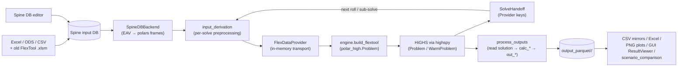
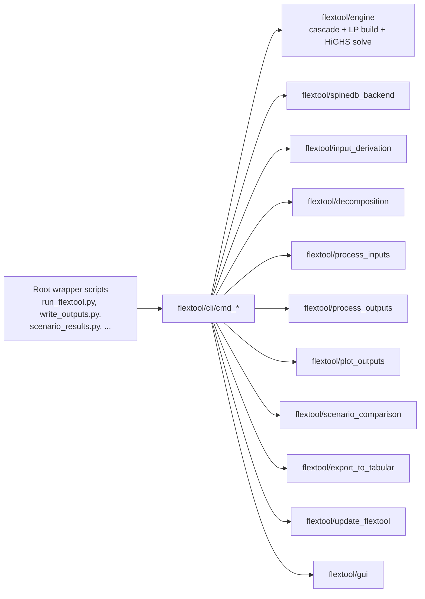

# FlexTool Architecture

## Project Purpose

IRENA FlexTool is an energy and power systems optimization model. It reads
input data from a Spine database, derives per-solve preprocessing tables in
polars, builds a linear/MIP program in memory via `polar_high`, solves it
with HiGHS in-process via `highspy`, and writes results to parquet (with
optional CSV, Excel, and plot renderings on top of the parquets).
Inputs can be authored directly in the Spine database, populated from
tabular input files (Excel / ODS / CSV), or imported from old FlexTool v2
`.xlsm` files. A Tkinter desktop application and a Spine Toolbox workflow
provide the two user-facing GUIs.

## Top-level data flow



Key invariants:

- **One backend.** `SpineDBBackend` is the only input backend. Everything
  upstream (Excel, ODS, CSV, old `.xlsm`) is converted to a Spine DB
  before the engine sees it.
- **Lazy polars, in-memory.** Frames stay as `LazyFrame` until they reach
  `polar_high`, which assembles the HiGHS matrix. Solver variables / duals
  are read back from the live `highspy.Highs` instance — no intermediate
  solver files.
- **Parquet is the canonical output.** CSV / Excel / PNG / GUI plots all
  read from the parquets the cascade just wrote. Scenario comparison loads
  multi-scenario parquet sets and emits combined renderings.

## CLI surface



Each `cmd_*.py` is a thin argparse wrapper; the work lives in the linked
packages. Every CLI command also has an installed entry point in
`pyproject.toml` (the `flextool-*` names).

| CLI module | Entry point | Purpose |
|---|---|---|
| `cmd_run_flextool` | `flextool-run` | Run the cascade (`run_chain_from_db` / `run_orchestration`) plus output processing for a scenario. |
| `cmd_write_outputs` | `flextool-write-outputs` | Replay `process_outputs.write_outputs` over an existing parquet folder. |
| `cmd_scenario_results` | `flextool-scenario-results` | Combine parquets from multiple scenario folders into comparison plots / Excel. |
| `cmd_read_tabular_input` | `flextool-read-tabular-input` | Parse Excel / ODS / CSV via JSON spec → Spine DB. |
| `cmd_read_self_describing_tabular_input` | `flextool-read-self-describing-tabular-input` | Self-describing Excel (embedded metadata) → Spine DB. |
| `cmd_read_old_flextool` | `flextool-read-old` | Import old FlexTool v2 `.xlsm` files → Spine DB. |
| `cmd_read_matpower` | `flextool-read-matpower` | Import a MATPOWER case → Spine DB. |
| `cmd_import_sensitivities` | `flextool-import-sensitivities` | Import FlexTool v2 sensitivity scenarios. |
| `cmd_export_to_tabular` | `flextool-export-to-tabular` | Export Spine DB → Excel (`.xlsx`). |
| `cmd_execute_flextool_workflow` | `flextool-execute-workflow` | Two-phase workflow runner: optional input-prep (auto-triggered by `--tabular-file-path` / `--csv-directory-path`) followed by the fused model-run + output-write phase. |
| `cmd_migrate_database` | `flextool-migrate-database` | Upgrade an input DB to the current schema version. |
| `cmd_update_flextool` | `flextool-update` | `git pull` + project-side migration in one step. |
| `cmd_gui` (via `flextool.gui.__main__`) | `flextool-gui` | Launch the Tkinter desktop application. |

## Repository layout

```
flextool/                          The installed Python package
├── __init__.py                    Public re-exports: write_outputs,
│                                    migrate_database, initialize_database,
│                                    update_flextool
├── cli/                           Argparse wrappers (cmd_*.py) +
│                                    cli/_timing.py (TimingRecorder)
├── spinedb_backend/               Spine DB → polars frames (the input API).
│                                    SpineDBBackend.find_entities /
│                                    parameter_values / default_values.
├── input_derivation/              Per-solve preprocessing computations
│                                    (the live successor to the retired
│                                    flextoolrunner/preprocessing).
├── engine/                        Optimization engine + cascade coordinator:
│                                    FlexData, FlexDataProvider, parameter
│                                    cascade + per-solve emitters,
│                                    build_flextool, run_orchestration /
│                                    run_chain_from_db, SolveHandoff,
│                                    auto-scaling.
├── decomposition/                 Region decomposition + region filter
│                                    (Benders sub-problems).
├── common_utils/                  Cross-package helpers (precision rounding).
├── process_inputs/                Tabular / Excel / old-format readers →
│                                    Spine DB writers.
├── process_outputs/               Solution → parquet + downstream CSV /
│                                    Excel rendering pipeline.
├── plot_outputs/                  PNG / SVG plot rendering + plot-plan
│                                    persistence (the viewer-readable
│                                    parquet plans).
├── scenario_comparison/           Multi-scenario parquet load + dispatch
│                                    & summary comparison rendering.
├── export_to_tabular/             Spine DB → Excel (.xlsx) exporter.
├── update_flextool/               DB schema migration chain, canonical-DB
│                                    generation, settings-DB initialisation,
│                                    repo self-update.
├── model_builder/                 Synthetic / mock-up scenario generator.
├── representative_periods/        Greedy convex-hull representative-period
│                                    clustering.
├── gui/                           Tkinter desktop application (main_window,
│                                    result_viewer, plot_canvas,
│                                    network_graph, check_tree, dialogs/...).
├── helpers/                       Small standalone diagnostic utilities
│                                    (file compare, LP coefficient inspector,
│                                    schema converters).
├── solver_config/                 Solver options templates (HiGHS + the
│                                    commercial solvers; shipped in the
│                                    wheel as *.opt.template, seeded into
│                                    the project-root solver_config/ on
│                                    first run).
├── schemas/                       Schema JSONs, YAML templates,
│                                    canonical-database JSONs, pre-v26
│                                    migration snapshots.
└── lean_parquet.py                Tiny parquet loader used by the GUI
                                     ResultViewer.

Root wrapper scripts (kept for Spine Toolbox workflow compatibility):
  run_flextool.py, write_outputs.py, scenario_results.py,
  migrate_database.py, read_tabular_input.py,
  execute_flextool_workflow.py, update_flextool.py

solver_config/                     Project-root user-editable solver options
                                     (highs.opt + gurobi/cplex/xpress/copt.opt
                                     — all gitignored; each seeded from its
                                     bundled *.opt.template on first run).

templates/                         Example databases and project assets
                                     (examples.sqlite, input templates).

migration_artifacts/               (none — the migration scratchpad was
                                     retired with the GMPL pipeline.)

tests/                             Test suite (single root):
  tests/                             — top-level unit & integration tests
  tests/engine/               — engine-internal unit tests (cluster,
                                       constraints, scaling, perturbation, ...)
  tests/spinedb_backend/             — backend unit tests
  tests/model/                       — model-level end-to-end suites
  tests/gui/                         — GUI startup tests
  tests/decomposition/               — Benders / region-filter tests
  tests/fixtures/*.json              — single authoritative source for all
                                       test data; sqlite DBs are built on
                                       demand
  tests/scenarios.yaml + tests/expected/  — the scenario integration suite
  tests/conftest.py                  — shared top-level fixtures
  tests/engine/conftest.py    — engine-internal fixtures
                                       (scenario_workdir, ...)

execution_tests/                   Spine Toolbox subprocess execution tests.

docs/                              MkDocs documentation site:
  docs/dev/                          — developer reference (this file,
                                       decomposition, scaling, slack convention)
  docs/*.md + assets                 — user-facing tutorials and reference.

.spinetoolbox/                     Spine Toolbox project integration.
.github/workflows/                 CI/CD (tests + verify hooks).
pyproject.toml, mkdocs.yml,        Build config, doc config, citation,
CITATION.cff, LICENSE.txt,         license, readme, release notes.
README.md, CHANGELOG.md
```

## Module details

### `flextool/spinedb_backend/` — the input API

`SpineDBBackend` is the sole materialiser between the Spine database and
the rest of the engine. It owns the EAV-to-tabular transformation: every
method returns a canonical-schema `polars.DataFrame`, and no method writes
to disk. The caller stack is:

```
SpineDB → SpineDBBackend → input_derivation → FlexDataProvider → cascade
```

Key surface:

- `SpineDBBackend.find_entities(entity_class, ...)` — entity rows.
- `SpineDBBackend.parameter_values(entity_class, parameter, ...)` —
  parameter rows with parsed values (Map / time-series / array / scalar).
- `SpineDBBackend.default_values(...)` — default-value lookups for
  cascade fallbacks.

A handful of small caching layers (parameter-value row cache, parsed-value
eviction, chunked accumulators) keep peak RSS bounded on continental-scale
inputs.

### `flextool/input_derivation/` — per-solve preprocessing

The per-solve derivation pipeline. Each module is a focused port of a
self-contained preprocessing step (commodity ladder, DC power flow, process
methods, period sets, ...). The package's `__init__.py` orchestrates the
three-step pattern:

1. Spec-driven entity / parameter spec loops over the backend.
2. Derivation helpers project the raw rows into FlexData fields.
3. Validators sanity-check shape / dtype invariants before handoff.

Output is an in-memory `FlexData` augmented with derived fields, exposed to
the engine through `FlexDataProvider`.

### `flextool/engine/` — the optimization engine

The dominant package. Builds a `polar_high.Problem` from `FlexData`, solves
it with HiGHS, and threads cross-solve state through `SolveHandoff` (in
memory; CSVs only emitted under `csv_dump=True` for debugging).

#### Public surface

Exported from `flextool.engine` (`__init__.py`):

| Symbol | Purpose |
|---|---|
| `FlexData` | Input dataclass — polars frames + `polar_high.Param`s. Sets unprefixed, parameters `p_*`. Full inventory in `_param_shapes.py`. |
| `FlexDataProvider` | In-memory transport surface (`preprocess/_flex_data_provider.py`; not re-exported). Keys are declared in `_provider_keys.py` (no `.csv` suffix). All cross-phase data moves through it. |
| `load_flextool(source, *, provider, db_reader)` | Build `FlexData` for one sub-solve from its `FlexDataProvider` + `SpineDbReader`; `source` (the work folder) only forms the provider keys. Never reads the work folder. |
| `build_flextool(m, d, ...)` | Feature-conditional LP/MIP construction on a `Problem` / `WarmProblem`. |
| `run_chain_from_db(...)` / `run_chain(...)` | Run a DB scenario end to end, threading `SolveHandoff` between sub-solves (`run_chain` is an older wrapper returning `ChainStep`s). |
| `run_orchestration(state, work_folder, ...)` | Native cascade coordinator: reads `RunnerState`, drives the rolling / nested / stochastic cascade, returns one `OrchestrationStep` per solve. |
| `SolveHandoff` | Cross-solve carrier (invest / divest / storage / roll-state / CO2 ladder / commodity ladder / cumulative sim-hours / history sets). |
| `SpineDbReader` / `InMemoryReader` / `CsvSource` / `FlexInputSource` / `InputSource` | Input adapters — production Spine DB, in-memory test fixture, or the work-folder path wrapper (`CsvSource`: the loader takes its directories as key paths and reads the provider). |

#### Solve modes

Same `build_flextool` body, three wrappers from `polar_high`:

- **Monolithic** — `polar_high.Problem`. One LP per call.
- **Warm-start cascade** — `polar_high.WarmProblem`. Reuses the built LP
  when the next sub-solve is identical (every `FlexData` field, labels
  included, and the solver configuration; `_reuse_blocker` in
  `solve/_warm.py`); rolls are rebuilt, because the output writer and the
  handoff read the LP by its labels. The future rolling-overlap work (adopt
  the new labels on the live LP and update only changing coefficients, the
  "rebind" feature item) would live here.
- **Benders (regional)** — `engine.solve._benders.solve_benders` driven by
  the orchestrator. Slices `FlexData` by region via `_region_filter`, then
  runs a **Benders decomposition**: a coordinating *master* (a persistent
  `polar_high.WarmProblem`) holds the inter-regional trade flows and the
  trade-connection investment plus one recourse variable `η_r` per region;
  each region is an operational *subproblem* solved with the master's trade
  pinned, returning duals that the master accumulates as optimality
  **cuts** (`WarmProblem.add_cut_row` / `add_recourse_col`). The master
  objective is a **valid lower bound** and the loop converges on the
  optimality gap. This replaces the earlier dual-subgradient scheme, which
  collapsed greenfield cross-region trade to autarky with an *invalid*
  bound. See [decomposition.md](decomposition.md).

#### Feature flags in `build_flextool`

`build_flextool` is a table of contents: `_prepare` → `_declare_variables`
→ `_shared_expressions` → one `_eq_<family>(b)` per core equation family
(plus the feature modules' `add_constraints(b)`) → `_obj_<family>(b)` /
`objective_terms(b)` summed into the objective. Optional features with
their own variables live in their own modules (`_online`, `_unit_floors`,
`_reserve`, `_group_slack`, `_cumulative_invest`, `_commodity_ladder`,
`_dc_power_flow`, `_delay`, `_non_anticipativity`). The `model/core.py` module
docstring maps every variable and equation family; details in
[engine.md](engine.md#lp-build-modelpy-and-the-feature-modules).

`_prepare` sets one `has_*` flag per feature on the `_Build` context from
its switch field on `FlexData`; each family function returns early when
its flag is off. Required-field lists are module-level tuples in
`model/core.py`:

| Flag | Switch field | Required tuple | Adds |
|---|---|---|---|
| (always) | — | `ALWAYS` | `vq_state_up/down`, `nodeBalance_eq`, balance slack penalty. |
| `has_proc` | `process_source_sink` | `PROCESSES` | `v_flow`, flow terms of `nodeBalance_eq`, `maxFlow`, `maxOutputSum` (indirect units), commodity cost. |
| `has_indirect` | `process_indirect` | `INDIRECT` | `conversion_indirect`, `minInputShare`. |
| `has_co2_price` | `flow_from_co2_priced` | — (warns and skips without price / content) | CO2 price term in the objective. |
| `has_co2_cap` / `has_co2_cap_total` | `flow_from_co2_capped[_noEff]` / `flow_from_co2_capped_total[_noEff]` | `CO2_CAP` / `CO2_CAP_TOTAL` | `co2_max_period` / `co2_max_total`. |
| `has_user_cstr` | `cdt_eq` / `cdt_le` / `cdt_ge` | `USER_CSTR` | `process_constraint_{equal,less_than,greater_than}[_period]` (`_period`: one row per period for constraints without flow or state terms). |
| `has_profile` | `process_profile_{upper,lower,fixed}` | `PROFILES` | `profile_flow_*` bounds on `v_flow`. |
| `has_storage` | `nodeState` | `STORAGE` | `v_state`, state change in `nodeBalance_eq`, `maxState`, start binding, state profiles, reference value. |
| `has_rp` | `nodeState_rp` | — | Representative-period inter-period state coupling (`_eq_rp_storage_chain`). |
| `has_nsb` | `nodeStateBlock` | — | `bind_intraperiod_blocks` nodes: `stateConstantWithinBlock_eq`, `nodeBalanceBlock_eq`. |
| `has_coarse` | `nodeCoarse` + `node_coarse_step` | — | Nodes of coarse `new_stepduration` groups: `nodeBalanceCoarse_eq` (the summed `nodeBalance_eq` terms per coarse step), `stateConstantCoarse_eq`. |
| `has_online_{lin,int}` | `process_online_{linear,integer}` | `ONLINE` | `_online`: `v_online`, startup / shutdown, uptime / downtime; `_unit_floors`: min-load floors. |
| `has_minload_eff` | `process_min_load_eff` | `MINLOAD_EFF` | min_load_efficiency section terms. |
| `has_startup_cost_{lin,int}` | `pdt_online_{linear,integer}` | `STARTUP_COST_*` | Startup-cost objective term. |
| `has_ramp` | any `process_source_sink_ramp_limit_*` | `RAMP` | Ramp-up / ramp-down constraints. |
| `has_{invest,divest}_{p,n}` | `pd_{invest,divest}_set` / `nd_{invest,divest}_set` | `INVEST` / `DIVEST` | `v_invest` / `v_divest`, investment maxima, annuities. |
| `has_reserve` | `reserve_upDown_group` | checked in `_reserve` | `_reserve`. |
| `has_capacity_margin` / `has_inertia` / `has_non_sync` | `_group_slack.has_*` | — | `_group_slack`. |
| `has_cumulative_invest` | `_cumulative_invest.has_feature` | — | `_cumulative_invest`. |
| `has_ladder` | `_commodity_ladder.has_feature` | — | `_commodity_ladder`. |

The DC power-flow, exact-connection, delay and non-anticipativity modules
gate on their own data (`_dc_power_flow.has_feature`, `_exact.has_feature`
(`process_exact`), `_delay.has_feature`, `period_branch_full` /
`pd_non_anticipativity`).

If a switch is set but a required field is missing, `build_flextool` raises
`ValueError` rather than silently degrading.

#### Block-COO dense-axis contract

`_prepare` (the first step of `build_flextool`) declares FlexTool's dense
trailing axes once, via
`m.declare_dense_axes(("d", "t"))` — `(period, timestep)`. This is an
unconditional call requiring **polar-high>=2.4.0** (the interim `hasattr`
capability guard has been dropped; the pin lives in `pyproject.toml`). With the
axes declared, polar-high's canonical-matrix build slices the pre-sorted dense
axis as contiguous numpy blocks and multiplies coefficient factors with ufuncs
(the block-COO slice path) instead of wide relational joins. `Sum`-wrapped
chains — FlexTool's `Sum`-heavy families (nodeBalance, reserves, co2) — evaluate
in one pass via a captured `SumBlockMeta` recipe with a relabel fast-path. The
block-COO output is bit-identical to the legacy polars path; the win is purely
the peak-memory and wall-time of the build.

#### Cross-solve state (Provider keys + `SolveHandoff`)

Inside the cascade everything moves through `FlexDataProvider`. The
relevant key families are declared in `engine/preprocess/_provider_keys.py`:

- `HANDOFF_*` — quantities the just-solved problem produces for the next
  iteration (`fix_storage_quantity/price/usage`, `roll_end_state`,
  `realized_invest`, `realized_existing`, `divest_cumulative`,
  `cumulative_co2`, `commodity_ladder_cumulative`, `cum_sim_hours`,
  `ed_history_realized_first`, `edd_history`).
- `INPUT_*` — backend-derived rows the cascade re-reads each iteration.
- `SOLVE_DATA_*` — per-solve sets and parameters that the derivation
  layer produces.

The Provider is the contract. Disk-side CSV mirrors in `input/` + `solve_data/`
exist only when `csv_dump=True` (a debug toggle; one folder, shared by every
sub-solve; a Benders solve dumps its undecomposed FlexData) and are not load-bearing for any downstream phase.

#### Output writers read only memory; one run per work folder

The output cascade (`flextool/process_outputs/`) has the same contract as the loader: every writer sources its
values from the sub-solve's `FlexData`, `FlexDataProvider` or `OutputWriterState`, never from `input/` or
`solve_data/` on the work folder (item 163, `specs/bugfix/c24/design_163.md`;
`test_output_writers_read_no_work_folder_inputs` in `tests/engine/test_meta_provider_invariants.py`, Rule 5). The
five handoff-mirror CSVs under `solve_data/` (`p_entity_divested`, `fix_storage_quantity`, `fix_storage_usage`,
`p_roll_continue_state`, `p_entity_period_existing_capacity`) are write-only `--csv-dump` debug output with no
reader anywhere in the engine; `period_capacity.csv` is the one mirror still written on every run (vestigial,
always header-only).

Because nothing reads the work folder back, **FlexTool supports exactly one run per work folder at a time**: a
second concurrent cascade into the same folder is not supported (its parquets would interleave with the first's,
and whichever run finishes first deletes the other's stash). `run_orchestration`'s `_bootstrap_dirs` clears the
*previous* run's own leftovers at the start of every cascade — `output_raw/` (`rmtree` + recreate: the per-roll
parquet stash, `_solve_order.txt`, `manifest.json`) and the `solve_data/` handoff-mirror basenames
(`handoff_writers.MIRROR_FILES`) — so a reused folder (the CLI-in-cwd rerun case, e.g. after a failed run or a
`--csv-dump` run) cannot leak a prior run's output into this one
(`union_realized_slice.has_persisted_slices` would otherwise union stale per-roll parquets into the fresh run).
`input/` and every other `solve_data/*` file (dump / debug output) are left alone. A symlinked `output_raw/` is
refused rather than followed. The GUI and Spine Toolbox already give each job / execution a fresh work folder, so
this clearing is a no-op there; it is the fix for the CLI case.

#### CSV dump (supported) and CSV reload (unsupported)

`--csv-dump` / the GUI "Full" debug level, `FlexData.dump_csvs` and
`FlexDataProvider.snapshot_processed_inputs` write a CSV dump for inspection. Both writers stamp the folder with
`_dump_meta.json` (`dump_format`, FlexTool version, schema version, git hash; `preprocess/_dump_stamp.py`). The
writers are supported; nothing in a run reads a dump back. The main loader is provider-only: it never reads `input/` or
`solve_data/` on disk, so a dump or stale CSVs in a reused work folder cannot change a run
(`test_loader_and_model_have_no_disk_arms` in `tests/engine/test_meta_provider_invariants.py`).

Reloading a model from a dump lives only in `flextool/engine/_csv_reload/`: `load_from_dump(dump_dir, *, db_url=None,
scenario=None, force=False)`, `copy_runner_meta`, and the offline output writer (`python -m
flextool.engine._csv_reload.offline_outputs`, outputs from an MPS + solution file). It is **unsupported**: it is not
kept in sync with the engine, it warns on every call, and it refuses a dump without a stamp or with another dump
format or schema version unless `force=True`. A reloaded model has no solve-to-solve carry and can differ from the
solved model. The stamp does not detect leftover CSVs from earlier runs in a reused folder (the CLI work folder
defaults to the current directory and is never cleaned), so reload only from a folder that holds a single dump. Nothing outside the package imports it (`test_csv_reload_is_a_leaf`), and its tests in
`tests/csv_reload/` run only with `pytest -m csv_reload`. Do not update the package when you change the engine;
whoever needs the reload brings it up to date first (and then updates `VERIFIED_FLEXTOOL` / `VERIFIED_SCHEMA` in
`_csv_reload/_stamp.py`).

The offline output writer replaces the removed `python -m flextool.process_outputs.read_highs_solution` and needs
`--dump`. It reads the solve's `scale_the_objective` from the dump's `solve_data/scale_the_objective.csv`: the
sub-solve provider holds the scale its LP was built with, so a provider snapshot (`--csv-dump`, a run's work folder)
carries it. `--scale` is an optional override (an MPS built at another scale); a missing or header-only file is an
error, never a silent default.

#### Package map

`flextool/engine/README.md` is the entry point: public API, the pipeline
step by step, and one line per folder. In short:

```
__init__.py           Public API (table above)
input/                Database and in-memory readers, SolveConfig, timeline,
                      RunnerState, parameter shapes (_param_shapes.py), constants
preprocess/           FlexData + load_flextool (flex_data.py), FlexDataProvider
                      and its keys, input writer, per-solve context
preprocess/params/    Parameter cascade: direct, projected, derived (NPV,
                      walks, profiles, blocks, branches, existing capacity)
preprocess/emit/      Per-solve sets and parameters written into the Provider
model/                The LP: core.py (build_flextool, table of contents +
                      core equations) and one module per optional feature
solve/                Orchestration (_orchestration.py), sub-solve expansion,
                      solver dispatch, warm start, Benders, SolveHandoff
output/               Solution → output parquet bundle; CSV dumps
_csv_reload/           Unsupported, opt-in CSV-dump reload + offline outputs (see "CSV dump … reload")
autoscale/            Auto-scaling pipeline + YAML audit report
```

Imports point down the pipeline (solve → model → preprocess → input); the
README lists the known exceptions.

#### Parameter shapes & `(d,t)` broadcasting

`_param_shapes.py` is the authoritative resolver for how a DB-authored
parameter maps onto the model axes. **Never detect a parameter's
period / time axis by column name.** Spine writes a Map's index column
under the author's `index_name`, defaulting to the silent `"x"` when
unset — so a column-name check like `("t","time","step")` misclassifies
a time series as a scalar and broadcasts it with a `how="cross"`
Cartesian product against the full `(d,t)` grid. On long timelines that
overflows polars' 2³² row index; on short ones it silently flattens the
time variation via a downstream `unique([...])`. Both bit us (the
`p_slope` blow-up). Route every param→`(d,t)` broadcast through
`resolve_param_shape` (DB-metadata shape + value-domain probing) →
`broadcast_to_period_time` (keeps the Param at its authored shape, no
cross-product) → `promote_param_to_dt` (narrowing inner-join on the
carried axis). A new parameter that needs this must be added to
`PARAM_ALLOWED_SHAPES`.

##### Silent-label Maps are resolved per entity, not per parameter

When the DB carries no explicit `index_name` on a Map (`"x"` or empty) and the registry admits both a
period and a time shape at that depth, `resolve_param_shape` first tries to disambiguate the *whole*
parameter at once, by value-domain probing the union of every entity's keys against the solve's
`(d, t)`. When that union probe stays ambiguous — no entity's keys overlap the solve's periods or
timesteps at all, or different entities' keys overlap different axes — the resolver does **not** fall
back to dropping the whole parameter. Instead each silent entity is classified on its own
(`_silent_entity_axes`): an entity never decides another entity's shape. An entity with no key in the
active solve has no value in that solve — it is removed from the frame the same way an entity that
authored nothing at all would be (so the parameter's own default applies, whatever that is for the
consuming producer); when *every* entity is removed this way, the frame falls through to the source's
own default-broadcast path (a scalar default spread over every entity, or nothing when there is none).
An entity whose keys match both axes raises, naming it — the same rule a single ambiguous row inside
one entity's own Map already raises on. See `tests/engine/test_param_shapes_silent_per_entity.py` and
`tests/engine/test_silent_label_params.py` (items #167 / #168 of `specs/github_issues.md`).

##### Every entity's index path is checked; unnamed maps of different depths are read per depth

Before any shape is resolved, `_check_entity_label_paths` checks each entity's own raw label path
(`parameter_entity_label_paths`), not only the parameter's combined one: a depth that is not the
`shape_rank` of an allowed shape, or an explicit name that no allowed shape of that depth has on that level
(`period` / `time`; for the price ladders, level 1 of a 3-level ladder is the period and the tier and
price / quantity levels may not be named `period` / `time`), raises `FlexToolConfigError` in plain words
(`allowed_shapes_in_words`): *"commodity 'coal', parameter 'price': the value has 2 index levels; this
parameter takes a constant, or a map over periods or over time (1 level)"*. A depth that stays ambiguous
between allowed shapes is accepted; value-domain probing decides it. `shape_rank(shape)` =
`len(_SHAPE_LABELS[shape])` is the one source of a shape's depth (also the schema's map rank,
`tests/engine/test_schema_shape_consistency.py`).

When a non-ladder parameter's entities have maps of more than one depth and some level is unnamed, the
reader's single positional unroll cannot place them (it puts every row into the deepest map's columns), so
`_resolve_by_depth` resolves each depth group on a `_view_without` the others (as `resolve_facet_groups`
does for ladders) with the usual rules, and unions the groups into one `[entities, period, t, value]` frame
(`_axis_frame_resolved`). It raises only where those rules cannot place a group: keys on both axes, or an
ambiguous group without a `period_filter`. With every level named, the reader places rows by label and no
split happens. When an unnamed map's shape was read from its depth or keys, `resolve_param_shape` prints one
note per (class, parameter) and run (`_behaviour_changes.warn_once`, `print(flush=True)`); ladders are left
out (their levels are placed by depth by definition).

`_param_shapes` is the **I/O contract only** — it validates user-authored
DB shapes and errors to the user on mismatch. Model-internal axes (e.g.
the rolling-solve `roll` axis) are deliberately excluded; they are never
DB-authored, never reach the resolver, and a stray one already fails
loudly via `_UnrecognisedIndex`. Document such internal axes in
`schemas/flextool_axis_contract.json`, not in the resolver's allow-lists.

##### Silent-default `"x"` index — readers outside the resolver

Not every DB read goes through `resolve_param_shape`. The **per-entity
cascades** in `_derived.py` / `_existing.py` /
`_npv.py` read raw entity params (`source.parameter(...)`) and
must detect the period axis themselves. The failure mode is identical to
the resolver's: Spine names a Map's index column with the author's
`index_name`, whose spinedb_api *default is the literal string `"x"`*
(not empty — real 2-D maps carry `index_name='x'`, see
`_spinedb_reader._discover_index_cols`). So a `if "period" in cols`
gate misfires on the common `"x"`-indexed map and the code either drops
the row or collapses it via a downstream `.unique(subset=["e"],
keep="last")` — for a *retiring* `existing` map (nameplate → 0 at expiry)
that keeps the last period's `0`, defaulting `unitsize` to `1000` and
turning `existing_count = capacity / unitsize` into a spurious fraction
(caps continuous online below 1; forbids integer online entirely).

**Safe idioms** (use one of these for any raw per-entity map read):

- period-agnostic aggregate — `group_by("e").agg(pl.col("value").max())`
  (used by `_entity_unitsize_lf`: the cascade only needs "non-zero", and
  the per-period MAX is non-zero iff any period is);
- explicit dual check — `period_col = "period" if "period" in cols else
  "x"` / `for cand in ("period","x")` (used by
  `_ed_explicit_period_param`, `_per_solve_sets`);
- per-row scalar detection — treat any single non-`name`/`value` column
  as the period dim and classify scalar-vs-map by that column's
  *per-row* null-ness, so a constant value sharing a class with period-Map
  siblings (surfaces as `x = null`) broadcasts instead of zeroing (used by
  `_per_entity_param_lf` in both the `existing` and `npv` mirrors).

**Audited state** (see the coverage test
`tests/engine/test_silent_default_index_pdt.py`):

- *Safe* — `availability`, `inflow`, `other_operational_cost`,
  `reservation` (resolver-routed); the `existing`/`lifetime`/
  `virtual_unitsize` per-period chains (`_per_entity_param_lf`,
  hardened); `_ed_explicit_period_param`, `_per_solve_sets`; `profile`
  in real solves (reads the engine-written canonical `pt_profile.csv` /
  `pbt_profile`, not the raw Map).
- *Residual, latent* — the `_profiles.py` **raw-Spine fallback**
  readers (`_profile_time_lf` matches only `t`/`i`/`time`;
  `_profile_period_time_lf` / `_profile_period_only_lf` gate on literal
  `"period"`). An `"x"`-indexed profile Map read via these returns empty
  (silent zero profile). Only reachable when the averaged-CSV primary
  path is absent (tests / runner bypass), so not a live-solve bug —
  harden if that path ever becomes load-bearing.
- *Guarded by schema* — `invest_max_total` and `virtual_unitsize` are
  declared `float`-only in `parameter_types` (no `map` row), so the
  `keep="last"` collapse in `_e_explicit_param` and in the
  `virtual_unitsize` sub-branch of `_entity_unitsize_lf` can only bite if
  a param is authored against its declared type. Value-type enforcement
  is not yet strict, so these are latent-until-misauthored, not safe by
  construction.
- *Separate gap* — `min_load` is declared map-capable (`map,1` / `map,3`)
  but `p_min_load_from_source` reads it as a scalar `Param(("p",))`, and
  `minFlow_minload` consumes only that scalar. A period/time-varying
  `min_load` is therefore flattened regardless of the index name — an
  engine "consumes scalar only" gap, not just an `"x"`-detection one.
  Route through the resolver if per-period `min_load` is ever wired.

### `flextool/process_inputs/` — tabular → Spine DB

Reads tabular data and writes Spine DB. The output of this package is the
Spine DB the engine consumes.

| File | Purpose |
|---|---|
| `read_tabular_with_specification.py` (`TabularReader`) | JSON-spec-driven reader for Excel / ODS / CSV. |
| `read_self_describing_excel.py` | Self-describing Excel with embedded metadata. |
| `read_old_flextool.py` | Parse old FlexTool v2 `.xlsm` → `OldFlexToolData`. |
| `read_matpower.py` | MATPOWER case → import structure. |
| `write_to_input_db.py` (`write_to_flextool_input_db`) | Tabular → Spine DB. |
| `write_self_describing_to_db.py` | Self-describing Excel → Spine DB. |
| `write_old_flextool_to_db.py` | Old FlexTool data → Spine DB. |
| `import_old_excel_input.json` / `import_excel_input.json` | Excel import specifications. |

### `flextool/process_outputs/` — solution → parquet → downstream

Three-layer architecture:

```
Solution extraction (in-memory, from highspy.Highs):
  read_highs_solution.py         VARIABLE_SPECS — variables, row duals,
                                 column duals harvested directly from
                                 the live solver instance.

Post-processing (parquet-backed calculations):
  drop_levels.py                 Strip 'solve' level from time-indexed objects.
  calc_capacity_flows.py         Capacity, online status, flow_dt, ramps.
  calc_connections.py            Connection flows and losses.
  calc_storage_vre.py            Storage state changes and VRE potential.
  calc_slacks.py                 Reserve, slack, inertia quantities.
  calc_costs.py                  All cost aggregates.
  calc_group_flows.py            Group-level flow aggregations.
  process_results.py             Coordinator: calls calc_* in order.
  handoff_writers.py             SolveHandoff CSV mirrors (csv_dump only).
  solve_order.py                 Solve-sequence reconstruction.

Output formatting:
  out_capacity.py                Unit / connection / node capacity tables.
  out_flows.py                   Unit flow, capacity-factor, VRE, ramp.
  out_group.py / out_flowgroup.py NodeGroup flow, inflow, VRE-share, indicators.
  out_node.py                    Node summary and additional-results outputs.
  out_costs.py                   Cost summary, CO2, generic outputs.
  out_ancillary.py               Connection, reserve, inertia, slack, dual.
  write_outputs.py               ALL_OUTPUTS list + orchestrator.
  to_spine_db.py                 Result DataFrames → Spine output DB.
```

The cascade produces `output_parquet/<scenario>/`. CSV / Excel / plot
renderers all consume those parquets — no separate solver-output
extraction step.

### `flextool/plot_outputs/` — PNG / SVG plots and plot plans

Static plots (lines, bars, stacked area) plus a persistence layer that
saves precomputed *plot plans* (one parquet per result key) so the GUI's
`ResultViewer` can re-render without recomputing pivots / pagination.

| File | Purpose |
|---|---|
| `orchestrator.py` | `plot_dict_of_dataframes`, `prepare_plot_data`, `compute_all_plot_plans`. |
| `config.py` | `PlotConfig`, `DIMENSION_RULES`, `PLOT_FIELD_NAMES`. |
| `plan.py` | `compute_plot_plans_for_result`, `save_plot_plan`, `load_plot_plan` (with `schema_version` invalidation). |
| `plot_lines.py` | Line and stacked-area rendering. |
| `plot_bars.py` / `plot_bars_detail.py` | Bar chart orchestration and rendering. |
| `axis_helpers.py`, `legend_helpers.py`, `subplot_helpers.py`, `format_helpers.py` | Layout, formatting, filename generation. |
| `color_template.py` | Stable color assignment across scenarios. |
| `shared_manifest.py`, `plan_union.py` | Per-scenario plan availability + cross-scenario union. |
| `perf.py` | Internal timing. |

### `flextool/scenario_comparison/` — multi-scenario analysis

Loads parquets from multiple scenario folders, builds combined views, and
renders comparison plots.

| File | Purpose |
|---|---|
| `data_models.py` | `TimeSeriesResults`, `DispatchMappings`. |
| `db_reader.py` | Load scenario parquet files into `TimeSeriesResults`. |
| `dispatch_mappings.py` | Load dispatch-mapping parquets. |
| `config_builder.py` | Discover dispatch entity/scenario names + assign palette colors (seeded into `plot_settings.yaml`). |
| `dispatch_data.py` / `dispatch_plots.py` | Per-scenario dispatch DataFrame prep and stacked-area rendering. |
| `constants.py` | Colors and special column-name lists. |
| `orchestrator.py` | Top-level `run()` function. |

### `flextool/export_to_tabular/` — Spine DB → Excel

Exports a Spine input DB to `.xlsx` in self-describing v2 or original v1.

| File | Purpose |
|---|---|
| `export_to_excel.py` | Orchestrator; v1 vs v2 format selection. |
| `db_reader.py` | `DatabaseContents` + `read_database()`. |
| `sheet_config.py` | `SheetSpec`, `build_sheet_specs()`. |
| `excel_writer.py` | Sheet writers (periodic, time-series, ...). |
| `formatting.py` | Cell formatting / type conversion. |
| `export_settings.yaml` | Export configuration. |

### `flextool/gui/` — Tkinter desktop application

Spawns CLI commands as subprocesses; never imports the engine directly.

```
__main__.py                      Entry point → MainWindow.
main_window.py                   MainWindow (tkinter.Tk root).
project_utils.py                 Create / list / rename projects.
settings_io.py                   Load / save GlobalSettings + ProjectSettings.
data_models.py                   Settings + ScenarioInfo dataclasses.
input_sources.py                 InputSourceManager (file selection).
scenario_lists.py                Available / executed scenario managers.
execution_manager.py             ExecutionManager (threaded subprocess pool).
execution_window.py              ExecutionWindow (progress).
output_actions.py                Plot / export action wiring.
output_log_window.py             Log display.
db_editor_integration.py         Spine DB editor launcher.
db_version_check.py              Input-DB version validation + auto-upgrade.
error_handling.py                safe_callback decorator.
platform_utils.py                Platform-specific file/app opening.
result_viewer.py                 ResultViewer (parquet → plot canvas).
plot_canvas.py                   Matplotlib canvas with downsampling.
plot_cache.py                    Plot cache.
plot_config_reader.py            Plot-config YAML parser.
network_graph.py                 Network-topology figure builder.
check_tree.py                    CheckTreeController.
hover_tooltip.py / tree_reorder.py / downsampling.py / cli_format.py / scenario_key.py / config_parser.py
dialogs/                         Add / project / plot / file-picker dialogs.
```

### `flextool/update_flextool/` — migration and updates

| File | Purpose |
|---|---|
| `self_update.py` (`update_flextool`) | `git pull` + project-side migration. |
| `db_migration.py` (`migrate_database`) | Walk the version chain to the current `FLEXTOOL_DB_VERSION`. |
| `initialize_database.py` (`initialize_database`) | Create new DB from JSON template. |
| `ensure_settings_db.py` | Idempotent settings-DB creation. |
| `test_fixtures.py` | Migrate `tests/fixtures/*.json` to current schema and sync their schema sections. |
| `fixture_schema.py` | Schema sections of fixture / canonical JSONs generated from `spinedb_schema.json`; sync rules and drift listing. |
| `canonical_databases.py` | Materialise / migrate canonical example DBs from JSON. |
| `generate_canonical.py` | Project authoritative fixtures into derived canonical DBs. |
| `extend_tests_fixture.py` | Agent-friendly YAML-delta workflow for append-only fixture additions. |

CI-enforced verify chain (`tests.yml::template-check`):

- `sync_master_json_template --verify` — schema parity.
- `test_fixtures verify` — `tests/fixtures/*.json` at current schema.
- `generate_canonical --verify` — generated canonical files in sync.
- `canonical_databases verify` — authoritative canonical files at current schema.

### `flextool/decomposition/` — Benders region helpers

`region_decomposition.py` and `region_filter.py` slice `FlexData` by region
group and prepare sub-problems for the Benders solve mode (the filter-only
`--region` CLI entry point that materialises one region's standalone input
directory). The in-engine slicer used by the live Benders driver lives at
`engine/solve/_region_filter.py`; the master + cut loop is in
`engine/solve/_benders.py`.

### `flextool/model_builder/` and `flextool/representative_periods/`

- **`model_builder`** — synthetic scenario generator used for benchmarking
  and stress-testing the engine. `build_model.py` is the entry point;
  `encoding.py`, `names.py`, `profiles.py` are helpers.
- **`representative_periods`** — greedy convex-hull clustering used at the
  input-preparation stage to pick representative weeks / days.
  `preprocess.preprocess_representative_periods` is the entry point.

#### Net-load clustering mode

By default the greedy hull clusters on the per-series normalized
profile/inflow feature stack (`preprocess._build_clustering_matrix`). The
`--netload-clustering` flag (schema wiring lives in
`representative_periods/netload_inputs.py` for the DB read and
`representative_periods/netload.py` for the pure math) instead clusters on a
real-MW **net-load** signal per aggregation unit `g`:

    net_load[g, h] = Σ_{demand node in g} demand_h
                     − Σ_{VRE unit in g} cap[u] · avail[profile(u)][h]

FlexTool's sign convention (shared with `force_include`) makes demand a
*negative* inflow, so `demand_h = −inflow_h + |scalar demand level|`. **VRE**
is any `unit__node__profile` arc whose `profile_method` is `upper_limit`;
that is the schema default, so an arc that never sets `profile_method`
explicitly (no row from the reader) is treated as VRE. Each aggregation
unit's series is min-max normalized to `[0, 1]` exactly as the default
feature builder does per feature.

An **aggregation unit** is either a **region group** or a single **node**.
Granularity is chosen by the schema-v68 `group.use_for_representative_periods`
(`yes_no`) flag: when one or more groups carry the flag `yes` the member
nodes' net load is summed into one regional signal per flagged group; when no
group carries the flag the selection falls back to **per-node** signals (each
node its own aggregation unit). On a pre-v68 database the flag parameter is
not yet defined — that genuinely-absent case is detected and quietly activates
the per-node fallback, while a read failure on a *defined* flag is allowed to
surface rather than silently degrade.

The iteration-0 VRE capacities come from a **demand-match** default: the
investable VRE of each aggregation unit is sized so its energy plus the
existing VRE energy just covers the unit's demand energy (pure energy balance,
curtailment ignored). `--vre-penetration` scales that energy-share target
(1.0 = full-energy match). The default (non-`--netload-clustering`) code path
is byte-parity with the prior behaviour.

#### Net-load iteration driver

`representative_periods/netload_iterate.py` (`run_netload_iteration`,
`NetloadIterConfig`; also a `main()`/`__main__` CLI) composes the single-shot
net-load selector into an *iterate-until-stable* loop that feeds each
iteration's solved investment capacities back into the next selection — sizing
the VRE fleet from a solve's realised investments (instead of the demand-match
default) sharpens which periods are net-load-critical.

- **Invest-only loop.** Iteration `k` in `range(iterations + 1)`. `k = 0` is
  the bootstrap: select on the demand-match caps and run an INVEST-ONLY solve.
  The bootstrap dispatch is **skipped** — default-cap investments are
  known-bad, so measuring their full-year cost is not worth the solve.
  `k = 1..n` select on the prior iteration's invested caps; if the selected
  representative set is unchanged from the previous iteration the loop
  converges and breaks before solving (**early-stop on stability**).
- **Keep-best (opt-in).** With `--keep-best`, each mature iteration (`k ≥ 1`)
  ALSO runs the full-year DISPATCH, reads its total system cost, and the loop
  keeps the representative set with the **lowest full-year dispatch cost**. A
  keep-best winner from an earlier iteration is deterministically
  re-materialised by re-running the selector on that iteration's input caps
  (greedy hull over a fixed matrix — no randomness). A final dispatch is run on
  the chosen set for output.
- **Stable-alternative-name orphan guard.** The full `alternative_name` is
  pinned once and passed as the explicit override to the selector every
  iteration, so the selector never derives a per-iteration name (whose
  force-suffix could shift with the forced count) and orphans timesets. A
  stable name lets the selector's purge+rewrite cleanly REPLACE the single
  net-load timeset each iteration, so N iterations leave exactly one.
- **`model.solves`-override subset mechanism.** `cmd_run_flextool` has no
  `--solves` flag; the DB-driven way to run a subset is the `model.solves`
  Array resolved under the scenario's alternative stack. The driver writes a
  dedicated `model.solves` OVERRIDE alternative at the top of the stack
  (mirroring `calibrate._db_alt`) — the invest solve(s) for an invest-only
  pass, the dispatch solves (or the scenario's full original chain) for a
  dispatch pass. A genuine subset run, not a silent full-chain fallback.
- **Fail-closed guards.** `_guard_no_timed_energy_margin` refuses to run when a
  node's `energy_margin_method` resolves to `inflow_adder` with a timed
  (2-D per-cell) `energy_margin_adder` — the timed adder and the net-load
  loop's cap feedback are mutually exclusive. Every iteration solve is
  `assess_solve`-gated on its required outputs; an untrusted solve raises
  `NetloadIterError` rather than feeding a bad cap set forward. Basis caches
  are cold per solve by default (the LP columns change with the representative
  set); `--warm-start` opts into one shared cache only when the grid is stable.

## Public API surface

```python
from flextool import (
    write_outputs,
    migrate_database,
    initialize_database,
    update_flextool,
)
from flextool.engine import (
    FlexData,
    FlexDataProvider,
    SolveHandoff,
    build_flextool,
    load_flextool,
    run_chain_from_db,
    run_orchestration,
)
from flextool.engine.input._db_loader import FlexToolRunner
from flextool.spinedb_backend import SpineDBBackend
from flextool.process_inputs import TabularReader, write_to_flextool_input_db
from flextool.process_outputs import write_outputs, post_process_results
from flextool.plot_outputs import plot_dict_of_dataframes
from flextool.scenario_comparison import get_scenario_results
from flextool.export_to_tabular import export_to_excel
from flextool.update_flextool import (
    migrate_database,
    initialize_database,
    update_flextool,
)
from flextool.helpers import (
    compare_files,
    find_largest_numbers,
    parse_mps_to_matrices,
    convert_schema,
)
```

## Solver layout

HiGHS is a regular Python dependency (`highspy`); FlexTool no longer
bundles solver binaries. The only solver-config artefact is the HiGHS
options file:

| Path | Tracked? | Role |
|---|---|---|
| `flextool/solver_config/highs.opt.template` | Yes (package data) | Template that ships in the wheel. |
| `solver_config/highs.opt` | No (gitignored) | User-editable runtime copy; seeded from the template on first run. |

`flextool._resources.package_data_path("solver_config/highs.opt.template")`
returns the template; the runtime layer copies it to
`solver_config/highs.opt` on first run if absent. Users edit the runtime
copy; `_orchestration._finalise_highs_options` reads it and applies any
CLI overrides (`--user-bound-scale`, `--presolve`, `--highs-threads`).

`--save-memory` (or `FLEXTOOL_SAVE_MEMORY=1`) is an opt-in peak-RSS
strategy that disables warm-start and round-trips each sub-solve through
an on-disk MPS file, trading ~5-10 GB peak RSS for slower per-solve
build time. The orchestrator emits a one-time warning when it disables
warm-start because of this flag.

**Memory: polars allocator.** polars links jemalloc statically, and its
own decay settings in 1.x (`dirty_decay_ms:500,muzzy_decay_ms:-1`) leave
freed pages resident for good, which roughly doubles peak RSS on large
models (2.x writes `muzzy_decay_ms:1000`, which returns them after ~2 s).
FlexTool wants `dirty_decay_ms:1000,muzzy_decay_ms:0`
(`flextool/_allocator.py`, called first thing in `flextool/__init__.py`).
jemalloc reads `_RJEM_MALLOC_CONF` once, when `import polars` loads the
runtime library, so there are two paths:
- polars not loaded yet (CLI, GUI, a fresh Toolbox run): `setdefault` the
  variable; a value from the shell wins as a whole.
- polars loaded first (a Toolbox console, a notebook, a script): append
  FlexTool's values to the variable for child processes and write the two
  decay values at runtime with jemalloc's `mallctl` (`arenas.*` and every
  initialised `arena.<i>.*`), which also returns pages freed before
  flextool was imported. `_rjem_mallctl` is a local symbol, so its address
  comes from the library's ELF `.symtab` and the load base of its exported
  `PyInit_*`; the function's first bytes in memory must equal those in the
  file before it is called. A value set before polars was imported was
  already read by jemalloc and is left alone. Any failure (macOS Mach-O,
  stripped symbol table, a mismatch, a failing call) prints one warning
  on stderr with the remedy: import flextool before polars, or start
  Python with `_RJEM_MALLOC_CONF=dirty_decay_ms:1000,muzzy_decay_ms:0`.
  Windows (mimalloc) and builds without jemalloc are a silent no-op.

## Solver outputs: folder layout

```
work_folder/
├── input/, solve_data/        Debug-only mirrors of cascade state
│                                (csv_dump=True path). Not load-bearing.
├── output_parquet/<scenario>/ Canonical results — one parquet per output.
├── output_csv/<scenario>/     Optional CSV mirror of the parquets.
├── output_excel/              Optional summary workbook.
└── output_plots/              Optional PNG / SVG plots (default_plots.yaml).
```

Cross-solve state moves through `FlexDataProvider` keys; the `solve_data/`
CSVs exist only as a debugging aid.

## Solve-to-solve handoff

When a solve is part of a rolling-horizon, nested, or sub-solve chain, the
just-solved problem produces a `SolveHandoff` (typed in-memory carrier).
Inside the cascade it's transported via the `HANDOFF_*` Provider keys —
zero disk round-trips. The `csv_dump=True` mirror files retain the same
names as before for debug inspection:

| Carrier (`SolveHandoff` field) | Debug-mirror file | Meaning |
|---|---|---|
| `realized_invest` | `p_entity_period_existing_capacity.csv` (period column) | New capacity built this solve, in absolute units. |
| `realized_existing` | `p_entity_period_existing_capacity.csv` (existing column) | Cumulative existing capacity history per `(entity, period)`. |
| `divest_cumulative` | `p_entity_divested.csv` | Cumulative divest per entity carried forward. |
| `roll_end_state` / `upward_roll_end_state` | `p_roll_continue_state.csv` | `v_state` at the end of the realized window; the start state of the sub-solves that continue from it, routed by `solve/_carry_routing.py` (the latest realised state at the sub-solve's nesting level or deeper; engine.md "Storage carry routing"). |
| `roll_end_online` | *(in-memory only)* | Committed jump-end `v_online` per online process (OC1 Carrier 1); the next roll's `online_change` first step (`dt_online_carry`) sees the prior commitment instead of the within-roll cyclic wrap, so a unit that stays committed is not re-charged a startup across the boundary. |
| `online_history` | *(in-memory only)* | The realized `v_startup`/`v_shutdown` that a minimum up / down time still covers after the solve: the last realized step and its predecessors along `dt_ramp_link`, each with `hours_to_end` (hours from its start to the end of the last realized step); inside a forecasts-only fan under the tied forecast's steps. Rebuilt into `uptime_carry`/`downtime_carry` at the next solve's steps that follow its `dt_ramp_carry` and injected on the `minimum_uptime` RHS / `minimum_downtime` LHS. |
| `fix_storage_quantity / price / usage` | `fix_storage_*.csv` | Parent-imposed storage quota at the boundary (any subset of the three metrics — each carries its own `(node, period, step)` index, so a separate timesteps carrier is not needed). |
| `cumulative_co2` | `co2_cum_realized_tonnes.csv` | Running CO2 totals across rolls. |
| `cumulative_commodity` | `commodity_ladder_cumulative.csv` | Per-tier commodity consumption (ladder pricing). |
| `cum_sim_hours` | `ladder_cum_sim_hours.csv` | Running simulated-hour total per period. |

Cross-boundary unit-commitment continuity (OC1 Carriers 1 & 2) is
**hard-enforced** and **timeline-aware**: a `min_uptime` / `min_downtime`
obligation opened near a solve's last realized step carries exactly where
`dt_ramp_carry` does — into the first steps of the next solve that continue
that step on the timeline (`jump == 1`): the same period, a period that
continues the previous one, and the forecast branches that start with such a
step. It does not carry into a period that does not continue the previous one
(investment years that reuse one timeset, e.g. 2020 → 2025), across a gap or
into a representative-block start. The consumer counts elapsed time from the
`dt_ramp_carry` roots along `dt_ramp_link` and adds each history step's
`hours_to_end` (`params/_mintime.py`); it raises when the history does not end
at the carried step (history and step handed over from different solves).
Time-keyed carries (ramp, online, min up / down) reach forecast branches
through the `dt_*_carry` roots (`_ramp_links._with_fan_members`); the
period-keyed `branch_periods_inherit_carry` (`params/_branch.py`) is
deliberately not applied to them — `hours_to_end` plus the roots is its
timeline counterpart, and a copy per branch would count twice. A solve whose
first step continues a step of another time resolution (a 6 h storage roll
after an hourly dispatch) has no `dt_ramp_carry` there: it takes neither the
ramp nor the min up / down carry, and the cut-short look-back warning names
the step. A node with the default `penalty_method`
(`regular`) absorbs any forced-on generation through its downward penalty
(`vq_state_down`, a feasible spill); a hard-balance node (`penalty_method =
off`) can instead become infeasible when a myopically-committed unit's
forced generation cannot be absorbed — that is the model correctly refusing
an un-absorbable commitment, resolved by allowing slack.

`fix_storage_timesteps`, `ed_history_realized_first`, and `edd_history`
used to be `SolveHandoff` fields too, populated only by the now-removed
`capture_post_solve()` disk-read constructor. They were retired when the
cascade fell through to Provider/CSV reads in all production paths; see
the docstring of `solve/_handoff.py` for the history.

## Solution extraction

`process_outputs.read_highs_solution.VARIABLE_SPECS` declares every
variable and dual to harvest from the live `highspy.Highs` instance:
`v_flow`, `v_state`, `v_invest`, `v_divest`, `vq_*`, period / total /
cumulative invest-cap duals, `co2_max_*` duals, the inflation-adjusted
`v_dual_node_balance`, and so on. Each `VariableSpec` carries an
`unscale_by` field so row / objective scaling is undone before the parquet
is written.

To add a new variable or dual: append a `VariableSpec` to `VARIABLE_SPECS`.
No other changes required.

## Numerical scaling

FlexTool's LP/MIP can accumulate coefficients spanning many decades when
users combine entities of different physical scale (10 kW heat pump
alongside 10 GW continental grid). The scaling pipeline is layered so each
mechanism targets one source of spread; see [scaling.md](scaling.md) for
the user-facing guide and [slack_convention.md](slack_convention.md) for
slack semantics.

### Layers (bottom up)

1. **Unitsize column normalisation.** Every variable is written in units
   of `p_entity_unitsize` per entity, so the raw values stay near `O(1)`.
2. **Single-variable slack convention.** Every `vq_*` is a single
   non-negative variable, relative to its row-scaler where one applies.
   See [slack_convention.md](slack_convention.md).
3. **Row scaling (opt-in, `--scaling` CLI flag / `FLEXTOOL_SCALING`).**
   Node-balance and
   group-balance constraint rows get multiplied by
   `node_capacity_for_scaling` / `group_capacity_for_scaling` derived
   from connected-entity unitsizes; rounded to powers of 10 to preserve
   HiGHS symmetry detection.
4. **Autoscale package** (`engine/autoscale/`). Three layers,
   on by default (gate via `--scaling=off` / `FLEXTOOL_SCALING=off`;
   intermediate modes are `solver_only`, `basic`, `full`):
   - **Layer 1 — detect** (`_ranges.py`). Walks the assembled LP and
     computes matrix / cost / bound / RHS log10 ranges plus a
     cross-group max-ratio. Always emitted to the YAML audit; the
     `trigger` flag tells the orchestrator whether Layers 2/3 should
     run. The range readout routes through polar-high's
     `bounded_coefficient_walk` (requires polar-high>=2.4.0): the
     constraint / column spine is iterated in fixed row-batches and the
     `(rid/col_id, coef)` product is rebuilt per batch, so the wide
     coefficient product is never materialised to read its min/max. The
     former size-blind family-row cap (`POLAR_HIGH_RANGES_MAX_FAMILY_ROWS`
     / `_skip_unbounded_over_cap`) is gone — every family's range is now
     bounded and folded into the report, so no shape is silently dropped.
   - **Layer 2 — semantic per-type scaling** (`_layer2.py`,
     `_quantity_types.py`). Buckets matrix columns by quantity-type
     (energy, capacity, monetary, …) and applies a power-of-2 scaler
     per type to compress the median-of-type onto O(1). Has structural
     limits: cannot compress within-type spread, and the Rivendell
     guard prevents over-shrinking columns with mixed-magnitude
     coefficients on a single row. Like Layer 1, the magnitude-bucketing
     readout walks the spine in bounded row-batches via
     `bounded_coefficient_walk` (the log2-magnitude histogram reducer)
     rather than collecting the wide product — and with the family-row
     cap retired, every family's magnitudes are folded into the scaling
     decision (no silent coverage gap).

     **Registry contract — read this before adding any `add_var` /
     `add_cstr` / parameter.** Layer 2 looks up the quantity-type of every
     variable (`VARIABLE_FAMILIES`), constraint (`CONSTRAINT_FAMILIES`
     via `lookup_cstr`) and parameter (`PARAMETER_TYPES`) in
     `_layer2_types.py` / `_quantity_types.py`. These registries refuse
     to default — an unregistered name raises `KeyError` in
     `bucket_coefficients`. That `KeyError` is **caught** in
     `_orchestration._autoscale_apply_layer2_pre_solve` and the solve
     silently reverts to an **un-scaled LP** ("autoscale Layer 2 apply
     failed … reverting"), so a missing registration does not crash — it
     quietly disables autoscaling. So: every new `add_var(...)` /
     `add_cstr(...)` literal and every new schema parameter MUST get a
     registry entry (flags / `yes_no` gates → `DIMENSIONLESS`).
     `lookup_cstr` resolves dynamic (f-string) constraint names by
     exact-match → `_linear`/`_integer`/`_p`/`_n` suffix strip → longest
     prefix; dynamic names are invisible to the static-literal grep in
     `test_registry_coverage`, so pin them in
     `test_dynamic_constraint_names_resolve`. Run autoscale-exercising
     tests with `FLEXTOOL_AUTOSCALE_STRICT=1` to turn the silent degrade
     into a loud failure (off in production so a gap never blocks a user
     solve).
   - **Layer 3 — HiGHS native + bound-scale folding** (`_layer3.py`).
     Picks an integer `user_bound_scale` exponent (within HiGHS's safe
     range) and folds D's escape-tier valve into the same pass, so the
     LP arriving at HiGHS is comfortably within the solver's
     conditioning sweet spot.
5. **YAML audit** (`engine/autoscale/_report.py`). After every
   solve, writes `solve_data/autoscale_<solve>.yaml` covering Layer 1
   ranges, the Layer 2 plan (per-type exponents + post-L2 ranges),
   and the Layer 3 plan (`user_bound_scale`, escape-tier).
   A 1-line console summary echoes via `format_console_summary`; the
   non-optimal hint (`format_nonoptimal_hint`) fires only when a *rejected*
   solve's **post-autoscale** LP is still wide-ranged (i.e. the autoscaler
   could not tame the spread), and even then it is framed as a possibility
   — never as the certified cause. Accept/reject itself is decided by
   `engine/solve/_acceptance.py` from the solver's own diagnostics
   (see "Solve acceptance" below), not by the range report.
6. **Manual override.** `--user-bound-scale N` (or
   `FLEXTOOL_USER_BOUND_SCALE`) pins Layer 3's bound-scale exponent and
   disables the auto-pick. Useful when the audit hints at a value the
   recommender did not lock in.
7. **Output un-scaling** (`process_outputs/read_highs_solution.py`).
   Every `VariableSpec` carries an `unscale_by` field; the Layer 2 +
   Layer 3 reverse maps are applied in the writer so downstream
   consumers see absolute units regardless of which layers fired.

### Solve acceptance

The cascade does **not** gate on a bare `kOptimal`. An interior-point
solve run without crossover (the model generator's `run_crossover`
choice) can return a genuinely feasible, in-practice-optimal *primal* that
HiGHS refuses to *certify* — post-solve leaves the dual objective slightly
inconsistent, so HiGHS reports `kUnknown` rather than a failure. FlexTool
consumes the primal for every output, so such a solve is usable.

`engine/solve/_acceptance.py::classify_acceptance` decides from the
solver's own diagnostics (`polar_high.Solution.solve_diagnostics()`, a
snapshot of `getModelStatus()` + `getInfo()`):

- `kOptimal` → accept.
- a genuine failure status (`kInfeasible`, `kUnbounded`, `kTimeLimit`,
  `kSolveError`, …) → reject, naming the precise cause.
- `kUnknown` → accept as **near-optimal** iff the primal is feasible
  (HiGHS' own verdict + a scale-invariant relative check + a
  tolerance-derived absolute backstop) *and* `primal_dual_objective_error`
  is within the accepted optimality gap; otherwise reject.

Thresholds default to primal-relative `1e-6`, absolute margin `10×` the
solver's `primal_feasibility_tolerance`, and P-D gap `1e-2` (the same
order as the `mip_rel_gap` models routinely accept); each has a
`FLEXTOOL_ACCEPT_*` env override, and `FLEXTOOL_ACCEPT_NEAR_OPTIMAL=0`
restores the legacy hard-fail. The subprocess/commercial path exposes no
queryable handle, so `solve_diagnostics()` returns `None` and the solve is
never near-optimal-accepted — it falls back to the strict `kOptimal` gate.

## Test layout and fixture architecture

### JSON-fixture single source of truth

`tests/fixtures/*.json` is the only authoritative source for test data and
canonical example databases. Schema migration covers them via
`flextool.update_flextool.test_fixtures.migrate_all`, and the CI verify
chain enforces drift detection.

**No test reads a checked-in `.sqlite`.** A test that needs a DB builds
one from its JSON / schema source under `tmp_path_factory` at session
start (e.g. `json_to_db(...)` for fixtures, or the `schema_db_url`
fixture which runs `initialize_database` on `spinedb_schema.json` once
per session). Checked-in DBs (`templates/*.sqlite`) are user-facing and
go stale between regenerations: a registry-coverage test that read
`templates/input_data_template.sqlite` stayed green through the v56
`is_enabled` add because the on-disk template lagged the schema. Build
from the source of truth so a schema change is caught the moment it
lands — and never mutate a user-facing DB from a test. Some downstream JSONs (e.g.
`templates_examples.json`, `howto_stochastics.json`) are *generated
projections* of authoritative fixtures via
`flextool.update_flextool.generate_canonical`; the remaining `howto_*.json`
files are individually authoritative.

For append-only edits to fixtures (entities / alternatives / scalar
parameter values / scenarios), use
`flextool.update_flextool.extend_tests_fixture` — it validates against
`spinedb_schema.json` with did-you-mean suggestions and rejects edits to
existing entries.

### Test directory layout

```
tests/
├── conftest.py                  Shared fixtures (scenario_workdir, ...).
├── fixtures/                    Authoritative JSON fixtures.
├── scenarios.yaml               Integration-suite scenario definitions.
├── expected/                    Golden CSVs (per-scenario, regenerated
│                                  when the suite genuinely changes).
├── engine/               Engine-internal unit tests.
├── spinedb_backend/             Backend unit tests.
├── model/                       Model-level end-to-end suites.
├── csv_reload/                  Unsupported CSV reload; run only with -m csv_reload.
├── gui/                         GUI startup tests.
├── decomposition/               Benders / region-filter tests.
└── test_*.py                    Top-level unit & integration tests.
```

`scenario_workdir(scenario_name, db_fixture="main")` (defined in
`tests/engine/conftest.py`) is a session-scoped fixture that
builds a per-scenario workdir on demand by running the full cascade with
`csv_dump=True`. It replaced the historical bulky CSV snapshot pattern
that previously sat under `tests/engine/data/work_*/` (~521 MB
gitignored); the directories that remain contain only a single
`golden_obj.json` golden file each. Tests do not depend on pre-built
fixture directories.

### Three-tier gate

- **Inner loop** — module-specific tests, run after every edit
  (typically `tests/engine/<area>/`).
- **Broader gate** — `tests/engine/` full sweep, once per commit
  batch.
- **Activation truth** — full `tests/` including the integration scenario
  suite, run rarely (overnight / release).

## Key architectural patterns

- **CLI → core delegation.** Every user-facing entry point (CLI script or
  GUI) is a thin wrapper that delegates to a core library module. The
  Tkinter GUI is special: it spawns CLI commands as subprocesses rather
  than calling library functions directly, so user runs stay isolated.
- **State containers.** `RunnerState`, `SolveConfig`, `TimelineConfig`,
  `PathConfig` bundle related state for the cascade. The Provider is the
  transport surface between phases.
- **Dataclass-driven module boundaries.** `FlexData`, `SolveHandoff`,
  `DatabaseContents`, `TimeSeriesResults`, `DispatchMappings`, `SheetSpec`
  define data shapes where packages meet.
- **Multi-format I/O at the edges only.** Inputs (Excel / ODS / CSV / old
  `.xlsm` / MATPOWER) convert to Spine DB; outputs render from parquets.
  The engine itself is single-source / single-sink.
- **Verify hooks instead of conventions.** CI verifies that schemas,
  canonical DBs, and test fixtures stay in sync — drift is a failed
  workflow, not a code-review catch.
