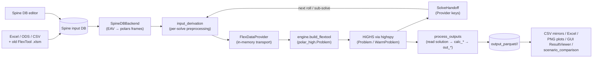
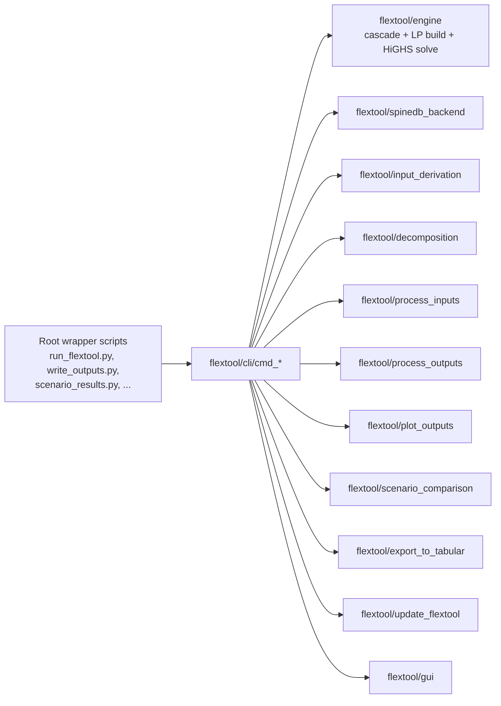

# FlexTool Architecture

The whole system: data flow, packages, run-time contracts and the
cross-cutting invariants. Engine internals (pipeline, model building,
emitters, solve orchestration, handoff) are in [engine.md](engine.md).

**Where to read**

| Task | Sections |
|---|---|
| Orientation: data flow, packages | [Top-level data flow](#top-level-data-flow), [Repository layout](#repository-layout), [Key architectural patterns](#key-architectural-patterns) |
| Add a model parameter | [Parameter shapes](#parameter-shapes-dt-broadcasting), [Solve-step aggregation](#solve-step-aggregation-new_stepduration-of-a-solve), [autoscale registry](#layers-bottom-up), engine [Where to start when…](engine.md#where-to-start-when) |
| Add a constraint / variable | engine [LP build](engine.md#lp-build-modelcore-and-the-feature-modules), [Equation headers](engine.md#equation-headers), [autoscale registry](#layers-bottom-up) |
| Change preprocess emit | engine [Emitters](engine.md#emitters), [Vectorized per-roll emit](engine.md#vectorized-per-roll-emit) |
| Change solve orchestration / rolling / stochastic handoff | engine [Solve modes](engine.md#solve-modes), [Solve-to-solve handoff](engine.md#solve-to-solve-handoff), [Stochastic branches](engine.md#stochastic-branches) |
| Schema change & migration | [update_flextool](#flextoolupdate_flextool-migration-and-updates), CONTRIBUTING.md "Updating the Data Structure" |
| Outputs | [process_outputs](#flextoolprocess_outputs-solution-parquet-downstream), [Output writers read only memory](#output-writers-read-only-memory-one-run-per-work-folder), [Solution extraction](#solution-extraction), [Run record](#run-record) |
| Scaling / solve acceptance | [Numerical scaling](#numerical-scaling), [Scaling range guard](#scaling-range-guard), [Solve acceptance](#solve-acceptance) |
| Options, env vars, threads, solver files | [Runtime options](#runtime-options), [Solver layout](#solver-layout), [solver option trust](../solvers/option_trust_internals.md) |
| Tests and fixtures | [Test layout](#test-layout-and-fixture-architecture), [testing.md](testing.md) |
| GUI / AI assistant | [gui](#flextoolgui-tkinter-desktop-application), [assistant.md](assistant.md) |

## Project Purpose

IRENA FlexTool is an energy and power systems optimization model. It reads
input data from a Spine database, derives per-solve preprocessing tables in
polars, builds a linear/MIP program in memory via `polar_high`, solves it
with HiGHS in-process via `highspy`, and writes results to parquet (with
optional CSV, Excel, and plot renderings on top of the parquets).
Inputs can be authored directly in the Spine database, populated from
tabular input files (Excel / ODS / CSV), or imported from old FlexTool v2
`.xlsm` files. A Tkinter desktop application and a Spine Toolbox workflow
provide the two user-facing GUIs.

## Top-level data flow



Key invariants:

- **One backend.** `SpineDBBackend` is the only input backend. Everything
  upstream (Excel, ODS, CSV, old `.xlsm`) is converted to a Spine DB
  before the engine sees it.
- **Lazy polars, in-memory.** Frames stay as `LazyFrame` until they reach
  `polar_high`, which assembles the HiGHS matrix. Solver variables / duals
  are read back from the live `highspy.Highs` instance — no intermediate
  solver files.
- **Parquet is the canonical output.** CSV / Excel / PNG / GUI plots all
  read from the parquets the cascade just wrote. Scenario comparison loads
  multi-scenario parquet sets and emits combined renderings.

## CLI surface



Each `cmd_*.py` is a thin argparse wrapper; the work lives in the linked
packages. Every CLI command also has an installed entry point in
`pyproject.toml` (the `flextool-*` names).

| CLI module | Entry point | Purpose |
|---|---|---|
| `cmd_run_flextool` | `flextool-run` | Run the cascade (`run_chain_from_db` / `run_orchestration`) plus output processing for a scenario. |
| `cmd_write_outputs` | `flextool-write-outputs` | Replay `process_outputs.write_outputs` over an existing parquet folder. |
| `cmd_scenario_results` | `flextool-scenario-results` | Combine parquets from multiple scenario folders into comparison plots / Excel. |
| `cmd_read_tabular_input` | `flextool-read-tabular-input` | Parse Excel / ODS / CSV via JSON spec → Spine DB. |
| `cmd_read_self_describing_tabular_input` | `flextool-read-self-describing-tabular-input` | Self-describing Excel (embedded metadata) → Spine DB. |
| `cmd_read_old_flextool` | `flextool-read-old` | Import old FlexTool v2 `.xlsm` files → Spine DB. |
| `cmd_read_matpower` | `flextool-read-matpower` | Import a MATPOWER case → Spine DB. |
| `cmd_import_sensitivities` | `flextool-import-sensitivities` | Import FlexTool v2 sensitivity scenarios into a version-56 import (`flextool-read-old --master` does both in one run). |
| `cmd_export_to_tabular` | `flextool-export-to-tabular` | Export Spine DB → Excel (`.xlsx`). |
| `cmd_execute_flextool_workflow` | `flextool-execute-workflow` | Two-phase workflow runner: optional input-prep (auto-triggered by `--tabular-file-path` / `--csv-directory-path`) followed by the fused model-run + output-write phase. |
| `cmd_migrate_database` | `flextool-migrate-database` | Upgrade an input DB to the current schema version. |
| `cmd_update_flextool` | `flextool-update` | `git pull` + project-side migration in one step. |
| `cmd_gui` (via `flextool.gui.__main__`) | `flextool-gui` | Launch the Tkinter desktop application. |

Two entry points are top-level modules outside `flextool/cli/` (`[tool.setuptools] py-modules`), because they
must act before `import flextool`: `flextool_run_supervisor` (`flextool-run`, see "Run record") and
`flextool_assistant_entry` (`flextool-assistant`, see [assistant.md](assistant.md)).

### Runtime options

`flextool/run_options.py` holds the one resolver for every operator option that has more than one form, and
the registry of every environment variable FlexTool reads. Where a setting belongs:

- **database** — what changes the model or its answer (a solve's `scaling`, `solver_mip_gap`,
  `benders_in_out_weight`, ...);
- **CLI flag** — a choice for one run (threads, time limit, log level, `--save-memory`, `--benders-workers`);
- **environment variable** — process-level settings that must exist before import (allocator, polars build),
  developer / CI switches, and the twin of a flag for callers without a command line (Spine Toolbox, a Python
  console, tests).

The contract:

1. Several forms of one option resolve in the order **flag > environment variable > database > default**,
   through `resolve()` / `RunOptions`, one `OptionSpec` per option in `OPTIONS`.
2. Flags of registry options default to `None` (a `store_true` flag gives `True` or `None`), so an unset flag
   lets the environment variable through.
3. Nothing writes `os.environ` to carry an option. `cmd_run_flextool` builds `RunOptions.from_cli(args)` and
   passes it to `run_chain_from_db(..., run_options=)`, which stores it on `RunnerState.run_options`; a library
   caller that passes none gets `RunOptions.from_env()`, resolved once per run. The database tier is added per
   solve with `RunOptions.with_db` (e.g. `scaling`).
4. A child FlexTool process (GUI job, calibration iteration, workflow run) gets the parent's flag-given choices
   as flags (`RunOptions.to_argv()`) and inherits the parent's environment untouched. Benders region workers are
   threads and read the same `RunOptions`. The launcher label is a flag too (`--run-launcher`; the outermost one
   is kept). **One exception:** a *pipe owner* — the GUI's `_run_job` and the `flextool-run` supervisor
   (`flextool_run_supervisor.py`), which read the engine's output pipe and write `_run.log` — adds
   `FLEXTOOL_RUN_LOG_OWNER=1`, `PYTHONIOENCODING=utf-8` and `PYTHONUNBUFFERED=1` to the `env=` copy of its
   **direct** child. They describe the pipe, not a run choice. The engine reads and removes
   `FLEXTOOL_RUN_LOG_OWNER`, so no process it starts inherits it; the owner's own `os.environ` is not changed.
   The calibrator, the representative-period iteration and the workflow runner start the supervisor with
   `env=None`. **A second exception:** `FLEXTOOL_RUN_STOP_FILE` is set only by the GUI, in the `env=` of an
   auxiliary job's process (a calibration, a representative-period iteration), passed on by inheritance and read
   only by the `flextool-run` supervisor, which drops it from the engine's `env=`. It is the job's stop channel
   (see "Run record"), never a run choice.
5. Process-level variables (`MALLOC_ARENA_MAX`, `_RJEM_MALLOC_CONF`, `POLARS_*`) keep `setdefault` semantics: a
   value already in the environment wins.  The exception is `POLARS_MAX_THREADS` while `flextool/__init__.py`
   imports polars: see "Thread budget" below.
6. Solver options keep their own stack, the same for every solver (HiGHS: baseline < `highs.opt`; a commercial
   solver: `<solver>.opt`; then `solve.solver_mip_gap` < `solve.solver_arguments` < operator layer); the registry
   supplies only the operator layer (`_operator_highs_overrides`; `_solver_dispatch._operator_native_overrides`
   maps `--solver-time-limit` / `--solver-mip-gap` to the native names of `_PARAM_MAP`).
   - **Where the files come from.** One ladder of folders per run, read FILE BY FILE (each solver's file from the
     first folder that has it, else the packaged template), `flextool/_solver_config_source.py` (engine-free; not
     `flextool/solver_config.py`, which would shadow the template data folder). `resolve_solver_config_source`
     builds the ladder from the first tier that applies — explicit argument > `--workspace-solver-config-dir`
     (repeatable, found by a launcher) above `--solver-config-dir` (repeatable) > `FLEXTOOL_SOLVER_CONFIG_DIR`
     (`os.pathsep` list), a closed ladder > the bounded database layout (next to the database, alone; else
     `[<P>/solver_config, <workspace>/solver_config]` for a `projects/<P>/input_sources/` database) > the Toolbox
     project folder > cwd > packaged templates. A GUI project's folder never gives an unedited template (it would
     hide the workspace's file). `snapshot_solver_option_files` reads them once at run start into
     `PathConfig.solver_option_files` (every solve reads its layer from there, never from disk) and writes the record
     `<work_folder>/solve_data/solver_config/`. The GUI and the calibrator pass the ladder explicitly
     (`gui_solver_config_flags`: the project's folder when it exists, then the workspace's, as
     `--workspace-solver-config-dir`; the folders of `FLEXTOOL_SOLVER_CONFIG_DIR` as `--solver-config-dir`, below
     the project's).
   - Which names are allowed, which folders are trusted, the solver wrapper and the per-user settings file:
     [solvers/option_trust_internals.md](../solvers/option_trust_internals.md).
7. The run header prints `RunOptions.summary_lines()` — each option set by a flag or an environment variable,
   with its source — and the thread budget (`Threads:`), with polars' and HiGHS' thread counts.

Every other variable is an `EnvKnob` in `ENV_KNOBS` with its audience (`user`, `dev`, `test`) and page:
[user page](../env_vars.md), [developer page](env_vars.md), [testing](testing.md#test-suite-environment-variables).
`tests/test_env_knob_registry.py` fails on an unregistered read, an undocumented registered variable, or a
documented variable that is no longer read.

## Repository layout

```
flextool/                          The installed Python package
├── __init__.py                    Public re-exports: write_outputs,
│                                    migrate_database, initialize_database,
│                                    update_flextool
├── cli/                           Argparse wrappers (cmd_*.py) +
│                                    cli/_timing.py (TimingRecorder)
├── spinedb_backend/               Spine DB → polars frames (the input API).
├── input_derivation/              Per-solve preprocessing computations.
├── engine/                        Optimization engine + cascade coordinator
│                                    (engine.md; folder map in its README.md).
├── engine_polars/                 Old name of flextool.engine: an alias of
│                                    its public API and _provider_keys only.
├── decomposition/                 Region decomposition + region filter
│                                    (Benders sub-problems, CLI side).
├── calibrate/                     Energy-margin calibrator (iterates
│                                    flextool-run solves).
├── run_record/                    _run_status.json / _run.log ("Run record").
├── run_warnings/                  Coded, grouped run warnings and notices
│                                    (registry → reference/warnings.md).
├── common_utils/                  Cross-package helpers (precision rounding).
├── process_inputs/                Tabular / Excel / old-format readers →
│                                    Spine DB writers.
├── process_outputs/               Solution → parquet + downstream CSV /
│                                    Excel rendering pipeline.
├── plot_outputs/                  PNG / SVG plot rendering + plot-plan
│                                    persistence (viewer-readable parquets).
├── scenario_comparison/           Multi-scenario parquet load + dispatch
│                                    & summary comparison rendering.
├── export_to_tabular/             Spine DB → Excel (.xlsx) exporter.
├── update_flextool/               DB schema migration chain, canonical-DB
│                                    generation, settings-DB initialisation,
│                                    repo self-update.
├── model_builder/                 Synthetic / mock-up scenario generator.
├── representative_periods/        Greedy convex-hull representative-period
│                                    clustering.
├── assistant/                     The AI assistant: read-only tools, the
│                                    connection server for agents, the chat.
├── docs_build/                    Generated docs pages (formulation, results
│                                    catalogue) and the assistant's docs index.
├── gui/                           Tkinter desktop application (gui/assistant/:
│                                    the AI assistant's chat window).
├── solver_config/                 Solver option templates (*.opt.template,
│                                    shipped in the wheel).
├── schemas/                       Schema JSONs, YAML templates,
│                                    canonical-database JSONs, the axis
│                                    contract (flextool_axis_contract.json).
├── run_options.py                 Option resolver + env-variable registry.
└── lean_parquet.py                Tiny parquet loader used by the GUI
                                     ResultViewer.

Top-level modules that run before `import flextool` (py-modules):
  flextool_run_supervisor.py (flextool-run), flextool_assistant_entry.py
  (flextool-assistant); build-time only: _flextool_build.py.

Root wrapper scripts (kept for Spine Toolbox workflow compatibility):
  run_flextool.py, write_outputs.py, scenario_results.py,
  migrate_database.py, read_tabular_input.py,
  execute_flextool_workflow.py, update_flextool.py

solver_config/                     Workspace solver options (highs.opt and
                                     the commercial *.opt; gitignored, each
                                     seeded from its template on first run).
templates/                         Example databases and project assets.
tests/                             Test suite (single root; "Test layout").
execution_tests/                   Spine Toolbox subprocess execution tests.
tools/                             Developer tools (lp_snapshot.py, ...).
docs/                              MkDocs site: docs/dev/ developer reference,
                                     the rest user-facing.
.spinetoolbox/                     Spine Toolbox project integration.
.github/workflows/                 CI/CD (tests + verify hooks).
pyproject.toml, mkdocs.yml,        Build config, doc config, citation,
CITATION.cff, LICENSE.txt,         license, readme, release notes.
README.md, CHANGELOG.md
```

## Module details

### `flextool/spinedb_backend/` — the input API

`SpineDBBackend` is the sole materialiser between the Spine database and
the rest of the engine. It owns the EAV-to-tabular transformation: every
method returns a canonical-schema `polars.DataFrame`, and no method writes
to disk. The caller stack is:

```
SpineDB → SpineDBBackend → input_derivation → FlexDataProvider → cascade
```

Key surface:

- `SpineDBBackend.find_entities(entity_class, ...)` — entity rows.
- `SpineDBBackend.parameter_values(entity_class, parameter, ...)` —
  parameter rows with parsed values (Map / time-series / array / scalar).
- `SpineDBBackend.default_values(...)` — default-value lookups for
  cascade fallbacks.

A handful of small caching layers (parameter-value row cache, parsed-value
eviction, chunked accumulators) keep peak RSS bounded on continental-scale
inputs.

### `flextool/input_derivation/` — per-solve preprocessing

The per-solve derivation pipeline. Each module is a focused port of a
self-contained preprocessing step (commodity ladder, DC power flow, process
methods, period sets, ...). The package's `__init__.py` orchestrates the
three-step pattern:

1. Spec-driven entity / parameter spec loops over the backend.
2. Derivation helpers project the raw rows into FlexData fields.
3. Validators sanity-check shape / dtype invariants before handoff.

Output is an in-memory `FlexData` augmented with derived fields, exposed to
the engine through `FlexDataProvider`.

### `flextool/engine/` — the optimization engine

The dominant package: it builds a `polar_high.Problem` from `FlexData`,
solves it with HiGHS and threads cross-solve state through `SolveHandoff`,
all in memory. Its internals are [engine.md](engine.md): the pipeline,
`FlexData` and `FlexDataProvider` (the in-memory transport and its key
families), the LP build and its feature flags, the emitters, the solve
modes, the solve-to-solve handoff and the
[public API](engine.md#public-api). `flextool/engine/README.md` is the
folder map and the import direction. Below are the engine contracts other
packages rely on.

#### Output writers read only memory; one run per work folder

The output cascade has the same contract as the loader: every writer —
`flextool/process_outputs/{read_highs_solution,handoff_writers,read_variables,solve_order,union_realized_slice,write_outputs}.py`
and `engine/output/_writer.py` — sources its values from the sub-solve's
`FlexData`, `FlexDataProvider` or `OutputWriterState` (cross-solve writer
scratch: `divested`, `existing` / `invested`, `mirrors_written`,
`periods_already_emitted`), never from `input/` or `solve_data/` on the
work folder. A file read there is one a normal run does not write, so the
output it feeds is silently empty: the entity-class split of
`v_dual_invest_{unit,connection,node}` comes from the provider's
`input/process_unit` / `input/process_connection` / `input/node` frames
(`_entity_class_members`), and `group_entity_invest` from
`solve_data/group_entity` ⋉ `solve_data/group_invest`. Rule 5 of
`tests/engine/test_meta_provider_invariants.py`
(`test_output_writers_read_no_work_folder_inputs`) pins it: none of those
files may call `pd.read_csv` / `pl.read_csv` / `pl.scan_csv`, or build an
`input/` / `solve_data/` path alongside a disk-read call. The four
handoff-mirror CSVs under `solve_data/` (`p_entity_divested`,
`fix_storage_quantity`, `fix_storage_usage`, `p_roll_continue_state`) are
write-only `--csv-dump` debug output; `period_capacity.csv` is written on
every run, always header-only.

Because nothing reads the work folder back, **FlexTool supports exactly one run per work folder at a time**: a
second concurrent cascade into the same folder is not supported (its parquets would interleave with the first's,
and whichever run finishes first deletes the other's stash). `run_orchestration`'s `_bootstrap_dirs` clears the
*previous* run's own leftovers at the start of every cascade — `output_raw/` (`rmtree` + recreate: the per-roll
parquet stash, `_solve_order.txt`, `manifest.json`) and the `solve_data/` handoff-mirror basenames
(`handoff_writers.MIRROR_FILES`) — so a reused folder (the CLI-in-cwd rerun case, e.g. after a failed run or a
`--csv-dump` run) cannot leak a prior run's output into this one
(`union_realized_slice.has_persisted_slices` would otherwise union stale per-roll parquets into the fresh run).
`input/` and every other `solve_data/*` file (dump / debug output) are left alone. A symlinked `output_raw/` is
refused rather than followed. The GUI and Spine Toolbox give each job / execution a fresh work folder, so
this clearing is a no-op there. `ExecutionManager` starts at most one job per output folder ("Run record").

#### CSV dump (supported) and CSV reload (unsupported)

`--csv-dump` / the GUI "Full" debug level, `FlexData.dump_csvs` and
`FlexDataProvider.snapshot_processed_inputs` write a CSV dump for inspection. Both writers stamp the folder with
`_dump_meta.json` (`dump_format`, FlexTool version, schema version, git hash; `preprocess/_dump_stamp.py`). The
writers are supported; nothing in a run reads a dump back. The main loader is provider-only: it never reads `input/` or
`solve_data/` on disk, so a dump or stale CSVs in a reused work folder cannot change a run
(`test_loader_and_model_have_no_disk_arms` in `tests/engine/test_meta_provider_invariants.py`).

Reloading a model from a dump lives only in `flextool/engine/_csv_reload/`: `load_from_dump(dump_dir, *, db_url=None,
scenario=None, force=False)`, `copy_runner_meta`, and the offline output writer (`python -m
flextool.engine._csv_reload.offline_outputs`, outputs from an MPS + solution file). It is **unsupported**: it is not
kept in sync with the engine, it warns on every call, and it refuses a dump without a stamp or with another dump
format or schema version unless `force=True`. A reloaded model has no solve-to-solve carry and can differ from the
solved model. The stamp does not detect leftover CSVs from earlier runs in a reused folder (the CLI work folder
defaults to the current directory and is never cleaned), so reload only from a folder that holds a single dump. Nothing outside the package imports it (`test_csv_reload_is_a_leaf`), and its tests in
`tests/csv_reload/` run only with `pytest -m csv_reload`. Do not update the package when you change the engine;
whoever needs the reload brings it up to date first (and then updates `VERIFIED_FLEXTOOL` / `VERIFIED_SCHEMA` in
`_csv_reload/_stamp.py`).

The offline output writer replaces the removed `python -m flextool.process_outputs.read_highs_solution` and needs
`--dump`. It reads the solve's `scale_the_objective` from the dump's `solve_data/scale_the_objective.csv`: the
sub-solve provider holds the scale its LP was built with, so a provider snapshot (`--csv-dump`, a run's work folder)
carries it. `--scale` is an optional override (an MPS built at another scale); a missing or header-only file is an
error, never a silent default.

#### Parameter shapes & `(d,t)` broadcasting

`engine/input/_param_shapes.py` is the authoritative resolver for how a DB-authored parameter maps onto the model
axes. **Never detect a parameter's period / time axis by column name.** Spine writes a Map's index column under the
author's `index_name`, defaulting to the silent `"x"` when unset — so a column-name check like `("t","time","step")`
misclassifies a time series as a scalar and broadcasts it with a `how="cross"` Cartesian product against the full
`(d,t)` grid. On long timelines that overflows polars' 2³² row index; on short ones it silently flattens the time
variation via a downstream `unique([...])`. Route every param→`(d,t)` broadcast through `resolve_param_shape`
(DB-metadata shape + value-domain probing) → `broadcast_to_period_time` (keeps the Param at its authored shape, no
cross-product) → `promote_param_to_dt` (narrowing inner-join on the carried axis). A new parameter that needs this
must be added to `PARAM_ALLOWED_SHAPES` (scalar, `1d_map[period]`, `1d_map[time]`, `2d_map[period,time]`, …); a
mismatch raises `FlexToolConfigError`.

`_param_shapes` is the **I/O contract only** — it validates user-authored DB shapes and errors to the user on
mismatch. Model-internal axes (e.g. the rolling-solve `roll` axis) are deliberately excluded; they are never
DB-authored, never reach the resolver, and a stray one already fails loudly via `_UnrecognisedIndex`. Document such
internal axes in `flextool/schemas/flextool_axis_contract.json`, not in the resolver's allow-lists.

##### Limits: `inf` is "no limit", a missing period is an error

A period-map limit read through `require_period_coverage` / `require_period_coverage_time` must cover every period
it applies to; a gap raises.  "No limit in this period" is written as `inf` (`-inf` for a lower limit).  The readers
pass `limit_side` (`"upper"` / `"lower"`): `check_limit_values` refuses the opposite infinity and warns, once per
(parameter, entity) and run, about a finite value of `HUGE_LIMIT_VALUE` (1e15) or more (kept as given: a huge
right-hand side wrecks the scaling).  Two ways to drop the no-limit rows:

- `drop_no_limit=True` drops them at the reader, for a limit whose missing row already means no limit (the flow
  group limits, whose rows come from the Param; a minimum whose 0 sets no floor: `inertia_limit`,
  `invest_min_period`, `retire_min_period`, `cumulative_min_capacity`).
- Otherwise the Param keeps them and the consumer leaves the row out with `without_no_limit_rows(domain, param,
  side)` and passes `drop_no_limit_rows(param, side)` as the right-hand side — for a family whose row domain does
  not come from the Param (`co2_max_period` → `group_d_co2_capped`, the investment maxima,
  `non_synchronous_limit` → `non_sync_rows`, `capacity_margin_absolute` / `capacity_margin_relative` →
  `capacity_margin_rows`, the user constraint constant → `cdt_le` / `cdt_ge`).  The variable bounds of an entity
  investment read an unlimited `invest_max_period` / `cumulative_max_capacity` period as the no-limit bound
  (`max_flow_for_unconstrained_variables`).

A solve with `new_stepduration` aggregates a time map before these checks, and the four time-series limits
(`_solve_step_aggregation.NO_LIMIT_SIDE`: `max_instant_flow`, `min_instant_flow`, `inertia_limit`,
`non_synchronous_limit`) are MEANs: a solve step that combines a no-limit time step with finite ones is itself
`inf` (`-inf`), so the limit is dropped for the whole solve step — on purpose (a partial limit has no single right
step value). `_warn_mixed_no_limit_steps` warns once per (parameter, entity) and run, naming the `period/step`s (5
shown, then "and N more"), and refuses a step that combines `inf` and `-inf` (its mean would be NaN). Gated by
`tests/engine/test_limit_inf_no_limit.py` (LP with `inf` = LP with a non-binding value minus that period's rows,
single / rolling / stochastic).

##### Silent-label Maps are resolved per entity, not per parameter

When a Map has no explicit `index_name` (`"x"` or empty) and the registry admits both a period and a time shape at
that depth, `resolve_param_shape` first probes the union of every entity's keys against the solve's `(d, t)`. When
that stays ambiguous (no entity's keys overlap the solve, or different entities overlap different axes) each silent
entity is classified on its own (`_silent_entity_axes`): an entity never decides another entity's shape. An entity
with no key in the active solve has no value in that solve — it is removed from the frame as if it had authored
nothing (the parameter's default applies); when every entity is removed the frame falls through to the source's
default-broadcast path. An entity whose keys match both axes raises, naming it. Tests:
`tests/engine/test_param_shapes_silent_per_entity.py`, `tests/engine/test_silent_label_params.py`.

##### Every entity's index path is checked; unnamed maps of different depths are read per depth

Before any shape is resolved, `_check_entity_label_paths` checks each entity's own raw label path
(`parameter_entity_label_paths`): a depth that is not the `shape_rank` of an allowed shape, or an explicit name that
no allowed shape of that depth has on that level (`period` / `time`; for the price ladders, level 1 of a 3-level
ladder is the period and the tier and price / quantity levels may not be named `period` / `time`), raises
`FlexToolConfigError` in plain words (`allowed_shapes_in_words`): *"commodity 'coal', parameter 'price': the value
has 2 index levels; this parameter takes a constant, or a map over periods or over time (1 level)"*. A depth that
stays ambiguous between allowed shapes is accepted; value-domain probing decides it. `shape_rank(shape)` =
`len(_SHAPE_LABELS[shape])` is the one source of a shape's depth (also the schema's map rank,
`tests/engine/test_schema_shape_consistency.py`).

When a non-ladder parameter's entities have maps of more than one depth and some level is unnamed, the reader's
single positional unroll cannot place them, so `_resolve_by_depth` resolves each depth group on a `_view_without`
the others (as `resolve_facet_groups` does for ladders) and unions the groups into one `[entities, period, t,
value]` frame (`_axis_frame_resolved`). It raises only where those rules cannot place a group: keys on both axes,
or an ambiguous group without a `period_filter`. With every level named, the reader places rows by label. When an
unnamed map's shape was read from its depth or keys, `resolve_param_shape` prints one coded note per (class,
parameter) and run (`run_warnings`); ladders are left out.

##### Solve-step aggregation (`new_stepduration` of a solve)

A solve with `new_stepduration` combines the time steps of its timeline into longer steps, each labelled by its
first original (base) step. Every time series then needs one value per new step, and the rule is a property of the
parameter: `TIME_AGGREGATION` in `engine/input/_solve_step_aggregation.py` maps each `(entity_class, parameter)`
that can vary in time to `MEAN` (duration-weighted mean: prices, costs, limits, availability, min load, penalties,
reserves, self-discharge, weights, profiles, instant-flow limits), `HARMONIC` (mean of 1/v: `efficiency`,
`efficiency_at_min_load`, so the fuel use of a constant flow is exact), `SUM` (`inflow`, `energy_margin_adder`:
energy per base step) or `LAST` (`storage_state_reference_value`: the state at the step's end). `NOT_TIME_SERIES`
lists the schema's other map parameters; every map parameter of the schema is in exactly one of the two
(`tests/engine/test_time_aggregation_registry.py`). **A new time-series parameter needs a `TIME_AGGREGATION`
entry**; while a solve's steps are active, a broadcast of a key without one raises.

One vectorised function, `aggregate_to_solve_steps`, does the arithmetic (a step whose base values are all equal
keeps the value itself; the means are exact, only the profile keeps its 6-decimal rounding (`ROUND6_KEYS`); `SUM`
is `math.fsum`, so n equal values give n·v like a constant; `LAST` follows the timeline position); `combine` is
its per-step reference (`test_vectorised_kernel_equals_combine`). A roll aggregates only the base steps of its own
solve steps (`aggregate_if_active(steps=...)`). It serves three places:

- the provider's frames: `TimelineConfig.create_averaged_timeseries` writes `solve_data/pt_*`, `pbt_*`,
  `pdt_process`, `pdt_node`, `pdt_energy_margin_adder` and (verbatim) `pd_energy_margin_adder` (kinds by (file,
  parameter)) and `solve_data/new_step_base_steps` (base step, new step, count, duration, position); without
  `new_stepduration` the `input/` frames pass through verbatim. **The per-solve emit folds read these
  `solve_data/` frames, never `input/`** (engine.md [Vectorized per-roll emit](engine.md#vectorized-per-roll-emit)),
  and `_run_model` mirrors every key the aggregation wrote onto the sub-solve provider;
- the DB-direct readers: `broadcast_to_period_time` aggregates the rows that carry `t`, keyed by
  `ResolvedShape.key`, after the null filter and before `filter_zero` and the axis cast;
- the readers outside the resolver (the period+time profile reader, `timeset_weights`).

`load_flextool` arms the base steps in a contextvar (`activate_solve_step_aggregation`) next to the stochastic-time
source; with no `new_stepduration` the frame is empty and nothing is aggregated, so the LP of every uncoarsened
solve is unchanged. `t` stays the I/O axis and only the values are grouped. The `SUM` kinds are scaled by their own
readers (a constant counts once per base step: the inflow scaling, the energy-margin adder), so a `SUM` key
reaching the generic broadcast raises.

##### Silent-default `"x"` index — readers outside the resolver

Not every DB read goes through `resolve_param_shape`. The **per-entity cascades** in `params/_derived/` /
`_existing.py` / `_lifetime_inputs.py` read raw entity params (`source.parameter(...)`) and must detect the period
axis themselves. The failure mode is the resolver's: spinedb_api's default `index_name` is the literal string
`"x"` (real 2-D maps carry `index_name='x'`, see `_spinedb_reader._discover_index_cols`), so an
`if "period" in cols` gate misfires and the code drops the row or collapses it via a downstream
`.unique(subset=["e"], keep="last")` — for a *retiring* `existing` map (nameplate → 0 at expiry) that keeps the
last period's `0`, defaulting `unitsize` to `1000` and making `existing_count = capacity / unitsize` a spurious
fraction (caps continuous online below 1; forbids integer online entirely).

**Safe idioms** (use one of these for any raw per-entity map read):

- period-agnostic aggregate — `group_by("e").agg(pl.col("value").max())` (`_entity_unitsize_lf`,
  `_node_unitsize_lf`: the cascade only needs "non-zero", and the per-period MAX is non-zero iff any period is);
- explicit dual check — `period_col = "period" if "period" in cols else "x"` / `for cand in ("period","x")`
  (`_ed_explicit_period_param`, `_per_solve_sets`);
- per-row scalar detection — treat any single non-`name`/`value` column as the period dim and classify
  scalar-vs-map by that column's *per-row* null-ness, so a constant value sharing a class with period-Map siblings
  (surfaces as `x = null`) broadcasts instead of zeroing (`_per_entity_param_lf` in both the `existing` and `npv`
  mirrors).

**Coverage** (`tests/engine/test_silent_default_index_pdt.py`):

- *Safe* — `availability`, `inflow`, `other_operational_cost`, `reservation` (resolver-routed); the `existing` /
  `lifetime` / `virtual_unitsize` per-period chains (`_per_entity_param_lf`); `_ed_explicit_period_param`,
  `_per_solve_sets`; `profile` in real solves (reads the engine-written canonical `pt_profile` / `pbt_profile`).
- *Profile tiers* — `_profiles._classify_profile_rows` reads a 1-D profile Map without an index name by its keys
  against the solve's `_param_shapes._period_time_vocab(dt)` (`_silent_map_tier`): periods only → period tier
  (`_profile_period_only_lf` reads `x` as the period), else time tier; the `InMemoryReader` column fallback uses
  the same rule. Unlike the resolver's silent drop, `validate_period_keys` warns once per run about a profile
  period map that misses periods of the scenario's solves and stops on keys that are both periods and time steps.
  `_profile_time_lf`'s raw fallback also reads `x`. A 2-D Map whose outer level has no index name is `period_time`
  by the same rule on its outer keys (`_profile_period_time_lf` reads `x` as the period and `x_2` / `t` as the
  time step; under an outer level labelled `period` the unnamed inner level `x` is the time step); other unnamed
  2-D Maps stay `stochastic` (only 3-level Maps fill `pbt_profile`), and `validate_period_keys` stops the run on
  them. Gap: the CSV `pdtProfile` seed has no period tier.
- *Guarded by schema only* — `invest_max_total` and `virtual_unitsize` are `float`-only in `parameter_types`, so
  the `keep="last"` collapse in `_e_explicit_param` and in the `virtual_unitsize` sub-branch of
  `_entity_unitsize_lf` bites only if a value is authored against its declared type (value types are not yet
  enforced strictly).
- *Gap* — `min_load` is declared map-capable (`map,1` / `map,3`) but `p_min_load_from_source` reads it as a scalar
  `Param(("p",))` and `minFlow_minload` consumes only that scalar, so a period/time-varying `min_load` is
  flattened whatever its index name. Route through the resolver if per-period `min_load` is ever wired.

### `flextool/process_inputs/` — tabular → Spine DB

Reads tabular data and writes Spine DB. The output of this package is the
Spine DB the engine consumes.

| File | Purpose |
|---|---|
| `read_tabular_with_specification.py` (`TabularReader`) | JSON-spec-driven reader for Excel / ODS / CSV. |
| `read_self_describing_excel.py` | Self-describing Excel with embedded metadata. |
| `read_old_flextool.py` | Parse old FlexTool v2 `.xlsm` → `OldFlexToolData`. |
| `read_matpower.py` | MATPOWER case → import structure. |
| `write_to_input_db.py` (`write_to_flextool_input_db`) | Tabular → Spine DB. |
| `write_self_describing_to_db.py` | Self-describing Excel → Spine DB. |
| `write_old_flextool_to_db.py` | Old FlexTool data → Spine DB. |
| `import_old_excel_input.json` / `import_excel_input.json` | Excel import specifications. |

### `flextool/process_outputs/` — solution → parquet → downstream

Three-layer architecture:

```
Solution extraction (in-memory, from highspy.Highs):
  read_highs_solution.py         VARIABLE_SPECS — variables, row duals,
                                 column duals harvested directly from
                                 the live solver instance.

Post-processing (parquet-backed calculations):
  drop_levels.py                 Strip 'solve' level from time-indexed objects.
  calc_capacity_flows.py         Capacity, online status, flow_dt, ramps.
  calc_connections.py            Connection flows and losses.
  calc_storage_vre.py            Storage state changes and VRE potential.
  calc_slacks.py                 Reserve, slack, inertia quantities.
  calc_costs.py                  All cost aggregates.
  calc_group_flows.py            Group-level flow aggregations.
  process_results.py             Coordinator: calls calc_* in order.
  handoff_writers.py             SolveHandoff CSV mirrors (csv_dump only).
  solve_order.py                 Solve-sequence reconstruction.

Output formatting:
  out_capacity.py                Unit / connection / node capacity tables.
  out_flows.py                   Unit flow, capacity-factor, VRE, ramp.
  out_group.py / out_flowgroup.py NodeGroup flow, inflow, VRE-share, indicators.
  out_node.py                    Node summary and additional-results outputs.
  out_costs.py                   Cost summary, CO2, generic outputs.
  out_ancillary.py               Connection, reserve, inertia, slack, dual.
  write_outputs.py               ALL_OUTPUTS list + orchestrator.
  to_spine_db.py                 Result DataFrames → Spine output DB.
```

The cascade produces `output_parquet/<scenario>/`. CSV / Excel / plot
renderers all consume those parquets — no separate solver-output
extraction step.

### `flextool/plot_outputs/` — PNG / SVG plots and plot plans

Static plots (lines, bars, stacked area) plus a persistence layer that
saves precomputed *plot plans* (one parquet per result key) so the GUI's
`ResultViewer` can re-render without recomputing pivots / pagination.

| File | Purpose |
|---|---|
| `orchestrator.py` | `plot_dict_of_dataframes`, `prepare_plot_data`, `compute_all_plot_plans`. |
| `config.py` | `PlotConfig`, `DIMENSION_RULES`, `PLOT_FIELD_NAMES`. |
| `plan.py` | `compute_plot_plans_for_result`, `save_plot_plan`, `load_plot_plan` (with `schema_version` invalidation). |
| `plot_lines.py` | Line and stacked-area rendering. |
| `plot_bars.py` / `plot_bars_detail.py` | Bar chart orchestration and rendering. |
| `axis_helpers.py`, `legend_helpers.py`, `subplot_helpers.py`, `format_helpers.py` | Layout, formatting, filename generation. |
| `color_template.py` | Stable color assignment across scenarios. |
| `shared_manifest.py`, `plan_union.py` | Per-scenario plan availability + cross-scenario union. |
| `perf.py` | Internal timing. |

### `flextool/scenario_comparison/` — multi-scenario analysis

Loads parquets from multiple scenario folders, builds combined views, and
renders comparison plots.

| File | Purpose |
|---|---|
| `data_models.py` | `TimeSeriesResults`, `DispatchMappings`. |
| `db_reader.py` | Load scenario parquet files into `TimeSeriesResults`. |
| `dispatch_mappings.py` | Load dispatch-mapping parquets. |
| `config_builder.py` | Discover dispatch entity/scenario names + assign palette colors (seeded into `plot_settings.yaml`). |
| `dispatch_data.py` / `dispatch_plots.py` | Per-scenario dispatch DataFrame prep and stacked-area rendering. |
| `constants.py` | Colors and special column-name lists. |
| `orchestrator.py` | Top-level `run()` function. |

### `flextool/export_to_tabular/` — Spine DB → Excel

Exports a Spine input DB to `.xlsx` in self-describing v2 or original v1.

| File | Purpose |
|---|---|
| `export_to_excel.py` | Orchestrator; v1 vs v2 format selection. |
| `db_reader.py` | `DatabaseContents` + `read_database()`. |
| `sheet_config.py` | `SheetSpec`, `build_sheet_specs()`. |
| `excel_writer.py` | Sheet writers (periodic, time-series, ...). |
| `formatting.py` | Cell formatting / type conversion. |
| `export_settings.yaml` | Export configuration. |

### `flextool/gui/` — Tkinter desktop application

Spawns CLI commands as subprocesses; never imports the engine directly.

```
__main__.py                      Entry point → MainWindow.
main_window.py                   MainWindow (tkinter.Tk root).
project_utils.py                 Create / list / rename projects.
settings_io.py                   Load / save GlobalSettings + ProjectSettings.
data_models.py                   Settings + ScenarioInfo dataclasses.
input_sources.py                 InputSourceManager (file selection).
scenario_lists.py                Available / executed scenario managers.
execution_manager.py             ExecutionManager (threaded subprocess pool).
execution_window.py              ExecutionWindow (progress).
output_actions.py                Plot / export action wiring.
output_log_window.py             Log display.
db_editor_integration.py         Spine DB editor launcher.
db_version_check.py              Input-DB version validation + auto-upgrade.
error_handling.py                safe_callback decorator.
platform_utils.py                Platform-specific file/app opening.
result_viewer.py                 ResultViewer (parquet → plot canvas).
plot_canvas.py                   Matplotlib canvas with downsampling.
plot_cache.py                    Plot cache.
plot_config_reader.py            Plot-config YAML parser.
network_graph.py                 Network-topology figure builder.
check_tree.py                    CheckTreeController.
hover_tooltip.py / tree_reorder.py / downsampling.py / cli_format.py / scenario_key.py / config_parser.py
dialogs/                         Add / project / plot / file-picker dialogs.
dialogs/_modal_base.py           ModalBase + ModalGrab: the shared modal base (deferred grab, shield).
dialogs/message_box.py           The one FlexTool box: tell / ask / name_list (no native messagebox).
dialogs/message_list_window.py   Non-modal message list window + MessageListController (indicator, auto-show).
messages.py                      Tk-free message list core: specs, per-user store, MessageCenter.
message_sources.py               The list's sources (W-0490, upgraded, unreadable, solver settings, update).
```

### `flextool/update_flextool/` — migration and updates

| File | Purpose |
|---|---|
| `self_update.py` (`update_flextool`) | `git pull` + project-side migration. |
| `db_migration/` (`migrate_database`) | Walk the version chain to the current `FLEXTOOL_DB_VERSION`: `runner.py` walks, one module per step (`v01_v25` .. `v84_branching`), `common.py` the shared helpers, `head.py` the refresh at the current version. |
| `migration_backup.py` | The pre-migration copy (`<db>.premigration.bak`) and its atomic restore on failure; shared by `migrate_database` and the window's upgrade. |
| `initialize_database.py` (`initialize_database`) | Create new DB from JSON template. |
| `ensure_settings_db.py` | Idempotent settings-DB creation. |
| `test_fixtures.py` | Migrate `tests/fixtures/*.json` to current schema and sync their schema sections. |
| `fixture_schema.py` | Schema sections of fixture / canonical JSONs generated from `spinedb_schema.json`; sync rules and drift listing. |
| `canonical_databases.py` | Materialise / migrate canonical example DBs from JSON. |
| `generate_canonical.py` | Project authoritative fixtures into derived canonical DBs. |
| `extend_tests_fixture.py` | Agent-friendly YAML-delta workflow for append-only fixture additions. |

CI-enforced verify chain (`tests.yml::template-check`):

- `sync_master_json_template --verify` — schema parity.
- `test_fixtures verify` — `tests/fixtures/*.json` at current schema.
- `generate_canonical --verify` — generated canonical files in sync.
- `canonical_databases verify` — authoritative canonical files at current schema.

### `flextool/decomposition/` — Benders region helpers

`region_decomposition.py` and `region_filter.py` slice `FlexData` by region
group and prepare sub-problems for the Benders solve mode (the filter-only
`--region` CLI entry point that materialises one region's standalone input
directory). The in-engine slicer used by the live Benders driver lives at
`engine/solve/_region_filter.py`; the master + cut loop is in
`engine/solve/_benders.py`.

### `flextool/model_builder/` and `flextool/representative_periods/`

- **`model_builder`** — synthetic scenario generator used for benchmarking
  and stress-testing the engine. `build_model.py` is the entry point;
  `encoding.py`, `names.py`, `profiles.py` are helpers.
- **`representative_periods`** — greedy convex-hull clustering used at the
  input-preparation stage to pick representative weeks / days.
  `preprocess.preprocess_representative_periods` is the entry point.

#### Net-load clustering mode

By default the greedy hull clusters on the per-series normalized profile/inflow feature stack
(`preprocess._build_clustering_matrix`). `--netload-clustering` (DB read in
`representative_periods/netload_inputs.py`, the math in `netload.py`) instead clusters on a real-MW **net-load**
signal per aggregation unit `g`:

    net_load[g, h] = Σ_{demand node in g} demand_h
                     − Σ_{VRE unit in g} cap[u] · avail[profile(u)][h]

Demand is a *negative* inflow (the `force_include` convention), so `demand_h = −inflow_h + |scalar demand level|`.
**VRE** is any `unit__node__profile` arc whose `profile_method` is `upper_limit` — the schema default, so an arc
without a `profile_method` row counts as VRE. Each unit's series is min-max normalized to `[0, 1]` like the default
features.

An **aggregation unit** is a **region group** — the groups with `group.use_for_representative_periods = yes`, whose
member nodes' net load is summed — or, when no group has the flag, each **node**. A database without that parameter
definition also gets the per-node signals; a read failure on a *defined* flag surfaces rather than degrade.

The iteration-0 VRE capacities are the **demand-match** default: the investable VRE of each unit is sized so its
energy plus the existing VRE energy covers the unit's demand energy (energy balance, curtailment ignored);
`--vre-penetration` scales that target (1.0 = full match).

#### Net-load iteration driver

`representative_periods/netload_iterate.py` (`run_netload_iteration`, `NetloadIterConfig`; also a CLI) loops the
net-load selector until the selection is stable, sizing each iteration's VRE fleet from the previous solve's
realised investments (sharper than the demand-match default about which periods are net-load-critical).

- **Invest-only loop.** Iteration `k` in `range(iterations + 1)`. `k = 0` selects on the demand-match caps and runs
  an INVEST-ONLY solve; its dispatch is skipped (default-cap investments are known-bad). `k = 1..n` select on the
  prior iteration's invested caps; an unchanged representative set stops the loop before solving.
- **Keep-best (opt-in).** With `--keep-best`, each `k ≥ 1` also runs the full-year DISPATCH and the loop keeps the
  set with the **lowest full-year dispatch cost**, re-materialised deterministically by re-running the selector on
  that iteration's input caps; a final dispatch runs on the chosen set for output.
- **Stable alternative name.** The full `alternative_name` is pinned once and passed to the selector every
  iteration, so the selector never derives a per-iteration name (whose force-suffix could shift) and orphans
  timesets: its purge+rewrite replaces the single net-load timeset, so N iterations leave exactly one.
- **Subset runs via `model.solves`.** `cmd_run_flextool` has no `--solves` flag; the driver writes a dedicated
  `model.solves` OVERRIDE alternative at the top of the stack (as `calibrate._db_alt` does) — the invest solve(s)
  for an invest-only pass, the dispatch solves (or the scenario's full chain) for a dispatch pass.
- **Fail-closed guards.** `_guard_no_timed_energy_margin` refuses a node whose `energy_margin_method` is
  `inflow_adder` with a timed (2-D) `energy_margin_adder` (exclusive with the cap feedback). Every iteration solve is
  `assess_solve`-gated on its required outputs; an untrusted solve raises `NetloadIterError`. Basis caches are cold
  per solve (the LP columns change with the set); `--warm-start` opts into one shared cache when the grid is stable.

## Public API surface

Package-level entry points (the engine's own API is
[engine.md Public API](engine.md#public-api)):

```python
from flextool import (            # also re-exported from their packages
    write_outputs,
    migrate_database,
    initialize_database,
    update_flextool,
)
from flextool.engine import (
    FlexData, SolveHandoff, build_flextool, load_flextool,
    run_chain_from_db, run_orchestration,
)
from flextool.engine.input._db_loader import FlexToolRunner
from flextool.spinedb_backend import SpineDBBackend
from flextool.process_inputs import TabularReader, write_to_flextool_input_db
from flextool.process_outputs import write_outputs, post_process_results
from flextool.plot_outputs import plot_dict_of_dataframes
from flextool.scenario_comparison import get_scenario_results
from flextool.export_to_tabular import export_to_excel
from flextool.update_flextool import (
    migrate_database,
    initialize_database,
    update_flextool,
)
```

## Solver layout

HiGHS is a regular Python dependency (`highspy`). The solver options files:

| Path | Tracked? | Role |
|---|---|---|
| `flextool/solver_config/<solver>.opt.template` | Yes (package data) | Templates shipped in the wheel (HiGHS, `gurobi`, `cplex`, `xpress`, `copt`). |
| `solver_config/<solver>.opt` | No (gitignored) | User-editable workspace copy; `ensure_runtime_files` (GUI start, `flextool-update`) seeds it from the template if absent. |

A run reads the files once ("Runtime options" item 6) and `_solve_highs_options` layers the solve's settings and
the CLI overrides on them (`flextool._resources.package_data_path(...)` finds a template).

**`--save-memory`** (or `FLEXTOOL_SAVE_MEMORY=1`) is an opt-in peak-RSS strategy: it disables warm start and
round-trips each sub-solve through an on-disk MPS file solved in a HiGHS child process, trading ~5-10 GB peak RSS
for slower per-solve build time. The orchestrator warns once when it disables warm start because of it.

**Solver hand-off.** A subprocess solve gets its merged options as a list of `(name, value text)` pairs, never
through a file it reads back: a commercial script builder (`_subprocess_solve._SCRIPTS`) takes
`commercial_params(options)` and emits one argument or script line per pair; the `--save-memory` HiGHS child
(`cmd_solve_mps --options-json`) sets each pair with `setOptionValue`, refusing an empty value as HiGHS' option-file
reader does. `<solve>.opt` next to the MPS is the record only. `tests/engine/test_solver_handoff_golden.py` pins
argv, scripts and HiGHS' resulting options for a corpus and compares seeded random option lists with a
write-and-read-back chain.

**Memory: polars allocator.** polars links jemalloc statically, and its decay settings in polars 1.x
(`dirty_decay_ms:500,muzzy_decay_ms:-1`) leave freed pages resident for good, which roughly doubles peak RSS on
large models (2.x returns them after ~2 s). FlexTool wants `dirty_decay_ms:1000,muzzy_decay_ms:0`
(`flextool/_allocator.py`, called first thing in `flextool/__init__.py`). jemalloc reads `_RJEM_MALLOC_CONF` once,
when `import polars` loads the runtime library, so measure resident private memory, and:

- polars not loaded yet (CLI, GUI, a fresh Toolbox run): `setdefault` the variable; a value from the shell wins as
  a whole.
- polars loaded first (a Toolbox console, a notebook, a script): append FlexTool's values to the variable for child
  processes and write the two decay values at runtime with jemalloc's `mallctl` (`arenas.*` and every initialised
  `arena.<i>.*`), which also returns pages freed before flextool was imported. `_rjem_mallctl` is a local symbol,
  so its address comes from the library's ELF `.symtab` and the load base of its exported `PyInit_*`; the
  function's first bytes in memory must equal those in the file before it is called. A value set before polars was
  imported was already read by jemalloc and is left alone. Any failure (macOS Mach-O, stripped symbol table, a
  mismatch, a failing call) prints one warning on stderr with the remedy: import flextool before polars, or start
  Python with `_RJEM_MALLOC_CONF=dirty_decay_ms:1000,muzzy_decay_ms:0`. Windows (mimalloc) and builds without
  jemalloc are a silent no-op.

**Thread budget.** One number B per run (`--threads` > `FLEXTOOL_THREADS` > the available cores, by CPU affinity)
limits FlexTool's processing and the solver (`flextool/_thread_budget.py`).

- A Spine Toolbox run takes 1 instead of the cores (`is_toolbox_run`: `sys.argv[0]` is the `cmd_run_flextool.py`
  file and no `-m` of a FlexTool command; Toolbox sets no environment variable and runs its tools in parallel), for
  polars and every solver: `solver_budget` gives HiGHS `threads=1`, the commercial thread count over the option file
  (operator layer "Spine Toolbox run's default") and at most one Benders region solve at once.
- polars reads `POLARS_MAX_THREADS` only at import, and `import flextool` imports it, so `flextool/__init__.py`
  runs, in order: the thread budget (`apply_before_polars`), the allocator config, `import polars`, the rest of the
  package, and `restore_env`, which puts `POLARS_MAX_THREADS` back exactly as it was. `apply_before_polars` reads
  `--threads` (full name only) from the command line when the process is a FlexTool command that accepts it —
  `sys.orig_argv` holds `-m flextool.cli.cmd_run_flextool` (also the engine `flextool-run` supervises) /
  `cmd_solve_mps` / `cmd_execute_flextool_workflow` / `flextool.calibrate`, or `sys.argv[0]` is a
  `flextool-run[.exe]` installed before the supervisor existed or the `cmd_run_flextool.py` file Spine Toolbox
  runs — and sets `POLARS_MAX_THREADS = min(B, the user's POLARS_MAX_THREADS, else 8)`. The assistant
  (`flextool-assistant`, `-m flextool_assistant_entry`) reads its `--threads` the same way; without it its budget
  is 1 (`command_default_threads`: it reads files while a model may be running; `FLEXTOOL_THREADS` does not raise
  it).
- The environment therefore never carries B: a child gets `--threads` on its command line (workflow, calibrator,
  GUI jobs, the `--save-memory` solve child). When polars was imported before flextool, its pool cannot change; the
  header says so.
- HiGHS: a caller-set B (or a Toolbox run's 1) gives `threads=B` with the `parallel=off` determinism pin kept
  (`highs_thread_options`, `solve/_determinism.py`); `--highs-threads N>1` keeps its parallel-simplex opt-in, at
  most B. Benders: without `--benders-workers`, at most B region solves at once.

## Solver outputs: folder layout

```
work_folder/
├── input/, solve_data/        Debug-only mirrors of cascade state
│                                (csv_dump=True path). Not load-bearing.
├── output_parquet/<scenario>/ Canonical results — one parquet per output.
├── output_csv/<scenario>/     Optional CSV mirror of the parquets.
├── output_excel/              Optional summary workbook.
└── output_plots/              Optional PNG / SVG plots (default_plots.yaml).
```

Cross-solve state moves through `FlexDataProvider` keys; the `solve_data/`
CSVs exist only as a debugging aid.

## Run record

Every engine run (`cmd_run_flextool.main`, once its scenario and output folder are known) writes two files into
`output_parquet/<subdir>/` (`flextool/run_record/`):

- **`_run_status.json`** (schema `flextool.run_status`) — written by the **engine**, the only process that knows
  the verdicts: `RunRecorder` (`_status.py`) creates it as `running`, rewrites it atomically as solves start and
  are classified, and finishes it in `main()`'s `finally` (`succeeded` / `failed` / `interrupted`). It records each
  solve's model status and acceptance, its `reduced` detail levels (`reduce_*_detail_method`), the error, the input, the options and threads, the solver option folder and a hash of each option file
  (`solver_config`: `SolverOptionFiles.record()`), and `outputs.parquet_state`:
  a failed run keeps the earlier run's parquet, marked `previous_run`. `write_outputs` keeps both files when it
  empties the folder.
- **`_run.log`** — written by the **pipe owner**, the process that reads the engine's stdout + stderr pipe and so
  also sees native solver output and crash dumps: the GUI job thread (`ExecutionManager._run_job`) or the
  `flextool-run` supervisor (`flextool_run_supervisor.py`, also used by the workflow runner, the calibrator and the
  representative-period iteration). The owner sets `FLEXTOOL_RUN_LOG_OWNER=1` in its child's `env=` (the first
  exception in "Runtime options" item 4; `FLEXTOOL_RUN_STOP_FILE` below is the second); the engine then prints one marker line with the folder and `run_id`, and
  the owner (`RunLogOwner`, `_owner.py`) writes the log from there, hiding the marker. Without an owner (Spine
  Toolbox, `python -m flextool.cli.cmd_run_flextool`, a Python console) the engine copies its own Python streams
  (`_tee.py`, `log_capture: "python"`). The log keeps its first 64 KiB and last `FLEXTOOL_RUN_LOG_MAX_BYTES`.
  A line for the log only (the scaling guard's report under its coded line: `run_warnings.warn_grouped(...,
  run_log=True)`) goes through `run_record.write_log_only`: printed with `LOG_ONLY_PREFIX` for an owner, which
  writes it without the prefix and does not show it; written to the `RunLogWriter` directly without one.
- When the engine dies without finishing its status (a crash, a kill, a signal), the owner finishes it from the
  exit code (`classify_exit`: `killed`, `interrupted`, `crashed`). Without an owner a reader derives `abandoned` from
  a stale `running` (`effective_state`).
- A run the GUI stops is `killed` with the reason (`ExecutionManager._stop_job_locked`: the job is KILLED with its
  `kill_reason` before its process is killed). A calibration or representative-period job runs its engines under
  `flextool-run` supervisors, which own those records, so the GUI does not kill them with the rest: it gives the
  job's process `FLEXTOOL_RUN_STOP_FILE` (a file in a private temp folder, inherited by each supervisor), writes
  the reason into that file, kills the job's process and everything not under a supervisor, gives the
  supervisors 10 s to kill their engines and record `killed`, then kills what is left (`stop_aux_tree`).
  The stop thread is the file's only owner and removes its folder at the end. A job's worker finishes the record
  before the job's output folder is free for the next job, and closing FlexTool waits (at most 15 s) for those
  records.
- A GUI job whose engine ends before it starts its record (an early error, a kill in its first seconds) would leave
  the folder's previous `succeeded` record, and its results would still be offered. The GUI then writes a minimal
  `failed` / `killed` record (`record_run_without_marker`, `_owner.py`) whose `outputs` carry the previous ones
  (`carried_outputs`, the same rule the engine uses), with the engine's early output in `_run.log`. It writes only
  over an older finished record or a folder with parquet from before run records; never into a missing folder, over a record that
  cannot be read, over another run's `running` record, or over a run that started at or after the launch. The run
  id on disk is read again just before the replace, and the log is written after the status, only while the status
  is still the GUI's.

The supervisor is a top-level module that never imports `flextool` (that imports polars): it loads `_owner.py` and
`env_check.py` by path, so `_owner.py` stays stdlib-only with no relative imports.

**Whether a folder's results may be offered** is one pure rule, `run_record.results_usable(status)` (with
`unusable_reason`): no record (a folder from before run records) → usable; otherwise only `succeeded` with
`parquet_state == "written"`. Every consumer calls it and none restates it:

- the GUI executed list (`ExecutedScenarioManager.scan_executed` → `ExecutedScenarioInfo.status` /
  `run_state` / `checkable`): a row that is not usable shows its state in the check column (✗ / … / –) with a
  tooltip, cannot be checked, is unchecked on a rescan, and its ▶ opens `_run.log`. The timestamp is the run's
  `finished_at` (else `started_at`), so sorting is unchanged. The list is refreshed once when a job's engine has
  written its record;
- the result viewer (`ResultViewer._scan_scenarios` drops such folders after the ordering merge) and the
  comparison (`OutputActionManager._build_comparison_cmd`; after a batch `ExecutionManager._run_post_execution`
  leaves out folders whose latest job failed). A new reader of run folders calls it too.

`ExecutionManager` also starts at most one job per output folder at a time (`_pick_next_pending`).

## AI assistant tools

The AI assistant (`flextool/assistant/`, `flextool/gui/assistant/`): [assistant.md](assistant.md).

## Solve-to-solve handoff

`SolveHandoff`, its carriers, routing, the unit-commitment continuity rule and the recipe for a new
realization-solve carrier are in [engine.md Solve-to-solve handoff](engine.md#solve-to-solve-handoff).

## Solution extraction

`process_outputs.read_highs_solution.VARIABLE_SPECS` declares every
variable and dual to harvest from the live `highspy.Highs` instance:
`v_flow`, `v_state`, `v_invest`, `v_divest`, `vq_*`, period / total /
cumulative invest-cap duals, `co2_max_*` duals, the discount-factor-adjusted
`v_dual_node_balance`, and so on. Each `VariableSpec` carries an
`unscale_by` field so row / objective scaling is undone before the parquet
is written.

To add a new variable or dual: append a `VariableSpec` to `VARIABLE_SPECS`.
No other changes required.

## Numerical scaling

FlexTool's LP/MIP can accumulate coefficients spanning many decades when users combine entities of different
physical scale (10 kW heat pump alongside 10 GW continental grid). The scaling pipeline is layered so each mechanism
targets one source of spread; every transform is reversible and reversed in the output writer, so scaling never
changes the optimum. User-facing guide (modes, the guard's thresholds and messages, the YAML audit sections):
[scaling.md](scaling.md); slack semantics: [slack_convention.md](slack_convention.md).

### Layers (bottom up)

1. **Unitsize column normalisation.** Every variable is written in units of `p_entity_unitsize` per entity, so the
   raw values stay near `O(1)`.
2. **Single-variable slack convention.** Every `vq_*` is a single non-negative variable, relative to its
   row-scaler where one applies.
3. **Row scaling** of node- and group-balance rows by `node_capacity_for_scaling` / `group_capacity_for_scaling`
   (powers of 10, to keep HiGHS symmetry detection). Off by default (`p_use_row_scaling=0`); only the
   `FLEXTOOL_FORCE_ROW_SCALING` test hook turns it on (scaling.md "Legacy LP row-scaling").
4. **Autoscale package** (`engine/autoscale/`, on top of `polar_high.autoscale`), on by default; `--scaling` /
   `FLEXTOOL_SCALING` = `off` | `solver_only` | `basic` | `full` (default):
   - **Layer 1 — detect** (`polar_high.autoscale.detect_ranges`). Matrix / cost / bound / RHS log10 ranges plus a
     cross-group max-ratio; always written to the YAML audit; its `trigger` tells the orchestrator whether Layers
     2/3 run. The readout uses polar-high's `bounded_coefficient_walk`: the constraint / column spine is iterated
     in fixed row-batches, so the wide coefficient product is never materialised and every family's range is
     counted.
   - **Layer 2 — semantic per-type scaling** (`_layer2.py`, `_quantity_types.py`). Buckets matrix columns by
     quantity type (energy, capacity, monetary, …) and applies a power-of-2 scaler per type to bring the
     median-of-type onto O(1), from the same bounded walk (log2-magnitude histogram). It cannot compress
     within-type spread, and a guard prevents over-shrinking columns with mixed-magnitude coefficients on a single
     row.

     **Registry contract — read this before adding any `add_var` / `add_cstr` / parameter.** Layer 2 looks up the
     quantity type of every variable (`VARIABLE_FAMILIES`), constraint (`CONSTRAINT_FAMILIES` via `lookup_cstr`) and
     parameter (`PARAMETER_TYPES`) in `_layer2_types.py` / `_quantity_types.py`. These registries refuse to default
     — an unregistered name raises `KeyError` in `bucket_coefficients`. That `KeyError` is **caught** in
     `_orchestration._autoscale_hooks._autoscale_apply_layer2_pre_solve` and the solve silently reverts to an **un-scaled LP**
     ("autoscale Layer 2 apply failed … reverting"), so a missing registration does not crash — it quietly disables
     autoscaling. So: every new `add_var(...)` / `add_cstr(...)` literal and every new schema parameter MUST get a
     registry entry (flags / `yes_no` gates → `DIMENSIONLESS`). `lookup_cstr` resolves dynamic (f-string)
     constraint names by exact-match → `_linear`/`_integer`/`_p`/`_n` suffix strip → longest prefix; dynamic names
     are invisible to the static-literal grep in `test_registry_coverage`, so pin them in
     `test_dynamic_constraint_names_resolve`. Run autoscale-exercising tests with `FLEXTOOL_AUTOSCALE_STRICT=1` to
     turn the silent degrade into a loud failure (off in production so a gap never blocks a user solve). A new
     period-level constraint family and a new step-linking FlexData frame also need their registry entries
     (engine.md [Realization rolls](engine.md#realization-rolls)).
   - **Layer 3 — HiGHS native** (polar-high). Picks the power-of-two `user_bound_scale` / `user_objective_scale`
     exponents from the post-Layer-2 readout (the *meaningful* bound / RHS pool: continuous-column bounds and row
     bounds below HiGHS' `infinite_bound`, float residue below 10 × the primal tolerance left out). The exponent is
     clipped into the tolerance window `[10·tol, 1e18·tol]`; where the range forces a choice (tag `smallest-side`)
     the small end aims at 100 × tol, else at 10 × tol, and the large end takes the excess — so the exponent
     depends on `primal_feasibility_tolerance`. When no exponent fits, the tag is `unscalable+smallest-side` and the
     scaling guard decides. When Layer 2 did not run, Layer 3 reuses the Layer 1 readout.
5. **YAML audit** (`engine/autoscale/_report.py`): `solve_data/autoscale_<solve>.yaml`, written before the solve (so
   it exists when the guard stops a solve and on the `--save-memory` path) and again after it. A one-line console
   summary (`format_console_summary`) ends with `guard=ok|warn|error` (`off` when not checked); the non-optimal hint
   (`format_nonoptimal_hint`) fires only when a *rejected* solve's **post-autoscale** LP is still wide-ranged, and
   is framed as a possibility, never as the certified cause. Accept / reject is decided by
   `engine/solve/_acceptance.py` from the solver's diagnostics ("Solve acceptance"), not by the range report.
6. **Manual override.** `--user-bound-scale N` (or `FLEXTOOL_USER_BOUND_SCALE`) pins Layer 3's bound-scale
   exponent and disables the auto-pick.
7. **Output un-scaling** (`process_outputs/read_highs_solution.py`). Every `VariableSpec` carries an `unscale_by`
   field; the Layer 2 + Layer 3 reverse maps are applied in the writer so downstream consumers see absolute units
   regardless of which layers fired.

### Scaling range guard

`engine/autoscale/_guard.py` judges, before any solver runs, whether the LP the solver gets can be solved
accurately after Layers 2 and 3 (polar-high `assess_scaling`, a pure verdict; FlexTool holds the policy). The
thresholds per group (bound / RHS: warn above 13 decades, error when no power-of-two exponent fits the 17-decade
window `[10·tol, 1e18·tol]` or a manual / external exponent leaves it; cost: warn only; matrix: warn on a term HiGHS
drops ≤ 1e-9 or refuses ≥ 1e15) and the message format are in scaling.md "The scaling guard".

* The verdict is taken after Layer 2, so in full mode a lone `1e18` placeholder next to `0.5` usually only
  **warns**; it **stops** under `--scaling basic` or when Layer 2 cannot shrink it. A warning whose pre-Layer-2
  spread (`decades_pre`) exceeds 17 decades adds "under --scaling basic this would stop".
* `--scaling-guard error|warn|off` (`FLEXTOOL_SCALING_GUARD`, default `error`, no database tier; the GUI's Solver
  options → Scaling guard sends the flag): an error raises `ScalingRangeError` (a `FlexToolConfigError`, so
  `cmd_run_flextool` prints it without a traceback); `warn` shows it as W-0544 and solves; `off` checks nothing
  (Layer 3's window clip still applies). Warnings W-0543..W-0546 are one console line naming the solve; the full
  report goes to `_run.log` (`run_warnings.warn_grouped(..., run_log=True)`, "Run record") and the debug log. They
  show once per run, keyed by base solve, Benders region, group, level and the roll's own exponent
  (`_behaviour_changes.mark_once`, also used for the once-per-run log of an adjusted exponent; reset by
  `start_run`), so a later roll's error or new exponent still shows.
* Commercial solvers get no `user_*_scale`: judged at `N = 0` with the solver's own feasibility parameter (Gurobi
  `FeasibilityTol`, CPLEX `simplex tolerances feasibility`, Xpress `FEASTOL`, COPT `FeasTol`; default 1e-6), and
  every error only warns.
* `FLEXTOOL_AUTOSCALE_STRICT=1` raises also under `warn` / `off`, but only for an error Layer 2 caused (the
  pre-Layer-2 pool fitted). A failure of the check itself (or of the range readout, monolith or Benders region)
  shows "scaling guard could not run" (W-0547) once per run and the solve goes on (re-raised under strict).
* Where it runs: after Layer 3 on the first solve of each LP shape (cold and warm paths; the verdict is cached in
  `_AutoscaleShapeCacheEntry` and replayed on a hit without a walk), and on every later roll that is built again,
  from the ranges of the LP actually built: polar-high's `pre_run_check` (`Problem.solve`, the first
  `WarmProblem.solve`, and `Problem.write_mps` on the `--save-memory` path, whose returned options go into the
  child's option file; when the hook or the call after it raises, the pre-solve YAML is rewritten with that roll's
  verdict). A roll whose smallest limit leaves the cached exponent's window gets its own exponent (Layer 3 on its
  ranges); when none fits the policy applies, with the roll named. A WarmProblem reuse solves the LP already
  checked and is not rechecked. Each Benders region subproblem is judged after its Layer 3, outside the best-effort
  `except` around it. `--scaling off|solver_only` runs no autoscaler and therefore no guard.

### Solve acceptance

The cascade does **not** gate on a bare `kOptimal`. An interior-point solve without crossover (the model
generator's `run_crossover` choice) can return a genuinely feasible, in-practice-optimal *primal* that HiGHS refuses
to *certify* — post-solve leaves the dual objective slightly inconsistent, so HiGHS reports `kUnknown`. FlexTool
consumes the primal for every output, so such a solve is usable.

`engine/solve/_acceptance.py::classify_acceptance` decides from the solver's own diagnostics
(`polar_high.Solution.solve_diagnostics()`, a snapshot of `getModelStatus()` + `getInfo()`):

- `kOptimal` → accept.
- a genuine failure status (`kInfeasible`, `kUnbounded`, `kTimeLimit`, `kSolveError`, …) → reject, naming the
  precise cause.
- `kUnknown` → accept as **near-optimal** iff the primal is feasible (HiGHS' own verdict + a scale-invariant
  relative check + a tolerance-derived absolute backstop) *and* `primal_dual_objective_error` is within the accepted
  optimality gap; otherwise reject.

Thresholds follow the solve's own `primal_feasibility_tolerance` (the option value HiGHS ran with, read from the
live handle; the Layer-2 unscale resets status and info, not options): primal-relative ceiling `max(1e-6, 10 ×
tolerance)`, absolute margin `10×` the tolerance, and P-D gap `1e-2` (the same order as the `mip_rel_gap` models
routinely accept). The dual side is judged by the P-D gap only.

The infeasibility count and the absolute check are made in the space HiGHS solved. Layer 3's `user_bound_scale = N`
makes HiGHS solve a problem whose bounds are `2^N` times the ones it was given and judge feasibility there; it then
removes the scaling and recomputes its info counters without rescaling its tolerance, so with `N = -26` a residual
of `1e-7` in the solved problem reads `6.7` afterwards and is counted as an infeasibility (and HiGHS's verdict flips
with it). With user scaling applied, the count, the absolute maximum and the verdict therefore come from
polar-high's solved-space counters (`SolveDiagnostics.user_scaled_*`, rebuilt exactly from the unscaled solution, as
the scaling is by powers of two); the relative check stays on HiGHS's unscaled numbers. The trade-off: the absolute
check mirrors HiGHS's own tolerance and no longer limits the residual in the units of the problem passed to HiGHS
(with `N = -26`, up to `2^26 × 10 × tolerance` there); the relative check is the guard in those units. Without user
scaling the unscaled counters decide. The messages say which space each number is in. A MIP stopped by a limit is
kept on the same solved-space verdict, also from the `--save-memory` HiGHS child (`cmd_solve_mps
--primal-feasible`, read in place of the solution file's Feasible line). Commercial solvers never get the HiGHS
user-scaling options.

Each threshold has a `FLEXTOOL_ACCEPT_*` env override ([env_vars.md](env_vars.md)); a set (positive)
`FLEXTOOL_ACCEPT_PRIMAL_REL` replaces the derived relative ceiling outright. `FLEXTOOL_ACCEPT_NEAR_OPTIMAL=0` gives
a hard fail on anything but `kOptimal` (a MIP kept at a limit included). A solve accepted above a fixed `1e-6`
ceiling prints the `acceptance_ceiling_follows_tolerance` behaviour-change notice. The subprocess / commercial path
exposes no queryable handle, so `solve_diagnostics()` returns `None` and the `kUnknown` check never applies; the
result file's parsed status (`Solution.shim_status`) decides instead.

A solve stopped by a search limit (time, work, node, leaf, solution-count, iteration) or at an objective target or
bound, on any solver, goes through `_limit_verdict`: no feasible primal → reject; an LP → reject; a MIP → keep with
a WARNING naming the stop, its option (`_LIMIT_OPTIONS`) and the gap (`Acceptance.limit_stopped`). A memory limit,
an interrupt and the other uncertified statuses stay rejected. Benders master and region solves raise on any
non-optimal status, outside this check.

## Test layout and fixture architecture

The test layout, the `scenario_workdir` / `scenario_run` fixtures, the markers and the CI verify chain are in
[testing.md](testing.md). The invariants:

### JSON-fixture single source of truth

`tests/fixtures/*.json` is the only authoritative source for test data and
canonical example databases. Schema migration covers them via
`flextool.update_flextool.test_fixtures.migrate_all`, and the CI verify
chain enforces drift detection.

**No test reads a checked-in `.sqlite`.** A test that needs a DB builds
one from its JSON / schema source under `tmp_path_factory` at session
start (e.g. `json_to_db(...)` for fixtures, or the `schema_db_url`
fixture which runs `initialize_database` on `spinedb_schema.json` once
per session). Checked-in DBs (`templates/*.sqlite`) are user-facing and
lag the schema between regenerations, so a test reading one silently
under-covers (a registry-coverage test stayed green through a schema
addition because the on-disk template had not caught up). Build from the
source of truth so a schema change is caught the moment it lands — and
never mutate a user-facing DB from a test. A test that must read one
(e.g. `templates/examples.sqlite`) opens it read-only or from a
`tmp_path` copy: concurrent xdist opens of a shared SQLite file can hang
a Windows CI shard until the job cap. Some downstream JSONs (e.g.
`templates_examples.json`, `howto_stochastics.json`) are *generated
projections* of authoritative fixtures via
`flextool.update_flextool.generate_canonical`; the remaining `howto_*.json`
files are individually authoritative.

For append-only edits to fixtures (entities / alternatives / scalar
parameter values / scenarios), use
`flextool.update_flextool.extend_tests_fixture` — it validates against
`spinedb_schema.json` with did-you-mean suggestions and rejects edits to
existing entries.

### Three-tier gate

- **Inner loop** — module-specific tests, run after every edit
  (typically `tests/engine/<area>/`).
- **Broader gate** — `tests/engine/` full sweep, once per commit
  batch.
- **Activation truth** — full `tests/` including the integration scenario
  suite, run rarely (overnight / release).

## Key architectural patterns

- **CLI → core delegation.** Every user-facing entry point (CLI script or
  GUI) is a thin wrapper that delegates to a core library module. The
  Tkinter GUI is special: it spawns CLI commands as subprocesses rather
  than calling library functions directly, so user runs stay isolated.
- **State containers.** `RunnerState`, `SolveConfig`, `TimelineConfig`,
  `PathConfig` bundle related state for the cascade. The Provider is the
  transport surface between phases.
- **Dataclass-driven module boundaries.** `FlexData`, `SolveHandoff`,
  `DatabaseContents`, `TimeSeriesResults`, `DispatchMappings`, `SheetSpec`
  define data shapes where packages meet.
- **Multi-format I/O at the edges only.** Inputs (Excel / ODS / CSV / old
  `.xlsm` / MATPOWER) convert to Spine DB; outputs render from parquets.
  The engine itself is single-source / single-sink.
- **Verify hooks instead of conventions.** CI verifies that schemas,
  canonical DBs, and test fixtures stay in sync — drift is a failed
  workflow, not a code-review catch.
