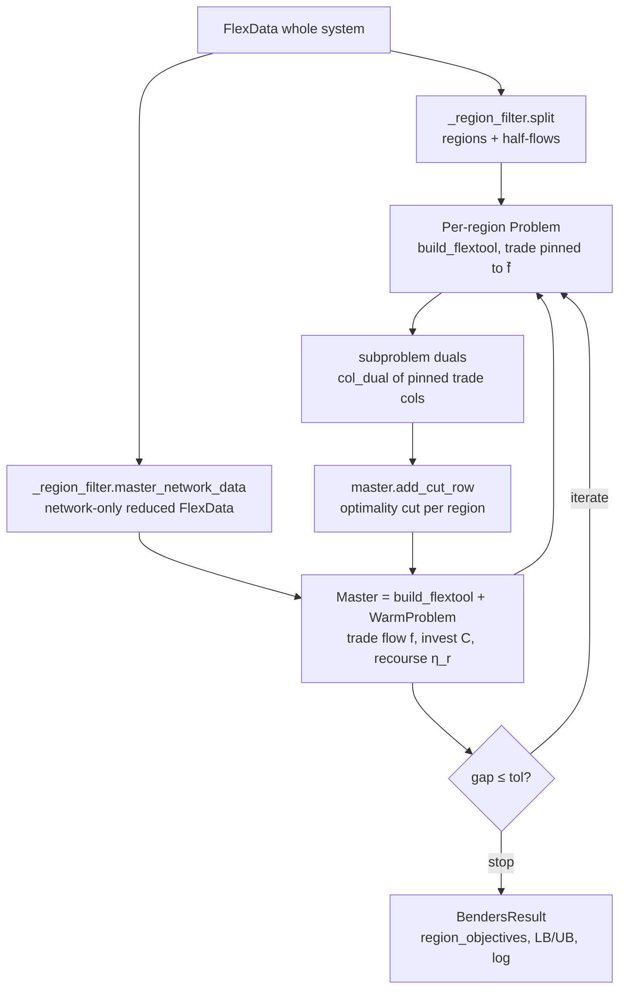

# Decomposition

Decomposition in FlexTool means splitting a monolithic LP into smaller
solvable pieces, then recombining their solutions. FlexTool supports
three independent flavours, all implemented natively in
`engine`:

- **Spatial / Benders** — partition the network into regions joined
  only by the inter-regional trade flows; a coordinating master holds
  those trade flows plus the trade-connection investment, and each
  region is an operational subproblem whose duals become optimality
  cuts the master accumulates until the optimality gap closes. Selected
  **per solve** from the database (`solve.decomposition = benders`); see
  [§2.8](#28-selecting-the-scheme-per-solve).
- **Flex-temporal** — balance some nodes at a coarser step than the
  solve (hourly power, daily hydrogen, …) in one LP; every flow stays on
  the solve's steps. Configured per node via `group.new_stepduration`.
- **Sequential / rolling / nested** — split a long horizon into
  overlapping windows (rolling) or into an outer long-horizon solve
  whose decisions feed an inner short-horizon solve (nested). The user
  configuration is in `solve.solve_mode` / `solve.contains_solves`; the
  engine wiring is in `solve/_recursive_solve.py` + `solve/_handoff.py`.

Spatial and flex-temporal are LP-level decompositions (one solve, many
sub-problems). Rolling / nested is a *meta*-level decomposition (one
chain of solves, each with its own LP). They compose, with one
exception noted in [§6](#6-where-they-compose).

The engine-side overview of the per-solve pipeline and warm-start /
Benders / cascade solve modes lives in
[engine.md](engine.md); this page focuses on the
decomposition mechanics themselves.

## 1. Picking a decomposition

| Symptom | Use |
|---|---|
| Monolithic LP slow, but the system has clear regional structure (multi-country grid, sparse interconnections) | Spatial / Benders |
| Power demand needs hourly resolution but some commodities (long-duration storage, hydrogen, district heat) only need daily / weekly resolution | Flex-temporal |
| Long horizon (decades, full reanalysis years) that does not fit one solve | Rolling |
| Long-term storage needs a multi-year view, but dispatch needs intra-week resolution | Nested |
| Capacity-expansion at coarse resolution + intra-week dispatch at fine resolution | Nested |
| Multiple operational scenarios sharing the same realised path | Nested + stochastic branches |

The three flavours are **orthogonal in intent** (a decomposition along
the geography axis, the time-resolution axis, and the horizon axis).
[§6](#6-where-they-compose) covers which combinations are actually
wired today.

## 2. Spatial / Benders decomposition

### 2.1 Concept

Benders decomposition splits the LP into a coordinating **master** and a
set of operational **subproblems**, one per region. The complicating
decisions — the inter-regional trade flows and the trade-connection
investment — live in the master; everything inside a region (its own
network, generators, storage, demand) is a subproblem solved with the
master's trade schedule **pinned**. Each subproblem returns the duals of
its pinned trade columns; the master accumulates those as **optimality
cuts** and re-solves. The master objective is a **valid lower bound** on
the true optimum; the incumbent feasible cost is the upper bound; the loop
stops when the optimality gap `(UB − LB) / |UB|` drops below tolerance.

This **replaces** the earlier dual-subgradient (Lagrangian) scheme, which
severed each cross-region arc into invest-less half-flows bounded near zero
and collapsed greenfield trade to an autarkic solution with an *invalid*
bound above the true optimum. Benders puts the trade investment and the
trade flow / capacity coupling in the master, feeds each region the
master's chosen flow as a pinned boundary injection, and returns a
certified lower bound and the true optimum.

The master is built by `build_flextool` over a **network-only reduced
`FlexData`** (`_region_filter.master_network_data`) — the SAME emit the
monolith uses — so the master picks up the trade `maxFlow` capacity
coupling, the invest annuity, and the connection flow cost natively and
**RP-weight-consistently**: the master's trade flow cost and the regions'
recourse costs are both weighted by the same representative-period /
timestep weights `build_flextool` applies everywhere, so summing them is
arithmetically the monolithic objective (no hand-rolled annuity, no
weight mismatch). One **recourse** variable `η_r` per region carries that
region's operational cost in the master objective.



### 2.2 Region declaration

Regions are `group` entities whose `decomposition_method` parameter
equals the string ``benders_regional``. The group's
`group__node` / `group__unit` / `group__connection` memberships list
the entities belonging to that region. The coordinator requires at
least two such groups in the active scenario; one is treated as an
error (use the monolithic path instead).

```python
# Spine input DB fixture sketch.
entities += [("group", "region_A"), ("group", "region_B")]
parameter_values += [
    ("group", "region_A", "decomposition_method", "benders_regional", ALT),
    ("group", "region_B", "decomposition_method", "benders_regional", ALT),
]
for r in ("A", "B"):
    for node in [f"elec_{r}", f"h2_{r}", f"battery_{r}"]:
        entities.append(("group__node", (f"region_{r}", node)))
```

The reference catalogue entry is `group.decomposition_method` in
[Groups](../reference/groups.md#decomposition-spatial-benders); the only accepted value is
`benders_regional` (the `_region` suffix makes the geographic flavour
explicit, leaving naming room for any future temporal variant). The
source of truth is
`flextool/engine/solve/_region_filter.py:load_decomposition_method`, which
reads the sub-solve provider's `input/p_group_decomposition` frame (a
provider is required; the work folder is never read).

### 2.3 Half-flow rewriting

Every connection whose endpoints straddle two region groups is
rewritten into a pair of **import / export half-flows** through a
virtual commodity node, one per region:

```
hf_<pipe>__export__<region_A>     (in region A, virtual sink node)
hf_<pipe>__import__<region_B>     (in region B, virtual source node)
```

Inside a region's standalone LP each half-flow is an ordinary `v_flow`
column. The export and import sides of an arc carry the **same flow** at
optimality. In the Benders scheme that consensus is enforced by the
master: each iteration **pins** every region's forward cross-region
half-flow to the master's current `f̄` per `(d, t)` (reverse pinned to 0)
before solving the region. The cut slope for `(arc, d, t)` is then the
reduced cost of the pinned forward column
(`Solution.col_dual[pin_col_id]` = `∂cost_r / ∂f̄`, basis-correct, no
monolith reference). The rewriter / half-flow metadata structure is in
`_region_filter` (`HalfFlow`, `Coupling`, `split`); the arc / pin
bookkeeping for the master lives in `_benders._build_arcs`.

Star topologies (more than two regions sharing one pipeline) are not
supported; the rewriter asserts bilateral arcs only.

### 2.4 Algorithm — master + multi-cut Benders loop

The master is a single `polar_high.Problem` wrapped in a
`polar_high.WarmProblem`, built ONCE and grown by appended optimality cut
rows. The loop:

1. **Bootstrap** `f̄ = 0`, solve every region, harvest the first cuts.
2. **Master solve** → new trade schedule `f̄` and invest `C`; the master
   objective is the lower bound `LB` (a *valid* global under-estimate —
   the whole point versus the old scheme).
3. **Subproblems**: pin each region's forward trade columns to `f̄`,
   solve, read `col_dual` of the pinned columns.
4. **Cuts**: append one optimality cut per region via
   `WarmProblem.add_cut_row`, bounding that region's recourse `η_r`.
5. **Upper bound**: `UB = master invest cost(C) + Σ_r cost_r(f̄)`;
   incumbent = best (min) `UB`.
6. Repeat from 2 until `gap = (best_UB − LB) / |best_UB| ≤ tol` or the
   iteration cap is hit.

The recourse vars and cut rows are appended through the polar-high
primitives `WarmProblem.add_recourse_col` and `WarmProblem.add_cut_row`;
each region subproblem is solved with `WarmProblem.solve(retry_on_unknown=
…)` so a transient HiGHS `kUnknown` is retried rather than aborting the
run. Each `η_r` is lower-bounded by a large-NEGATIVE finite floor (NOT a
hard `η ≥ 0`): FlexTool region costs can be negative, so a blind zero floor
could cut off the optimum; the finite floor is a provably valid global
under-estimate that keeps the cut-less iter-0 master optimal.

The two knobs:

| DB parameter (`solve` entity) | Default | Meaning |
|---|---|---|
| `benders_max_iter` | `50` | Outer-loop iteration cap |
| `benders_tolerance` | `1e-3` | Relative optimality-gap threshold (gap normalised by the incumbent UB) |

They are resolved per solve by `SolveConfig.benders_config_for`; a solve
that authors neither falls back to these defaults.

### 2.5 Existing vs investable trade capacity

The master handles existing and investable trade connections in ONE
build. An existing-only arc (`existing > 0`, no `invest_method`) carries
no invest variable; its flow is bounded by the existing unit count (`existing_count` = capacity / unitsize) through
the FlexTool `maxFlow` RHS (`p_flow_upper_existing`). An investable arc
gets a `v_invest` var and its capacity is bounded by `existing +
invested`. A greenfield arc (`existing = 0`) is unchanged — all its trade
capacity is invested `C`. Because the master is the SAME emit as the
monolith, the existing-capacity term and the invest annuity drop in with
no rescale, and the per-region half-flows are left **uncapped**
(`benders_uncap_cross_region=True`) so a positive master pin is always
feasible in the region.

### 2.6 Validity guard

A monolith-free **sandwich guard** is always on: `LB ≤ optimum ≤ best_UB`
must hold (`best_UB` is itself an upper bound on the optimum). An
`LB > best_UB` is the genuine invalid-lower-bound pathology — exactly the
bug this scheme fixes — and raises `RuntimeError` rather than reporting a
wrong-but-plausible optimum. No external big-`M` is needed.

### 2.7 Diagnostics

Every outer iteration logs the iteration index, the master `LB`, the
incumbent `UB`, and the current gap; the orchestrator also prints a final
convergence + LB/UB sandwich summary. The same data is available on the
returned `BendersResult`:

- `BendersResult.iteration_log` — per-iteration dicts (LB / UB / gap
  trajectory)
- `BendersResult.lower_bound` / `upper_bound` / `gap` — final values
- `BendersResult.region_objectives` — per-region recourse cost at the
  incumbent
- `BendersResult.converged` — True iff the gap dropped below `tol`
  before the iteration cap

Look for:

- the gap closing monotonically (LB rising, UB falling toward each
  other); a stalled gap usually means `benders_max_iter` is too low or
  the cut slopes are degenerate (a region whose pinned trade column is
  basic returns a zero reduced cost)
- region objectives broadly similar magnitude — one region dominating
  often means the cut placement is wrong (a major load centre ended
  up in a region with too little generation)

### 2.8 Selecting the scheme per solve

Decomposition is chosen **per solve, from the database** — there is no
CLI flag. Set `solve.decomposition = benders` on the solve(s) you
want decomposed, optionally overriding the two `benders_*` knobs:

| `solve` parameter | Value list / type | Default | Effect |
|---|---|---|---|
| `decomposition` | `decomposition_schemes` = {`none`, `benders`} | `none` | `benders` routes this solve through `solve_benders`; `none` solves it monolithically |
| `benders_max_iter` | float | `50` | Outer-loop iteration cap |
| `benders_tolerance` | float | `1e-3` | Relative optimality-gap threshold |

Because the decision is per solve, a single chain can mix schemes — for
example a Benders investment solve followed by a monolithic
full-resolution dispatch solve. The orchestrator
(`engine.solve._orchestration`) reads each solve's resolved
`decomposition` value as it iterates `model.solves`. This is distinct
from the group-level `group.decomposition_method`
(`none` / `benders_regional`), which declares *which groups are
regions*; `solve.decomposition` declares *whether a given solve
decomposes*. Benders still requires at least two `benders_regional`
groups.

**Invest → dispatch handoff.** A Benders investment solve assembles the
owner-selected invested trade + in-region capacity into a whole-system
`SolveHandoff` (the TIER-1 invest→dispatch chain) so a downstream rolling
or monolithic dispatch solve consumes the realised capacity exactly as it
would after any other invest solve. The orchestrator records which Benders
solves produced an invest handoff and threads it forward; a downstream
solve that would consume a Benders solve which produced none is rejected
loudly rather than silently dropping the link.

The `--region <GROUP_NAME>` flag is a separate, filter-only entry
point that emits a per-region input directory and exits without
solving — useful for inspecting how the rewriter sees a given region.

### 2.9 Reference implementation

| Symbol | Module |
|---|---|
| `solve_benders(data, *, ...)` — top-level entry | `flextool/engine/solve/_benders.py` |
| `BendersResult` — return type | same |
| `Coupling`, `_build_arcs`, the master + cut loop | same |
| `master_network_data` (network-only reduced FlexData for the master) | `flextool/engine/solve/_region_filter.py` |
| `RegionSplit`, `HalfFlow`, `split` | same |
| `load_decomposition_method` (reads ``decomposition_method`` from the provider's `input/p_group_decomposition`) | same |
| `WarmProblem.add_cut_row` / `add_recourse_col` / `solve(retry_on_unknown=…)` | `polar_high` (external) |

The per-solve routing lives in `flextool/engine/solve/_orchestration.py`
(`_PolarHighCascadeSolver._run_benders_solve`, driven by
`SolveConfig.decomposition_for`). The Benders path is also surfaced
as a "Solve modes" entry in
[engine.md § Solve modes](engine.md#solve-modes).

## 3. Flex-temporal decomposition

### 3.1 Concept

Mixed-resolution scheduling: some nodes (power demand, VRE, batteries)
need fine timesteps; others (long-duration storage, hydrogen, district
heat) only need a coarser energy balance.  A node of a group whose
`new_stepduration` is longer than the solve's step is a *coarse node*:
it is balanced once per coarse step by summing its fine balance terms
(`nodeBalanceCoarse_eq`), and a coarse storage node keeps one state per
coarse step (`stateConstantCoarse_eq`).  An arc between a fine and a
coarse node stays on the solve's steps and enters both balances, so it
conserves energy at both ends without any per-arc weights or filters.

A unit or connection whose every balance node is coarse is a *coarse
process* (`params._coarse.coarse_process_frames` → `processCoarse`,
`process_coarse_step`): its flows, units online, start-ups / shut-downs,
reserve and the direction of an exact connection have one column per
coarse step (`model/_coarse_flows`, §3.6).  Only a process with a delay
keeps the solve's steps (`flex_data.coarse_process_exclusions`), plus
Benders cross-region arcs and master flows (§3.5), stochastic processes
whose coarse step a forecast tie covers in part
(`flex_data.coarse_tie_straddles`) and realization-solve processes whose
pin varies within a step (`flex_data.coarse_pin_varies`); an info line
names each with its reason.

This is structurally different from the Benders path: there is one
LP, one HiGHS run, no outer loop.

### 3.2 Schema surface

| Parameter | Entity | Effect |
|---|---|---|
| `solve.new_stepduration` | `solve` | Solve-wide step (aggregates the solve's timeline) |
| `group.new_stepduration` | `group` | The group's balance / storage nodes are balanced per coarse step of this length (when longer than the solve's step) |
| `group.decomposition_method` | `group` | Benders region groups |
| `group__node` | (relation) | The coarse nodes |
| `group__unit` / `group__connection` | (relation) | No effect on time resolution (a warning names a listed process that touches a node outside the group — Q-c15-A) |

Validation in `validate_group_membership`:

- every entity may belong to at most one resolution-group
- every entity may belong to at most one decomposition-group (the
  Benders region groups counted here too)
- reserve participants may sit in a resolution-group (a coarse provider
  holds one reserve per coarse step; the requirement stays per solve step)

Validation in `params._coarse.coarse_node_frames`: a group step that is
not a multiple of the solve's step, a fine step crossing the end of a
coarse step, a coarse step that would straddle a representative period,
and a `bind_intraperiod_blocks` node in a coarse group raise
`FlexToolConfigError`; a group step shorter than the solve's step is
ignored with a warning.

### 3.3 Block layout and coarse steps

`emit/_blocks.py` (production) and its port `BlockLayout.build` (in
`_block_layout.py`) emit the per-solve block frames:

- `entity_block` — `(entity, block)`: each node's group, else `default`
- `block_step_duration` — `(block, period, step, step_duration)`
- `overlap_set`, `block_step_previous`, `block_period_time_first/_last`

The model reads the node → group map and the group step durations from
these frames and the default block's period boundaries
(`nodeState_last_dt`).  The per-block aggregated timelines of the coarse
blocks are a plain chunking of each period and do not feed the model.

The coarse steps come from one place, `params._coarse.coarse_node_frames`,
called at the end of `load_flextool` for every solve, roll, nested and
stochastic sub-solve.  It takes the solve's own steps (`dt` in order, step
durations, `dtttdt`), splits each period into runs of consecutive steps — a
run ends where `t_previous_within_timeset` is not the step before (a gap, a
timeset block start, a period or roll start), at every representative-block
start (`rp_block_first`) and after the period's last realized step (a roll's
realized end, so the state a roll hands over excludes look-ahead flows) — and
chunks each run from its start: a coarse step closes once its fine durations
add up to the group step (a run that is not a multiple ends with a shorter
step).  Result: `nodeCoarse (n)`, `node_coarse_step (n, d, b_first, t)` and
`node_coarse_interior (n, d, t, t_previous)`.

### 3.4 The coarse balance

`nodeBalanceCoarse_eq[n, d, b]` is `nodeBalance_eq` summed over the fine
steps `t ∈ b`: flows, slacks, the state change of the node's binding
method, the `fix_start` and roll-continuation start terms and
self-discharge, with the summed `−inflow` as RHS.  With the state constant
inside the coarse step the state terms telescope to
`v_state[b⁻] − v_state[b]`, so every storage binding method applies.
Same orientation and units as `nodeBalance_eq`: its dual is the node's
price over the coarse step.  `bind_intraperiod_blocks` nodes have the
same summed row per timeset block (`nodeBalanceBlock_eq`) with the block
lag `dtttdt_block_lag` (the blocks of a period form a loop; in a rolling
solve the blocks also end at the roll's realized end, and in a period the
roll holds only in part — `period_block_chain`, from
`solve_data/roll_period_whole` — the lag is the `bind_forward_only` lag,
so the blocks chain forward and the roll carry starts the chain).

### 3.5 Paths

- **Rolling / nested / stochastic:** every sub-solve builds its own
  coarse frames from its own steps; nested `fix_price` reads the coarse
  row's dual for a coarse parent node.
- **Benders:** region subproblems and the master filter the coarse frames
  by node; half-flows enter coarse rows like any arc, so a region↔master
  boundary may join nodes of different resolutions.  Cross-region arcs and
  master flows stay on the solve's steps (`_region_filter`); a process
  inside one region may be coarse in its subproblem.
- **Warm start:** the coarse frames are in the fingerprint.

### 3.6 Coarse processes and the row rule

`model/_coarse_flows` (module docstring is the reference):

- **Levels** (`v_flow(_back)`, `v_online_*`, `v_reserve`,
  `v_exact_forward`; `v_angle` of a coarse-angle node, `vq_inertia` /
  `vq_non_synchronous` of an averaged row) are registered at each coarse
  step's first fine step `b_first` and read through `alias`, which maps
  every fine row to its step's column.
- **Events** (`v_startup_*`, `v_shutdown_*`) live at `b_first` only and are
  not aliased; minimum up / down times count whole coarse steps.
- **Arc-local rows** (capacity, conversion, profiles, online capacity,
  minimum load, start-up / shut-down reduction, reserve limits) are written
  once per coarse step as the twin family `<family>_coarse`, the
  Δt-weighted average of the fine row (`add_cstr`).
- **Row rule** (`add_row_rule_cstr`, `row_partition`;
  `flex_data.coarse_row_members` / `COARSE_ROW_FAMILIES`): a row coupling
  several entities (capacity margin, inertia, non-synchronous, flow-group
  instant flow, user constraint, forecast storage-use tie, DC power flow)
  whose every member is coarse is one averaged `<family>_coarse` row per
  coarse step; a row with a fine member stays per solve step and reads the
  coarse terms at their constant value.  The reserve requirement
  (`reserveBalance_*`) is always per solve step.
- Ramps run between coarse steps (`ramp_rows`, `reserve_room_rows`).
- The behaviour notice `coarse_process_flows` (upgraded databases only)
  names coarse processes whose result can differ from the fine model
  (`flex_data.coarse_process_reasons`).

### 3.7 Outputs

Every reader of a coarse variable expands it to the solve's steps through
`engine/output/_coarse_flows` (`COARSE_VARS`: `copy` for levels, `first`
for events — the whole start-up at the step's first fine step, 0 at the
others, so totals and costs are the LP's); a grep gate in the tests keeps
direct reads out.  A coarse storage state is constant within its coarse
step.  Coarse-node prices are the `nodeBalanceCoarse_eq` duals broadcast
to the fine steps of each coarse step
(`read_highs_solution._broadcast_block_node_duals`).

### 3.8 Caveats

- A process with a delay keeps the solve's steps (its flow is shifted by
  solve steps).
- An averaged row sees step means: a capacity margin covers the mean net
  demand of the step, not its peak.

The engine-side overview of flex-temporal lives in
[engine.md § Flex-temporal decomposition](engine.md#flex-temporal-decomposition).

## 4. Rolling / nested solves

These are user-facing patterns documented in
[Solve sequences, rolling and nested solves](../how_to/solve_sequences.md); this section covers the engine wiring.

### 4.1 Rolling

A long horizon is split into overlapping optimisation windows. Each
window ("roll") is its own LP; the next window starts at the previous
window's "jump" point with the storage state at that point fixed.

Schema:

- `solve.solve_mode = rolling_window`
- `solve.rolling_solve_jump` — interval between roll start points
  (also the output interval per roll)
- `solve.rolling_solve_horizon` — length of the roll's optimisation
  horizon (`> jump`; the overlap is `horizon - jump`)
- `solve.rolling_duration` — optional total horizon length;
  ``-1`` (or unset) means "until the active time list is exhausted"

Engine wiring:

- `RecursiveSolveBuilder.create_rolling_solves` in
  `_recursive_solve.py` expands the parent solve into a sequence
  ``solve_roll_0, solve_roll_1, …`` with per-roll active-time and
  realized-time lists.
- Per-roll storage carry-over rides
  `SolveHandoff.roll_end_state` (`solve/_handoff.py`), routed to the
  sub-solve that continues from it by `solve/_carry_routing.py`.
- Every roll builds its own LP: the in-process `polar_high.WarmProblem`
  is reused only for an identical sub-solve (every `FlexData` field,
  labels included, and the solver configuration), and a roll's `dt`
  labels always shift. See
  [engine.md § Warm-start cascade](engine.md#warm-start-cascade-polar_highwarmproblem).

### 4.2 Nested

An outer long-horizon solve fixes long-term decisions (capacity, long-
term storage state at chosen anchor periods); an inner short-horizon
solve dispatches within those decisions.

Schema:

- `solve.contains_solves` — array of child solves run after the parent
  using the parent's realised data
- `solve.fix_storage_periods` — periods where the parent's last
  storage value becomes a target for the child
- `node.storage_nested_fix_method` — how the child handles the
  fix-storage target (`fix_quantity` / `fix_price` / etc.; `fix_price`
  requires `storage_state_reference_price`)

Engine wiring:

- The `RecursiveSolveBuilder` walks the solve tree at
  ``define_solve_recursive`` time and threads `ParentSolveInfo` into
  nested children.
- The parent's realised capacity / storage state rides
  `SolveHandoff.realized_invest` / `realized_existing` /
  `fix_storage` / `fix_storage_timesteps`.
- The child's preprocessing reads from `state.handoffs[parent_name]`
  (in memory; there is no disk fallback).

The single-matching-period rename quirk: when a child solve's period
set intersects its parent's by exactly one period, the child is
renamed ``solve + "_" + period`` and `SolveConfig.derive_solve` gives
the new name a copy of every per-solve setting of the child
(`PER_SOLVE_FIELDS`, solver settings included). Preserved verbatim
from the legacy preprocessor.

### 4.3 Stochastic branches

Each branch is itself a sub-solve in the chain. `solve.stochastic_branches`
is a 4-D map that decorates affected periods with branch-suffixed
clones (`y2025` → `y2025`, `y2025_low`, `y2025_high`). Only the
realised branch contributes to `realized_time_lists` and
`fix_storage_time_lists`; the other branches' LP variables exist for
the optimisation but do not enter the realised outputs.

The wiring lives in `_stochastic.StochasticSolver` (called from
`RecursiveSolveBuilder`); non-anticipativity constraints are emitted
by `_non_anticipativity.py` (`add_dispatch_constraints`, `add_invest_constraints`). See
[engine.md § Stochastic branches](engine.md#stochastic-branches).

## 5. RELEASE notes context

The 3.29.0–3.33.0 release cycle is the relevant window for these
features. Quick map (full text in
[release.md](../release.md) or `CHANGELOG.md`):

- **3.29.0** — Flex-temporal decomposition lands. `v50` migration
  moves `new_stepduration` from `timeset` to `solve`. `v51` adds
  group-level `new_stepduration` + `decomposition_method`.
- **3.30.0–3.32.0** — Block-aware emitters complete (then known as writer ports); output
  expansion stabilises.
- **4.0.0 (`v60` migration)** — spatial decomposition becomes DB-driven
  and per-solve: `solve.decomposition` plus per-solve knobs. The global
  `--decomposition` CLI flags are removed; the orchestrator routes each
  solve from its DB value.
- **4.0.0 (`v62` migration)** — the spatial scheme switches from the
  dual-subgradient (Lagrangian) coordinator to **Benders**. The
  `decomposition_schemes` value `lagrangian` → `benders` and the group
  method `lagrangian_region` → `benders_regional`; the old
  `lagrangian_alpha` / `lagrangian_max_iter` / `lagrangian_tolerance`
  knobs are dropped and replaced by `benders_max_iter` (50) /
  `benders_tolerance` (1e-3). Existing DBs are auto-migrated (breaking
  schema change, DB version 62). The Benders invest solve threads its
  realised capacity into a downstream dispatch solve (TIER-1
  invest→dispatch handoff).

## 6. Where they compose

| Combination | Supported | Notes |
|---|---|---|
| Benders + flex-temporal | Yes | Region subproblems and the master filter the coarse-step frames by node; a region↔master boundary may join nodes of different resolutions (the half-flows are hourly on both sides). |
| Benders + rolling | No | One Benders solve is the unit of work for the outer rolling loop. Not currently wired; would require per-roll cut warm-start. The TIER-1 invest→dispatch handoff threads a Benders *invest* solve into a downstream *rolling dispatch* solve, which is the supported pattern. |
| Benders + nested | Partial | The outer (parent) solve can be Benders, but the parent's handoff to children propagates only the invest→dispatch capacity, not per-region operational state. Treat as untested beyond the invest→dispatch chain. |
| Flex-temporal + rolling | Yes | Each roll cuts its own coarse steps; a coarse step ends at the roll's realized end, and the roll carry reaches the first coarse row. |
| Flex-temporal + nested | Yes | Each parent / child solve builds its own coarse steps; `fix_price` reads a coarse parent node's coarse-row dual. |
| Flex-temporal + stochastic | Yes | Every branch period gets its own coarse steps; a branch's first coarse row starts from the trunk's state. |
| Rolling + nested | Yes | The legacy "more than one solve in a rolling solve" raise still trips for unsupported sibling-rolling-children patterns. |
| Rolling + stochastic | Yes | Each roll can carry branches; the realised branch chains forward. |

## 7. See also

- [engine.md](engine.md) — the engine guide; Solve modes
  section covers monolithic / warm / Benders and Flex-temporal
  decomposition section covers the coarse-group frames.
- [architecture.md](architecture.md) — top-level architecture; how the
  decomposition pieces fit into the larger pipeline.
- [scaling.md](scaling.md) — auto-scaling pipeline; runs per
  sub-problem, so each region / each roll / each block gets its own
  scaling pass.
- [Model parameters](../reference/index.md) — the parameters touched here:
  `solve.solve_mode`, `solve.rolling_solve_jump`,
  `solve.rolling_solve_horizon`, `solve.contains_solves`,
  `solve.fix_storage_periods`, `solve.stochastic_branches`,
  `solve.new_stepduration`, `group.new_stepduration`,
  `group.decomposition_method`, `node.storage_nested_fix_method`.
- [How-to recipes](../how_to/index.md) — practical recipes for setting up
  Benders regions, rolling windows, nested solves, and stochastic
  branches.
