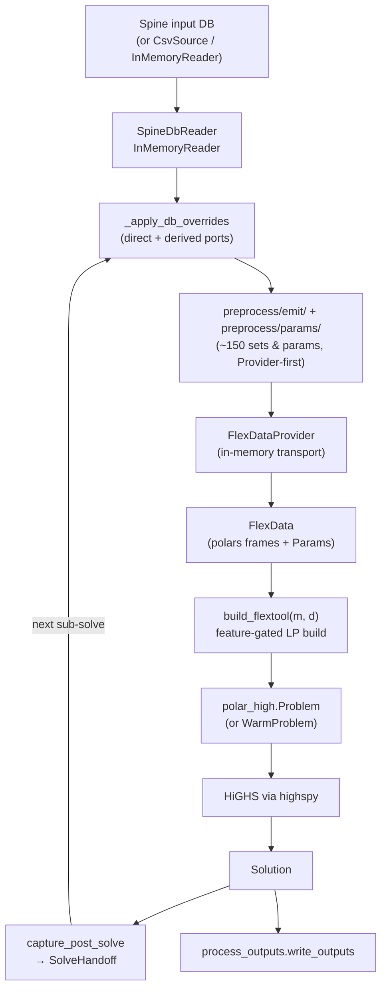

# The engine pipeline

`flextool/engine/` is FlexTool's in-memory optimization engine. It
reads a Spine input DB (or a CSV workdir, or an in-memory test fixture)
into a single typed dataclass, runs ~150 derived-parameter helpers to
populate the rest of the dataclass, builds an LP feature-by-feature on
top of the upstream `polar_high` eDSL, and hands the HiGHS-via-`highspy`
solution off to either the next solve in a cascade or to
`process_outputs`.

This page is the developer-side deep dive — the folder map is in
`flextool/engine/README.md` and the feature table on
[architecture.md](architecture.md); here we walk the pipeline in the
order a bug or extension actually traverses it.

!!! note "Two repositories"
    `polar_high` is the standalone LP eDSL — sets, parameters,
    variables, lazy constraint composition, warm-LP machinery, and
    the Benders cut / recourse primitives. `engine` is the
    FlexTool-side glue:
    it knows the on-disk layout of the input/ + solve_data/ CSVs
    and the shape of FlexTool's optimization model. `polar_high`
    knows nothing of FlexTool.

## Per-solve pipeline



Side-paths off this trunk:

- **Rolling-horizon / nested**: every iteration loops back through
  `overlay` carrying a `SolveHandoff`. When the LP shape is unchanged
  the cascade re-uses the live `WarmProblem`; when it isn't, the
  cascade cold-rebuilds.
- **Stochastic branches**: `_stochastic.py` decorates per-solve
  active-time lists with branch-suffixed periods before `overlay`
  sees them. Branched periods get LP variables; only the realized
  branch contributes to handoff carriers.
- **Spatial Benders**: `_benders.solve_benders` slices a
  single `FlexData` into per-region copies via `_region_filter`,
  builds a coordinating master (trade flows + trade invest + one
  recourse per region) plus one operational sub-problem per region,
  and accumulates the sub-problems' duals as optimality cuts until
  the optimality gap closes.

## FlexData — the central data carrier

`FlexData` (in `flex_data.py`) is a `@dataclass` of roughly 220 fields. Five
fields are positional and always present (the time / weighting / node
floor); every other field defaults to `None` and is filled in only when
the scenario exercises the corresponding feature.

The naming convention is documented on the class:

- Sets — index frames, `pl.DataFrame`, no prefix. Example:
  `nodeBalance`, `process_source_sink`, `pss_dt`, `nodeState`,
  `cdt_eq`, `dtttdt`.
- Parameters — numeric `polar_high.Param`, `p_*` prefix. Example:
  `p_inflow`, `p_unitsize`, `p_commodity_price`, `p_step_duration`.
- Variables created later by `build_flextool` are `v_*` for primal
  and `vq_*` for slack.

The contract carried throughout the engine is simple: **a field is
either populated with a non-empty frame / Param, or it is `None`**.
Populating with an *empty* frame is legal — that signals "this feature
class is enabled, but no rows in this partition" (e.g.
`process_source_sink_noEff` empty because every process is in the eff
partition). `None` always means "loader didn't touch this field".

### Data sources

The loaders are stacked on two protocols defined in `_input_source.py`:

| Source | Implementation | When used |
|---|---|---|
| `CsvSource` | `_input_source.py` | Loads from an on-disk `input/` + `solve_data/` workdir. Used by tests and by `load_flextool(path_or_csv_source)` against pre-built fixture workdirs. |
| `SpineDbReader` | `_spinedb_reader.py` | The DB-direct reader — returns one polars frame per `(entity_class, parameter_name)` pair, no CSV roundtrip. Consumed by the override chain in `_apply_db_overrides` and by the live cascade entry point `run_chain_from_db`. |
| `InMemoryReader` | `_inmemory_reader.py` | Same `InputSource` protocol as `SpineDbReader`, but driven by an in-memory dict-of-frames fixture. The vehicle for fast unit tests under `tests/engine/`. |

`FlexInputSource` (CSV-shaped) and `InputSource` (per-parameter frame)
are deliberately two protocols, not one: the legacy CSV reader path
walks directories, the DB-direct path requests one parameter at a time.
They coexist — `load_flextool` accepts either, and a Spine DB load
typically uses both (CSV side for the bulky pre-computed sets, DB side
for the parameters the override chain owns).

### Per-field shapes

The shape registry lives in `_param_shapes.py`. Every parameter known
to the engine has an entry in `PARAM_ALLOWED_SHAPES` listing the
shapes FlexTool's preprocessing is allowed to emit (scalar,
`1d_map[period]`, `1d_map[time]`, `2d_map[period,time]`,
`2d_map[time,period]`, …). The resolver
(`resolve_param_shape`) reads the actual nesting depth and per-level
`index_name` labels from the DB, validates against the allow-list, and
raises `FlexToolConfigError` on a mismatch.

This DB-driven validation matters because a 2D parameter authored as
`Map[time, period]` versus `Map[period, time]` has the same column
*names* in polars but the opposite axis semantics. Column-shape
detection misses the difference; the per-level `index_name` doesn't.

## LP build: `model/core.py` and the feature modules

`build_flextool(m, d)` builds the LP into the `polar_high.Problem` `m`
from the `FlexData` `d`. Its body is a table of contents: a list of
steps run in order, each taking the `_Build` context `b` (the problem,
the data, the `has_*` feature flags, shared index sets, variables and a
few shared expressions):

1. `_prepare` — declares the dense axes, sets the `has_*` flags from the
   data, checks required fields and builds the shared index sets
   (`pss_dt`, `nodeBalance_dt`, `nodeState_dt`, …).
2. `_declare_variables` — the one place where the decision space is
   assembled: core variables are declared here and the feature modules'
   `add_variables(b)` are called from here. Declaration order is the LP
   column order.
3. `_shared_expressions` — expressions read by several families (reserve
   coupling sums, invest/divest-in-dispatch sums, `op_factor`).
4. One `_eq_<family>(b)` per core equation family, in emit order,
   interleaved with the feature modules' `add_constraints(b)`.
5. `_obj_<family>(b)` and the modules' `objective_terms(b)` return their
   term (or `None`); `build_flextool` sums them in order and calls
   `m.set_objective`.

Every family function starts with an early-return guard on its flag
(`if not b.has_storage: return`), so a feature whose data is empty emits
nothing. The `model/core.py` module docstring is the map: every variable with
its dims and unit, and every equation family in emit order with the
module it lives in. Each row, objective term and variable carries an
`EQ.` / `OBJ.` / `VAR.` header with its formula, so
`grep -rn "EQ. ─── maxFlow" flextool/engine` finds an equation.

**What lives where.** `model/core.py` holds the core model that every run
uses: node balance, storage state, flows and capacity, conversion,
investment maxima, CO2 caps, user constraints, profiles and the core
objective. An optional feature that brings its own variables or rows
lives in its own module, exposing the parts of the interface it needs —
`add_variables(b)`, `add_constraints(b)`, `objective_terms(b)`:
`_online` (unit commitment), `_unit_floors` (minimum load and
reserve headroom), `_reserve`, `_group_slack` (capacity margin, inertia,
non-synchronous share), `_cumulative_invest` (investment floors and
group / cumulative / flow-group limits), `_commodity_ladder`,
`_dc_power_flow`, `_exact` (direction switch of `exact` connections),
`_delay` (delayed inputs, used by `conversion_indirect`) and
`_non_anticipativity` (stochastic ties).
Small helpers shared by these live in `_common`.

**Emit order is part of the LP.** Row and column order decide which
alternate optimum the solver returns, so moving a step in the table of
contents (or a variable in `_declare_variables`) changes results on
degenerate models. Check the effect with `tools/lp_snapshot.py`
(see CONTRIBUTING.md "Running Tests").

### Required fields

The data each feature needs is declared as module-level tuples at the
top of `model/core.py`:

```python
ALWAYS = ("dt", "nodeBalance",
          "p_step_duration", "p_timestep_weight", "p_inflation_op", "p_period_share",
          "p_inflow", "p_penalty_up", "p_penalty_down")
PROCESSES = ("process_source_sink", "process_source_sink_eff", "process_source_sink_noEff",
             "flow_to_n", "flow_from_commodity_eff", "flow_from_commodity_noEff",
             "p_unitsize", "p_flow_upper", "p_slope", "p_commodity_price")
STORAGE = ("nodeState", "dtttdt", "p_state_upper", "p_state_unitsize")
ONLINE = ("process_online", "p_online_dt", "p_min_load",
          "dtttdt", "p_process_existing_count")
# ... INDIRECT, CO2_CAP, CO2_CAP_TOTAL, USER_CSTR, PROFILES, MINLOAD_EFF,
#     STARTUP_COST_LINEAR, STARTUP_COST_INTEGER, RAMP, INVEST, DIVEST
```

`_prepare` runs `_check(d, ALWAYS, "always")`, sets each flag from its
switch field (e.g. `has_storage` from `nodeState`, `has_indirect` from
`process_indirect`) and calls `_check(d, TUPLE, "name")` for every
active flag. The check is **fail-fast**: if the switch is set but a
required field is `None`, it raises `ValueError`. No silent degradation.

`_prepare` also declares FlexTool's dense trailing axes with
`m.declare_dense_axes(("d", "t"))` — `(period, timestep)`. This
unconditional call requires **polar-high>=2.4.0** (the version pin lives
in `pyproject.toml`). Declaring the dense axes lets polar-high build the
canonical matrix via the block-COO slice path: the pre-sorted dense axis
is sliced as contiguous numpy blocks and the coefficient factors are
multiplied with ufuncs, instead of wide relational joins. `Sum`-wrapped
chains (FlexTool's `Sum`-heavy nodeBalance / reserves / co2 families)
evaluate in a single pass via a captured `SumBlockMeta` recipe with a
relabel fast-path. The block-COO output is bit-identical to the legacy
polars path — the gain is the LP build's peak memory and wall time, not
the LP itself.

### Worked example: storage

1. Flag and fields: `b.has_storage` is set when `nodeState` has rows;
   `STORAGE` lists `nodeState`, `dtttdt`, `p_state_upper`,
   `p_state_unitsize`.
2. Variable: `v_state[n, d, t]` over `nodeState_dt`
   (`_declare_variables`), in units of the state unitsize. Its upper
   bound depends on invest/divest, so it is the `maxState` row
   (`_eq_max_state`), not a variable bound.
3. Constraints: the state change enters `nodeBalance_eq` through
   `_state_change_terms`, one term per `storage_binding_method`, using
   the predecessor lookup `dtttdt` from `_timeline.py`. Start binding,
   cyclic period binding, state profiles and the solve-horizon reference
   value are `_eq_storage_start_binding`,
   `_eq_storage_start_binding_cyclic`, `_eq_state_profiles` and
   `_eq_storage_reference_value`.
4. Objective: `_obj_storage_reference_price` when a reference price is
   set; otherwise only the balance slack penalties.

A bug report like "storage transition wrong at the period boundary"
walks straight back to `_state_change_terms` and the frames it reads:
most often `dtttdt` or `storage_bind_forward_only`, both populated by
the loader.

### RP-blended-weights inter-period coupling

Representative-period storage (`b.has_rp`, set when `d.nodeState_rp`
has rows — the union of nodes whose `storage_binding_method` selects one
of the blended-weights variants) adds the variables and constraints that
close representative-period storage state across base periods. It
extends ordinary storage and shares the `v_state` declaration; on top it
adds:

| Element | Where | Role |
|---|---|---|
| `v_state_inter[n, d, b]` | `model._declare_variables` | Long-run state at the end of base period `b` of period `d`, free per `(n, d, b)`. Every period has its own base periods, also when two periods share a timeset or a timeline (the same base-period names). |
| `v_state_rp_start[n, d, t]` | `model._declare_variables` | Free starting state at the first step of each RP block. |
| `nodeState_rp_dt` | `_pdt_join.compute_nodeState_rp_dt` | The `(n, d, t)` join used to project `v_state` rows onto the RP cohort. |
| `nodeState_rp_block_first_dt` | `_pdt_join.compute_nodeState_rp_block_first_dt` | Index set for `v_state_rp_start` — RP-block-first `(d, t)` tuples per RP node. |
| `state_change_rp_interior` / `state_change_rp_start` | `model._state_change_terms` (`nodeBalance_eq` terms) | Intra-period state-change. Interior steps use the ordinary within-timeset lag; the first step of each RP block replaces the lag with `v_state_rp_start` so each block starts free. |
| `rp_inter_period_balance` | `model._eq_rp_storage_chain` | Inter-period balance over `(n, d, b, d′, b′)`: the within-period edges `(d, b, b′) ∈ rp_base_chain` (`d′ = d`) for every `nodeState_rp` node, and for the within-solve / forward-only variants the period-to-period edges `(d, d′) ∈ rp_period_previous` from the last base period of `d′` to the first of `d` (solve order, the predecessor the `bind_within_solve` state lag uses). The drift sums the per-RP-block state change weighted by `rp_base__rep[d, b, r]`. |
| `rp_inter_period_cyclic` | `model._eq_rp_storage_chain` | End-to-start closure: within-period — every rp period's first base period ← its own last; within-solve — the first rp period's first base period ← the last rp period's last. The forward-only variant skips this constraint. |
| `rp_inter_period_max_state` | `model._eq_rp_storage_chain` | Capacity bound on `v_state_inter[n, d, b]` over `(n, d, b) ∈ nodeState_rp × rp_base_period`, `d ∈ period_in_use` (a base period of `d` by `d`'s capacity), tightened by cumulative invest/divest exactly as the ordinary `maxState`. |
| `maxState_rp_start` | `model._eq_rp_storage_chain` | Sibling capacity bound on `v_state_rp_start[n, d, t]` over `rp_block_first`. Both bounds depend on invest/divest, so they are rows rather than variable bounds. |

The three blended-weights methods that activate the block —
`bind_within_solve_blended_weights`, `bind_within_period_blended_weights`,
and `bind_forward_only_blended_weights` — are projected from the user-side
`storage_binding_method` value list by
`storage_bind_within_solve_blended_weights` /
`storage_bind_within_period_blended_weights` /
`storage_bind_forward_only_blended_weights` in `_projection.py`,
which populate the corresponding `FlexData` fields. `nodeState_rp` is
the union (the inter-period constraints all share it); the cyclic
constraint further filters back to the within-solve / within-period
subset because the forward-only variant deliberately leaves the chain
open.

The on-disk `rp_weights` carrier is authored as a flat triple
`(base_start, rep_start, weight)` and decoded by
`_timeline._decode_rp_weights`, which accepts both the nested Map
shape and the flattened list-of-Maps shape Spine produces depending on
import path. Both decode to the same nested
`{base: {rep: weight}}` dict that
`_solve_writers._compute_rp_frames` converts into the per-solve
`rp_weights` frame and from which it derives the `rp_base_chain`,
`rp_base_first`, `rp_base_last`, `rp_block_*` and `rp_base_period_set`
companion sets, one set of rows per period of the solve (every frame has a
`period` column), plus `rp_period_previous` (the rp periods in solve
order).  `solve/_run_model.py` emits them for every period whose timeset
has `representative_period_weights`; periods without keep their
`timeset_weights` rows in the same `timestep_weight` frame.  A solve with
stochastic branch periods and an rp timeset, a rolling solve with
blended-weights nodes, and a solve that mixes rp and other periods while it
has blended-weights nodes stop with an error. See architecture.md
[Feature flags in `build_flextool`](architecture.md#feature-flags-in-build_flextool)
for the entry in the gating table.

## Emitters (formerly writer ports)

About 150 sets and calculated parameters that used to be `param := ...`
declarations in the retired `flextool.mod` are now produced in Python
by the modules in `preprocess/emit/` and `preprocess/params/`. They all share a
common shape:

- Input: a `FlexData` populated with the prior phases' fields, plus a
  source plugin (`InputSource` or `FlexDataProvider`).
- Output: one or more frames published to `FlexDataProvider` under the
  canonical key declared in `_provider_keys.py`; downstream consumers
  read by key.
- Purity: every helper either fully populates its target keys or
  leaves them absent — no half-populated state.

The split between `preprocess/params/` and `preprocess/emit/` is
historical, not semantic. `emit/` holds the ports of the modules that
wrote `solve_data/*.csv` in the legacy preprocessing; `params/` holds
the ports of the modules that produced computed parameters
in-process. Both are now just Python functions writing into the
Provider.

Representative entries:

| Module | Produces |
|---|---|
| `_block.py` | `BlockLayout` fan-out — per-entity blocks, overlap sets, block step durations. |
| `_branch.py` | `period_branch`, `pdt_branch_weight`, `pd_branch_weight` — stochastic branch weighting. |
| `_existing.py` | `p_entity_all_existing`, `p_entity_previously_invested_capacity` — cross-solve existing-capacity composition. |
| `_npv.py` | Annualized investment / divestment carriers feeding the objective. |
| `_profiles.py` | `p_profile_value` and the `p_process_existing_count` factor used by profile-bound constraints. |
| `_walks.py` | Backward / forward step lookups (`dtttdt`, `dtttdt_forward_only`, the block-interior variant). |
| `_arc_unions.py` | Arc set algebra: `flow_to_n`, `flow_from_n`, the commodity-flow joins, the reverse-arc additions for connections. |
| `_calc_params.py` | The `pdtX` / `pdX` per-step parameter cascade. |
| `_co2_accumulators.py` | Cumulative-CO2 ladder feeding the CO2-cap constraint. |
| `_pdt_params.py` | The full `pdt_*` family (online indices, varCost frames, …). |
| `_period_calc.py` | `p_period_share`, `complete_period_share_of_year`, `p_timeline_duration_in_years`. |
| `_reserve_sets.py` | Reserve-up / reserve-down set machinery for `_reserve.py`. |
| `_provider_io.py` | The single Provider-funnel (`_emit`, `_provider_key`, `_provider_open`) every emitter routes through. |
| `_vectorize.py` | Shared per-roll vectorize helpers: the entity × dt and entity × period grids (carrying `__eo` / `__to` / `__po` order keys), the dict→lookup lift, the stochastic / parent-period fold, and the `repr()`-based value rendering. |

### Vectorized per-roll emit

The heavy per-step parameter families — `pdtProcess`, `pdtNode`, the
`pdtProcess_{source,sink}` per-side variants, `pdtCommodity`,
`pdtGroup`, and friends — each produce a dense `(entity × dt)` (or
`(entity × period)`) frame. They are derived with vectorized polars,
once per roll, over that roll's own window: there is no cache and no
full-domain frame.

The recipe is the same for every family. First build the dense grid
for the roll with `build_entity_dt_grid` (or `build_entity_period_grid`
for the period-only families) from `_vectorize.py`. The grid is the
cross-product of the entity list and the roll's `(period, time)` list,
and it carries integer order keys (`__eo` for the entity position,
`__to` / `__po` for the time or period position) so that a final
`.sort` on those keys reproduces the intended entity-major,
time-within-entity row order. Next, lift each parameter source into a
small polars lookup frame with `lift_dict_to_lookup` and left-join it
onto the grid. Where a family also has stochastic or parent-period
terms, `build_fold_frame` computes those as a group-by-sum and joins
the result in as one more candidate column. Then `coalesce_value`
picks the first non-null candidate across the cascade branches in
priority order, and `collect_value_frame` collects the graph to a
single Float64 value column, sorts by the order keys, and renders each
value to a string. `derive_pdtProcess_vectorized` in
`_pdt_params.py` is a representative example, and `emit_pdtProcess`
simply publishes its output to the Provider.

Two rules keep the rendered output exact:

- **Render values with the `repr()` loop, never `.cast(Utf8)`.**
  `_render_value_column` walks the value column and emits `repr(v)`
  per cell. A polars `.cast(Utf8)` diverges from `repr` on
  scientific-notation exponent padding and on `NaN`/`nan`, which would
  silently corrupt the emitted text.
- **Lift lookups from the de-duplicated parameter dict, not raw CSV.**
  The parameter dicts the family already builds are last-wins-deduped.
  Lifting a lookup frame straight from the raw CSV would re-introduce
  duplicate join keys and explode the left-join (one grid row matching
  many lookup rows). Always lift from the dict.

### Writer → emitter rename (Phases 1–5)

Every module that used to be `_writer_*.py` became `_emit_*.py`
(now in `preprocess/emit/`). The accompanying function-level rename moved
`write_X(workdir, ...)` to `emit_X(provider, ...)` — emitters publish
to `FlexDataProvider` first, and any CSV mirror is a side-effect of
`csv_dump=True` rather than the canonical path. The retired surfaces
include the `capture_frames` snapshot helper, the `_PATCH_MODULES`
indirection used by older parity tests, and the transitional
`write_*` aliases that wrapped `emit_*` during the migration; the
`emit_*(provider, ...)` signature is now the only call shape and the
meta-test
`tests/engine/test_meta_provider_invariants.py` forbids disk
reads from any cascade module.

The architectural consequence is that there is no longer a disk-side
hand-off path *inside* the cascade. The Provider is the contract:
emitters `put` under a canonical key, consumers `get` by the same key,
and the workdir CSVs that used to mediate cross-phase data flow are
purely a debug artefact. See architecture.md
[engine/ — the optimization engine](architecture.md#flextoolengine--the-optimization-engine)
for the public-surface narrative and
[Cross-solve state (Provider keys + SolveHandoff)](architecture.md#cross-solve-state-provider-keys--solvehandoff)
for the handoff-key family.

### Topological ordering

Emitters have dependencies — `_existing` reads
`realized_invest` from prior solves' handoffs and `pd_invest_set`
from `_period_params`; `_npv` reads
`ed_lifetime_fixed_cost` which depends on `p_entity_all_existing`;
`_block`'s overlap sets feed the arc-side block aggregation
in `_arc_unions`.

The runner does not compute the order. It is encoded in the call
order of `_apply_db_overrides` (in `flex_data.py`) and the legacy
load sequence in `load_flextool`. Adding a new derived field
typically means appending one call to the right phase.

## FlexDataProvider and override translator

`FlexDataProvider` (`flextool/engine/preprocess/_flex_data_provider.py`)
is the in-memory dict-of-frames that every cascade module reads from
and writes to. Keys are declared in `_provider_keys.py`; the
convention is `<parent>/<basename>` (e.g. `solve_data/foo`,
`input/bar`, `handoff/realized_invest`). Bare-basename consumer
lookups are resolved against the parent-qualified key, so a single
`put` registers the frame under one canonical name.

Three key families:

| Prefix | Purpose |
|---|---|
| `INPUT_*` | Backend-derived rows the cascade re-reads each iteration (CSV-shaped, populated from the input DB). |
| `SOLVE_DATA_*` | Per-solve sets and parameters that the derivation layer produces (the bulk of the `preprocess/emit/` output). |
| `HANDOFF_*` / `OVERRIDE_*` | Cross-solve handoff carriers and their override siblings; see below. |

### Override translator

`_provider_translators.py` carries two small layers that let the
orchestrator inject external state into the live Provider without
re-running the emit pipeline:

- `translate_handoff_to_provider(handoff, provider)` writes one
  `HANDOFF_*` key per field of a `SolveHandoff`. Empty fields land as
  header-only frames so consumers can use a single
  `provider.get(K.HANDOFF_X).height > 0` check.
- `translate_overrides_to_provider(overrides, provider)` takes a
  caller-supplied `{K.HANDOFF_X: pl.DataFrame, ...}` dict and writes
  each frame under the corresponding `OVERRIDE_X` key. Unknown keys
  are rejected with `ValueError` so the override surface stays
  explicit.

Consumers go through `read_handoff_frame(provider, K.HANDOFF_X)`,
which checks the `OVERRIDE_X` slot first and falls back to the natural
`HANDOFF_X` carrier. A non-empty override shadows the cascade-produced
handoff for that key; an empty override frame falls through cleanly,
so the override layer is opt-in per key.

### Source-tagging and audit dump

`FlexDataProvider.put(key, frame, *, source=None)` accepts an optional
free-form `source` tag retained alongside the frame and surfaced via
`get_source(key)`. Natural-cascade emits leave `source` at the default
`None`; only the override translator currently tags its writes
(`source="external_override"`). Untagged writes carry no entry in the
source map, so the audit surface stays minimal.

`dump_provider_sources(provider, path, solve_name)` iterates every
Provider key whose `get_source(...)` returns non-`None` and appends one
tab-separated line per `(solve_name, key, source)` to the dump path.
The orchestrator invokes it at the end of per-iteration preprocessing
when `FLEXTOOL_AUDIT_SOURCES=1` is set; the log lands at
`<work_folder>/audit_sources.log` and accumulates across sub-solves.
This is the recommended trail for answering "who set this value?" on
override-driven cascades.

## Enum-dtype axis convention

Identity columns in `FlexData` (entity, source, sink, period, time,
group, commodity, …) carry the `pl.Enum` dtype rather than `pl.Utf8`.
The Enum vocabulary is built at the `SpineDBBackend` and
`SpineDbReader` emit boundaries and propagated through the cascade by
`_axis_enums.cast_flexdata_axes` / `cast_value_axes`.

Three column-axis helpers in `_axis_enums.py` make the Enum
preservation mechanical at the call sites where polars would otherwise
drop back to `Utf8`:

- `rename_to_axis(frame, mapping)` — rename columns AND cast to the
  matching axis Enum in one call. Any rename that introduces a
  canonical axis column (`"n"`, `"p"`, `"e"`, `"source"`, `"sink"`,
  `"period"`, …) takes ownership of the dim-column dtype at the rename
  target.
- `alias_to_axis(source, target_axis)` — the sibling for
  `select()`/`with_columns()` projections that rename via alias instead
  of `.rename(...)`. Accepts either a string column name or an
  arbitrary `pl.Expr`.
- `lit_axis(value, axis)` — `pl.lit(value)` that emits the canonical
  axis Enum dtype, so literal tokens injected into axis-aware columns
  don't `SchemaError` against neighbouring Enum frames.

For empty-frame fallbacks the same module exports
`schema_dtype(enums, axis)`, which returns the Enum dtype if a live
vocabulary is set and `pl.Utf8` otherwise. Every site that previously
hard-coded `schema={"e": pl.Utf8, "d": pl.Utf8}` now uses
`schema_dtype(_enums, "e")` so empty frames carry the canonical dtype
without each helper threading the enum dict through.

### Entity-union axis

Mixed-vocab dimension columns (`"source"`, `"sink"`, and anywhere a
join needs to land both sides of a heterogeneous arc) resolve through
the axis-synonym table to the canonical axis `"e"`, a union enum that
covers every entity vocabulary. The convention is: when joining frames
whose dim columns hold different vocabulary subsets, use the union
axis named `"entity"` and cast against the union enum. Never mix
`Enum` and `Utf8` columns in the same join — the polars caster nulls
out the mismatched side silently. The `_axis_enums.align_join_dtypes`
helper normalises both sides before the join in cases where the call
site cannot use one of the rename helpers.

Cross-link: every parameter known to the engine has its expected
shape declared in `_param_shapes.py`, and the axis vocabulary the
parameter's dim columns must satisfy is implicit in the `dims=` tuple
its loader passes to `polar_high.Param`. The two registries together
are the schema contract that the emitters obey and the meta-tests
verify.

## Solve modes

The same `build_flextool` body backs three solver wrappers exported by
`polar_high`. They differ only in what they do *between* solves.

### Monolithic — `polar_high.Problem`

The default. One LP, one HiGHS run. Used for every single-shot solve
and for the cold rebuild path inside a cascade. The
`include_existing_fixed_cost` flag on `build_flextool` toggles the
inclusion of the §8.1 objective constant; default `False` to match
the parquet writer (see the docstring on `build_flextool`).

### Warm-start cascade — `polar_high.WarmProblem`

With `warm=True` (the default of the CLI, the GUI and `run_chain_from_db`)
each sub-solve is solved in-process through a `WarmProblem`. The built LP
is reused for the next sub-solve only when that sub-solve would build
exactly the same LP with the same labels; the warm path pushes no
updates. `_warm.py` carries the decision:

- `_fingerprint(data)` — a cheap pre-filter: the heights of the
  `_STRUCTURAL_FIELDS` sets plus the time-axis structure
  (`_time_axis_signature`). A mismatch means "build a new LP".
- `_reuse_blocker(prior, next)` — the decision. Every `FlexData` field is
  compared by content (`_values_equal`: frames by schema and rows,
  `Param`s by dims and frame, containers element by element), `dt`
  first; it returns the first differing field or `None`.
- `_apply_warm_updates(warm, prior, next)` — raises `_IncompatibleUpdate`
  naming that field, or returns 0.

The orchestrator (`_drive_cascade`) additionally requires the same solver
configuration: HiGHS options, autoscale mode, `user_bound_scale` and the
objective scale (`solver_key`). A reused LP keeps the options and the
Layer-2 plan of its build, which is exact because the LP is identical.

Why labels: a reused `WarmProblem` keeps the `Var` frames and the HiGHS
column / row names of the sub-solve it was built for. The output writer
(`write_all_variables`) and `build_handoff_from_solution` select the
realized `(d, t)` of the current sub-solve by those labels, so an LP built
for another window reports other hours (or zeros) and loses the storage /
online / invest carry-over. Rolls shift `dt` on every roll and are
therefore always rebuilt; the per-shape autoscale cache still skips the
range walks. Reuse happens between consecutive identical non-last solves
(only the last solve of a model that realizes a period gets
`realized_dispatch` / `dt_non_anticipativity`).

The in-process basis cache (`FLEXTOOL_WARM_START`, `NamedBasis`, policy
`"exact"`) is keyed on the exact column / row name set, so a roll is
warm-started only from the same roll of an earlier run, never from the
previous roll. Roll-to-roll LP reuse (adopting the new labels on the live
LP) and roll-to-roll basis transfer are a logged feature item ("rebind").

The `OrchestrationStep.warm_used` boolean reports whether each
sub-solve re-solved the previous LP or was built cold.

### Spatial Benders — master + multi-cut loop

`_benders.solve_benders` slices `FlexData` by region using
`_region_filter.split`, which returns a list of `RegionSplit` (one per
region) plus the `HalfFlow` / `Coupling` metadata that describes
cross-region arcs. A coordinating **master** is built by `build_flextool`
over a network-only reduced `FlexData`
(`_region_filter.master_network_data`) and wrapped in a
`polar_high.WarmProblem`; it holds the trade flows `f`, the
trade-connection invest `C`, and one recourse var `η_r` per region
(`WarmProblem.add_recourse_col`). Each iteration pins every region's
forward trade columns to the master's chosen `f̄`, solves the region as
an operational sub-problem, reads the pinned columns' reduced costs, and
appends one optimality cut per region (`WarmProblem.add_cut_row`). The
loop converges on the optimality gap; the master objective is a valid
lower bound.

The FlexTool wrapper handles the FlexTool-side concerns: regional
unitsize, regional profiles, regional handoff state, and the RP-weight
consistency that follows from building the master with the same emit as
the monolith. See [decomposition.md](decomposition.md) for the
user-facing story and the parameters that gate this path.

## Solve-to-solve handoff

When a solve is part of a cascade (rolling-window, nested, or stochastic
sub-solves), each completed solve produces a `SolveHandoff` that seeds
the next solve's preprocessing. The dataclass is in
`solve/_handoff.py`; its eleven optional carriers are all
`pl.DataFrame | None`:

| Field | Shape | Meaning |
|---|---|---|
| `realized_invest` | `[entity, period, value]` | Capacity built in *this* solve, in absolute units. |
| `realized_existing` | `[entity, period, value]` | Resolved existing-capacity history per `(entity, period)`. Captures pre-existing decay + divest that `realized_invest` doesn't. |
| `divest_cumulative` | `[entity, value]` | Cumulative divest per entity. |
| `roll_end_state` | `[node, value]` | `v_state` × unitsize at the last realised step; the start of the sub-solves that continue from it (routed, see [Storage carry routing](#storage-carry-routing-where-a-sub-solves-storage-starts)). |
| `upward_roll_end_state` | `[node, value]` | Same shape as `roll_end_state`; dispatch→storage upward feedback in nested cascades. |
| `fix_storage_quantity` | `[node, period, step, p_fix_storage_quantity]` | Parent-imposed storage quota (hard equality). |
| `fix_storage_price` | `[node, period, step, p_fix_storage_price]` | Parent's storage dual fed into `p_storage_state_reference_price`. |
| `fix_storage_usage` | `[node, period, step, p_fix_storage_usage]` | Parent's realized-usage allowance bound on the child via `node_storage_usage_fix_le`. |
| `cumulative_co2` | `[group, period, value]` | Running CO2 totals across rolls. |
| `cumulative_commodity` | `[commodity, tier, period, mwh]` | Per-tier commodity consumption ladder. |
| `cum_sim_hours` | `[period, value]` | Running simulated-hour total per period. |

`build_handoff_from_solution(sol, work_folder, solve_name, ...)` in
`flex_data.py` populates one `SolveHandoff` from the just-completed
solve's `polar_high` Solution plus the per-solve metadata in
`solve_data/`. The cascade transports the carriers through the
Provider's `HANDOFF_*` keys (see
[FlexDataProvider and override translator](#flexdataprovider-and-override-translator));
the `solve_data/<solve>/*.csv` mirrors only exist under
`csv_dump=True` and are not load-bearing for any downstream phase.

After a solve the `handoff/*` keys keep what that solve **consumed** (the
translated and routed carriers), so `load_flextool(work_folder,
provider=<post-solve provider>)`, or a reload of the provider's csv dump,
rebuilds the LP that was solved.  The solve's own (**produced**)
`SolveHandoff` is written beside them under `produced_handoff/*`
(`translate_produced_handoff_to_provider`; e.g. the final
`produced_handoff/cumulative_commodity.csv` of a rolling ladder); nothing
in the cascade reads those keys.

The handoff flows back into the next solve through the override
translator + `_apply_db_overrides` chain in `flex_data.py`, which reads
the `HANDOFF_*` Provider keys and translates each carrier into the
next `FlexData`'s `p_entity_*` parameters and the corresponding
`n_*` / `ndt_*` / `p_*` sets (`p_fix_storage_quantity`,
`p_fix_storage_usage`, `p_storage_state_reference_price`, …).

### Fix-storage semantics (Deferred-B wiring)

The three `fix_storage_*` carriers translate into distinct LP wirings
on the child solve:

- `fix_storage_quantity` pins
  `v_state[n, d_upper, t_upper] * p_state_unitsize[n]` to the parent's
  realized state — a hard equality at the boundary timesteps. The
  `node_storage_fix` constraint family is gated on
  `p_fix_storage_quantity` being populated; the supporting sets
  `n_fix_storage_quantity` and `ndt_fix_storage_quantity` are derived
  from the Param frame at load time.
- `fix_storage_price` arrives on the child as a dual carrier folded
  into `p_storage_state_reference_price`. The objective term added by
  `use_reference_price` (`model._obj_storage_reference_price`) values `v_state` at the last
  step of each `period_last` period (and of a chained block tail, `model._horizon_end_steps`) by that reference price, so the parent's
  shadow price on storage at the boundary becomes the child's
  end-of-period valuation:

      − Σ_{n ∈ nodeState, (d, t) ∈ period__time_last : d ∈ period_last}
            p_storage_state_reference_price[n, d]
            · v_state[n, d, t] · unitsize[n]
            · rp_cost_weight[d, t] · inflation_op[d] / period_share[d]
            · pdt_branch_weight[d, t]

  The same parameter is also populated for any node whose
  `storage_binding_method` is `use_reference_price`, so the routing is
  unified and the dual carrier merely supplies values for the existing
  term.
- `fix_storage_usage` adds the `node_storage_usage_fix_le` constraint
  (`model._eq_storage_usage_fix`, gated on `n_fix_storage_usage` / `ndt_fix_storage_usage`
  / `p_fix_storage_usage` all being populated). The constraint pins
  cumulative realized usage at `nodeState_last_dt` to be at most the
  parent's allowance, indexed over the n_fix_storage_usage subset of
  nodes.

`build_handoff_from_solution` (in `flex_data.py`, formerly
`build_handoff_from_flexpy`) is the producer side: it extracts the
three metrics from the just-completed solution and packs them into the
`SolveHandoff` carrier. Each metric is sourced independently —
quantity from `v_state` at fix-storage timesteps, price from the
`fix_storage_*` row duals, usage from the realised flow integrals —
so a fixture exercising one metric doesn't force the others to be
populated. The HANDOFF carriers
(`HANDOFF_FIX_STORAGE_QUANTITY` / `_PRICE` / `_USAGE` in
`_provider_keys.py`) are the cross-solve transport surface; the
`OVERRIDE_*` siblings let the orchestrator inject parent-imposed
values without re-solving the parent.

### Storage carry routing (where a sub-solve's storage starts)

`roll_end_state` is the state (MWh) at the last *realised* step of a
sub-solve.  Which sub-solve's end state a later sub-solve continues
from is decided in one place, `solve/_carry_routing.py`
(`CarryRouter`, run-scoped, created in `_run_model.native_run_model`):

- every realised end is appended to a registry with the sub-solve's
  nesting level (0 at the top, +1 per `contains_solve`; an auto-spawned
  realised-dispatch sibling takes its parent's level) and the position
  of its realised end step in time;
- a sub-solve continues, per node, from the latest entry recorded
  before it started at its own level or deeper whose end lies before
  its first step.  That gives the next roll, the next solve of a
  sequence, the upward feedback (a storage roll continues from the
  dispatch below it), and the first dispatch roll under a later
  storage roll.  A sibling's cut-off is its parent's start, so it never
  takes its parent's end-of-window state;
- a level's first appearance has no entry: the node is "first" and
  starts from `fix_start` (or free).

At iteration start `_run_model` writes the routed frame into both
`HANDOFF_ROLL_END_STATE` and `HANDOFF_UPWARD_ROLL_END_STATE` (after
the sequential and parent translates, before the external override
translate, so an override still wins); `_overlay_handoff` no longer
overlays `p_roll_continue_state`.  In the model
(`model/_self_discharge.py`) the carried nodes are the nodes of
`p_roll_continue_state`: they get the carry terms (except cyclic and
representative-period nodes) and no `fix_start` pin; the others get
`fix_start` (or the open first step).  `p_nested_solve_first` is not
read by storage (it still gates the divest history).

The carriers tied to the realised end step (`STEP_FIELDS`:
`roll_end_online`, `roll_end_flow`, `roll_end_step`, `online_history`)
are routed by the same rule, taken whole from the latest entry with a
realised step: the next dispatch roll continues the commitment, the
ramp and the min up / down history from the dispatch realised last,
also across a storage or investment solve in between.  The producer
extends the min up / down window it was handed (the routed
`handoff/online_history` its LP read).  A nested parent's handoff is
translated only for `PIN_FIELDS` (realised investment / existing /
divest, fixed online, the nested storage fix).  The running totals
(`cumulative_co2`, `cumulative_commodity`, `cum_sim_hours`) are not
routed: every sub-solve passes them on with its own realised part added,
so the sequential predecessor holds the total at any level.

`upward_roll_end_state` (`SolveHandoff` field added by `bb35cd54`) stays
as a carrier and an override key; the producer copies the same
end-of-horizon state into both fields.  See architecture.md
[Solve-to-solve handoff](architecture.md#solve-to-solve-handoff)
for the carrier table.

### Where the storage chain ends

`period_last` (`solve_data/period_last`,
`_solve_writers._compute_first_and_last_periods`) is the solve's last
period and its stochastic branch siblings (the `period__branch` rows of
its anchor that end on the same timestep).  An earlier period of a
multi-period solve is not last even when it ends on the same timestep
name (periods sharing one timeset, #37).  The horizon-end conditions
of `storage_solve_horizon_method` (`model._horizon_end_steps`) apply at
`nodeState_last_dt ∩ period_last` and, in a rolling solve, at the end
of a chained `bind_intraperiod_blocks` tail that a looping period
follows (`_self_discharge.block_tail_ends`: a period the roll holds in
part, not last, from whose last step no block state link continues).

`fix_end` / `fix_start_end` (`storage_fix_end`) pin the state at
`nodeState_last_dt ∩ period_last` to `storage_state_end` of the built
capacity (`storage_state_end_binding`, `model._eq_storage_end_binding`),
in every sub-solve whose horizon holds the last step of the entire
model (owner decision Q-c15f-D).  `_run_model` computes that flag per
sub-solve (`_carry_routing.reaches_model_end`: the sub-solve's end — the
base-timeline position after the last step of its periods, so an
aggregated `new_stepduration` step covering the last hour counts and a
stochastic solve ends with its terminal branches — equals the latest end
over all sub-solves of the run; a sub-solve that cannot be placed in
time does not reach it) and emits it as
`solve_data/storage_solve_at_model_end`
(`FlexData.storage_solve_at_model_end`, default True for a single solve
or a FlexData built without the cascade).  So an investment solve and
the last dispatch roll that both run to the end are both pinned, also
a roll whose look-ahead reaches it; each realised-dispatch sibling is
judged on its own steps.

Precedence at a step where several end conditions meet
(`model._nested_fixed_end`): an upper-level nested fix wins over the
end pin for `fix_quantity` (`node_balance_fix_quantity_eq_lower`, a
second equality on the same state) and `fix_usage`
(`node_storage_usage_fix_le`, which the pin could make infeasible), not
for `fix_price` (an objective term).  The horizon-end reference value
(`storage_state_solve_horizon_reference_value`) yields to all three,
`fix_price` included (`ndt_fix_storage_price`, the steps of
`handoff/fix_storage_price`).

A `fix_start_end` node ignores its `storage_binding_method` (reference.md,
exception `bind_forward_only`): `_run_model._fix_start_end_chains_forward`
rewrites the per-solve `input/node__storage_binding_method` frame right
after `_downgrade_rp_methods_for_non_rp_solve` (so a blended node of a
solve without representative periods goes blended → plain →
forward-only), mapping `bind_within_timeblock` / `_period` / `_solve` to
`bind_forward_only` and the `*_blended_weights` cycles to
`bind_forward_only_blended_weights`.  Every `storage_bind_*` set of the
solve comes from that frame, and every sub-solve (rolling, nested,
stochastic, the Benders region subproblems built from the solve's
FlexData) passes that site.  `bind_intraperiod_blocks` stays (it is an
aggregation, not a cycle scope): `model._self_discharge.block_forward_nodes`
(`nodeStateBlock ∩ storage_fix_start ∩ storage_fix_end`) chain their
blocks forward in every period on `block_forward_lag` (the
`bind_forward_only` lag on the block steps, the construction a rolling
roll uses in a period it holds in part), with the start in the first
block's balance and the end pin on the last block.  So the start pin and
the end pin never sit on one state: a cyclic node is pinned at its wrap
target by `fix_start` only, and at its end by `fix_end` only.

## Output-writer shape adaptation

The Phase E.1 work made the post-solve output writers in
`flextool/process_outputs/read_parameters.py` shape-aware. The
preprocessing helper `broadcast_to_period_time` returns Params whose
dims match the *authored* Spine shape — `SCALAR` → `(entity,)`,
`MAP_PERIOD` → `(entity, d)`, `MAP_PERIOD_TIME` → `(entity, d, t)`.
`polar_high` broadcasts the lower-dim Params lazily at constraint
emission so the LP doesn't care, but the parquet writers used to
assume the canonical `(entity, d, t)` shape and would crash on any
scalar / period-map authoring.

The fix routes through `_param_shapes.promote_param_to_dt`: every
writer that pivots a Param checks `param.dims` for the presence of
`"d"` and `"t"`, and when either is missing it promotes the Param
against `flex_data.dt` before the pivot. Empty Params take the same
empty-frame fallback as before.

The same shape-tolerance idea shows up in the loader-side
`_node_unitsize_lf` helper (`_derived.py`): a node parameter
authored as a Spine `Map` carries the Map's `index_name` on the data
column, which Spine defaults to `x` rather than `period`. The helper
treats any non-`(name, value)` column as the period axis and
`group_by("n").agg(max)` collapses it to one row per node, so a
user-renamed `Map.index_name` works without code changes. The same
pattern reappears in `p_entity_all_existing_from_source` for the
existing-capacity loader.

## Per-solve sets and PDT lookup

A FlexTool scenario may have several solves with overlapping but
distinct time / entity scopes. The per-solve scoping machinery lives
in two places:

- `_per_solve_sets.py` — produces per-active-solve aggregates directly
  from `InputSource`: `period_in_use`, `dt_complete`,
  `period__timeline`, `p_timeline_duration_in_years`,
  `complete_period_share_of_year`. These are the sets that decide
  *which* timesteps and periods the next LP build will see. They are
  computed once per `load_flextool` / per orchestration step and
  reused throughout.
- `_pdt_lookup.py` — the period × time-instant parameter family
  (`pdtProcess`, `pdtNode`, the per-side variants, …). For each
  parameter there is a priority cascade: a period+time default falls
  back to a period default, then a time default, then a class-level
  default, with stochastic and parent-period folds layered on top. The
  derive that actually produces these frames is vectorized and runs
  per roll over the roll's own window — see
  [Vectorized per-roll emit](#vectorized-per-roll-emit) under
  Emitters for how the cascade is evaluated with polars left-joins and
  `coalesce` rather than a per-cell scalar loop.

Together these two modules are how "logical model time" (period
identifiers like `y2025`, branch suffixes like `y2025_low`) is
resolved against the "physical timeline" — the ordered-by-step
timeline that HiGHS sees through `polar_high`.

## Flex-temporal decomposition

A node of a `group` whose `new_stepduration` is longer than the solve's
step is a *coarse node*.  Every flow, online status, reserve and angle
stays on the solve's steps; a coarse node is balanced once per coarse
step by `nodeBalanceCoarse_eq` — `nodeBalance_eq` summed over the fine
steps of the coarse step — and a coarse storage node keeps one state per
coarse step (`stateConstantCoarse_eq`).  No arc is filtered or weighted by
block: every arc enters the balance of both its nodes.

- `emit/_blocks.py` / `_block_layout.BlockLayout` — per-solve node blocks
  (`entity_block`) and block step durations; the default block's period
  boundaries give `nodeState_last_dt`.
- `params/_coarse.coarse_node_frames` — the one source of the coarse
  steps (`nodeCoarse`, `node_coarse_step`, `node_coarse_interior`), cut
  from the solve's own steps at gaps, timeset-block / period / roll
  starts, representative-block starts and a roll's realized end; called
  at the end of `load_flextool` for every (sub-)solve.
- `bind_intraperiod_blocks` storage nodes (`nodeStateBlock`) are balanced
  per timeset block by `nodeBalanceBlock_eq`: `nodeBalance_eq` summed over
  the block, the state change through `dtttdt_block_lag` (state constant
  within the block, `v_state` of a block = its end state).  The blocks of a
  period loop; in a rolling sub-solve the blocks are also cut at the
  realized end, and the periods the roll holds only in part
  (`period_block_chain`, from `solve_data/roll_period_whole`, written by
  `_run_model`) take the `bind_forward_only` lag instead, so the node is an
  open-start node there (`_self_discharge.block_open_nodes`).

See [decomposition.md § 3](decomposition.md#3-flex-temporal-decomposition).

## Stochastic branches

`_stochastic.StochasticSolver` reads `solve.stochastic_branches` from
the source DB and decorates each affected period with branch-suffixed
clones (`y2025` becomes `y2025`, `y2025_low`, `y2025_high`, …).
Branches enter the active-time lists and get LP variables; only the
realized branch contributes to `realized_time_lists` and
`fix_storage_time_lists`.

A handful of behavioural quirks preserved verbatim from the legacy
preprocessor:

- **Zero-weight branches**: excluded from `new_active_time_list` but
  still appear in `solve_branch__time_branch_lists` under certain
  three-way conditions on `branch != period` and the realized flag.
- **Sticky branch suffixes across periods**: when a roll's jump
  exceeds a period length, branches continue into subsequent periods
  reusing the same `period + "_" + branch` naming.
- **Single realized branch per period** (otherwise loud failure).
- **R-O6 invariant**: branches do NOT enter `invest_periods`.
  Investment stays realized-only; recourse-invest is a future
  capability requiring a deeper refactor.

The non-anticipativity constraints (`add_dispatch_constraints`
in `_non_anticipativity.py`) close the LP back together at the anchor period across
sibling branches — there are four families covering `v_state`,
`v_online`, `v_reserve`, and `v_flow`. The implementation pins the
sibling-branch variables via Var renaming (`d → b`) so the engine's
join routes the same Var through two key columns at once.

## Auto-scaling and the slack convention

FlexTool's LP can accumulate coefficients spanning many decades —
think a 10 kW heat pump alongside a 10 GW grid. The scaling pipeline
runs on every solve and is documented end-to-end in
[scaling.md](scaling.md); the slack-variable side is documented in
[slack_convention.md](slack_convention.md). One-line summary:

- `autoscale._ranges.compute_ranges` (Layer 1) walks the assembled
  LP and reports matrix / cost / bound / RHS log10 ranges and the
  cross-group max-ratio that gates whether Layers 2/3 fire. The range
  readout routes through polar-high's `bounded_coefficient_walk`
  (requires polar-high>=2.4.0): it iterates the constraint / column
  spine in fixed row-batches and never materialises the wide coefficient
  product to read its min/max. The former size-blind family-row cap is
  retired, so every family's range is bounded and folded into the report.
- `autoscale._layer2.apply_layer2` (Layer 2) applies per-quantity-type
  power-of-2 column scalers; its magnitude-bucketing readout also walks
  the spine in bounded row-batches via `bounded_coefficient_walk` (the
  log2-magnitude histogram reducer) instead of collecting the wide
  product, and with the cap gone every family's magnitudes feed the
  scaling decision (no silent coverage gap). `autoscale._layer3.apply_layer3`
  (Layer 3) folds the HiGHS-native `user_bound_scale` and the escape
  valve in a single pass.
- `--scaling={off,solver_only,basic,full}` (or `FLEXTOOL_SCALING=<mode>`)
  selects the autoscale strategy; `off` disables the whole package
  (default is `full`). `--user-bound-scale N` pins Layer 3 manually.
- `autoscale._report.write_report` writes
  `solve_data/autoscale_<solve>.yaml` after each solve; the same
  module's `format_console_summary` prints a one-liner verdict and
  `format_nonoptimal_hint` triggers only on HiGHS non-optimal.
- Output un-scaling happens in
  `flextool/process_outputs/read_highs_solution.py` via the
  `unscale_by` field on each `VariableSpec`, applying both the
  Layer 2 and Layer 3 reverse maps.

The scaling pipeline never changes the LP optimum — every transform
is reversible and the reverse is wired into the output writer.

## Public API

`flextool.engine`'s public surface (see `__init__.py`) is
small. Repeating the table from
[architecture.md](architecture.md) with deeper notes:

| Symbol | Notes |
|---|---|
| `FlexData` | The single input dataclass. Everything else either produces it, consumes it, or transforms it in place. Modifying its field list is the cardinal extension act. |
| `load_flextool(source, ...)` | CSV-shaped loader. Source may be a `Path`, a `str`, or a `CsvSource`. Accepts an optional `InputSource` override for migrated parameters. In the live cascade it is driven by `_drive_cascade` against a pre-built workdir whose Provider serves every read in-memory. |
| `build_flextool(m, d, *, include_existing_fixed_cost=False, scale_the_objective=1.0)` | The model build. `m` is a fresh `Problem` / `WarmProblem`; `d` is the populated `FlexData`. Returns `None`; mutates `m` in place. |
| `run_chain(steps, ...)` | Thin compat shim around `run_chain_from_db`. Kept for callers that still hand-construct `ChainStep` lists. |
| `run_chain_from_db(input_db_url, scenario_name, work_folder, ...)` | The canonical multi-solve driver. Fills the Provider and the `RunnerState` from the DB, then calls `run_orchestration`, which walks the sub-solves and threads `SolveHandoff` between them. |
| `run_orchestration(state, work_folder, ...)` | One layer below `run_chain_from_db`. Takes a pre-built `RunnerState` (with `SolveConfig` and `TimelineConfig` already resolved) and drives the cascade. The intended entry point from the GUI / Spine Toolbox layer. |
| `SolveHandoff` | The carrier dataclass. Optional fields covering invest / divest / fix-storage / cumulative ladders / roll-end state (incl. the upward variant). `is_empty()` returns True when nothing fired. Populated by `build_handoff_from_solution` (in `flex_data.py`); the older disk-read `capture_post_solve` constructor was retired when the cascade fell through to Provider/CSV reads in all production paths. |
| `OrchestrationStep` | Per-solve result. Carries `solve_name`, `solution`, `handoff`, `warm_used`. |
| `ChainStep` | Per-sub-solve result of the compat shim. Same shape as `OrchestrationStep`. |
| `FlexInputSource` / `CsvSource` | The CSV-shaped source protocol family. |
| `InputSource` / `SpineDbReader` / `InMemoryReader` | The per-parameter-frame source protocol family. |

## Where to start when…

| You want to… | Start at | Then read |
|---|---|---|
| Add a constraint that uses only existing parameters | `model/core.py` table of contents in `build_flextool` | Write an `_eq_<family>(b)` function: an early-return guard on its flag (`if not b.has_<x>: return`), then an `EQ. ─── <name>` header (formula, one to three lines on what it does) above the `m.add_cstr` call. Add it to the table of contents next to related families. A constraint of an optional feature goes into that feature's module (`add_constraints(b)`). Placement sets the LP row order: check the effect with `tools/lp_snapshot.py`. Register the constraint name in autoscale `CONSTRAINT_FAMILIES` (CLAUDE.md invariant #1) and list it in the `model/core.py` module docstring. |
| Add a new input parameter | `_param_shapes.py` `PARAM_ALLOWED_SHAPES` | Add the parameter's entry, then populate it in `_direct.py` (trivial DB read) or a new module in `preprocess/params/` (computed). Add the field to `FlexData`. Add it to the relevant feature's required-field tuple in `model/core.py`. Register it in autoscale `PARAMETER_TYPES` (CLAUDE.md invariant #1). |
| Add a new pre-solve set / index | `_per_solve_sets.py` if it's per-active-solve; a new module in `preprocess/emit/` otherwise | Wire the new function into `_apply_db_overrides` in `flex_data.py`. |
| Add a new optional feature | A new module next to `_reserve.py` / `_group_slack.py` | Give it `add_variables(b)` (variables with `VAR.` headers, set on `b`), `add_constraints(b)` and `objective_terms(b) -> Expr \| None`, each with an early-return guard on the feature's flag. Add the flag (and any variable fields) to `_Build`; set the flag in `_prepare`, with a `MY_FEATURE = (...)` required-field tuple and a `_check(d, MY_FEATURE, "my_feature")` call if it needs one. Call `add_variables` from `_declare_variables` and put `add_constraints` / `objective_terms` in the `build_flextool` table of contents. Register every new variable and constraint in autoscale `VARIABLE_FAMILIES` / `CONSTRAINT_FAMILIES` (CLAUDE.md invariant #1), add them to the `model/core.py` module docstring, and check the LP with `tools/lp_snapshot.py`. |
| Trace a numerical issue | `solve_data/autoscale_<solve>.yaml` | The Layer 1 ranges + Layer 2/3 plans show which families are wide and which scalers fired. Cross-link: [scaling.md](scaling.md). |
| Trace a feasibility issue | `vq_*` outputs in `output_parquet/` | Slack activity localises the infeasibility to a row family. Cross-link: [slack_convention.md](slack_convention.md). |
| Add a new decomposition mode | `_benders.py` (+ `_region_filter.py`) for spatial, `_warm.py` + `_orchestration.py` `_drive_cascade` for temporal | Each carries the FlexTool-side glue around a `polar_high` driver. Read [decomposition.md](decomposition.md) first. |
| Trace a wrong-period bug in rolling horizon | `_apply_db_overrides` in `flex_data.py` | The handoff translation site. Cross-check against the `SolveHandoff` fields populated by `capture_post_solve`. |
| Trace a warm-LP divergence | `_warm._reuse_blocker`, `_orchestration` `solver_key` | A reuse requires every `FlexData` field and the solver configuration to be identical; the INFO line "warm reuse fell back to COLD REBUILD" names the blocker. A warm/cold divergence on a reused sub-solve means something that shapes the LP lives outside `FlexData` and the solver key: add it to the comparison. |
| Add a new variable / dual to the parquet output | `flextool/process_outputs/read_highs_solution.VARIABLE_SPECS` | Append one `VariableSpec`. No engine-side change required. |

## Conventions worth knowing

A few cross-cutting conventions that aren't obvious from a single
file:

- **Lazy at the rim, eager at the boundary.** Internal frames are
  `pl.LazyFrame`; helpers `.collect()` once at the function boundary.
  This is the pattern documented at the top of `_derived.py`
  and `_per_solve_sets.py`.
- **None-skip is canonical.** A field at `None` means "feature not
  active" and is the recommended way to opt out. Empty frames mean
  "active but no rows". Helpers that downstream this distinction
  should never silently coerce `None` into an empty frame.
- **Provider is authoritative; CSVs are debug-only.** Cross-phase
  data inside the cascade moves through `FlexDataProvider`. The
  `solve_data/<solve>/*.csv` mirrors only exist under `csv_dump=True`
  and are not load-bearing — the meta-test
  `tests/engine/test_meta_provider_invariants.py` forbids
  disk reads from any cascade module.
- **One funnel per source.** All Provider reads inside emitter
  modules go through `_provider_io._provider_open` /
  `_provider_key`. All Spine DB reads go through
  `SpineDbReader.parameter()`. Adding a new reader site is a smell;
  route through the existing funnel.
- **Fail loud on schema surprises.** The codebase prefers
  `FlexToolConfigError` / `ValueError` / `NotImplementedError` over
  silent fallbacks. The retired preprocessor was full of defensive
  branches that masked bugs; the engine port deliberately
  walks back to the input the moment a shape doesn't match.

## Cross-references

- [architecture.md](architecture.md) — the higher-level package map
  and the cross-package data-flow diagram.
- [scaling.md](scaling.md) — the full scaling pipeline.
- [slack_convention.md](slack_convention.md) — the `vq_*` convention.
- [decomposition.md](decomposition.md) — spatial and temporal
  decomposition.
- [db_schema.md](db_schema.md) — the Spine input DB schema.
- [testing.md](testing.md) — how the engine unit and parity
  tests are organised.
