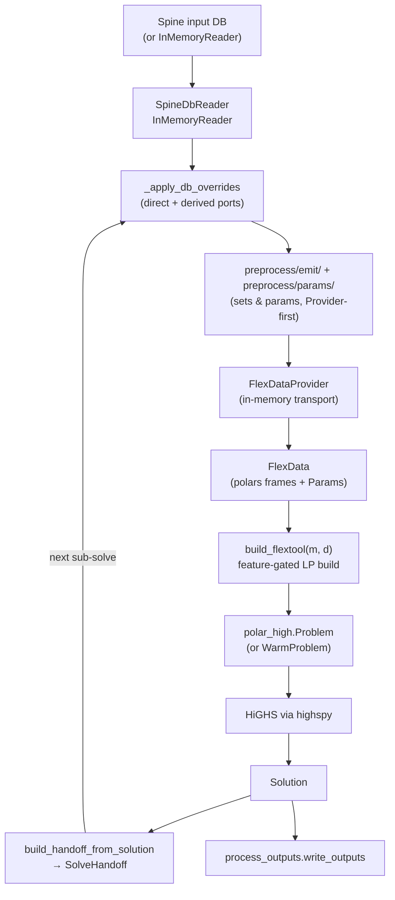

# The engine pipeline

`flextool/engine/` is FlexTool's in-memory optimization engine. It reads a
Spine input DB (or an in-memory test fixture) into one typed dataclass,
derives the per-solve sets and parameters, builds an LP feature by feature
on the `polar_high` eDSL, solves it with HiGHS via `highspy` and hands the
solution to the next solve of the cascade and to `process_outputs`. The
folder map is `flextool/engine/README.md`; the whole-system picture and the
cross-cutting invariants are in [architecture.md](architecture.md).

**Where to read**

| Task | Sections |
|---|---|
| Add a model parameter | [Where to start when…](#where-to-start-when), architecture [Parameter shapes](architecture.md#parameter-shapes-dt-broadcasting), [Solve-step aggregation](architecture.md#solve-step-aggregation-new_stepduration-of-a-solve), [autoscale registry](architecture.md#layers-bottom-up) |
| Add a constraint / variable / objective term | [LP build](#lp-build-modelcore-and-the-feature-modules), [Feature flags](#feature-flags-and-required-fields), [Equation headers](#equation-headers) |
| Add an optional model feature | [Where to start when…](#where-to-start-when), [Feature flags](#feature-flags-and-required-fields) |
| Change a preprocess emit / derive | [Emitters](#emitters), [Vectorized per-roll emit](#vectorized-per-roll-emit), [FlexDataProvider](#flexdataprovider-and-override-translator) |
| Change solve orchestration, warm start, Benders | [Per-solve pipeline](#per-solve-pipeline), [Solve modes](#solve-modes) |
| Change rolling / nested / stochastic handoff | [Solve-to-solve handoff](#solve-to-solve-handoff), [Storage carry routing](#storage-carry-routing-where-a-sub-solves-storage-starts), [Stochastic branches](#stochastic-branches) |
| Storage behaviour | [Worked example: storage](#worked-example-storage), [Where the storage chain ends](#where-the-storage-chain-ends), [RP coupling](#rp-blended-weights-inter-period-coupling) |
| `reduce_*_detail_method` | [Solve-level detail reduction](#solve-level-detail-reduction) |
| Axis dtypes and joins | [Enum-dtype axis convention](#enum-dtype-axis-convention), [Entity-union axis](#entity-union-axis) |
| Outputs | architecture [Output writers read only memory](architecture.md#output-writers-read-only-memory-one-run-per-work-folder), [Solution extraction](architecture.md#solution-extraction), [Output-writer shape adaptation](#output-writer-shape-adaptation) |
| Schema change & migration | CONTRIBUTING.md "Updating the Data Structure", architecture [update_flextool](architecture.md#flextoolupdate_flextool-migration-and-updates) |
| Numerical trouble | architecture [Numerical scaling](architecture.md#numerical-scaling), [Solve acceptance](architecture.md#solve-acceptance) |

!!! note "Two repositories"
    `polar_high` is the standalone LP eDSL — sets, parameters,
    variables, lazy constraint composition, warm-LP machinery, the
    autoscale range readout and Layer 3, and the Benders cut / recourse
    primitives. It knows nothing of FlexTool. `engine` is the
    FlexTool-side glue: the shape of FlexTool's data and model.

## Per-solve pipeline



The steps, with their modules, are listed in `flextool/engine/README.md`
("Pipeline"). Side-paths off this trunk:

- **Rolling-horizon / nested**: every iteration loops back through
  `overlay` carrying a `SolveHandoff`. An identical next sub-solve
  re-solves the live `WarmProblem`; any other is built cold
  ([Warm-start cascade](#warm-start-cascade-polar_highwarmproblem)).
- **Stochastic branches**: `solve/_stochastic.py` decorates per-solve
  active-time lists with branch-suffixed periods before `overlay`
  sees them ([Stochastic branches](#stochastic-branches)).
- **Spatial Benders**: `solve/_benders.solve_benders`
  ([Spatial Benders](#spatial-benders-master-multi-cut-loop)).

### Solve-level detail reduction

`solve.reduce_unit_detail_method` / `reduce_system_detail_method` (user docs: entities_and_time.md "Leaving out
detail in a solve") are applied in one place: `preprocess._reduce_detail.apply_reduce_detail(d, unit, system)`,
called by the cascade right after `load_flextool` for every sub-solve (`_orchestration._cascade._drive_cascade`). Every
consumer after it reads the reduced data: the online / ramp carry check (`check_online_ramp_carry`, outside
`load_flextool` so that it sees the reduced online set), the realization checks, the Benders split, the cold and
warm build, the handoff and the per-roll outputs. The per-roll emit and the input derivation are not changed.
Which `has_*` flags each level turns off is listed under [Feature flags](#feature-flags-and-required-fields).

- **Copy, not replace.** The transform returns a `copy.copy` of the FlexData with the changed fields set, not `dataclasses.replace`.

    A shallow copy keeps the extra attributes that the cascade and the emit hang on a FlexData (the axis
    vocabulary, `output_static_data`, `reduced_output_features`); `dataclasses.replace` would rebuild the object
    from its fields only and drop them. Unchanged frames are shared. A level that changes nothing returns the
    same object, so the LP is byte-identical.

- **Only clears, prunes, relaxes or folds to full load.** Each part sets its fields to `None` (the field lists `RAMP_FIELDS`, `ONLINE_FIELDS`, `RESERVE_FIELDS`, ... in `_reduce_detail.py`), except `relax_integrality` (integer online columns continuous), the full-load efficiency of `min_load_efficiency` and multi-line `piecewise_linear` units under `online*` (a constant_efficiency unit: `p_slope + p_section / W`, `p_section = 0`, `W` the weighted output one unit online gives at full output, `_unit_widths`; a multi-line unit leaves `process_piecewise` and its lines with `p_slope = 1/η(1)` (`W = 1`) or `max_g(α_g·W + β_g) / W`, `_full_load_piecewise`; the full model's fuel at full output and its input limits; module docstring "Full-load efficiency"; under `*_min_limits` the same fold for the `min_load_efficiency` units with a negative `p_section`, `_falling_min_load_eff`, which also leave `process_min_load_eff`) and the pruning of online variables without a use.

    Under the `integers*` levels, `online_uses` lists, on the data after the level's removals, the uses of each
    process's online variables (`ONLINE_USES`: start-up cost, min load / capacity_min_coeff floors, min up / down
    times, the min_load_efficiency section, a written user constraint with `constraint_online_coeff`, a reserve,
    inertia, ramp limits, the parent's commitment pin; non-anticipativity ties are no use). The processes
    without a use lose their online variables: `_prune_online` filters the rows of `PRUNE_FIELDS` (the online sets
    and their parameters, the carry and pin, the min-time sets, `p_startup_cost`) to the other processes, and
    clears `dt_online_carry` with the last carried commitment (`ReduceReport.removed["online_unused"]`). The
    reserve use is conservative: maxFlow and the connection reserve rows hold the same reserve terms without the
    units online, so a reserve-only unit could be pruned too; it keeps its online variables, as the user docs say.
    `test_reduce_detail_online_uses.py` classifies every model reader of the online sets / variables (a new
    reader must be added as a use or as no use) and checks that pruning gives the optimum of the same units
    authored as `no_startup`.

    `test_reduce_detail.py` and `test_reduce_system_detail.py` check that every FlexData field of a feature is in
    its list by name, and for the system features also by the columns the frames hold. A new field of a feature
    must be added there.

- **Warm start.** `relax_integrality` is a FlexData field in `_warm._STRUCTURAL_FIELDS`, so a warm LP built under one integrality is never reused under the other.

    The level strings are not fields: two sub-solves whose reduced data are identical may share a warm LP.

- **Run log and run status.** The cascade prints one info line per solve at its first roll (`_reduce_detail.summary_line`: what each level left out and the interaction notes, `ReduceReport.notes`), logs the dropped user constraints as warnings, and records `reduced = {unit, system, summary}` on the run-status entry of every roll (`RunRecorder.solve_reduced`); `summary` is the line on the solve's first roll and None on the later ones.
- **Outputs.** The static sets of the last sub-solve come from its pre-transform data (`output_static_view`), so a reduced last solve keeps the tables of earlier full solves.

    The cells of a left-out feature in a reduced solve's steps are emptied after the tables are built
    (`process_outputs.reduced_cells`): the cascade sets `reduced_output_features` on the reduced data, the per-roll
    writer writes it as `output_raw/reduced_detail__<roll>.parquet`, and `write_outputs` maps the markers onto
    the realised steps and periods (from the solve-keyed sets before `drop_levels`) and empties the rows of the
    feature tables (`FEATURE_TABLES`). Unreduced solves write no marker, so their tables are unchanged.

    A whole feature is one whose `OUTPUT_FEATURES` fields the transform cleared; `online` is keyed on the online
    sets alone (`process_online*`), since the carry and pin fields lose all their rows when every carried process
    is pruned while others keep their online variables. Online variables pruned for some processes only are
    per-entity markers (`output_entities` → `reduced_output_entities`): the marker's `entity` column holds the
    process (null for a whole feature), `read_reduced_markers` gives `(feature, entity)` keys, and
    `mask_reduced_cells` empties only that entity's column in the steps of the solves that pruned it. A period
    realised by both a keeping and a pruning solve keeps its average, with the pruning solve's steps in it as
    zeros (the same convention as whole features). The static online sets of the outputs keep every process that
    some solve so far kept (`output_static_view(…, online_gone_everywhere)`, `online_gone`).

- **Carry across levels.** The handoff records its producer's unit level (`SolveHandoff.unit_detail`) and the processes the producer left without online variables (`SolveHandoff.online_left_out`: all online processes under `online*`, those without a use under `integers*`).

    A solve that keeps online variables and continues the ramp flow of such a producer drops that flow for those
    processes only and starts their ramp and commitment cold (`cold_start_online_flow_carry`). Any other online
    process with a carried ramp flow but no online carry is a real inconsistency: `check_online_ramp_carry`
    raises for it.

## FlexData — the central data carrier

`FlexData` (`preprocess/flex_data/_container.py`) is a `@dataclass` of about 400
fields. Nine are positional and always present (the time / weighting / node
floor); every other field defaults to `None` and is filled in only when
the scenario exercises the corresponding feature.  The package
`preprocess/flex_data/` re-exports the public names; its modules are the
container, the shared readers (`_readers`), the feature loaders (`_load_*`,
`_coarse`), `load_flextool` (`_load`), the DB-direct passes (`_db_overrides`)
and `build_handoff_from_solution` with its helpers (`_handoff*`).

The naming convention is documented on the class:

- Sets — index frames, `pl.DataFrame`, no prefix. Example:
  `nodeBalance`, `process_source_sink`, `pss_dt`, `nodeState`,
  `cdt_eq`, `dtttdt`.
- Parameters — numeric `polar_high.Param`, `p_*` prefix. Example:
  `p_inflow`, `p_unitsize`, `p_commodity_price`, `p_step_duration`.
- Variables created later by `build_flextool` are `v_*` for primal
  and `vq_*` for slack.

The contract carried throughout the engine: **a field is either populated
with a frame / Param, or it is `None`**. An *empty* frame is legal — it
signals "this feature class is enabled, but no rows in this partition"
(e.g. `process_source_sink_noEff` empty because every process is in the
eff partition). `None` always means "loader didn't touch this field".

How a DB-authored parameter is mapped onto the Param's axes
(`_param_shapes.py`, `PARAM_ALLOWED_SHAPES`, `resolve_param_shape`) is in
architecture.md [Parameter shapes & `(d,t)` broadcasting](architecture.md#parameter-shapes-dt-broadcasting).
The resolver reads each Map level's `index_name` from the DB because a
`Map[time, period]` and a `Map[period, time]` have the same polars column
names but opposite axis semantics.

### Data sources

The loaders are stacked on two protocols defined in `input/_input_source.py`:

| Source | Implementation | When used |
|---|---|---|
| `CsvSource` | `_input_source.py` | Path wrapper for a sub-solve's work folder (`input/` + `solve_data/`). `load_flextool(path_or_csv_source, provider=..., db_reader=...)` forms the provider keys from its directories and reads the provider, never the files. |
| `SpineDbReader` | `_spinedb_reader.py` | The DB-direct reader — returns one polars frame per `(entity_class, parameter_name)` pair. Consumed by the override chain in `_apply_db_overrides` and by `run_chain_from_db`. |
| `InMemoryReader` | `_inmemory_reader.py` | Same `InputSource` protocol as `SpineDbReader`, driven by an in-memory dict-of-frames fixture. The vehicle for fast unit tests under `tests/engine/`. |

`FlexInputSource` (work-folder shaped) and `InputSource` (per-parameter
frame) are deliberately two protocols: the first names the sub-solve's
directories (the paths the provider keys are formed from), the second
requests one parameter at a time from the DB. `load_flextool` takes both:
the work folder (`source`) and a required `db_reader`. The bulky
pre-computed sets come from the sub-solve's `FlexDataProvider`, the
parameters the override chain owns from the reader. The loader is
provider-only: it never reads `input/` or `solve_data/` on disk, so a dump
or stale CSVs in a reused work folder cannot change a run (Rule 4 of
`tests/engine/test_meta_provider_invariants.py`). Only the unsupported
`flextool.engine._csv_reload.load_from_dump` loads from CSVs (it seeds a
provider from them first; architecture.md
[CSV dump](architecture.md#csv-dump-supported-and-csv-reload-unsupported)).

## LP build: `model/core/` and the feature modules

`build_flextool(m, d)` builds the LP into the `polar_high.Problem` `m`
from the `FlexData` `d`. Its body is a table of contents: a list of
steps run in order, each taking the `_Build` context `b` (the problem,
the data, the `has_*` feature flags, shared index sets, variables and a
few shared expressions):

1. `_prepare` — declares the dense axes, sets the `has_*` flags from the
   data, checks required fields and builds the shared index sets
   (`pss_dt`, `nodeBalance_dt`, `nodeState_dt`, …).
2. `_declare_variables` — the one place where the decision space is
   assembled: core variables are declared here and the feature modules'
   `add_variables(b)` are called from here. Declaration order is the LP
   column order.
3. `_shared_expressions` — expressions read by several families (reserve
   coupling sums, the capacity in service `b.cap` of `_capacity`,
   `op_factor`).
4. One `_eq_<family>(b)` per core equation family, in emit order,
   interleaved with the feature modules' `add_constraints(b)`.
5. `_obj_<family>(b)` and the modules' `objective_terms(b)` return their
   term (or `None`); `build_flextool` sums them in order and calls
   `m.set_objective`.

Every family function starts with an early-return guard on its flag
(`if not b.has_storage: return`), so a feature whose data is empty emits
nothing. The `model/core/__init__.py` docstring is the map: every variable with
its dims and unit, and every equation family in emit order with the
module it lives in. Each row, objective term and variable carries an
`EQ.` / `OBJ.` / `VAR.` header with its formula, so
`grep -rn "EQ. ─── maxFlow" flextool/engine` finds an equation.

**What lives where.** The package `model/core/` holds the core model that
every run uses, one module per equation family: `_prepare` (flags, data
checks, index sets), `_variables` (variables and shared expressions),
`_rp_storage`, `_node_balance`, `_flows` (maxFlow, maxOutputSum),
`_ramp`, `_invest` (investment maxima), `_conversion`, `_co2`,
`_user_constraints`, `_storage_state`, `_profiles` and `_objective`;
`_storage_links` holds the storage helpers several of them read,
`_context` the `_Build` context and the required-field tuples, `_build`
the table of contents.  `core/__init__.py` re-exports the public names
only: code that needs a private helper imports it from its module. An optional feature that brings its own variables or rows
lives in its own module, exposing the parts of the interface it needs —
`add_variables(b)`, `add_constraints(b)`, `objective_terms(b)`:
`_online` (unit commitment), `_unit_floors` (minimum load and
reserve headroom), `_reserve`, `_group_slack` (capacity margin, inertia,
non-synchronous share), `_cumulative_invest` (investment floors and
group / cumulative / flow-group limits), `_commodity_ladder`,
`_dc_power_flow`, `_exact` (direction switch of `exact` connections),
`_delay` (delayed inputs, used by `conversion_indirect`) and
`_non_anticipativity` (stochastic ties).
Small helpers shared by these live in `_common`. `_capacity` builds the
capacity in service once per solve (`b.cap`, below); every family that
reads an investment or a retirement takes its frames and sums from there.

**Emit order is part of the LP.** Row and column order decide which
alternate optimum the solver returns, so moving a step in the table of
contents (or a variable in `_declare_variables`) changes results on
degenerate models. Check the effect with `tools/lp_snapshot.py`
(CONTRIBUTING.md "LP snapshot gate").

### Feature flags and required fields

`_prepare` sets one `has_*` flag per feature on the `_Build` context from
its switch field on `FlexData`. The data each feature needs is a
module-level tuple in `model/core/_context.py`:

```python
ALWAYS = ("dt", "nodeBalance",
          "p_step_duration", "p_timestep_weight", "p_inflation_op", "p_period_share",
          "p_inflow", "p_penalty_up", "p_penalty_down")
PROCESSES = ("process_source_sink", "process_source_sink_eff", "process_source_sink_noEff",
             "flow_to_n", "flow_from_commodity_eff", "flow_from_commodity_noEff",
             "p_unitsize", "p_flow_upper", "p_slope", "p_commodity_price")
STORAGE = ("nodeState", "dtttdt", "p_state_upper", "p_state_unitsize")
ONLINE = ("process_online", "p_online_dt", "p_min_load",
          "dtttdt", "p_process_existing_count")
# ... INDIRECT, CO2_CAP, CO2_CAP_TOTAL, USER_CSTR, PROFILES, MINLOAD_EFF,
#     STARTUP_COST_LINEAR, STARTUP_COST_INTEGER, RAMP, INVEST, DIVEST
```

`_prepare` runs `_check(d, ALWAYS, "always")` and `_check(d, TUPLE, "name")`
for every active flag. The check is **fail-fast**: a set switch with a
required field at `None` raises `ValueError`, never a silent degrade.

| Flag | Switch field | Required tuple | Adds |
|---|---|---|---|
| (always) | — | `ALWAYS` | `vq_state_up/down`, `nodeBalance_eq`, balance slack penalty. |
| `has_proc` | `process_source_sink` | `PROCESSES` | `v_flow`, flow terms of `nodeBalance_eq`, `maxFlow`, `maxOutputSum` (indirect units), commodity cost. |
| `has_indirect` | `process_indirect` | `INDIRECT` | `conversion_indirect`, `minInputShare`. |
| `has_co2_price` | `flow_from_co2_priced` | — (warns and skips without price / content) | CO2 price term in the objective. |
| `has_co2_cap` / `has_co2_cap_total` | `flow_from_co2_capped[_noEff]` / `flow_from_co2_capped_total[_noEff]` | `CO2_CAP` / `CO2_CAP_TOTAL` | `co2_max_period` / `co2_max_total`. |
| `has_user_cstr` | `cdt_eq` / `cdt_le` / `cdt_ge` | `USER_CSTR` | `process_constraint_{equal,less_than,greater_than}[_period\|_period_total]` (`_period`: one row per period for constraints without flow or state terms; `_period_total`: one annualised row per period for `constraint_period_method` *period_total*, `constraint_period_total`). |
| `has_profile` | `process_profile_{upper,lower,fixed}` | `PROFILES` | `profile_flow_*` bounds on `v_flow`. |
| `has_storage` | `nodeState` | `STORAGE` | `v_state`, state change in `nodeBalance_eq`, `maxState`, start binding, state profiles, reference value. |
| `has_rp` | `nodeState_rp` | — | Representative-period inter-period state coupling (`_eq_rp_storage_chain`). |
| `has_nsb` | `nodeStateBlock` | — | `bind_intraperiod_blocks` nodes: `stateConstantWithinBlock_eq`, `nodeBalanceBlock_eq`. |
| `has_coarse` | `nodeCoarse` + `node_coarse_step` | — | Nodes of coarse `new_stepduration` groups: `nodeBalanceCoarse_eq` (the summed `nodeBalance_eq` terms per coarse step), `stateConstantCoarse_eq`. |
| `has_online_{lin,int}` | `process_online_{linear,integer}` | `ONLINE` | `_online`: `v_online`, startup / shutdown, uptime / downtime; `_unit_floors`: min-load floors. |
| `has_minload_eff` | `process_min_load_eff` | `MINLOAD_EFF` | min_load_efficiency section terms. |
| `has_piecewise` | `process_piecewise` | `PIECEWISE` | `conversion_piecewise` (multi-line `piecewise_linear` units; `conversion_indirect` skips them). |
| `has_startup_cost_{lin,int}` | `pdt_online_{linear,integer}` | `STARTUP_COST_*` | Startup-cost objective term. |
| `has_ramp` | any `process_source_sink_ramp_limit_*` | `RAMP` | Ramp-up / ramp-down constraints. |
| `has_{invest,divest}_{p,n}` | `pd_{invest,divest}_set` / `nd_{invest,divest}_set` | `INVEST` / `DIVEST` | `v_invest` / `v_divest`, investment maxima, annuities. |
| `has_reserve` | `reserve_upDown_group` | checked in `_reserve` | `_reserve`. |
| `has_capacity_margin` / `has_inertia` / `has_non_sync` | `_group_slack.has_*` | — | `_group_slack`. |
| `has_cumulative_invest` | `_cumulative_invest.has_feature` | — | `_cumulative_invest`. |
| `has_ladder` | `_commodity_ladder.has_feature` | — | `_commodity_ladder`. |

The DC power-flow, exact-connection, delay and non-anticipativity modules
gate on their own data (`_dc_power_flow.has_feature`, `_exact.has_feature`
(`process_exact`), `_delay.has_feature`, `period_branch_full` /
`pd_non_anticipativity`).

A solve's `reduce_unit_detail_method` / `reduce_system_detail_method` turns flags off by clearing their switch
fields before the build ([Solve-level detail reduction](#solve-level-detail-reduction)): `online*` clears the
`has_online_*`, `has_minload_eff` and `has_startup_cost_*` switches, `*ramps` the `has_ramp` switch and the
ramp-cost set, `*min_limits` the min-load and min-time sets, `reserves` the `has_reserve` gate, `inertia` /
`non_synchronous` the group sets behind `has_inertia` / `has_non_sync`, and `dc_power_flow` the DC sets.
`integers*` keeps the online flags and sets `relax_integrality`, which `_online` and `_exact` read as
`integer=not d.relax_integrality`. The capacity margin is never cleared.

**Dense axes.** `_prepare` also declares FlexTool's dense trailing axes,
`m.declare_dense_axes(("d", "t"))` — `(period, timestep)`. polar-high then
builds the canonical matrix by the block-COO slice path: the pre-sorted
dense axis is sliced as contiguous numpy blocks and the coefficient factors
are multiplied with ufuncs, instead of wide relational joins; `Sum`-wrapped
chains (the `Sum`-heavy nodeBalance / reserves / co2 families) evaluate in
one pass via a captured `SumBlockMeta` recipe. The output is bit-identical
to the plain polars path; the gain is the build's peak memory and wall time.

### Equation headers

Every row family, variable and objective term carries a header comment
directly above its `add_cstr` / `add_var` call (or the term it returns),
and the generated [formulation page](../formulation.md) is built from these
headers (`flextool/docs_build/formulation.py`, the one reader of this
grammar; `tests/docs/test_header_grammar.py` checks it):

```python
        # ─── EQ. ─── maxOnline_{linear,integer} ──────────────────────────────
        # ─────────────────────────────────────────────────────────────────────
        # v_online[p,d,t] − Σ v_invest_p[p,d′] + Σ v_divest_p[p,d′]  ≤ existing_count[p,d]
        #   ∀ (p,d,t) ∈ p_idx
        # Units online cannot exceed the units built.
```

- **First line:** `# ─── KIND. ─── names ───`, `KIND` one of `EQ`, `VAR`,
  `OBJ`. When the names do not fit, continuation lines follow: `#` and 13
  spaces, then more names, until a line that ends in `─`.
- **Names** are separated by ` / `, `, ` or `;`. A `(…)` part is a
  qualifier and is dropped (`v_flow (coarse processes)` is `v_flow`); a
  `label:` before a name is dropped (`<family>_coarse: maxFlow_coarse`).
  `{a,b}` expands to each alternative, `[_x]` is optional
  (`co2_max_total[_path]` is `co2_max_total` and `co2_max_total_path`).
  `{sfx}` is the one declared placeholder (`_linear`, `_integer`);
  `<family>` appears only in a label. Each expanded name is an identifier:
  the row or column name the LP carries (OBJ: the term's name).
- **Free-text header:** a header whose names are words
  (`# ─── OBJ. ─── reserve shortfall ───`) carries the names on the next
  line, `# names: a, b`.
- **Body:** the comment lines that follow, up to the first line that is not
  a comment or the next header; a line of `─` is a rule and is skipped. The
  body starts with the **formula** (the row, `∀` its domain, then the
  symbols it uses, indented) and continues with the **prose** from the
  first unindented line that starts with a capitalised word (`Forces …`,
  `Row rule …`). An indented line in the prose is a formula fragment.
- **One header per family.** A generic row helper carries no header; its
  callers do (`ROW_HELPERS` in the test: `_coarse_flows.add_cstr` /
  `add_twin` / `add_row_rule_cstr`, `_lead_time.period_limit`,
  `core._ramp._ramp_family`, `_cumulative_invest._group_period_limit_online`,
  `_online._add_max_input_flow_online`).
- **Ratchets** (`tests/docs/test_header_grammar.py`): every `add_cstr` /
  `add_var` in `engine/model/` has a header earlier in its function or sits
  in a row helper whose callers have one; every autoscale
  `CONSTRAINT_FAMILIES` / `VARIABLE_FAMILIES` key is a header name, its
  `_coarse` twin, or a key `lookup_cstr` reaches by suffix
  (`PREFIX_REGISTERED`); every `_obj_*` step and `objective_terms` has an
  `OBJ.` header.

### Capacity symbols used in the headers

For a unit, connection or storage node `e` in period `d`:

- `capacity[e,d] = existing[e,d] × virtual_unitsize[e]` when
  `virtual_unitsize` is set, else `existing[e,d]` (MW, or MWh for storage).
  With `virtual_unitsize`, `existing` is the number of units.
- `unitsize[e] = virtual_unitsize[e]`, else `existing` (the largest period
  value), else 1000.
- `existing_count[e,d] = capacity[e,d] / unitsize[e]`: equal to `existing`
  when `virtual_unitsize` is set; otherwise 1 (less in a period whose
  `existing` is below the largest, 0 without existing capacity).
- `invest_*`, `retire_*`, `cumulative_*`, `invest_forced` and the capacity a
  construction lead time carries are MW (MWh) in every case. `v_invest` and
  `v_divest` are continuous, in units of `unitsize`.
- The capacity in service (`model/_capacity.py`, built once per solve from
  the cohort table `preprocess/params/_cohorts.py`), in units of `unitsize`
  (`state_unitsize` for a storage node):
  - `invested[e,d] = Σ_{d′ : (e,d′,d) ∈ alive} v_invest[e,d′]`: the
    investments in service in `d` — the investment cohort `(e,d′)` is alive
    in `d` when `y_on ≤ y[d] < y_eol`, along the scenario lineage of a fan.
    `y_on` is the start of operation (existing capacity:
    `y_on = y[d0] − age`, `d0` the first period of the run, `age` from
    `age_at_model_start` or `model.start_year − build_year`) and
    `y_eol = round_end_of_life(y_on + lifetime_technical, end_of_life_method)`,
    the `lifetime_technical` of the period the capacity comes online (`d0`
    for existing capacity)
    (`_run_calendar.round_end_of_life`: the nearer period start for
    `closest_seam`, the default, a tie to the later one; the one at or after
    it for `next_seam`, at or before it for `previous_seam`; within
    `YEAR_TOL`; `+inf` for `reinvest_automatic`);
  - `prebuilt[e,d]`: the same over the cohorts in service from the start of
    `d` (`y[d] > y_on`), not starting to operate in `d`;
  - `retired[e,d] = Σ_{d′ : (e,d′,d) ∈ retired} v_divest[e,d′] + v_divested_built[e,d]`: a retirement
    of existing capacity decided in `d′` counts in `d` when `y[d′] ≤ y[d]`
    and the existing cohort of `e` is still in service in `d` (none for
    `reinvest_automatic`, which has no end of life); `v_divested_built[e,d]`
    is the model-built capacity retired so far that still counts in `d`
    (`model/_retire_built.py`, `divestedBuilt`: the retirements
    `v_divest_built[e,c,d′]` of each model-built cohort `c` of a
    `reinvest_choice` / `no_reinvestment` entity, `(d′,d) ∈ dd_forward`, while
    `c` is in service in `d`; one column per (entity, period) whatever the
    number of cohorts; absent without such a cohort, so existing-only rows
    keep their terms).  A cohort retires at most what it has
    (`maxDivest_cohort`: the investment of this solve, or the carried size less
    the carried retirements); a chain carries each retirement with its cohort
    (handoff `realized_retire`), so the existing capacity's limit
    (`maxRetired_existing`) counts only the existing cohort's;
  - `retired[e,d]` also subtracts `v_extended[e,d]`, the capacity extended beyond its end of life that is in
    service in `d` (`model/_extend.py`, `extendedCapacity`: each extension `v_extend[e,c,d′]` of a cohort `c`
    reaching its end of life at the start of an investment period `d′`, `(d′,d) ∈ dd_forward`, while
    `y[d] < y_eol(x)` of the extension cohort `x = extend:<d′>:<c>`).  It is a capacity term, never an
    investment: the investment limits and `constraint_invested_capacity_coeff` do not count it.  A cohort
    extends at most what it has in service at its end of life (`maxExtend_cohort`), once;
  - `cap[e,d] = existing[e,d] + invested[e,d] − retired[e,d]`.
- `existing_mw[e,d]` (`p_entity_all_existing`, MW or MWh; the `existing` of
  `cap` is `existing_mw / unitsize`) — the capacity a solve starts from, from
  the cohorts (`_cohort_handoff.existing_capacity`, emitted per solve by
  `_chain_params.emit_existing_capacity`):
  `existing_mw[e,d] = pre[e,d] + carried[e,d] − retired_carried[e,d]`, with
  `pre[e,d] = capacity[e,d]` while the existing cohort (counted from the start
  of the run) is in service in `d`, `carried[e,d]` the cohorts earlier solves
  of the run realised (handoff `realized_cohort`) in service in `d`, and
  `retired_carried[e,d]` their realised retirements still counting in `d`
  (handoff `realized_retire`).  The same formula in every solve: the first,
  a chained, a roll, a nested sub-solve; the user's `existing` is read for
  each period of each solve.
- The price of an investment cohort per year in service (`a_cap`, CUR/MW a
  year, MWh for storage; column `a_cap` of the cohort table, carried by
  `realized_cohort`; `_npv._per_method_annuity_lf`, `_annuity.level_factor`),
  all values read at the period `c` the capacity comes online:
  `A = invest_cost[e,c]·1000·r/(1 − (1+r)^−n)·(1+r)^(off_inv − 1)`
  (`c·1000/n` for `r = 0`), `r = discount_rate[e,c]`, `n = payback_time[e,c]`
  (else `lifetime_technical[e,c]`), `off_inv =
  model.discount_offset_investment`;
  `a_cap = A·G(n)/G(L)` with `L = lifetime_technical[e,c]`,
  `G(x) = Σ_{k<⌈x⌉} min(1, x−k)·(1+i)^−k`, `i = model.social_discount_rate`
  (the investment payments are weighed by `inflation_inv[d]`, the social
  discount factor of investment payments, at `discount_offset_investment`)
  (`G(x) = x` for `i = 0`); `a_cap = A` when `n = L`.  The loan's present value spread evenly over the real
  lifetime: one price for every build period, rounding and period length.
  The timing factor `(1+r)^(off_inv − 1)` (`_annuity.annuity_factor`) makes
  the loan worth `invest_cost` at `r` for every `discount_offset_investment`.
  The salvage credit `a_salv = S·(1+r)^−L·af(r, L)` (`af` the annual factor
  `annuity_factor`, `_annuity.salvage_credit`) with `S =
  1000·net_salvage_value[e,d_eol]` (`_npv._level_prices_lf`) lowers the price: the
  objective charges `a_cap − a_salv` over the cohort's periods in service
  (`invest_cost_p` OBJ header).  A `reinvest_automatic` cohort is priced by its
  `generation` rows: each plant of the chain at the values of the period it comes
  online (`_npv.generation_prices`, `chain_lumps`; one price for the whole chain
  with constant values, the annuity bit for bit); the replacement of existing
  capacity as one plant (`existing_replacement_prices`), outside the default
  objective (`existing_replacement` OBJ header), and its retirement settled by
  `chain_retirement_costs`.  The cohort
  also carries the loan (`pay = A`, `n_pay = n`, `r_loan = r`) and `nsv_eol = S`.
  A life extension (kind `extend`, `parent` the cohort it extends) is priced as
  one plant of its own (`_extend.extension_prices`): capital `E + S_c` (the
  `life_extension_cost` and the parent's salvage value it gives up), loan over
  `life_extension_years` at its `discount_rate`, its own salvage at the extended
  end of life; its option costs `(a_cap − a_salv)·S̄` and its fixed cost over its
  periods in service (`extend_cost` OBJ header), and its retirement is one of
  model-built capacity.
  The existing cohort carries `r_loan = r_x`, `a_salv = a_x` and `nsv_eol = S_x`
  of its salvage credit (`_existing_salvage.existing_salvage`, `divest_cost_p` /
  `existing_salvage` OBJ headers).

### Worked example: storage

1. Flag and fields: `b.has_storage` is set when `nodeState` has rows;
   `STORAGE` lists `nodeState`, `dtttdt`, `p_state_upper`,
   `p_state_unitsize`.
2. Variable: `v_state[n, d, t]` over `nodeState_dt`
   (`_declare_variables`), in units of the state unitsize. Its upper
   bound depends on invest/divest, so it is the `maxState` row
   (`_eq_max_state`), not a variable bound.
3. Constraints: the state change enters `nodeBalance_eq` through
   `_state_change_terms`, one term per `storage_binding_method`, using
   the predecessor lookup `dtttdt` from `_timeline.py`. Start binding,
   cyclic period binding, state profiles and the solve-horizon reference
   value are `_eq_storage_start_binding`,
   `_eq_storage_start_binding_cyclic`, `_eq_state_profiles` and
   `_eq_storage_reference_value`.
4. Objective: `_obj_storage_reference_price` when a reference price is
   set; otherwise only the balance slack penalties.

A bug report like "storage transition wrong at the period boundary"
walks straight back to `_state_change_terms` and the frames it reads:
most often `dtttdt` or `storage_bind_forward_only`, both populated by
the loader.

### Part-load curves (`piecewise_linear`)

User docs: units.md "Part-load efficiency curve". A unit with `conversion_method` *piecewise_linear* has a curve
`piecewise_linear_efficiency` (load share ℓ → efficiency η; one curve, or one per period; no time level). Its
fuel use per unit of capacity is `F(ℓ) = ℓ/η(ℓ)`, linear between the points; convexity (non-falling incremental
heat rate) is checked before the solve, so the curve is the upper envelope of its segment lines.

- **Curve → lines** (`engine/input/_piecewise_curve.py`, no FlexData dependency, shared by both classifiers and the
  load boundary so they cannot drift): segment `k` has intercept `β_k = ℓ_{k−1}ℓ_k(1/η_{k−1} − 1/η_k)/(ℓ_k −
  ℓ_{k−1})` (input per unit of capacity at zero output) and slope `α_k = 1/η_k − β_k/ℓ_k`; collinear points
  merge. *Online form* (the unit has online variables): the segments, plus an origin line `(1/η₀, 0)` when the
  efficiency falls from the first point. *Capacity form* (no online variables): the origin line through the best
  point `(1/max η, 0)` plus the segments with `β < 0`, exact for a capacity used as a fleet (`min_U U·f(x/U)` with
  `U ≤ built`). Both forms give the same full-load fuel `F(1)`.
- **Classes** (whole authored curve): one flat line → constant efficiency (`p_slope = 1/η`); one rising line →
  a `process_min_load_eff` member (`p_slope = α`, `p_section = β`; byte-identical to *min_load_efficiency*);
  two or more lines in some period → `process_piecewise` (fork forced, so the input has its own `v_flow`).
  A rising first segment gives automatic *linear* start-ups in both classifiers.
- **Load boundary** (`preprocess/params/_piecewise.apply_piecewise_curves`, in `load_flextool` after the DB
  overrides, on every path: single, rolling, synthetic, nested, stochastic): reads the points through
  `_param_shapes` (`MAP_LOAD` / `MAP_PERIOD_LOAD`; branch periods inherit the anchor's curve; a solve period without
  a curve raises), writes `p_piecewise_slope` / `p_piecewise_intercept` `(p, seg, d)` and `p_piecewise_points`,
  overwrites the seeded `p_slope` / `p_section` in place and recomputes the input capacity Params derived from them.
  One-input, one-output multi-line units (`process_piecewise_remap`) keep their input-side items on the output
  (`_projection.single_input_curve_arc_remap`); reserves, operating cost, start-up input, commodity / CO2,
  flowGroup membership and inertia stay on the input.
- **Model** (`core._conversion._eq_conversion_piecewise`, rows `conversion_piecewise` and the coarse twin): weighted input ≥
  `pw_slope·x + pw_intercept·unitsize·U` for every line, `U` = units online, or the units built (existing count +
  invested − divested) without online variables; `conversion_indirect` skips these units. The rows are `≥`, so the
  input can exceed the curve where that costs nothing or pays (the over-burn cases, units.md "Input above the
  curve"). Part-load measures of the reserve sizing use the lines (`_online._fuel_share`).
- **Detail reduction** (`_reduce_detail._full_load_piecewise`): `online*` runs the unit as a constant_efficiency
  unit at its full-load efficiency (it leaves `process_piecewise` and the line fields; `p_slope` is the full-load
  fuel per weighted output, `1/η(1)` at `W = 1`; the input limits stay; `process_piecewise_remap` stays, so a
  one-input unit keeps its reserve pairing at `p_slope`). Under `integers*` the curve is an online use when its
  efficiency rises from the first point (`process_piecewise_needs_online`); a unit without that use gets the
  capacity-form lines (`_fold_piecewise`, the same least fuel).
- **Checks.** Before the solve: `input_derivation/_validators.validate_piecewise_linear_inputs` (E1–E10, E12; E11 in the reader; the
  warnings W1–W7, W7 = setups that invite input above the curve). After the solve:
  `process_outputs/calc_piecewise` measures per solve, in `read_parameters`, the weighted input and its part above
  the curve (`process_piecewise_input_dt` / `process_piecewise_excess_dt`, solve-keyed, persisted per roll and
  unioned like the other parameters) and `write_outputs` logs W5 per unit (steps with
  `excess > 1e-5·max(1, q)`, the largest and the total). No result table.

### RP-blended-weights inter-period coupling

Representative-period storage (`b.has_rp`, set when `d.nodeState_rp`
has rows — the union of nodes whose `storage_binding_method` selects one
of the blended-weights variants) adds the variables and constraints that
close representative-period storage state across base periods. It
extends ordinary storage and shares the `v_state` declaration; on top it
adds:

| Element | Where | Role |
|---|---|---|
| `v_state_inter[n, d, b]` | `model._declare_variables` | Long-run state at the end of base period `b` of period `d`, free per `(n, d, b)`. Every period has its own base periods, also when two periods share a timeset or a timeline (the same base-period names). |
| `v_state_rp_start[n, d, t]` | `model._declare_variables` | Free starting state at the first step of each RP block. |
| `nodeState_rp_dt` | `_pdt_join.compute_nodeState_rp_dt` | The `(n, d, t)` join used to project `v_state` rows onto the RP cohort. |
| `nodeState_rp_block_first_dt` | `_pdt_join.compute_nodeState_rp_block_first_dt` | Index set for `v_state_rp_start` — RP-block-first `(d, t)` tuples per RP node. |
| `state_change_rp_interior` / `state_change_rp_start` | `model._state_change_terms` (`nodeBalance_eq` terms) | Intra-period state-change. Interior steps use the ordinary within-timeset lag; the first step of each RP block replaces the lag with `v_state_rp_start` so each block starts free. |
| `rp_inter_period_balance` | `model._eq_rp_storage_chain` | Inter-period balance over `(n, d, b, d′, b′)`: the within-period edges `(d, b, b′) ∈ rp_base_chain` (`d′ = d`) for every `nodeState_rp` node, and for the within-solve / forward-only variants the period-to-period edges `(d, d′) ∈ rp_period_previous` from the last base period of `d′` to the first of `d` (solve order, the predecessor the `bind_within_solve` state lag uses). The drift sums the per-RP-block state change weighted by `rp_base__rep[d, b, r]`. |
| `rp_inter_period_cyclic` | `model._eq_rp_storage_chain` | End-to-start closure: within-period — every rp period's first base period ← its own last; within-solve — every rp period without a predecessor ← every rp period that is no period's predecessor (`d_first × d_last`: deterministic one pair; a stochastic fan after the trunk period one pair per branch path; a fan in the first period N × N, the path loops plus equal chain starts). The forward-only variant skips this constraint. |
| `rp_inter_period_fan_start` | `model._eq_rp_storage_chain` | Forward-only blended nodes in a fan that opens in the solve's first period: the chain start `v_state_inter − drift` of the first base period is equal in every root (`period_first_of_solve`), fix_start nodes included (fix_start pins the first block, not the chain start). |
| `rp_inter_period_max_state` | `model._eq_rp_storage_chain` | Capacity bound on `v_state_inter[n, d, b]` over `(n, d, b) ∈ nodeState_rp × rp_base_period`, `d ∈ period_in_use` (a base period of `d` by `d`'s capacity), tightened by cumulative invest/divest exactly as the ordinary `maxState`. |
| `maxState_rp_start` | `model._eq_rp_storage_chain` | Sibling capacity bound on `v_state_rp_start[n, d, t]` over `rp_block_first`. Both bounds depend on invest/divest, so they are rows rather than variable bounds. |
| `non_anticipativity_rp_block_start` | `model._non_anticipativity.add_dispatch_constraints` | `v_state_rp_start` equal across the forecast star at the block starts inside the tie window, for `include_stochastics` nodes in `nodeState_rp`; a block already tied by a `non_anticipativity_storage_state_first` row is left out. |

In a stochastic solve every forecast branch period is an rp period with the timeset of the period it branches from (`_solve_writers._with_branch_period_timesets`); `rp_period_previous` is then a tree (a branch's first period ← the trunk period, later periods ← the same branch). A rolling_window solve on representative periods is a configuration error (`_run_model._rp_methods._reject_rolling_rp`), and so is a plain bind_forward_only node in a solve on representative periods (`_run_model._rp_methods._reject_plain_forward_in_rp_solve`). A plain bind_within_solve / bind_within_period / bind_intraperiod_blocks node there is a warning (`_run_model._rp_methods._warn_plain_cyclic_in_rp_solve`: the plain cycle moves the level between the representative periods unweighted while their flows are weighted, which is reasonable with equal weights or storage whose inflow timing does not matter; the weights are the user's to use).

The three blended-weights methods that activate the block —
`bind_within_solve_blended_weights`, `bind_within_period_blended_weights`,
and `bind_forward_only_blended_weights` — are projected from the user-side
`storage_binding_method` value list by
`storage_bind_within_solve_blended_weights` /
`storage_bind_within_period_blended_weights` /
`storage_bind_forward_only_blended_weights` in `_projection.py`,
which populate the corresponding `FlexData` fields. `nodeState_rp` is
the union (the inter-period constraints all share it); the cyclic
constraint further filters back to the within-solve / within-period
subset because the forward-only variant deliberately leaves the chain
open.

The on-disk `rp_weights` carrier is authored as a flat triple
`(base_start, rep_start, weight)` and decoded by
`_timeline._decode_rp_weights`, which accepts both the nested Map
shape and the flattened list-of-Maps shape Spine produces depending on
import path. Both decode to the same nested
`{base: {rep: weight}}` dict that
`_solve_writers._compute_rp_frames` converts into the per-solve
`rp_weights` frame and from which it derives the `rp_base_chain`,
`rp_base_first`, `rp_base_last`, `rp_block_*` and `rp_base_period_set`
companion sets, one set of rows per period of the solve (every frame has a
`period` column), plus `rp_period_previous` (the rp periods in solve
order).  `solve/_run_model/_native_run_model.py` emits them for every period whose timeset
has `representative_period_weights`; periods without keep their
`timeset_weights` rows in the same `timestep_weight` frame.  The forecast
branch periods of a stochastic solve are rp periods with the timeset of the
period they branch from (`tests/engine/test_invest_branching_rp.py`).  A
rolling solve on representative periods (`_reject_rolling_rp`) and a solve
that mixes rp and other periods while it has blended-weights nodes
(`_check_rp_solve`) stop with an error.

## Emitters

The per-solve sets and calculated parameters are produced in Python by the
modules in `preprocess/emit/` and `preprocess/params/`. The split between
the two folders is not semantic (`emit/` holds what writes `solve_data/`
frames, `params/` what computes parameters in-process); both are Python
functions writing into the Provider, with a common shape:

- Input: a `FlexData` populated with the prior phases' fields, plus a
  source plugin (`InputSource` or `FlexDataProvider`).
- Output: one or more frames published to `FlexDataProvider` under the
  canonical key declared in `_provider_keys.py`; downstream consumers
  read by key. The signature is `emit_X(provider, ...)`; a CSV mirror is
  only a `csv_dump=True` side effect.
- Purity: every helper either fully populates its target keys or
  leaves them absent — no half-populated state.

Representative entries:

| Module | Produces |
|---|---|
| `_block.py` | `BlockLayout` fan-out — per-entity blocks, overlap sets, block step durations. |
| `_branch.py` | `period_branch`, `pdt_branch_weight`, `pd_branch_weight` — stochastic branch weighting. |
| `_cohorts.py` | The cohort table (`cohort`, `cohort_alive`, `dd_forward`): the start of operation and end of life of the existing capacity and of each investment, the periods each is in service, the reach of a retirement; the `generation` rows of a `reinvest_automatic` chain (`chain_rows`: each plant that holds the root's capacity in turn, from its start of operation to its rounded end of life, at least one period each, to the end of the horizon; no capacity of their own); its views are the only lifetime gate (end of life, expired periods, investment alive / pre-built, retirement reach); `in_service` gives the model (`model/_capacity.py`) and the output readers the periods each investment and retirement counts in. |
| `_cohort_handoff.py` | The cohorts carried between the solves of a run: `realized_cohorts` writes the handoff `realized_cohort` / `realized_retire` (the realized investments, their chains and life extensions, and the retirements per cohort, chain-cumulative); `existing_capacity` sums the existing and the carried cohorts into the capacity a solve starts from. |
| `_extend.py` | The life extensions (`cd_extend`, `cdd_extend`, `cohort_extend`): each cohort that ends its life at the start of an investment period can be extended by `life_extension_years`; the extension cohort (`extend:<period>:<parent>`) and its periods in service join the cohort table; its prices and costs (`extension_prices`, `extension_costs`, `apply_extension_costs`), the one cost point. |
| `_existing.py` | `p_entity_all_existing`, `p_entity_previously_invested_capacity` — cross-solve existing-capacity composition. |
| `_npv.py` | The investment price: the per-method annuity, the level prices, the chain and generation prices of `reinvest_automatic`, the investment lump `ed_entity_annual_discounted` (`apply_invest_lumps`) and the cohort prices. |
| `_fixed_costs.py` | The lifetime fixed costs: `ed_lifetime_fixed_cost`, the side a retirement saves `ed_lifetime_fixed_cost_divest` (`apply_retirement_fixed_cost`), `p_ed_fixed_cost`. |
| `_retire_settlement.py` | The retirement settlement of model-built cohorts and of `reinvest_automatic` chains (`cd_divest_built_cost` / `cd_divest_built_fixed`, `apply_built_retirement_costs`). |
| `_existing_salvage.py` | The salvage and replacement prices of existing capacity (`ed_divest_salvage`, `ed_existing_salvage_credit`; `apply_retirement_salvage`, `apply_existing_replacement`). |
| `_lifetime_inputs.py` | The per-entity readers and the per-decision lifetime inputs the lifetime costs share: entity class, `invest_method` / `lifetime_method`, the lifetime at the period a decision comes online, the raw fixed cost, the per-period walk (`period_walk_iterator`) and its window to the end of life, the registration of the lumps set as values. |
| `_discount.py` | Discount factors: the inflation scalars, the year rows, the per-period investment and operations factors (`p_inflation_op`), the solve's discount base from the run start (`solve_year_rows`), the run years (`run_years`). |
| `_report_lines.py` | Placing a reported cost event in a period (`report_years`, `event_period`, `stack_lines`). |
| `_run_costs.py` | The run-level fields of the reported costs (no model term reads them): the run's investment lump `ed_entity_annual_discounted_run` and cost lines, the run's discount factors `p_inflation_op_run` / `p_inflation_inv_run`, `p_entity_pre_existing`. |
| `_lifetime_costs.py` | The apply boundary: `apply_npv` (a Spine solve) and `apply_run_fields_of_synthetic_solve` (a roll or nested sub-solve) set the lifetime costs on `flex_data`. |
| `_profiles.py` | `p_profile_value` and the `p_process_existing_count` factor used by profile-bound constraints. |
| `_walks.py` | Backward / forward step lookups (`dtttdt`, `dtttdt_forward_only`, the block-interior variant). |
| `_arc_unions.py` | Arc set algebra: `flow_to_n`, `flow_from_n`, the commodity-flow joins, the reverse-arc additions for connections. |
| `_calc_params.py` | The `pdtX` / `pdX` per-step parameter cascade. |
| `_co2_accumulators.py` | Cumulative-CO2 ladder feeding the CO2-cap constraint. |
| `_pdt_params.py` | The full `pdt_*` family (online indices, varCost frames, …). |
| `_period_calc.py` | `p_period_share`, `complete_period_share_of_year`, `p_timeline_duration_in_years`. |
| `_reserve_sets.py` | Reserve-up / reserve-down set machinery for `_reserve.py`. |
| `_provider_io.py` (in `preprocess/`) | The shared Provider helpers every emitter routes through: `_emit` (register a frame), `_provider_key` (path → key), `_provider_lookup_positional` (provider-only read with positional column rename). |
| `_vectorize.py` | Shared per-roll vectorize helpers: the entity × dt and entity × period grids (carrying `__eo` / `__to` / `__po` order keys), the dict→lookup lift, the stochastic / parent-period fold, and the `repr()`-based value rendering. |

### Vectorized per-roll emit

The heavy per-step parameter families — `pdtProcess`, `pdtNode`, the
`pdtProcess_{source,sink}` per-side variants, `pdtCommodity`,
`pdtGroup`, and friends — each produce a dense `(entity × dt)` (or
`(entity × period)`) frame. They are derived with vectorized polars,
once per roll, over that roll's own window: there is no cache and no
full-domain frame.

The recipe is the same for every family. First build the dense grid
for the roll with `build_entity_dt_grid` (or `build_entity_period_grid`
for the period-only families) from `_vectorize.py`. The grid is the
cross-product of the entity list and the roll's `(period, time)` list,
and it carries integer order keys (`__eo` for the entity position,
`__to` / `__po` for the time or period position) so that a final
`.sort` on those keys reproduces the intended entity-major,
time-within-entity row order. Next, lift each parameter source into a
small polars lookup frame with `lift_dict_to_lookup` and left-join it
onto the grid. Where a family also has stochastic or parent-period
terms, `build_fold_frame` computes those as a group-by-sum and joins
the result in as one more candidate column. Then `coalesce_value`
picks the first non-null candidate across the cascade branches in
priority order, and `collect_value_frame` collects the graph to a
single Float64 value column, sorts by the order keys, and renders each
value to a string. `derive_pdtProcess_vectorized` in
`_pdt_params.py` is a representative example, and `emit_pdtProcess`
simply publishes its output to the Provider.

Rules that keep the rendered output exact:

- **Render values with the `repr()` loop, never `.cast(Utf8)`.**
  `_render_value_column` walks the value column and emits `repr(v)`
  per cell. A polars `.cast(Utf8)` diverges from `repr` on
  scientific-notation exponent padding and on `NaN`/`nan`, which would
  silently corrupt the emitted text.
- **Lift lookups from the de-duplicated parameter dict, not raw CSV.**
  The parameter dicts the family already builds are last-wins-deduped.
  Lifting a lookup frame straight from the raw CSV would re-introduce
  duplicate join keys and explode the left-join (one grid row matching
  many lookup rows). Always lift from the dict.
- **Preserve order.** Keep the domain / period order of the source lists
  (don't `.unique()` them) and sort on the `__eo` / `__to` keys.
- **Parity gate.** Every heavy derive has a
  `tests/engine/test_vectorize_<family>_parity.py` against a reference
  implementation: Tier A `.equals` for pure lookup / coalesce families,
  Tier B `rtol≈1e-12` (both sides parsed back to float) for many-term sums.

The time-series sources of the folds (`pt_*`, `pbt_*`, `pdt_process`,
`pdt_node`, `pdt_energy_margin_adder`, and `pd_energy_margin_adder`, passed
through verbatim) are read from `solve_data/`, never from `input/`:
`create_averaged_timeseries` writes them there, combined to the solve's
steps when the solve has `new_stepduration` (architecture.md
[Solve-step aggregation](architecture.md#solve-step-aggregation-new_stepduration-of-a-solve))
and verbatim otherwise. A derive and its `_vectorized` twin switch a
source in the same commit, and their parity fixtures seed the
`solve_data/` key. The `input/pt_node_inflow` reads of the peak scaling
stay on `input/`: `peak_inflow` is per original step; so does the
`input/pbt_node_inflow` read of the inflow-scaling checks, which takes
only the node names (the same in both folders).

### Topological ordering

Emitters have dependencies — `_chain_params.emit_existing_capacity` reads
`realized_cohort` from prior solves' handoffs, `_existing` reads `pd_invest_set`
from `_period_params`; `_fixed_costs` reads
`ed_lifetime_fixed_cost` which depends on `p_entity_all_existing`;
`_block`'s overlap sets feed the arc-side block aggregation
in `_arc_unions`.

The runner does not compute the order. It is encoded in the call
order of `_apply_db_overrides` (in `flex_data/_db_overrides.py`) and the load sequence
in `load_flextool`. Adding a new derived field typically means appending
one call to the right phase.

## FlexDataProvider and override translator

`FlexDataProvider` (`preprocess/_flex_data_provider.py`, not re-exported)
is the in-memory dict-of-frames that every cascade module reads from and
writes to; **all cross-phase data moves through it, there is no disk-side
hand-off inside the cascade.** Keys are declared in `_provider_keys.py`
(no `.csv` suffix); the convention is `<parent>/<basename>` (e.g.
`solve_data/foo`, `input/bar`, `handoff/realized_cohort`). Bare-basename
consumer lookups are resolved against the parent-qualified key, so a
single `put` registers the frame under one canonical name.

| Prefix | Purpose |
|---|---|
| `INPUT_*` | Backend-derived rows the cascade re-reads each iteration (CSV-shaped, populated from the input DB). |
| `SOLVE_DATA_*` | Per-solve sets and parameters that the derivation layer produces (the bulk of the `preprocess/emit/` output). |
| `HANDOFF_*` / `OVERRIDE_*` | Cross-solve handoff carriers ([Solve-to-solve handoff](#solve-to-solve-handoff)) and their override siblings; see below. |

The `input/` + `solve_data/` CSV mirrors on disk exist only under
`csv_dump=True` (one folder shared by every sub-solve; a Benders solve
dumps its undecomposed FlexData) and nothing reads them.
`tests/engine/test_meta_provider_invariants.py` forbids CSV reads in
cascade modules and any disk read in `preprocess/` and `model/`.

### Override translator

`_provider_translators.py` carries two small layers that let the
orchestrator inject external state into the live Provider without
re-running the emit pipeline (user guide:
[Injecting parameters between solves](inject_between_solves.md)):

- `translate_handoff_to_provider(handoff, provider)` writes one
  `HANDOFF_*` key per field of a `SolveHandoff`. Empty fields land as
  header-only frames (`_HANDOFF_EMPTY_SCHEMAS`) so consumers can use a
  single `provider.get(K.HANDOFF_X).height > 0` check.
- `translate_overrides_to_provider(overrides, provider)` takes a
  caller-supplied `{K.HANDOFF_X: pl.DataFrame, ...}` dict and writes
  each frame under the corresponding `OVERRIDE_X` key. Unknown keys
  are rejected with `ValueError` so the override surface stays
  explicit.

Consumers go through `read_handoff_frame(provider, K.HANDOFF_X)`,
which checks the `OVERRIDE_X` slot first and falls back to the natural
`HANDOFF_X` carrier. A non-empty override shadows the cascade-produced
handoff for that key; an empty override frame falls through cleanly,
so the override layer is opt-in per key.

### Source-tagging and audit dump

`FlexDataProvider.put(key, frame, *, source=None)` accepts an optional
free-form `source` tag retained alongside the frame and surfaced via
`get_source(key)`. Natural-cascade emits leave `source` at the default
`None`; only the override translator tags its writes
(`source="external_override"`).

`dump_provider_sources(provider, path, solve_name)` appends one
tab-separated line per tagged `(solve_name, key, source)` to the dump
path. The orchestrator invokes it at the end of per-iteration
preprocessing when `FLEXTOOL_AUDIT_SOURCES=1` is set; the log lands at
`<work_folder>/audit_sources.log` and accumulates across sub-solves —
the trail for "who set this value?" on override-driven cascades.

## Enum-dtype axis convention

**Axis-Enum mode is EXPERIMENTAL and off in production**: production
runs keep every axis column `pl.Utf8`. `FLEXTOOL_AXIS_ENUMS=1` (exactly
`"1"`) turns it on for a whole `run_chain_from_db` run and logs a
warning once; tests switch it on per load with
`load_scenario(axis_enums=True)`. In this mode identity columns in
`FlexData` (entity, source, sink, period, time, group, commodity, …)
carry the `pl.Enum` dtype rather than `pl.Utf8`. The vocabulary is
built by `spinedb_backend._axis_enums.build_scenario_axis_enums`
(lexically sorted categories, so an Enum run builds the byte-identical
LP of the Utf8 run; rules in `flextool/schemas/AXIS_CONTRACT.md`), attached at
the `SpineDBBackend` and `SpineDbReader` emit boundaries, inherited by
every sub-solve provider, and propagated through the cascade by
`_axis_enums.cast_flexdata_axes` / `cast_value_axes`. The guard is the
LP parity of the two modes: `tests/engine/test_axis_enum_lp_parity_sites.py`
(normal suite, one fixture per site family), the opt-in
`pytest -m axis_enums tests/engine/axis_enums -n 8` (nightly, non-gating
CI job `enum-mode`), and by hand `tools/lp_snapshot.py snapshot A`,
`snapshot B --axis-enums`, `compare A B`.

Known gaps (not exercised, or not Enum, in this mode):

- Writing results (`process_outputs`) is not covered by the opt-in
  run. It runs after the run's vocabulary is reset, so its axis columns
  come out as `Categorical` instead of `String`; a manual `base` check
  found the output values equal to the Utf8 run's.
- Providers built without a vocabulary stay Utf8 even with the switch
  on: region decomposition (`decomposition/region_decomposition.py`)
  and the CLI region export (`decomposition/region_filter.py`), the staged input
  loader (`engine/input/_db_loader.py`), the CSV reload
  (`engine/_csv_reload/load.py`), and the sub-solve provider that
  `_run_model.native_run_model` builds when the run state carries none.
- Engine Benders inherits the vocabulary through `FlexData`
  (`_region_filter.split` widens it per region), but no lp_snapshot
  fixture runs it; only the Benders / master-hosted region tests that
  load with `axis_enums=True` cover it.
- Intended narrowing casts null labels outside the scenario's
  vocabulary: `d` casts of periods outside the solve (`_retire_settlement.py`,
  `params/_derived/`) and the `constraint` cast in `_spinedb_reader.py`. No
  LP effect in the fixtures; a site that needs such a label must not
  read it through the cast.

The column-axis helpers in `engine/input/_axis_enums.py` make the Enum
preservation mechanical at the call sites where polars would otherwise
drop back to `Utf8`:

- `rename_to_axis(frame, mapping)` — rename columns AND cast to the
  matching axis Enum in one call. Any rename that introduces a
  canonical axis column (`"n"`, `"p"`, `"e"`, `"source"`, `"sink"`,
  `"period"`, …) takes ownership of the dim-column dtype at the rename
  target.
- `alias_to_axis(source, target_axis)` — the sibling for
  `select()`/`with_columns()` projections that rename via alias instead
  of `.rename(...)`. Accepts either a string column name or an
  arbitrary `pl.Expr`.
- `lit_axis(value, axis)` — `pl.lit(value)` that emits the canonical
  axis Enum dtype, so literal tokens injected into axis-aware columns
  don't `SchemaError` against neighbouring Enum frames.
- `join_aligned(left, right, ...)` / `filter_isin(frame, col, values)` —
  join and membership across axis columns of different vocabularies
  (see "Entity-union axis" below).
- `schema_dtype(enums, axis)` — for empty-frame fallbacks: the Enum dtype
  when a live vocabulary is set, `pl.Utf8` otherwise. Never hard-code
  `schema={"e": pl.Utf8, ...}`.

### Entity-union axis

Mixed-vocab dimension columns (`"source"`, `"sink"`, and anywhere a
join needs to land both sides of a heterogeneous arc) resolve through
the axis-synonym table to the canonical axis `"e"`, a union enum that
covers every entity vocabulary. When joining frames whose dim columns
hold different vocabulary subsets, use the union axis named `"entity"`
and cast against the union enum. Never mix `Enum` and `Utf8` columns in
the same join — the polars caster nulls out the mismatched side
silently. `_axis_enums.align_join_dtypes` normalises both sides before
the join where the call site cannot use one of the rename helpers.

A column named for an axis (`"p"`, `"n"`, `"d"`, …) carries that
axis's Enum: narrow an entity-union frame onto the axis by renaming
and casting it to the axis dtype (`rename_to_axis`, or
`_cumulative_invest._on_var_axis` against a variable's own column).
Period labels carry the `d` Enum wherever they are joined to a
period-keyed frame, also in a column named `b` (the forecast star of
`_non_anticipativity`). Only an entity-union **role** column
(`source` / `sink` / `attr_node`) is matched against a narrower axis
column, through `join_aligned(left, right, on=… | left_on=…,
right_on=…)` or, for membership, `filter_isin(frame, col, values)`.
Both act only on `pl.Enum` keys: the right key (the values) is cast to
the left key's Enum, so `inner` / `left` / `semi` / `anti` keep every
left row and dtype; an Enum against a Utf8 key raises `TypeError` (type
the Utf8 side where it is built — a Utf8 cast "bridge" is not a fix);
`how="full"` / `"cross"` raise. Utf8 keys (production) are the plain
join / `is_in`.
The rule: never `.join`, `.is_in` or `pl.concat` axis columns that may
hold different vocabularies without `join_aligned` / `filter_isin` or
first casting both to one target dtype.

The parameter shapes in `_param_shapes.py` and the `dims=` tuple each
loader passes to `polar_high.Param` are together the schema contract that
the emitters obey and the meta-tests verify.

## Per-solve sets and PDT lookup

A FlexTool scenario may have several solves with overlapping but
distinct time / entity scopes. The per-solve scoping machinery lives
in two places:

- `preprocess/params/_per_solve_sets.py` — produces per-active-solve
  aggregates directly from `InputSource`: `period_in_use`, `dt_complete`,
  `period__timeline`, `p_timeline_duration_in_years`,
  `complete_period_share_of_year`. These are the sets that decide
  *which* timesteps and periods the next LP build will see. They are
  computed once per `load_flextool` / per orchestration step and
  reused throughout.
- `preprocess/emit/_pdt_lookup.py` — the period × time-instant parameter
  family (`pdtProcess`, `pdtNode`, the per-side variants, …). For each
  parameter there is a priority cascade: a period+time default falls
  back to a period default, then a time default, then a class-level
  default, with stochastic and parent-period folds layered on top. The
  derive is vectorized and runs per roll over the roll's own window
  ([Vectorized per-roll emit](#vectorized-per-roll-emit)).

Together these two modules resolve "logical model time" (period
identifiers like `y2025`, branch suffixes like `y2025_low`) against the
"physical timeline" — the ordered-by-step timeline that HiGHS sees
through `polar_high`.

## Output-writer shape adaptation

`broadcast_to_period_time` returns Params whose dims match the *authored*
Spine shape — `SCALAR` → `(entity,)`, `MAP_PERIOD` → `(entity, d)`,
`MAP_PERIOD_TIME` → `(entity, d, t)`. `polar_high` broadcasts lower-dim
Params lazily in the LP, but a parquet writer that pivots a Param must not
assume `(entity, d, t)`: every writer in
`flextool/process_outputs/read_parameters.py` checks `param.dims` for `"d"`
and `"t"` and, when either is missing, promotes the Param against
`flex_data.dt` with `_param_shapes.promote_param_to_dt` before the pivot.
Empty Params take the empty-frame fallback.

Where outputs are allowed to read from (memory only, never the work
folder) is architecture.md
[Output writers read only memory](architecture.md#output-writers-read-only-memory-one-run-per-work-folder).

## Solve modes

The same `build_flextool` body backs three solver wrappers exported by
`polar_high`. They differ only in what they do *between* solves.

The loop that drives them is the `solve/_orchestration/` package: `_entry`
(`run_chain_from_db`, `run_orchestration`), `_cascade` (`_drive_cascade` and its
per-sub-solve `_run_one`: load, build or warm reuse, solve, outputs, handoff),
`_highs_options` (the HiGHS option set of a sub-solve), `_autoscale_hooks` (the
autoscale steps around a solve), `_guards` (solve-chain guards and the realization
solves of stochastic solves), `_steps` (`OrchestrationStep`) and `_memory` (the
memory / phase diagnostics).  `_drive_cascade` hands each sub-solve to it from the
`solve/_run_model/` package: `_native_run_model` (`native_run_model`: the solve-tree
expansion, stochastic branching and the per-solve setup), `_rolling_storage` /
`_nested_storage` (the storage carry of rolling and nested solves), `_rp_methods`
(storage-binding methods on representative periods, the fix_start_end forward chain),
`_storage_frames` (the shared method readers and `_RollingStorage`) and
`_run_timelines` (realization-roll plans, run time steps).

### Monolithic — `polar_high.Problem`

The default. One LP, one HiGHS run. Used for every single-shot solve
and for the cold rebuild path inside a cascade. The
`include_existing_fixed_cost` flag on `build_flextool` toggles the
inclusion of the existing-capacity fixed-cost constant in the objective;
default `False` to match the parquet writer (see the docstring on
`build_flextool`).

### Warm-start cascade — `polar_high.WarmProblem`

With `warm=True` (the default of the CLI, the GUI and `run_chain_from_db`)
each sub-solve is solved in-process through a `WarmProblem`. The built LP
is reused for the next sub-solve only when that sub-solve would build
exactly the same LP with the same labels; the warm path pushes no
updates. `solve/_warm.py` carries the decision:

- `_fingerprint(data)` — a cheap pre-filter: the heights of the
  `_STRUCTURAL_FIELDS` sets plus the time-axis structure
  (`_time_axis_signature`). A mismatch means "build a new LP".
- `_reuse_blocker(prior, next)` — the decision. Every `FlexData` field is
  compared by content (`_values_equal`: frames by schema and rows,
  `Param`s by dims and frame, containers element by element), `dt`
  first; it returns the first differing field or `None`.
- `_apply_warm_updates(warm, prior, next)` — raises `_IncompatibleUpdate`
  naming that field, or returns 0.

The orchestrator (`_drive_cascade`) additionally requires the same solver
configuration: HiGHS options, autoscale mode, `user_bound_scale` and the
objective scale (`solver_key`). A reused LP keeps the options and the
Layer-2 plan of its build, which is exact because the LP is identical.

Why labels: a reused `WarmProblem` keeps the `Var` frames and the HiGHS
column / row names of the sub-solve it was built for. The output writer
(`write_all_variables`) and `build_handoff_from_solution` select the
realized `(d, t)` of the current sub-solve by those labels, so an LP built
for another window reports other hours (or zeros) and loses the storage /
online / invest carry-over. Rolls shift `dt` on every roll and are
therefore always rebuilt; the per-shape autoscale cache still skips the
range walks. Reuse happens between consecutive identical non-last solves
(only the last solve of a model that realizes a period gets
`realized_dispatch` / `dt_non_anticipativity`).

The in-process basis cache (`FLEXTOOL_WARM_START`, `NamedBasis`, policy
`"exact"`) is keyed on the exact column / row name set, so a roll is
warm-started only from the same roll of an earlier run, never from the
previous roll. Roll-to-roll LP reuse (adopting the new labels on the live
LP) and roll-to-roll basis transfer are not implemented. `--save-memory`
disables warm start (architecture.md [Solver layout](architecture.md#solver-layout)).

The `OrchestrationStep.warm_used` boolean reports whether each
sub-solve re-solved the previous LP or was built cold.

### Spatial Benders — master + multi-cut loop

`solve/_benders.solve_benders` slices `FlexData` by region using
`_region_filter.split`, which returns a list of `RegionSplit` (one per
region) plus the `HalfFlow` / `Coupling` metadata that describes
cross-region arcs. A coordinating **master** is built by `build_flextool`
over a network-only reduced `FlexData`
(`_region_filter.master_network_data`) and wrapped in a
`polar_high.WarmProblem`; it holds the trade flows `f`, the
trade-connection invest `C`, and one recourse var `η_r` per region
(`WarmProblem.add_recourse_col`). Each iteration pins every region's
forward trade columns to the master's chosen `f̄`, solves the region as
an operational sub-problem, reads the pinned columns' reduced costs, and
appends one optimality cut per region (`WarmProblem.add_cut_row`). The
loop converges on the optimality gap; the master objective is a **valid
lower bound**.

The FlexTool wrapper handles the FlexTool-side concerns: regional
unitsize, regional profiles, regional handoff state, and the RP-weight
consistency that follows from building the master with the same emit as
the monolith. After the loop the solve's results come from the **final
solve**: the orchestrator falls through to the monolithic path with the
investment decisions pinned to the Benders incumbent
(`_benders_final.pin_invest_decisions`); with `--benders-final-solve off`
a chained Benders solve writes only its investment slice
(`output/_benders_slice.py`). See [decomposition.md](decomposition.md)
(§2.9 for the outputs) for the user-facing story and the parameters that
gate this path. `flextool/decomposition/` holds the CLI-side region
filter (architecture.md [decomposition](architecture.md#flextooldecomposition-benders-region-helpers)).

## Solve-to-solve handoff

When a solve is part of a cascade (rolling-window, nested, or stochastic
sub-solves), each completed solve produces a `SolveHandoff`
(`solve/_handoff.py`) that seeds the next solve's preprocessing. Its
carriers (`SolveHandoff._FIELDS`) are all `pl.DataFrame | None`; the
columns are those of the module docstring:

| Field | Columns | Meaning |
|---|---|---|
| `realized_cohort` | `_cohort_handoff.realized_cohort_schema` (`entity, cohort, kind, method, eol_method, period_decided, period_online, y_on, …, y_eol, period_eol, a_cap, pay, n_pay, r_loan, a_salv, nsv_eol, root, parent, size`) | The investments realised by the run so far, one row per cohort (investment decision), chain-cumulative: the cohort-table row of the deciding solve, in run years (a later solve compares its periods' run years with `y_on` / `y_eol`, no rounding repeated), its prices and loan ([Capacity symbols](#capacity-symbols-used-in-the-headers)) and its size (MW, MWh). A `reinvest_automatic` cohort is followed by its `generation` rows (`root` the cohort, size empty). A realized life extension is a row of its own (kind `extend`, `parent` the cohort it extends): a later solve counts it as capacity (`p_entity_all_existing`) but not as previously invested capacity or investment (`p_entity_invested`, the investment limits), retires it as model-built capacity, and offers its parent no other extension. |
| `realized_retire` | `[entity, cohort, period, value]` | Retired capacity per cohort and realised decision period, chain-cumulative; counts while the cohort is in service. |
| `realized_commission` | `[entity, period, commission_period, value]` | Realised investments with a construction lead time (coming online / in construction in a later solve). |
| `divest_cumulative` | `[entity, value]` | Cumulative divest per entity. |
| `roll_end_state` | `[node, value]` | `v_state` × unitsize at the last realised step; the start of the sub-solves that continue from it ([Storage carry routing](#storage-carry-routing-where-a-sub-solves-storage-starts)). |
| `upward_roll_end_state` | `[node, value]` | The same end state, copied by the producer: dispatch→storage upward feedback in nested cascades; a carrier and an override key. |
| `roll_end_online` | `[process, value]` | Committed jump-end `v_online` (unit count) per online process; the next roll's `online_change` first step (`dt_online_carry`) sees the prior commitment instead of a free start, so a unit that stays committed pays no start-up across the boundary and one that was offline does. |
| `roll_end_flow` | `[process, source, sink, period, step, duration, value]` | `v_flow` of every ramp-limited arc at the last realized step: the ramp carry-in (`p_roll_continue_flow`, `dt_ramp_carry`). Keyed on `roll_end_step`: an override without it is ignored, one with another step raises. |
| `roll_end_step` | `[period, step, duration]` (+ `end_rank, end_root, end_index, end_branch` once routed) | The last realized step, the one the next solve's first step continues from; the routing adds its position on the base timeline. |
| `online_history` | `[process, period, step, startup, shutdown, duration, hours_to_end]` | The realized `v_startup` / `v_shutdown` that a minimum up / down time still covers after the solve: the last realized step and its predecessors along `dt_ramp_link`, each with `hours_to_end` (hours from its start to the end of the last realized step); inside a forecasts-only fan under the tied forecast's steps. Rebuilt into `uptime_carry` / `downtime_carry` at the next solve's steps that follow its `dt_ramp_carry` and injected on the `minimum_uptime` RHS / `minimum_downtime` LHS. |
| `fix_online` | `[process, period, step, value]` | A `separate_dispatch` parent's committed `v_online` over the jump (from a forecast branch, unit count), pinned into the realization solve (`p_fix_online`, `online_fix_eq_*`); only `process_online_fix_in_uc` processes. |
| `fix_storage_quantity` | `[node, period, step, p_fix_storage_quantity]` | Parent-imposed storage quota (hard equality). |
| `fix_storage_price` | `[node, period, step, p_fix_storage_price]` | Parent's storage dual fed into `p_storage_state_reference_price`. |
| `fix_storage_usage` | `[node, period, step, p_fix_storage_usage]` | Parent's realized-usage allowance bound on the child via `node_storage_usage_fix_le`. |
| `cumulative_co2` | `[group, period, value, represented]` | Running CO2 totals across rolls (`value` tonnes; `represented` the tonnes × years represented / period share of the realizing solve). |
| `cumulative_commodity` | `[commodity, tier, period, p_ladder_cum_realized_mwh]` | Per-tier commodity consumption (ladder pricing). |
| `cum_sim_hours` | `[period, p_ladder_cum_sim_hours]` | Running simulated-hour total per period (ladder and CO2 cap). |
| `cumulative_flowgroup` | `[group, period, flow, hours, weight]` | Running realized net flow and hours (Σ step_duration · timestep_weight) per flow group with a cumulative flow limit (`_flowgroup_accumulators`); `weight` the years represented / period share of the latest solve that realized steps of the period (one weight per period, for the solve row).  Read as `flowgroup_realized` into the carry of `{max,min}Cumulative_flow_{period,solve}`. |

The other attributes are not carriers: `unit_detail` / `online_left_out`
([Solve-level detail reduction](#solve-level-detail-reduction)), and
`cycle_start_state`, `storage_level`, `scope_start_state`,
`realised_storage_usage`, which the cascade (the `solve/_run_model/` package) reads
for cyclic scopes, nested starts and the per-roll usage cap.

**Producer and transport.** `build_handoff_from_solution` (`flex_data/_handoff.py`)
populates one `SolveHandoff` from the just-completed solve's `polar_high`
Solution and the sub-solve's provider (which it requires). The cascade
transports the carriers through the Provider's `HANDOFF_*` keys
(`_provider_translators._FIELD_TO_KEY`) — zero disk round-trips — and the
override translator + `_apply_db_overrides` chain in `flex_data/_db_overrides.py`
translates each carrier into the next `FlexData`'s `p_entity_*` parameters
and the corresponding `n_*` / `ndt_*` / `p_*` sets
(`p_fix_storage_quantity`, `p_fix_storage_usage`,
`p_storage_state_reference_price`, …). Under `csv_dump=True` the four
`solve_data/` mirrors `p_entity_divested`, `fix_storage_quantity`,
`fix_storage_usage`, `p_roll_continue_state`
(`process_outputs/handoff_writers.py`) and the provider keys are written
for inspection; nothing reads them.

After a solve the `handoff/*` keys keep what that solve **consumed** (the
translated and routed carriers), so `load_flextool(work_folder,
provider=<post-solve provider>, db_reader=<the run's reader>)`
(`tests._support.load.load_scenario`), or the unsupported reload of the
provider's csv dump (`_csv_reload.load_from_dump`), rebuilds the LP that
was solved.  The solve's own (**produced**)
`SolveHandoff` is written beside them under `produced_handoff/*`
(`translate_produced_handoff_to_provider`; e.g. the final
`produced_handoff/cumulative_commodity.csv` of a rolling ladder); nothing
in the cascade reads those keys.

**Unit-commitment continuity** across a solve boundary is hard-enforced
and timeline-aware: a `min_uptime` / `min_downtime` obligation opened near
a solve's last realized step carries exactly where `dt_ramp_carry` does —
into the first steps of the next solve that continue that step on the
timeline (`jump == 1`): the same period, a period that continues the
previous one, and the forecast branches that start with such a step. It
does not carry into a period that does not continue the previous one
(investment years that reuse one timeset, e.g. 2020 → 2025), across a gap
or into a representative-block start. The consumer counts elapsed time
from the `dt_ramp_carry` roots along `dt_ramp_link` and adds each history
step's `hours_to_end` (`params/_mintime.py`); it raises when the history
does not end at the carried step (history and step handed over from
different solves). Time-keyed carries (ramp, online, min up / down) reach
forecast branches through the `dt_*_carry` roots
(`_ramp_links._with_fan_members`); the period-keyed
`branch_periods_inherit_carry` (`params/_branch.py`) is deliberately not
applied to them — `hours_to_end` plus the roots is its timeline
counterpart, and a copy per branch would count twice. A solve whose first
step continues a step of another time resolution (a 6 h storage roll
after an hourly dispatch) has no `dt_ramp_carry` there: it takes neither
the ramp nor the min up / down carry, and the cut-short look-back warning
names the step. A node with the default `penalty_method` (`regular`)
absorbs any forced-on generation through its downward penalty
(`vq_state_down`, a feasible spill); a hard-balance node
(`penalty_method = off`) can instead become infeasible when a
myopically-committed unit's forced generation cannot be absorbed — the
model correctly refusing an un-absorbable commitment, resolved by allowing
slack.

**Realization-solve carriers.** A realization solve (the deterministic
solve after a stochastic one) takes the `PIN_FIELDS` carriers of its
parent: the investments and `fix_online` (the NA-tied units online of the
processes in `process_online_fix_in_uc`, `startup_method`
*linear_fix_in_uc* / *integer_fix_in_uc*: `online_fix_eq_linear` /
`online_fix_eq_integer`; the units online of *linear* and *integer*
processes are re-decided). It does not take reserve: it meets the reserve
requirements with its own data. A per-unit reserve pin was tried and
removed; a later reserve-market stage that realizes reserve separately
must handle why it failed: reserve provision has no cost, so the
stochastic solve's per-unit allocation is degenerate (solver noise); an
`==` pin is infeasible against the profile, storage-reserve and ramp rows
when the realized data is lower; a requirement that varies with the data
(stochastic `reservation`, dynamic, n-1) is set day-ahead in a real
market, so the stage has to choose between the procured and the
recomputed amount; and the per-unit day-ahead tie
(`non_anticipativity_reserve`, kept) assumes non-transferable awards. Such
a carrier (`fix_online` is the pattern) needs:

- one row in `SolveHandoff._FIELDS`, `PIN_FIELDS`, `_FIELD_TO_KEY` and
  `_HANDOFF_EMPTY_SCHEMAS`, and a `handoff/...` key constant in
  `preprocess/_provider_keys.py` (`HANDOFF_FIX_ONLINE`);
- a producer: `online_tie_cells` / `reference_forecasts` are the pattern;
- a FlexData field (`p_fix_online`) and its loader from the handoff key;
- one entry in `flex_data.coarse_pin_varies`;
- its constraint, with an `EQ.` header and a `CONSTRAINT_FAMILIES` entry in
  `autoscale/_layer2_types.py`;
- the field in the `_reduce_detail` field list of the detail level that
  leaves its variable out (`p_fix_online` sits with the online fields; a
  reserve carrier goes in `RESERVE_FIELDS`).

### How the fix_storage carriers enter the child solve

The three `fix_storage_*` carriers translate into distinct LP wirings
on the child solve:

- `fix_storage_quantity` pins
  `v_state[n, d_upper, t_upper] * p_state_unitsize[n]` to the parent's
  realized state — a hard equality at the boundary timesteps. The
  `node_storage_fix` constraint family is gated on
  `p_fix_storage_quantity` being populated; the supporting sets
  `n_fix_storage_quantity` and `ndt_fix_storage_quantity` are derived
  from the Param frame at load time.
- `fix_storage_price` arrives on the child as a dual carrier folded
  into `p_storage_state_reference_price`. The objective term added by
  `use_reference_price` (`model._obj_storage_reference_price`) values `v_state` at the last
  step of each `period_last` period (and of a chained block tail, `model._horizon_end_steps`) by that reference price, so the parent's
  shadow price on storage at the boundary becomes the child's
  end-of-period valuation:

      − Σ_{n ∈ nodeState, (d, t) ∈ period__time_last : d ∈ period_last}
            p_storage_state_reference_price[n, d]
            · v_state[n, d, t] · unitsize[n]
            · rp_cost_weight[d, t] · inflation_op[d] / period_share[d]
            · pdt_branch_weight[d, t]

  with `inflation_op[d]` (`p_inflation_op`, the social discount factor of
  operating costs) = Σ over the years of `d` of the years' length ·
  `(1 + social_discount_rate)^−(years from the run start + discount_offset_operations)`.

  The same parameter is also populated for any node whose
  `storage_binding_method` is `use_reference_price`, so the routing is
  unified and the dual carrier merely supplies values for the existing
  term.
- `fix_storage_usage` adds the `node_storage_usage_fix_le` constraint
  (`model._eq_storage_usage_fix`, gated on `n_fix_storage_usage` / `ndt_fix_storage_usage`
  / `p_fix_storage_usage` all being populated). The constraint pins
  cumulative realized usage at `nodeState_last_dt` to be at most the
  parent's allowance, indexed over the n_fix_storage_usage subset of
  nodes.

On the producer side `build_handoff_from_solution` sources each metric
independently — quantity from `v_state` at fix-storage timesteps, price
from the `fix_storage_*` row duals, usage from the realised flow integrals
— so a fixture exercising one metric doesn't force the others to be
populated. The `OVERRIDE_*` siblings of `HANDOFF_FIX_STORAGE_QUANTITY` /
`_PRICE` / `_USAGE` let the orchestrator inject parent-imposed values
without re-solving the parent.

### Storage carry routing (where a sub-solve's storage starts)

`roll_end_state` is the state (MWh) at the last *realised* step of a
sub-solve.  Which sub-solve's end state a later sub-solve continues
from is decided in one place, `solve/_carry_routing.py`
(`CarryRouter`, run-scoped, created in `_run_model.native_run_model`):

- every realised end is appended to a registry with the sub-solve's
  nesting level (0 at the top, +1 per `contains_solve`; an auto-spawned
  realised-dispatch sibling takes its parent's level) and the position
  of its realised end step in time;
- a sub-solve continues, per node, from the latest entry recorded
  before it started at its own level or deeper whose end lies before
  its first step.  That gives the next roll, the next solve of a
  sequence, the upward feedback (a storage roll continues from the
  dispatch below it), and the first dispatch roll under a later
  storage roll.  A sibling's cut-off is its parent's start, so it never
  takes its parent's end-of-window state;
- a level's first appearance has no entry: the node is "first" and
  starts from `fix_start` (or free).

At iteration start `_run_model` writes the routed frame into both
`HANDOFF_ROLL_END_STATE` and `HANDOFF_UPWARD_ROLL_END_STATE` (after
the sequential and parent translates, before the external override
translate, so an override still wins).  In the model
(`model/_self_discharge.py`) the carried nodes are the nodes of
`p_roll_continue_state`: they get the carry terms (except cyclic and
representative-period nodes) and no `fix_start` pin; the others get
`fix_start` (or the open first step).  `p_nested_solve_first` is not
read by storage (it gates the divest history).

The carriers tied to the realised end step (`STEP_FIELDS`:
`roll_end_online`, `roll_end_flow`, `roll_end_step`, `online_history`)
are routed by the same rule, taken whole from the latest entry with a
realised step: the next dispatch roll continues the commitment, the
ramp and the min up / down history from the dispatch realised last,
also across a storage or investment solve in between.  The producer
extends the min up / down history it was handed (the routed
`handoff/online_history` its LP read) when its realized chain reaches
the step that continued from it (its `dt_ramp_carry`), adding that
step's `hours_to_end`.  A nested parent's handoff is
translated only for `PIN_FIELDS` (realised investment / existing /
divest, fixed online, the nested storage fix).  The running totals
(`cumulative_co2`, `cumulative_commodity`, `cum_sim_hours`) are not
routed: every sub-solve passes them on with its own realised part added,
so the sequential predecessor holds the total at any level.

### Where the storage chain ends

`period_last` (`solve_data/period_last`,
`_solve_writers._compute_first_and_last_periods`) is the solve's last
period and its stochastic branch siblings (the `period__branch` rows of
its anchor that end on the same timestep).  An earlier period of a
multi-period solve is not last even when it ends on the same timestep
name (periods sharing one timeset).  The horizon-end conditions
of `storage_solve_horizon_method` (`model._horizon_end_steps`) apply at
`nodeState_last_dt ∩ period_last` and, in a rolling solve, at the end
of a chained `bind_intraperiod_blocks` tail that a looping period
follows (`_self_discharge.block_tail_ends`: a period the roll holds in
part, not last, from whose last step no block state link continues).

`fix_end` / `fix_start_end` (`storage_fix_end`) pin the state at
`nodeState_last_dt ∩ period_last` to `storage_state_end` of the built
capacity (`storage_state_end_binding`, `model._eq_storage_end_binding`),
in every sub-solve whose horizon holds the last step of the entire
model.  `_run_model` computes that flag per
sub-solve (`_carry_routing.reaches_model_end`: the sub-solve's end — the
base-timeline position after the last step of its periods, so an
aggregated `new_stepduration` step covering the last hour counts and a
stochastic solve ends with its terminal branches — equals the latest end
over all sub-solves of the run; a sub-solve that cannot be placed in
time does not reach it) and emits it as
`solve_data/storage_solve_at_model_end`
(`FlexData.storage_solve_at_model_end`, default True for a single solve
or a FlexData built without the cascade).  So an investment solve and
the last dispatch roll that both run to the end are both pinned, also
a roll whose look-ahead reaches it; each realised-dispatch sibling is
judged on its own steps.

Precedence at a step where several end conditions meet
(`model._nested_fixed_end`): an upper-level nested fix wins over the
end pin for `fix_quantity` (`node_balance_fix_quantity_eq_lower`, a
second equality on the same state) and `fix_usage`
(`node_storage_usage_fix_le`, which the pin could make infeasible), not
for `fix_price` (an objective term).  The horizon-end reference value
(`storage_state_solve_horizon_reference_value`) yields to all three,
`fix_price` included (`ndt_fix_storage_price`, the steps of
`handoff/fix_storage_price`).

A `fix_start_end` node ignores its `storage_binding_method` (reference/nodes.md,
exception `bind_forward_only`): `_run_model._rp_methods._fix_start_end_chains_forward`
rewrites the per-solve `input/node__storage_binding_method` frame right
after `_downgrade_rp_methods_for_non_rp_solve` (so a blended node of a
solve without representative periods goes blended → plain →
forward-only), mapping `bind_within_timeblock` / `_period` / `_solve` to
`bind_forward_only` and the `*_blended_weights` cycles to
`bind_forward_only_blended_weights`.  Every `storage_bind_*` set of the
solve comes from that frame, and every sub-solve (rolling, nested,
stochastic, the Benders region subproblems built from the solve's
FlexData) passes that site.  `bind_intraperiod_blocks` stays (it is an
aggregation, not a cycle scope): `model._self_discharge.block_forward_nodes`
(`nodeStateBlock ∩ storage_fix_start ∩ storage_fix_end`) chain their
blocks forward in every period on `block_forward_lag` (the
`bind_forward_only` lag on the block steps, the construction a rolling
roll uses in a period it holds in part), with the start in the first
block's balance and the end pin on the last block.  So the start pin and
the end pin never sit on one state: a cyclic node is pinned at its wrap
target by `fix_start` only, and at its end by `fix_end` only.  In a solve
on representative periods the mapping is `_FIX_START_END_FORWARD_RP`: a
`bind_within_timeblock` fix_start_end node becomes
`bind_forward_only_blended_weights` (plain `bind_forward_only` there is a
configuration error, `_reject_plain_forward_in_rp_solve`, checked on the
database methods before this mapping).

Then `_run_model._rolling_storage._timeblock_binds_within_period_in_roll` rewrites
`bind_within_timeblock` to `bind_within_period` in a rolling solve
(`_reject_rolling_with_gaps` has made sure each period is one timeblock),
so the per-period rolling rule (`_scope_rows`, `scope_*` rows) applies to
it.  Order per sub-solve: non-RP downgrade → `_reject_rolling_rp` /
`_reject_rolling_with_gaps` / `_warn_plain_cyclic_in_rp_solve` /
`_reject_plain_forward_in_rp_solve` → fix_start_end → rolling timeblock.
`_restore_methods` captures the frame after these rewrites.

Storage warnings and notices print one line per code and complete solve,
naming how many nodes and the first (`run_warnings.warn_grouped(code, names,
solve=...)`: W-0534..W-0539, W-0580..W-0583; `notice(..., solve=...)`); the
values per node go to the `flextool.warnings` logger at debug level.

## Flex-temporal decomposition

A node of a `group` whose `new_stepduration` is longer than the solve's
step is a *coarse node*.  A coarse node is balanced once per coarse
step by `nodeBalanceCoarse_eq` — `nodeBalance_eq` summed over the fine
steps of the coarse step — and a coarse storage node keeps one state per
coarse step (`stateConstantCoarse_eq`).  No arc is filtered or weighted by
block: every arc enters the balance of both its nodes.  A unit or
connection whose every balance node is coarse (`processCoarse`) has one
flow, units online, start-up / shut-down, reserve and exact direction per
coarse step (`model/_coarse_flows`: aliased levels, events at `b_first`,
averaged `<family>_coarse` twins of its arc-local rows); rows coupling
several entities follow the row rule (averaged per coarse step when every
member is coarse, else per solve step with the coarse terms constant).
Only a delay keeps a process at the solve's step.  Readers expand coarse
variables through `engine/output/_coarse_flows` (`COARSE_VARS`).

- `model/_coarse_flows` — `alias`, `domain`, `add_cstr` (twins),
  `add_row_rule_cstr` / `row_partition` (row rule), `ramp_rows`.
- `params/_coarse.coarse_process_frames` + `flex_data.coarse_process_*`,
  `coarse_tie_straddles`, `coarse_pin_varies` — which processes are coarse,
  which keep the solve's step and why (info line), and the notice reasons.
- `emit/_blocks.py` / `_block_layout.BlockLayout` — per-solve node blocks
  (`entity_block`) and block step durations; the default block's period
  boundaries give `nodeState_last_dt`.
- `params/_coarse.coarse_node_frames` — the one source of the coarse
  steps (`nodeCoarse`, `node_coarse_step`, `node_coarse_interior`), cut
  from the solve's own steps at gaps, timeset-block / period / roll
  starts, representative-block starts and a roll's realized end; called
  at the end of `load_flextool` for every (sub-)solve.
- `bind_intraperiod_blocks` storage nodes (`nodeStateBlock`) are balanced
  per timeset block by `nodeBalanceBlock_eq`: `nodeBalance_eq` summed over
  the block, the state change through `dtttdt_block_lag` (state constant
  within the block, `v_state` of a block = its end state).  The blocks of a
  period loop; in a rolling sub-solve the blocks are also cut at the
  realized end, and the periods the roll holds only in part
  (`period_block_chain`, from `solve_data/roll_period_whole`, written by
  `_run_model`) take the `bind_forward_only` lag instead, so the node is an
  open-start node there (`_self_discharge.block_open_nodes`).

See [decomposition.md § 3](decomposition.md#3-flex-temporal-decomposition).

## Stochastic branches

`solve/_stochastic.StochasticSolver` reads `solve.stochastic_branches` from
the source DB and decorates each affected period with branch-suffixed
clones (`y2025` becomes `y2025`, `y2025_low`, `y2025_high`, …).
Branches enter the active-time lists and get LP variables; only the
realized branch contributes to `realized_time_lists`,
`fix_storage_time_lists` and the handoff carriers.

Behaviours to know:

- **Zero-weight branches**: excluded from `new_active_time_list` but
  still appear in `solve_branch__time_branch_lists` under certain
  three-way conditions on `branch != period` and the realized flag.
- **Sticky branch suffixes across periods**: when a roll's jump
  exceeds a period length, branches continue into subsequent periods
  reusing the same `period + "_" + branch` naming.
- **Single realized branch per period** (otherwise loud failure).
- **Investments of the branch copies** follow `solve.invest_solve_branching_method`
  (investment solves only; `SolveConfig.invest_branching_method_for`, refused
  elsewhere by `check_invest_branching`).  The resolver feeds the internal
  switches the model reads: `recourse_invest` (written as
  `solve_data/stochastic_invest_method.csv`), the invest tie periods
  (`invest_tie_periods_for` → `pd_non_anticipativity_invest_periods`: the reveal
  period under `investments_after_reveal_period`, tied by
  `add_invest_constraints`) and the operational window
  (`operational_window_for`: empty for an investment solve, so nothing
  operational is tied; unset for a dispatch solve, which ties its committed
  window).  Under `operations_only` the investments stay on the period labels.
  A per-branch investment is never realized; the handoff realizes the tied
  reveal-period copy under its label (`flex_data._handoff_inputs._label_tied_cohorts`), and the
  realization solve of an investment solve starts at the reveal
  (`SolveConfig.realization_window`).

The non-anticipativity constraints (`add_dispatch_constraints`
in `_non_anticipativity.py`) close the LP back together at the anchor period across
sibling branches — there are four families covering `v_state`,
`v_online`, `v_reserve`, and `v_flow`. The implementation pins the
sibling-branch variables via Var renaming (`d → b`) so the engine's
join routes the same Var through two key columns at once.

### Realization rolls

A top-level rolling solve with `stochastic_branches` and an explicit
`dispatch_realization_method` `within_solve` or `separate_dispatch`
(`_realization_tail.realization_roll_method`; not with an
author-declared realization solve, nested solves or delayed units) is
solved as realization rolls R_k (`roll_tail_plan` → `RollTail`, keyed on the
sub-solve). R_k dispatches its jump once with the `realized: yes` branch's
data, read as one timeline (`realized_analysis_times`), under the period's
own name (the label), and after the jump looks ahead with every forecast
made at the end of the jump (`roll_branch_rows`): each forecast copy `p_f`
holds the steps after the jump, so the path of forecast f is the jump plus
`p_f` (the trunk). A roll whose horizon ends with its jump is
`deterministic` (realized data only). `within_solve`: R_k is the only solve
of the roll. `separate_dispatch`: solve (1) is the stochastic solve over the
forecasts made at the roll start and ties only the units online of
`process_online_fix_in_uc` (`solve_data/na_online_fix_in_uc`, na role
`uc_only`); its realization solve is R_k with the pins over the jump. Single
solves keep the realization solve over their realized periods.

A split roll (a jump that ends inside a period) gives the base period both
the jump steps and forecast copies after them, so per-period rows and
step-pair relations must be path-aware. Four checks turn a missed case into
an internal error, not a different LP: G1 (period-level rows,
`PERIOD_ROW_KINDS` / `REVIEWED_STEP_LEVEL` in `model/_period_rows.py`), G2
(every `(d, t)` cell has a branch weight), G3 (no self-wrap) and G4 (the
tail links to the jump end; both over `STEP_RELATIONS` in
`preprocess/_step_relations.py`). They do nothing without a period label
with steps. A new period-level constraint family and a new FlexData frame
that links two steps must be registered there; the coverage tests refuse
an unregistered one.

## Public API

`flextool.engine`'s public surface (`__init__.py` `__all__`; the package-level
API of the other packages is in architecture.md
[Public API surface](architecture.md#public-api-surface)):

| Symbol | Notes |
|---|---|
| `FlexData` | The single input dataclass. Everything else either produces it, consumes it, or transforms it. Sets unprefixed, parameters `p_*`. |
| `load_flextool(source, *, provider, db_reader, handoff=None)` | Builds `FlexData` for one sub-solve from its `FlexDataProvider` + `SpineDbReader`. `source` (a `Path`, a `str`, or a `CsvSource`) is the work folder; it only forms the provider keys and is never read. Without `provider` or `db_reader` it raises `FlexToolConfigError`. In the live cascade `_drive_cascade` passes both. |
| `build_flextool(m, d, *, include_existing_fixed_cost=False, scale_the_objective=1.0, solve_name=None)` | The model build. `m` is a fresh `Problem` / `WarmProblem`; `d` is the populated `FlexData`. Returns `None`; mutates `m` in place. |
| `run_chain_from_db(input_db_url, scenario_name, work_folder, ...)` | The usual entry point: a DB scenario end to end. Fills the Provider and the `RunnerState` from the DB, then calls `run_orchestration`. |
| `run_orchestration(state, work_folder, ...)` | One layer below: takes a pre-built `RunnerState` (with `SolveConfig` and `TimelineConfig` resolved), drives the rolling / nested / stochastic cascade and returns one `OrchestrationStep` per solve. |
| `OrchestrationStep` | Per-solve result: `solve_name`, `solution`, `handoff`, `warm_used`, `obj`, `optimal`. |
| `run_chain(steps, ...)` / `ChainStep` | Compat wrapper around `run_chain_from_db` for callers that hand-construct `ChainStep` lists (`solve/chain.py`); `ChainStep` has the shape of `OrchestrationStep`. |
| `SolveHandoff` | The cross-solve carrier ([Solve-to-solve handoff](#solve-to-solve-handoff)); `is_empty()` is True when no carrier is set. |
| `FlexInputSource` / `CsvSource` | The work-folder source protocol family ([Data sources](#data-sources)). |
| `InputSource` / `SpineDbReader` / `InMemoryReader` | The per-parameter-frame source protocol family. |

`FlexDataProvider` is not re-exported (`preprocess/_flex_data_provider.py`).
`flextool.engine_polars` is the old package name, an alias of this API and
`_provider_keys` only.

## Where to start when…

| You want to… | Start at | Then read |
|---|---|---|
| Add a constraint that uses only existing parameters | `model/core/_build.py` table of contents in `build_flextool` | Write an `_eq_<family>(b)` function: an early-return guard on its flag (`if not b.has_<x>: return`), then an `EQ. ─── <name>` header (formula, one to three lines on what it does) above the `m.add_cstr` call. Add it to the table of contents next to related families. A constraint of an optional feature goes into that feature's module (`add_constraints(b)`). Placement sets the LP row order: check the effect with `tools/lp_snapshot.py`. Register the constraint name in autoscale `CONSTRAINT_FAMILIES` (architecture.md [Layers](architecture.md#layers-bottom-up)), a period-level family also in `PERIOD_ROW_KINDS` / `REVIEWED_STEP_LEVEL` ([Realization rolls](#realization-rolls)), and list it in the `model/core/_build.py` module docstring. |
| Add a new input parameter | `_param_shapes.py` `PARAM_ALLOWED_SHAPES` | Add the parameter's entry, then populate it in `_direct.py` (trivial DB read) or a new module in `preprocess/params/` (computed). Add the field to `FlexData` and to the relevant feature's required-field tuple in `model/core/`. Register it in autoscale `PARAMETER_TYPES`; a time series also needs its `TIME_AGGREGATION` kind (architecture.md [Solve-step aggregation](architecture.md#solve-step-aggregation-new_stepduration-of-a-solve)). A parameter that takes several shapes needs a constant-vs-equivalent-map test (CONTRIBUTING.md "Shape-equivalence tests"). |
| Add a new pre-solve set / index | `_per_solve_sets.py` if it's per-active-solve; a new module in `preprocess/emit/` otherwise | Wire the new function into `_apply_db_overrides` in `flex_data/_db_overrides.py`. A frame that links two steps goes in `STEP_RELATIONS`. |
| Add a new optional feature | A new module next to `_reserve.py` / `_group_slack.py` | Give it `add_variables(b)` (variables with `VAR.` headers, set on `b`), `add_constraints(b)` and `objective_terms(b) -> Expr \| None`, each with an early-return guard on the feature's flag. Add the flag (and any variable fields) to `_Build`; set the flag in `_prepare`, with a `MY_FEATURE = (...)` required-field tuple and a `_check(d, MY_FEATURE, "my_feature")` call if it needs one. Call `add_variables` from `_declare_variables` and put `add_constraints` / `objective_terms` in the `build_flextool` table of contents. Register every new variable and constraint in autoscale `VARIABLE_FAMILIES` / `CONSTRAINT_FAMILIES`, add them to the `model/core/` module docstring, and check the LP with `tools/lp_snapshot.py`. |
| Trace a numerical issue | `solve_data/autoscale_<solve>.yaml` | The Layer 1 ranges + Layer 2/3 plans show which families are wide and which scalers fired. [scaling.md](scaling.md), architecture.md [Numerical scaling](architecture.md#numerical-scaling). |
| Trace a feasibility issue | `vq_*` outputs in `output_parquet/` | Slack activity localises the infeasibility to a row family. [slack_convention.md](slack_convention.md). |
| Add a new decomposition mode | `_benders.py` (+ `_region_filter/`) for spatial, `_warm.py` + `_orchestration/_cascade.py` `_drive_cascade` for temporal | Each carries the FlexTool-side glue around a `polar_high` driver. Read [decomposition.md](decomposition.md) first. |
| Trace a wrong-period bug in rolling horizon | `_apply_db_overrides` in `flex_data/_db_overrides.py` | The handoff translation site. Cross-check against the `SolveHandoff` fields populated by `build_handoff_from_solution` and the routing in `solve/_carry_routing.py`. |
| Trace a warm-LP divergence | `_warm._reuse_blocker`, `_orchestration/_cascade.py` `solver_key` | A reuse requires every `FlexData` field and the solver configuration to be identical; the INFO line "warm reuse fell back to COLD REBUILD" names the blocker. A warm/cold divergence on a reused sub-solve means something that shapes the LP lives outside `FlexData` and the solver key: add it to the comparison. |
| Add a new variable / dual to the parquet output | `flextool/process_outputs/read_highs_solution.VARIABLE_SPECS` | Append one `VariableSpec` (architecture.md [Solution extraction](architecture.md#solution-extraction)). |

## Conventions worth knowing

- **Lazy at the rim, eager at the boundary.** Internal frames are
  `pl.LazyFrame`; helpers `.collect()` once at the function boundary.
  This is the pattern documented in `params/_derived/__init__.py`
  and `_per_solve_sets.py`.
- **None-skip is canonical.** A field at `None` means "feature not
  active" and is the recommended way to opt out. Empty frames mean
  "active but no rows". Helpers should never silently coerce `None`
  into an empty frame.
- **Provider is authoritative; CSVs are debug-only**
  ([FlexDataProvider](#flexdataprovider-and-override-translator)).
- **One funnel per source.** All Provider reads inside emitter
  modules go through `_provider_io._provider_key` /
  `_provider_lookup_positional`. All Spine DB reads go through
  `SpineDbReader.parameter()`. Adding a new reader site is a smell;
  route through the existing funnel. Readers fetch only what the model
  instance uses.
- **Fail loud on schema surprises.** Prefer `FlexToolConfigError` /
  `ValueError` / `NotImplementedError` over silent fallbacks: the engine
  walks back to the input the moment a shape doesn't match.
- **LP determinism.** `flextool/engine/__init__.py::_install_polar_high_determinism`
  makes `add_var` / `add_cstr` sort their domains before assigning column /
  row ids; a script that builds an LP with `polar_high` directly must call
  it first. Axis vocabularies are lexically sorted; never let an order come
  from a Python `set` (it changes with `PYTHONHASHSEED`, and with it the
  simplex path and the alternate optimum). Check a suspected flake in
  separate processes.
