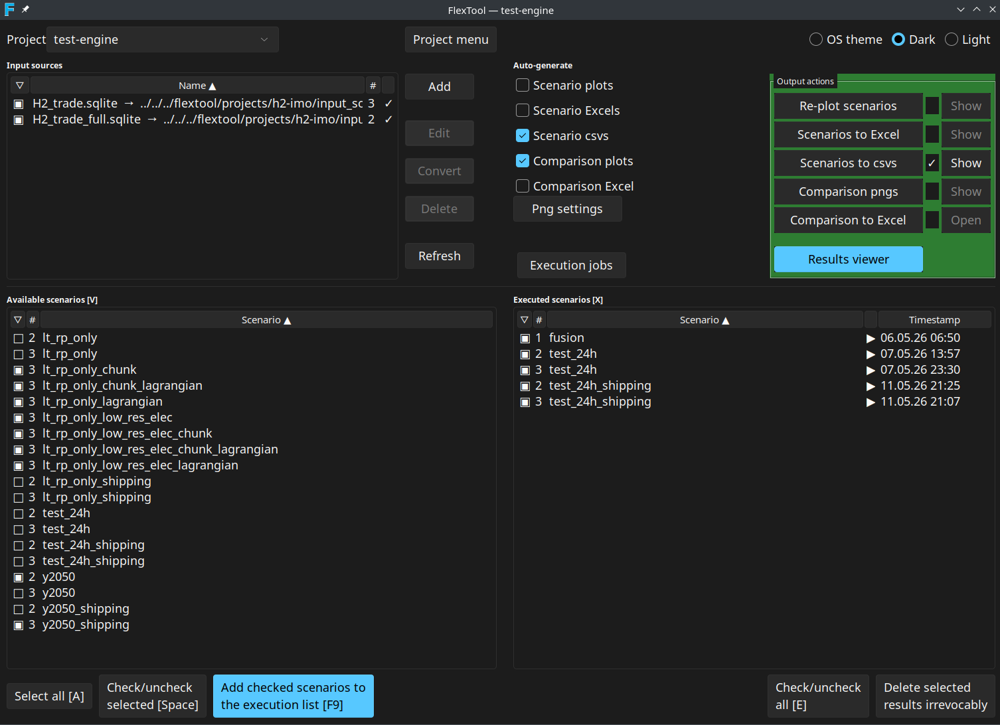
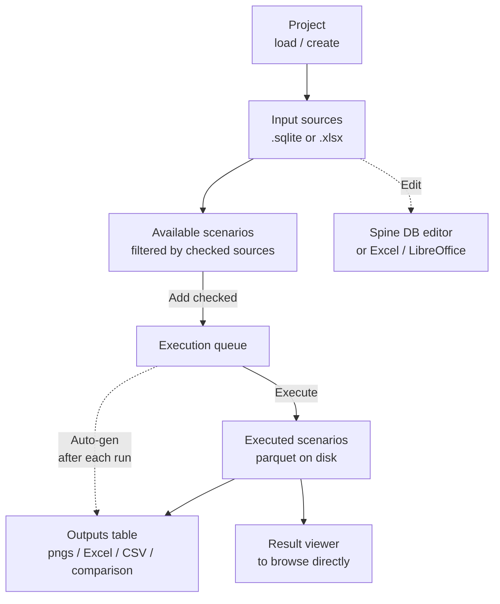

# FlexTool GUI

The FlexTool GUI is a standalone Tkinter application and the **primary** way to use FlexTool. It manages projects, input sources, scenario execution, and output generation in a single window. Start it from the FlexTool installation directory with:

```
python -m flextool.gui
```

See [Install with FlexTool GUI](install_gui.md) for installation, and [Architecture](dev/architecture.md) for what the GUI does under the hood. [Spine Toolbox](spine_toolbox.md) is the workflow-oriented alternative interface, and [Excel / LibreOffice](excel_interface.md) is the parallel spreadsheet editor for the same input sources. For headless / CI use see the [Terminal CLI](terminal_workflow.md).



## Workflow at a glance



Editing an input source jumps out to the Spine database editor or a spreadsheet application. The **Auto-gen** column on the Outputs table controls which derived artefacts are produced automatically after each successful execution.

## Top bar: Project

Each project lives in `projects/<name>/` and owns its own input sources, execution history, and `settings.yaml`. The **Project** drop-down switches between projects; **Project menu** opens a popup with:

- **Manage projects…** — create / rename / delete projects, and **Export…** / **Import…** a project package (see [Sharing a project](#sharing-a-project)).
- **UI font size** — radio choices (9, 10, 11, 12, 14 pt) plus **Custom…** to enter any integer between 6 and 32. The chosen size is applied live to every named Tk font (body / menu / heading / tooltip / fixed) and persisted to `projects/projects.yaml`. See [Display and fonts](#display-and-fonts).
- **Reset window layout** — clears saved window sizes and sash positions for the result viewer and execution window. Any open viewer or execution window is closed; their defaults apply the next time they open.

F2 or double-click on the drop-down renames the current project. The most recently used project is reopened on the next launch.

## Input sources

The **Input sources** panel lists every `.sqlite` and `.xlsx` file in the project's `input_sources/` directory plus any registered external references. Each input source contributes one or more scenarios.

| Action | Effect |
| --- | --- |
| Add | Add a new `.xlsx` or `.sqlite` source. Imports are migrated to the current FlexTool DB version automatically. |
| Edit | SQLite opens in the Spine database editor; Excel opens in the OS default spreadsheet app. Double-click does the same. |
| Convert | Convert an `.xlsx` input source to a SQLite database. |
| Delete | Remove the selected source from the project. External references unlink the reference; the file on disk is untouched. |
| Refresh | Rescan `input_sources/` on disk. |

The **checkbox** column decides whether the source's scenarios appear in **Available scenarios**. The **#** column is the source's persistent number — it is assigned the first time the source is seen and stored in `settings.yaml` (`input_source_numbers`). When a source is deleted its number is freed only when no executed-scenario folder on disk still references it; the next new source picks the lowest free number, so a deleted slot is reused once its outputs are also cleaned up. Hovering over a row with an error, empty, "editing" or frozen status shows a Toplevel tooltip explaining the status; external references show their POSIX path relative to the project root and a reminder that **Delete** only removes the reference.

Right-click a row for the same actions as the buttons. Column headers sort the list; the active sort direction is shown by a small arrow.

### Migration and frozen databases

When the list is refreshed, a `.sqlite` source older than this FlexTool (or at the current version but with an older SpineDB schema, e.g. after a `spinedb_api` update) is migrated to the current version: a source in `input_sources/` without asking (a safety copy is kept until the migration has finished), an external reference after asking whether to migrate it in place or copy it into the project first. Checking the version reads the file read-only, so nothing in the file changes before you agree. Adding scenarios to the execution list, or opening **Calibrate investments**, checks their sources again and migrates any that changed since the last refresh; FlexTool does not run a database that is not at the current version.

A released model can be **frozen** so that it is never migrated in place without asking: right-click a `.sqlite` source → **Freeze database…** and give a label, e.g. `Reference case 1.0` (at most 170 characters). Only a database at the current version can be frozen. A frozen source shows ❄ in the status column; the tooltip shows the label, the version and the date it was frozen. **Unfreeze database** removes the marker. The same can be done in a terminal with `flextool-freeze` (see [Freeze a released database](terminal_workflow.md#freeze-a-released-database)).

When a frozen source is older than this FlexTool (or has an older SpineDB schema), the refresh asks what to do with it. A frozen source newer than this FlexTool is left as it is; running it asks you to update FlexTool.

- **Migrate a copy** (default): the copy, `input_sources/<name>_v<version>.sqlite`, is migrated and added as a new input source. It has its own source number, so its results go to new result folders. The copy is not frozen; it records the label, the old version and the SHA-256 of the frozen file it was made from. The frozen file stays unchanged and is not asked about again while the copy is there.
- **Migrate in place**: after a second confirm, the frozen file itself is migrated. Its frozen marker is kept with the new version.
- **Cancel**: the source is not migrated. Until the project is reopened (or FlexTool restarted) it shows ❄✗ (frozen, older version), its scenarios are not listed and it is not asked about again; right-click → **Migrate frozen database…** asks again.

Editing a frozen database in the database editor is not prevented; a frozen database is protected from migration only.

Excel input is described in [Excel interface](excel_interface.md); the Spine database editor is described in [Spine database](spine_database.md).

### Add empty FlexTool input Excel

When you choose **Add → empty Excel**, the **parameter-group picker** dialog opens. Every parameter group from the FlexTool template is listed as a checkbox row. Required groups (currently `timeline`, `model`, `solve_basics`, `basics`) are highlighted at the top of the list with a yellow tint and a hover tooltip explaining that they are required for a functioning model, but can still be unchecked when assembling a model from several input sources. Bulk-action buttons select all, select required only, or clear all. The highlight colour adapts to the active dark / light theme.

See [Excel interface](excel_interface.md) for the resulting file structure.

### Convert a FlexTool 2.0 model

**Add → Convert from FlexTool 2.0 input file** asks for the FlexTool 2 input data file (one of the master workbook's `InputData/*.xlsm`), then whether to import its sensitivities too; if yes, pick the FlexTool 2 master workbook (the one with the `Sensitivity definitions` sheet). The sensitivities become alternatives and scenarios on top of `base`. Converting an `.xlsx` FlexTool 2 file in the input sources list asks the same question. The conversion runs as one job in the Execution window: it imports the data and the sensitivities, migrates the database to the current version and ends with an import report that lists, by topic, every FlexTool 2 input that was not carried over or works differently in FlexTool 4, with the entities that use it and what to do. The database is written in the project's `intermediate` folder and moved into `input_sources` only when the conversion has succeeded; the new input source and its scenarios are then ticked. See [Import old FlexTool v2 files](terminal_workflow.md#import-old-flextool-v2-files) for what the report lists and how must-run (fix / min / max generation) and storage start / finish are translated.

## Available scenarios `[V]`

Lists every scenario found in the **checked** input sources. The header text `[V]` is the keyboard shortcut: press **V** to focus the list.

| Key | Action |
| --- | --- |
| V | Focus the Available scenarios list |
| A | Select all rows |
| Space | Check / uncheck the selected rows |
| Alt-A | Add checked scenarios to the execution queue |
| F9 | Same as Alt-A |
| Click column header | Sort by that column |
| Right-click | Check selected / Add selected to execution jobs |

The **Add checked scenarios to the execution list** button queues every checked row. Scenarios already pending or running are skipped.

## Executed scenarios `[X]`

A row appears here as soon as a scenario produces a parquet result tree under `output_parquet/<scenario>_<src#>/`. Parquet is the canonical result format — every other output is derived from it.

| Key | Action |
| --- | --- |
| X | Focus the Executed scenarios list |
| E | Check / uncheck all rows |
| Space | Check / uncheck the selected rows |
| Right-click | Check selected / View results / Delete irrevocably |
| Click the **View** column | Open the scenario's plot directory |

Rows whose `#` (source number) no longer matches any current input source are shown greyed (foreground `#888888`) and tagged **orphan**. The row stays so the outputs are visible and can be deleted explicitly with **Delete selected results irrevocably**.

## Outputs (unified table)

The **Outputs** table replaces the older *Auto-generate* checkbox group and *Output actions* button column with a single bordered widget. Each row covers one derived artefact:

| Column | Meaning |
| --- | --- |
| **Output** | Display name (Scenario pngs, Scenario Excels, Scenario csvs, Comparison pngs, Comparison Excel). |
| **Auto-gen** | Checkbox: produce this output automatically after every successful scenario run. Persisted to `settings.yaml`. |
| **Status** | Clickable cell. Blank = not run, **✓** = produced, **⊘** = last attempt failed, animated spinner = currently running. Clicking the cell (re-)generates the output for the **checked** executed scenarios. |
| **Action** | **Show** opens the output folder in the system file manager; for **Comparison Excel** the label is **Open** because the target is a single file. |

Parquet is always written for an executed scenario, regardless of any Auto-gen tick. Auto-gen only controls the derived artefacts; png / Excel / CSV outputs can always be (re-)generated later by clicking the Status cell of the relevant row.

## Side menu

The narrow column to the left of the Outputs table holds five user-tunable controls. It is split into a top group and a bottom group by a flexible spacer:

- **Save memory** — checkbox that passes `--save-memory` to scenario runs. After the LP is built, polar-high's polars / numpy LP source is dropped, the LP is written to a temp MPS file, and HiGHS solves it in a separate subprocess (via `cmd_solve_mps`) so the solver's working set lives outside the FlexTool address space. Trades ~+90 s I/O per sub-solve for ~5–10 GB lower peak RSS. Also disables warm-LP reuse across cascade iterations (every sub-solve cold-rebuilds).
- **Debug** — checkbox that passes `--debug --csv-dump` to scenario runs. `--debug` turns on verbose engine logging; `--csv-dump` writes the cascade's processed inputs to disk after the last sub-solve for inspection.
- **OS theme / Dark / Light** — theme radio buttons. Takes effect on the next launch and is persisted to `projects/projects.yaml`.
- **Png settings** — opens the plot configuration dialog (see [Png settings](#png-settings)).
- **Execution jobs** — opens the [Execution jobs](#execution-jobs) window.
- **Results viewer** — opens the [Result viewer](#result-viewer). When the viewer is already open the button relabels to **Update view scenarios**.

### Png settings

The **Png settings** dialog has separate sections for **scenario** and **scenario-comparison** plots:

- **Start timestep** — first timestep to include in the plot range.
- **Duration** — number of timesteps to plot (0 = until the end of the data).
- **Plot config file** — YAML config defining what plots to render and how. The shipped default is the bundled `flextool/schemas/default_plots.yaml`.
- **Active configs** — checkbox list of named configurations from the chosen file. Only checked configs are rendered.
- **Dispatch plots** *(comparison section only)* — toggle whether dispatch time-series plots are included in comparisons. In a multi-period scenario the periods follow one another along the time axis (the period names below the time steps), with a gap where a period does not continue the previous one; *Start timestep* and *Duration* count the time steps across the periods, so the default window shows only the start of the first period of a long run. The companion **Edit dispatch plots…** button opens a YAML editor for the dispatch config.
- **Just one file per plot** — render only the first file of a plot that is split into several files (a quick overview).
- **Write plotted data (CSV)** — also write the data drawn in each plot as a CSV file next to its image, with the same name (see [Plotted data as CSV](results.md#plotted-data-as-csv)). A `write_plot_data: true` in the project's `plot_settings.yaml` turns this on whatever the checkbox says; the checkbox then shows as checked and greyed out, with "on in plot_settings.yaml" next to it.

The dialog is purely a configuration step; rendering happens via the Status cell of the relevant Outputs row (or automatically through Auto-gen).

## Execution jobs

The **Execution jobs** window is a separate `Toplevel` dedicated to queue management. It coexists with the main window — actions in the main window keep working while the jobs window is open.

### Resource controls

The top row of the window holds five spinboxes; each is a per-project setting persisted to `settings.yaml`. Their defaults are deliberately conservative — one job at a time, one thread per run, auto-budget — so the GUI never starves the host machine by default:

| Control | Default | Meaning |
| --- | --- | --- |
| Max. parallel executions | **1** | Number of scenario subprocesses that may run concurrently. |
| Threads per run | **1** | Threads of each run: FlexTool's data processing and the solver (every solver's thread count: HiGHS, Gurobi, CPLEX, Xpress, COPT; it replaces the value in the solver's option file). Passed to each subprocess as `--threads`; runs executed in parallel each use this many. |
| Memory budget/job (GB, 0=auto) | **0.0** (auto) | Soft target. Jobs are allowed to exceed it when memory is available. Only enforced when free RAM drops below the reserve **and** swap growth reaches the allowance — the watchdog then kills whichever running job is most over its budget. In **auto** mode, every successful run records its measured peak × 1.5 as the budget for the next run, persisted under `scenario_resource_history`. First-run fallback is `(system memory − reserve) ÷ max parallel jobs`. |
| Min free RAM (GB) | **0.5** | Floor for system free memory. The watchdog acts only when this floor is breached **and** the swap allowance is exhausted. |
| Allow swap (GB) | **0.0** | How much swap **growth** to tolerate, measured since FlexTool started (pre-existing swap is ignored). 0 means kill as soon as free RAM dips below the reserve. |

Together these settings let FlexTool absorb oversized-scenario pressure without taking the host system down.

### Memory enforcement

On all platforms the in-process `MemoryWatchdog` (5-second poll) is the sole memory enforcer. It tracks per-job peak RSS and kills the most-over-budget running job only when free RAM falls below **Min free RAM** *and* swap growth reaches **Allow swap**. A killed-for-memory job shows a "⚠" suffix on its Peak GB cell. On Linux every job is launched via a transient `systemd-run --user --scope`; the `FLEXTOOL_SLICE` environment variable can place the scope in a user-defined cgroup slice (e.g. `heavy.slice`) for scheduling isolation. No `MemoryHigh` / `MemoryMax` property is set — they would stall or abort large polars `collect_all` calls. Windows and macOS launch the subprocess directly.

### Jobs table and progress pane

The horizontal split has the Jobs tree on the left and a per-job log on the right; the sash position is persisted globally. The jobs tree has columns Status icon, source `#`, Scenario, Peak GB, and Timestamp. Failed and killed rows are tagged `failed` and rendered bright red (`#ff3333`).

A status label at the bottom of the window shows `running/max threads | used/total GB`. When pending jobs are being held back the label appends `| Thread limited` (max workers reached) or `| Memory limited` (admission blocked by the reserve) and the label text turns theme-aware red — `#c62828` on the light theme, `#ff6b6b` on dark / OS-theme. The colour clears as soon as there are no pending jobs or the limit is no longer active.

### Per-job actions

- **▲ / ▼** (or **PgUp / PgDn**) — reorder pending jobs.
- **Kill selected** — terminate selected running or pending jobs.
- **Remove selected** — drop finished or killed rows from the list.
- **Pause executions / Continue executions** — pause the scheduler so already-running jobs finish but no new ones start.
- **Kill all** — terminate everything that is running or pending.

The log pane appends lines as the selected job produces stdout and auto-scrolls only when the user is already at (or near) the bottom; scrolling up to read older output suppresses the auto-scroll.

## Result viewer

The **Result viewer** is its own window. It reads scenarios directly from parquet, so navigation is live and is **not** constrained by the Png settings (start timestep, duration, etc.); the Png settings only affect pre-rendered PNG output.

| Key | Action |
| --- | --- |
| S | Focus the Scenarios list |
| P | Focus the Plots list |
| V | Switch to single-scenario view |
| X | Switch to comparison view |
| ↑ / ↓ | Navigate scenarios / plots |
| ← / → | Previous / next variant in the current plot |
| PgUp / PgDn | Previous / next variant (alias) |
| Ctrl-A | Select all comparison rows |
| Alt-↑ / Alt-↓ | Reorder comparison rows |
| Tab | Cycle focus between the three panes |

Click the **Results viewer** button in the side menu, or **View results** in the right-click menu of an executed scenario, to open it. Closing the main window also closes the viewer.

Two behaviour notes worth knowing:

- **Style scoping.** The plot tree's selection highlight is mapped on a dedicated `PlotTree.Treeview` ttk style, so opening the viewer no longer overwrites the main window's global Treeview selection colours. The main window's blue selection survives a viewer open / close cycle.
- **Off-UI-thread figure builds.** Plan-path figure construction (`build_figure_from_plan`) runs on a background executor. Most plots are essentially instant, but bar plots with hundreds of items per file can take tens of seconds; running them off the Tk main thread keeps the GUI responsive during the render and avoids the "freeze" the user would otherwise see.

## Display and fonts

All text-rendering widgets share six named Tk fonts that are configured at startup from `GlobalSettings.font_size_pt` (body / menu / text — default 10 pt) and `GlobalSettings.code_font_size_pt` (`TkFixedFont` used by logs; 0 = auto = body + 2). Headings are body + 2 pt bold; tooltips are body − 1. Sizes are POINTS, so Tk's scaling factor DPI-scales them automatically.

Changing the size via **Project menu → UI font size** calls `setup_fonts` and recomputes the Treeview row height live — every widget that uses the named fonts updates without restart. The new size is persisted to `projects/projects.yaml`.

**Per-monitor DPI.** When the main window is moved between monitors with different scaling factors, the `<Configure>` handler reads `winfo fpixels 1i` and, if the effective DPI has changed by more than 10 %, re-applies the configured font sizes so points render at the new DPI. Already-placed widgets keep their pixel positions until the user resizes or re-opens the window; this is intentionally a partial fix — it beats leaving text frozen-tiny or frozen-huge until restart. If auto-detection picks the wrong monitor, setting `FLEXTOOL_DPI` at startup forces a value.

## Sharing a project

A project can be sent to another computer as one file, `<Name>_<YYYYMMDD>.flextool.zip`. In **Manage projects…** select the project and click **Export…**:

- **Always in the package** (greyed): the input sources, `settings.yaml` without the settings of this machine (execution limits, parallel executions, learned memory budgets), `plot_settings.yaml`, and the solver option files (`*.opt`) of the workspace's `solver_config` folder.
- **Copy external input files into the package** (on by default): input files that the project reads from outside its folder are copied into `input_sources/` of the package. They keep their source numbers, so a shipped result `base_2` and a re-run of the same scenario on the other computer pair up.
- **Result runs**: tick the runs to include, or use **None** / **All**. The size of each run is shown, and the total is the uncompressed size (parquet files barely compress). A run whose input file changed after the run is marked *input changed after the run* in amber: its results do not match the input being shipped. The package lists such runs. A run that is still being written — by this window, Spine Toolbox or the terminal, as its run record says — is marked *running* in red and cannot be exported until it ends. The viewer's shared y-axis ranges (`output_parquet/_axis_bounds.json`) go with the package cut to the ticked runs, so the names and ranges of the other runs stay home.
- **Run records**: each result run has a run record (`_run_status.json`) and a run log (`_run.log`) that show this computer's folder paths, user name and host name. **Remove this computer's folder paths, user name and host name from the run records, and leave the run logs out** is on by default: the project folder becomes `<project>`, the home folder `~`, other folders `<path>/`, and the host and user `<host>` / `<user>`; the verdict, times and solver stay. Untick it to ship the records and logs as they are.
- Plots, CSV and Excel outputs, `results.sqlite` and the scratch folders (`work/`, `converted/`, `intermediate/`) are not packaged. The plots and the CSV and Excel outputs are made again from the results on the other computer; `results.sqlite` is written only when a scenario runs, or with `flextool-write-outputs --write-methods spinedb` from the terminal.

A `.sqlite` input that a program may be writing to (it has a `-journal` or `-wal` file next to it) is copied through SQLite, so the package holds a consistent database; otherwise it is copied byte for byte and keeps its SHA-256. A file that changes while it is being copied stops the export, and an input open in Excel is noted. File names that Windows cannot hold (`CON`, `NUL`, `COM1`…, the characters `< > : " | ? *`, a trailing dot or space, two names that differ only in case) stop the export with the names to change, because a package must unpack on Windows, macOS and Linux. When the package file exists already, Export asks before replacing it. The solver `.opt` files and the plot settings travel as they are: if they hold a folder path of this computer, the receiver has to change it.

Export is refused while the project has running or pending jobs. Frozen databases go into the package as they are and stay frozen. A `manifest.json` in the package records the FlexTool, polar-high, HiGHS, polars and spinedb_api versions, the data version and frozen marker of each input database, and the SHA-256, size and modification time of every file.

To import, click **Import…** in **Manage projects…** and pick the package. The dialog shows the project name, when and with which FlexTool it was made, the data version of each database and the result runs, without unpacking anything. The name is filled in from the package; when a project of that name exists (compared without case), the first free `<Name>_2`, `<Name>_3`… is suggested, and **Import** stays disabled while the name is taken. Warnings are shown in amber: a package made with a newer FlexTool (results and inputs may use features this version lacks), and databases that are migrated when the project opens (FlexTool asks first for a frozen one, as for any frozen database). A database newer than this FlexTool cannot be opened, and Import is disabled until FlexTool is updated. An input that was outside the project folder and not copied in is named: its scenarios cannot be run again until the receiver adds that file. Every checksum, every name and the free disk space are checked before anything is written; files keep their modification times, so the results are not reported as made from a changed input (a FAT32 disk keeps times only to 2 s, so there a result can show as made from a changed input). On success the new project opens; an import that was stopped leaves a hidden `.<name>.partial` folder, which is not listed as a project and is removed by the next import of that name.

The shipped solver options are unpacked to `imported_solver_config/` in the project; the workspace's own `.opt` files are never changed. The import message says whether they differ from the workspace's, with the lines that differ. To run with the shipped options, copy `imported_solver_config/*.opt` to the workspace's `solver_config` folder, or start FlexTool with `FLEXTOOL_SOLVER_CONFIG_DIR` set to the project's `imported_solver_config` folder. The same can be done from the terminal with `flextool-project` (see [Sharing a project](terminal_workflow.md#sharing-a-project)).

## Where things live on disk

- `projects/projects.yaml` — global settings (theme, font sizes, last project, jobs-window sash).
- `projects/<project>/settings.yaml` — project settings: Auto-gen flags, Debug / Save-memory checkboxes, per-project `execution_limits` and `max_workers`, `input_source_numbers`, `bare_output_owners`, `scenario_resource_history`, viewer state.
- `projects/<project>/input_sources/` — `.xlsx` and `.sqlite` input files.
- `solver_config/` in the FlexTool workspace (the folder FlexTool is started from) — the solver option files (`highs.opt`…) that every run and calibration started from the GUI uses (the GUI passes the folder to each run as `--solver-config-dir`, so it does not matter where a project's input database is); `$FLEXTOOL_SOLVER_CONFIG_DIR`, set before the GUI starts, points runs at another folder. Each run copies the files it used to `projects/<project>/work/<run>/solve_data/solver_config/`. An imported project keeps the options it was shipped with in `projects/<project>/imported_solver_config/`.
- `output_parquet/<scenario>_<src#>/` — canonical results, always written. New writes always carry the `_<src#>` suffix so the folder name itself records which source produced it. Pre-existing bare-name folders from older projects are still readable via `bare_output_owners`; the GUI flags rows whose source no longer exists as **orphan**.
- `output_plots/<scenario>_<src#>/` — PNGs from scenario plots.
- `output_excel/<scenario>_<src#>.xlsx` — Excel export of one scenario.
- `output_csv/<scenario>_<src#>/` — CSV export of one scenario.
- `output_plot_comparisons/` — comparison plots and Excel workbook.
- `output_parquet_comparison/` — parquet feeding the comparison plots and viewer.

## See also

- [Install with FlexTool GUI](install_gui.md)
- [Interface overview](interface_overview.md) — which interface to pick
- [Terminal CLI](terminal_workflow.md) — headless / CI usage
- [Excel interface](excel_interface.md) — the parallel spreadsheet editor
- [Spine database](spine_database.md) — the SQLite input format
- [Spine Toolbox](spine_toolbox.md) — the workflow alternative
- [Architecture](dev/architecture.md) — what runs under the hood
