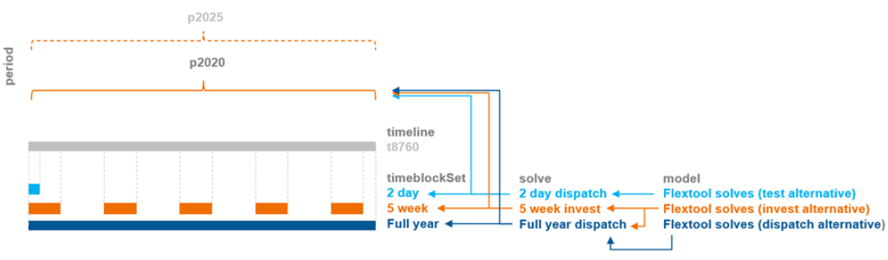
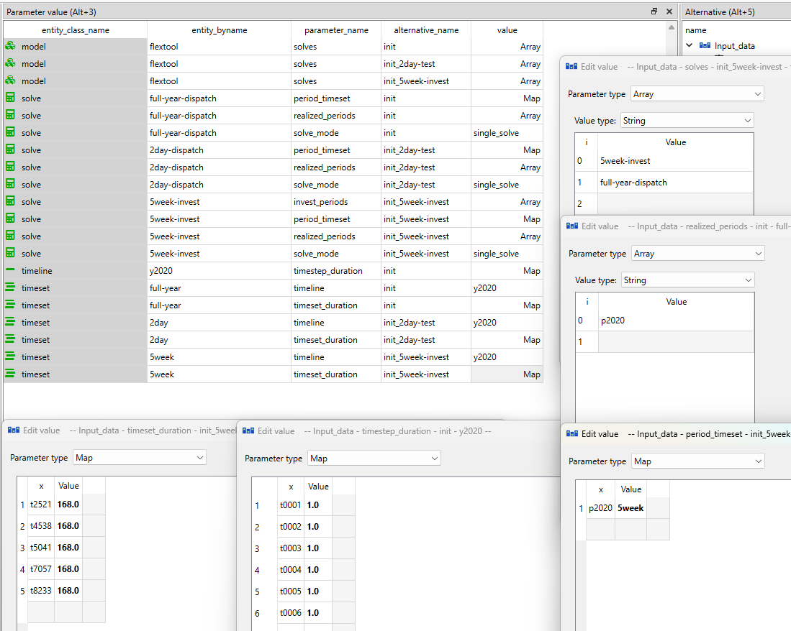
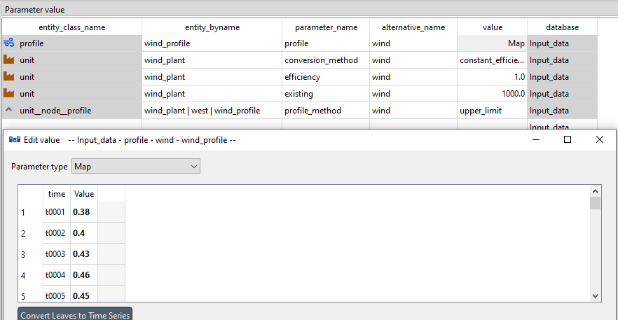
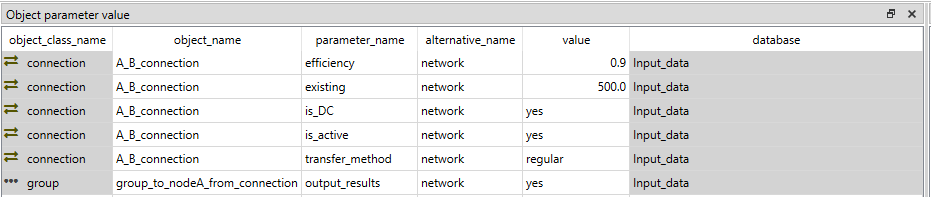
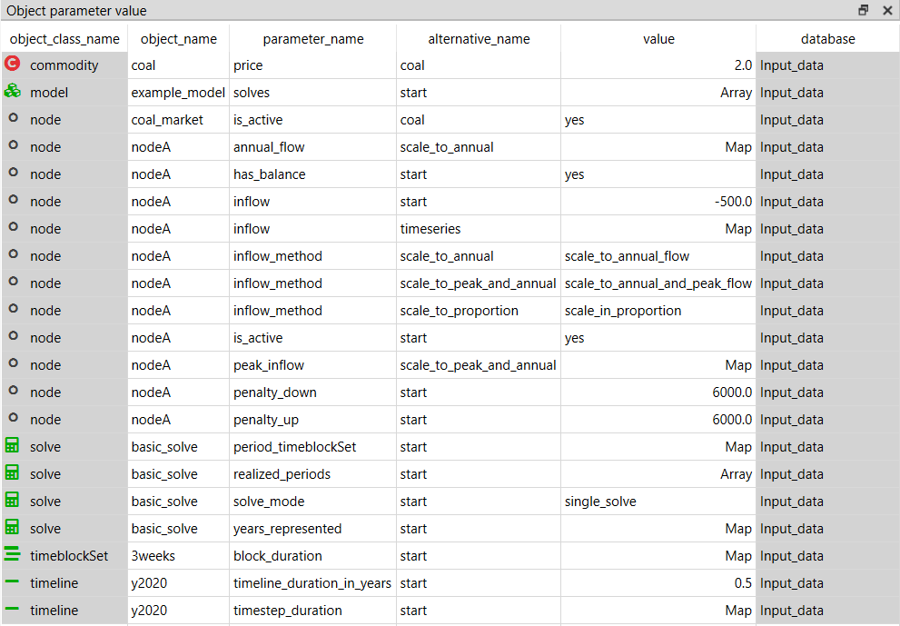
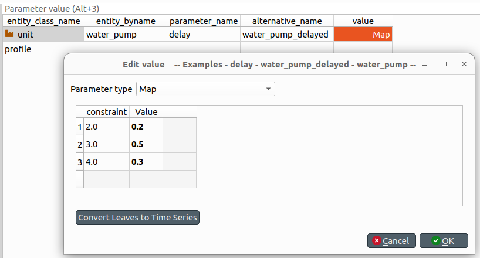

# Basics: time, VRE, network and demand

## How to create basic temporal structures for your model
**(time_settings_only.sqlite)**

FlexTool allows to build models for different kinds of purposes and has therefore a flexible temporal structure, which requires some learning at first. To get you started, this how-to creates three different timelines: a full year, a 48h timeline and a timeline with five one-week periods to represent a full year. To be able to choose which of these are used in a given scenario, three alternatives are created: init, init_2day-test, init_5week-invest. 

The names of these alternatives hint at the intended use of each timeline. Even when you are building a large model with a long timeline, it is better to use a short 48 hour timeline for testing purposes when building the model. Using five one-week periods, i.e. "a representative periods", in an investment model is a method to reduce the model size and consequently solve time. More about that in [How to run solves in a sequence (investment + dispatch)](solve_sequences.md#how-to-run-solves-in-a-sequence-investment-dispatch)



To define a temporal structure for a model instance, you need to create the following entities:

- `timeline` entity called *y2020* with a map-type parameter `timestep_duration` that defines the timeline the time series data in the model will need to use. It contains, in the first column, the name of each timestep (e.g. *t0001* or *2022-01-01-01*) and, in the second column, the length of the timestep in hours (e.g. *1.0*). The timestep names here must match the timestep names in other time series like `inflow` or `profile`. Here all of the three options use the same full year timeline i.e. timesteps from t0001 to t8760 with a step size of one hour.
- `timeset` entities called *full-year*, *2day* and *5week*. Each of them need a map-type parameter `timeset_duration` to define a timeset using a timestep name to indicate where the timeset starts and a number to define the duration of the timeset in timesteps: (*t0001*, *8760*) for the *full-year* and (*t4001* and *48.0*) for the 48h. The timeline is larger than the 48 hours, but this way the solver uses 48 hours specified. The *5week* needs five starting points
*t2521*, *t4538*, *t5041*, *t7057* and *t8233* with all having the length of *168.0*
- `timeset` needs to be connected to the timeline. This is done by adding the `timeset` parameter `timeline`. Each of the three `timesets` include the value *y2020*.
- `solve` entities called *full-year-dispatch*, *2day-dispatch* and *5week-invest*. In addition, they need the following parameters:

  - a map-type parameter `period_timeset` to define the timeset to be used by each period. Here each of the three use their `timeset` to describe the same period *p2020*. The first column of the map has the period: *p2020* and the second column the `timeset`: *full-year*, *2day* or *5week*
  - an array-type parameter `realized_periods` to define the periods that are realised from the `solve` named by the entity (the first column of an array is an index number starting with *0*, the second column contains the period to be realized in the results: *p2020* for all the solves here)
  - a parameter `solve_mode`, to be set to *single_solve* in these examples

- Finally, a `model` entity will define the solves to be included in a one model instance. They are defined in the array parameter `solves`. For these examples, the model name is *flextool* and for each `solve` the name of the `solve` should be given in the `solves` array (distinguished by the alternative): *full-year-dispatch*, *2day-dispatch* or *5week-invest*.

Be careful when choosing datatypes! Maps need to be maps not arrays. You will see a red exclamation mark if you are using the wrong datatype. (In the future, an update is coming to toolbox to ensure compliance.) 



The tool includes some assumptions about the time structure, in case something is missing. These will work if there is only one option for the model to choose. The assuptions are the following:

 - If `timeset`: `timeline` is not set and only one `timeline` is defined, it is used
 - If no `timeset` is exist and only one `timeline` is defined, create a full timeline timeset
 - If `period_timeset` is defined, but no `realized_periods` or `invest_periods` exists, all periods are realized
 - If `period_timeset` does not exist and only one `timeset` exists, create `timesets` for all `realized_periods` and `invest_periods`
 - If `model`: `solves` does not exist, and only one `solve` exists, that it is used
 - If a `solve` in `model`: `solves` does not exist, create a `solve` where all `periods_available` are realized

## How to create a PV, wind or run-of-river hydro power plant

**(examples.sqlite scenario: wind)**
***init - west - wind***

These three power plant types don't use any commodities (i.e. fuels), but are instead dependant on a timeseries profile.
To create these plants one needs an output node, an unit and a profile.

The unit needs to be added to an alternative in the `Entity Alternative` sheet. 

The unit only needs parameters:

- `existing`: [The maximum capacity of the plant] 

Additionally these parameters should be at their default values:

- `conversion_method`: *constant_efficiency*
- `efficiency`: 1

The `profile` entity only has one parameter: `profile`. It is a timeseries map which tells what fraction of the capacity the plant can produce at each timestep.

The other entities 

- `unit__outputnode`: (plant|output node) and 
- `unit__node__profile`: (plant|output node|profile) need to be both created.

The `unit__node__profile` entity needs a parameter `profile_method` that has three options: `upper_limit`, `lower_limit` and `exact`. It states how the profile is considered. In most cases the `upper_limit` option should be used as it allows the plant to curtail the production if there is more supply than demand. Otherwise the output node might have to use `downward_penalty` to spill energy.

The same profile can be used for multiple `unit__outputnode`s (and that is why the profile is not a unit parameter but its own entity).



## How to connect nodes in the same energy network
**(connections.sqlite)**

Typically nodes are used to maintain an energy balance and therefore they are used to represent a location with demand or a storage. The nodes can pass energy to each other through a connection entity. This is often an electricity connection but it can be any form of energy (or matter)  moving between two nodes. To create a connection one needs:

- two `nodes` 
- `connection`
- `connection__node__node` to tie these three together.

The `connection` and `nodes` need to be added to an alternative in the `Entity Alternative` sheet. 

The connection needs parameters:

- `existing`: The maximum capacity of the connection [MW]. Applies to both directions.
- `efficiency`: represents the losses in transferring the energy. Same in both directions.

Optional parameters:

- `is_DC`: *yes*, flag if the connection is counted as non-synchronous for the possible non-synchronous limit. If `is_DC` (direct current) is yes, then the connection is non-synchronous. More at: How-to create a non-synchronous limit
- `transfer_method`: Five options: *regular* (default), *exact*, *variable_cost_only*, *no_losses_no_variable_cost*, *unidirectional*.

In most cases *regular* should be used. The downside of it is that it allows the flows to both directions at the same time, but the model does this only in specific circumstances when its beneficial to leak energy through the connection losses. For example, if connection capacity is 500 and efficiency 0.8, both nodes can receive 500, but send 625 (500 / 0.8), reducing the incoming energy by 125 in both nodes without any cost.
Typically the model does not want to produce extra energy as it usually has costs, but it can happen if there is a cost to curtailing energy generation from a free source or if a unit is forced to generate at some level ('e.g. using `profile_method`: 'equal'). If `non-synchronous` constraint is used with a node using this connection, use *exact* instead as *regular* connections can circumvent this limit.

*Exact* method does not allow flow in both directions at the same time: it uses one binary variable per connection and time step, so in each time step the whole connection transfers in one direction only. This is computationally heavier (especially if the model would otherwise be fully linear). 

*Variable_cost_only* can be used when there are no losses associated with the flow. It allows costs related to the flow, but if losses are to be included, it should not be used.

The *no_losses_no_variable_cost* can be used when the connection has no losses and no variable costs accociated with the flow. It is computationally the most efficient method, as it uses only one variable for the flow (the variable becomes negative for the other direction, but this can work only when there are no losses or variable costs). It also prevents simultanoues flow to both directions.

The *unidirectional* method restricts the flow to one direction only (from the first node to the second node in `connection__node__node`). It uses a single non-negative variable and supports `efficiency` and `other_operational_cost` in the usual way. Useful for one-way transmission such as controllable HVDC links or commodity pipelines.

A `group` can also carry a `transfer_method` that overrides the per-connection choice for every connection between its member nodes. Set it to any of the connection options above, or to `dc_power_flow_with_angles` to activate B-theta DC power flow on the subnet (which additionally needs `reactance` on each connection). An `is_DC` connection between the group's nodes is not a DC power-flow line: it keeps its own `transfer_method`. See the Groups section of the reference for details.

The results of connections can be seen from the node_balance table. However, these are the results from all the connections connected to the node. If you want summary metrics for an individual connection or a collection of them, create a `flowGroup`, add the relevant `flowGroup__connection__node` members, and set `flow_aggregator: standalone_aggregator_only` on the flowGroup. This produces a flow-group summary (per-period `cumulative_flow` MWh/a, scaled to a full year, and `average_flow` MW, plus a signed net-flow timewise series) for the group.

The example database shows a connection between a two node system where the other node has a wind power plant and the other node has a coal power plant. 



## How to set the demand in a node
**(demand.sqlite)**

The demand in a node is set with the inflow parameter. When the node is consuming energy or matter, the values should be negative and when the node is supplying energy (or matter) the values should be positive.
The inflow parameter accepts two types of data:

- Constant
- Timeseries map

If the model is using multiple periods, then the same timeseries profile is used for every period. However, the inflow can be scaled for different periods with the `inflow_method` parameter:

- `scale_to_annual_flow`: This will multiply the demand with a constant to make the summed inflow to match the `annual_flow`. This requires the node parameter `annual_flow` that is a map of periods containing the annual flow for each period. The sum of inflows is divided by the period's share of the year (hours in period /8760) before scaling (so that the annual energy demand/supply matches the `annual_flow` no matter what parts of the year are used to represent the full year). 
- `scale_in_proportion`: calculates a scaling factor by dividing `annual_flow` with the sum of time series inflow (after it has been annualized using `timeline_duration_in_years`). This does not force the demand/supply to match annual flow in case the representative periods are not representing the full year, but the time series will still be scaled to capture the proportional change in the `annual_flow` parameter. 
- `scale_to_annual_and_peak_flow`: The inflow scaled so that the peak is at the given `peak_flow` and the inflow sums to annual flow of the period. This is done by the following equation:

```
new_inflow = (peak/peak_old)*(1+c)*old_inflow-peak*c

where c = 
[(peak/peak_old)*(8760/hours_in_period)*sum(old_inflow) - annual_flow] 
/ [peak*steps_in_period*(8760/hours_in_period) - (peak/peak_old)*(8760/hours_in_period)*sum(old_inflow)]
```

`peak_old` is the largest (by magnitude) inflow of the period's own time steps, so each period's peak reaches its `peak_inflow`. `steps_in_period` is the number of time steps in the period (= hours_in_period on 1 h steps). `peak_inflow` is, like `inflow`, energy per time step; with `timeset_weights` or representative periods the sums and the step count are weighted.

Examples of all these options are shown in the demand.sqlite.



## How to create a delay between two nodes
**(examples.sqlite scenario: water_pump_delayed)**

Sometimes a flow between two nodes needs to be delayed, for example water flow in river systems can take hours between two power plants. This can be approximated using the `delay` parameter of units (connections do not apply `delay` yet — a connection `delay` is ignored with a warning — so use a unit for a delayed flow). Delay can be expressed using a constant value (hours) or as a weighted map of time delays (index: time delay in hours, value: weight). Each weight indicates its share of the original flow and the weights should sum to 1. Delay requires that the time resolutions in the model are always integer multiples of these time differences.



## How to use timeset weights (non-RP weighted timesteps)

`timeset.timeset_weights` lets each timestep within a `timeset` carry a custom weight that is applied to the cost and slack terms in the objective. The typical use case is a coarse, OSeMOSYS-style timeslice structure where some timesteps cover more year-hours than others (wet vs. dry season, peak vs. off-peak day-types) — `timeset_duration` already controls how long each step is, but `timeset_weights` is what scales the *contribution to the annual cost* when those slices are uneven.

The parameter is a flat Map on the `timeset` entity: index is the timestep name, value is a float. Weights are normalised per period to sum to 1 and then re-scaled by the number of active timesteps, so uniform input reproduces weight = 1 per step (the default behaviour) and the absolute magnitude of the weights does not matter — only the relative shape does. Decoder lives in `flextool/engine/input/_timeline.py` (`_decode_timeset_weights`) and the per-period normalisation is documented under `TimelineConfig.timeset_weights` in the same file. See also the `timeset_weights` entry in [Reference](../reference/index.md).

!!! note "Mutually exclusive: timeset_weights and representative_period_weights"
    A single `timeset` may carry **either** `timeset_weights` (per-step weights for non-RP timeslice models) **or** `representative_period_weights` (per-period weights for RP-clustered models), not both. The runner errors out if both are set on the same timeset.

## How to run a sensitivity (one alternative on top of a scenario)
**(examples.sqlite scenarios: coal and coal_co2_price)**

**The idea.** A sensitivity changes one or a few input values and leaves the rest of the model as it is. In FlexTool, put the changed values in an alternative of their own and add that alternative on top of the scenario you want to vary. The new scenario then differs from the original only in those values, and the difference in the results is the effect of the change.

**Make the alternative.** Add an alternative, for example *fuel_price_high*, and give it only the values that change: here `price` 30 on the `commodity` *coal* (instead of 20). Do not copy the other data into it.

**Make the scenario.** Make a new scenario with the same alternatives as the original, in the same order, and add the new alternative last. An alternative lower in the list overrides the ones above it when they set the same parameter (see [the tutorial](../tutorial.md#step-1-a-node-with-no-units)), so the last alternative wins. Make one scenario for each sensitivity: *coal* and *coal_fuel_price_high* side by side. To combine two changes, add both alternatives.

**An example.** In *examples.sqlite*, the scenario *coal_co2_price* is the scenario *coal* with the alternative *co2_price* on top. That alternative sets `co2_method` *price* and `co2_price` 50 CUR/t on the group *co2_price*. The three scenarios of [How to compare emission trajectories](emissions.md#how-to-compare-emission-trajectories) are built the same way.

**Things to know.**

- A value in the sensitivity alternative replaces the whole value of the alternatives above it, not a part of it. If you give a period map, give every period of the solves: for many parameters a missing period is an error (the parameter descriptions say which).
- An entity that exists only in the sensitivity (a new unit, for example) needs its entity alternative set to active in that alternative.
- Check that the two scenarios differ only where you meant: the AI assistant's `compare_inputs` lists the input differences between two scenarios (see [The AI assistant](../ai_assistant.md#try-a-tool-from-the-terminal)).

**Compare the results.** Run both scenarios and open them together in the comparison view of the [Result viewer](../flextool_gui_interface.md#result-viewer) (key X), or make comparison plots with [`scenario_results.py`](../terminal_workflow.md#scenario_resultspy-cross-scenario-comparison). To run many sensitivities from the terminal, see [Run several scenarios in a batch](../terminal_workflow.md#7-run-several-scenarios-in-a-batch).
