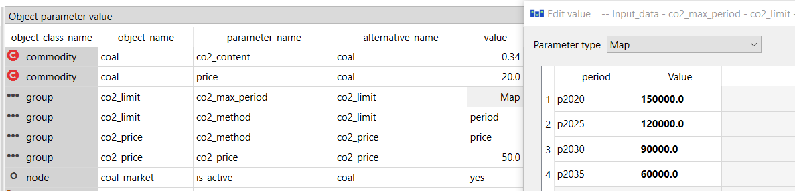
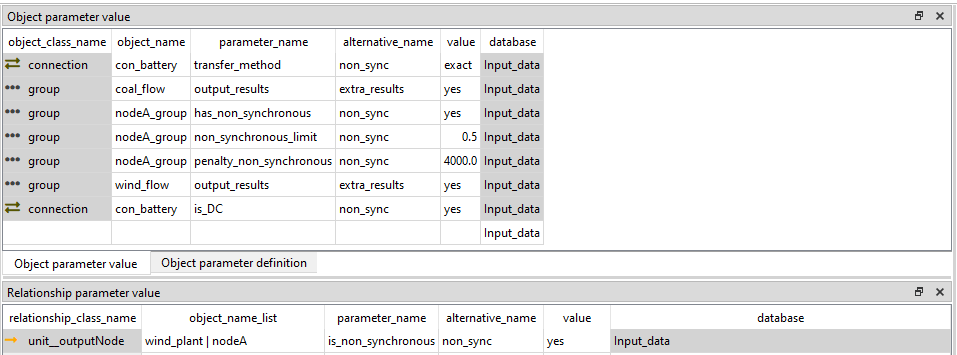

# Emissions and system limits

## How to add CO2 emissions, costs and limits

**(examples.sqlite scenario: coal_co2 )**
***init - west - coal - co2_price - co2_limit***

Carbon dioxide emissions are added to FlexTool by associating relevant `commodities` (e.g. *coal*) with a `co2_content` parameter (CO2 content (tons per MWh) of energy contained in the fuel). 
The other CO2 parameters are handeled through a group of nodes (Here *coal_price* or *coal_limit* `groups`). Therefore one needs to create a group and add all the nodes that supply these commodities (eg. coal_market) to a group with a `group_node` entity. (Here the entity *co2_price--coal_market*)
To set a price one needs to create set the co2_method parameter to *price* (constant) and create the `co2_price` parameter with the desired value. This price is added to the price of the commodity. 

Alternatively one can set a limit on the co2 used by setting the `co2_method` parameter to *period* or *total* and setting the `co2_max_period` (periodic map [tCO2/a], annual emissions in each period) parameter or `co2_max_total` (constant [tCO2], emissions over the whole solve: annual emissions times `years_represented`, summed over the periods) parameter. 

A flow into a node of the same `group` (instead of out of it) is treated as CO2 removal: it earns `co2_content × co2_price` as a credit against the price, and it is subtracted from the group's `co2_max_period` / `co2_max_total` emissions. This is how a direct-air-capture or bio-energy-with-carbon-capture process should be modelled — as a process whose output flow delivers into the group's CO2-content commodity node.

There methods can be combined by setting the `co2_method` to *price_period*, *price_total*, *period_total* or *price_period_total*.

## How to compare emission trajectories

**(examples.sqlite scenarios: co2_without_measures, co2_existing_measures, co2_additional_measures)**
***init - west - coal - co2_trajectory_system - (one trajectory alternative)***

**The idea.** Put the system in one set of alternatives and each emission trajectory in an alternative of its own, on top of it. A scenario per trajectory then differs only in the CO2 limit, so the results show what the trajectory costs. The examples use the usual reporting terms: without measures, with existing measures and with additional measures.

**The system.** The alternative *co2_trajectory_system* has:

- a solve *y2020_2035_2day_dispatch* with `solve_mode` *single_solve*, four periods *p2020*, *p2025*, *p2030* and *p2035* in `period_timeset` (each → *2day*) and in `realized_periods`, `years_represented` 5 in each period, and the model's `solves` set to it;
- a constant demand of 300 MW at *west*;
- *coal_plant* (from *coal*), 50 CUR/MWh, which emits 0.34 / 0.4 = 0.85 t of CO2 per MWh of electricity;
- a carbon-free *clean_plant* (`existing` 500 MW, `conversion_method` *none*), turned on in this alternative, with a `unit__outputNode` (*clean_plant*, *west*) and no input; its `other_operational_cost` of 80 CUR/MWh is on that flow;
- `co2_method` *period* on the group *co2_limit*, whose member is *coal_market*.

The objectives below assume no `inflation_rate` (0).

**The trajectories.** Each trajectory alternative sets `co2_max_period` on *co2_limit* as a period map [tCO2/a]:

| Alternative | p2020 | p2025 | p2030 | p2035 |
|---|---|---|---|---|
| *co2_without_measures* | 3.0 Mt | 3.0 Mt | 3.0 Mt | 3.0 Mt |
| *co2_existing_measures* | 2.0 Mt | 1.8 Mt | 1.6 Mt | 1.4 Mt |
| *co2_additional_measures* | 2.0 Mt | 1.5 Mt | 1.0 Mt | 0.5 Mt |

**No limit is a large value.** The system alternative sets `co2_method` *period*, and a group with that method must have a `co2_max_period`: no value is an error, and so is a period missing from a map. The scenario without measures therefore gives a value that never binds; a constant is enough (the example uses a map with the same value in each period). Coal alone would emit 300 MW × 0.85 t/MWh × 8760 h = 2 233 800 t/a, so 3.0 Mt/a does not bind. Another way is to set `co2_method` in the trajectory alternatives only.

**The scenarios.** Each scenario is *init*, *west*, *coal*, *co2_trajectory_system* and one trajectory, with the trajectory ranked last so that it overrides the others (see [the tutorial on alternative order](../tutorial.md#step-1-a-node-with-no-units)).

**The results.** Below 2 233 800 t/a the limit binds, so coal makes exactly the limit's worth of electricity and *clean_plant* makes the rest. A tonne less of CO2 costs (80 − 50) / 0.85 = 35.29 CUR, which is the CO2 price that the model reports in every period where the limit binds.

| Scenario | Emissions [Mt/a] | CO2 price [CUR/t] | Objective [M CUR] |
|---|---|---|---|
| *co2_without_measures* | 2.2338 in every period | 0 | 2628.0 |
| *co2_existing_measures* | 2.0, 1.8, 1.6, 1.4 | 35.29 | 3004.8 |
| *co2_additional_measures* | 2.0, 1.5, 1.0, 0.5 | 35.29 | 3322.45 |

**Compare them.** Run the three scenarios and open them together in the comparison view of the [Result viewer](../flextool_gui_interface.md#result-viewer) (key X), or make comparison plots with [`scenario_results.py`](../terminal_workflow.md#scenario_resultspy-cross-scenario-comparison) `--alternatives co2_without_measures co2_existing_measures co2_additional_measures`. The plots *Emissions CO2 per nodeGroup* and *CO2 period limited shadow price* show the emissions and the CO2 price per period.

**Things to know.**

- The limit is annual (t/a): each period's emissions are scaled to a full year, whatever the length of its timeset. Use `co2_max_total` with `co2_method` *total* for a budget over the whole horizon (see [CO2 costs and limits](../reference/groups.md#co2-costs-and-limits)).
- In a rolling solve, each roll may use the part of the period's limit that its horizon reaches, minus what earlier rolls already emitted in that period.
- CO2 is the only emission that FlexTool tracks, and `co2_content` is a constant per commodity.
- The limit has no slack. If the system cannot meet a trajectory, the model meets it by leaving demand unserved (the node's upward slack at `penalty_up`; with `penalty_method` *off* on the node, the model is infeasible instead), so check the slack results of a tight trajectory.

## How to create a non-synchronous limit
**(non_sync_and_curtailment.sqlite)**
***(scenario: non_sync)***

Non-synchronous limit is a property of a `group` of nodes. It states that the non-synchronous flow to the group of nodes cannot exceed a set share of the input flows at any timestep. To demonstrate this, we have set a system with a coal plant, a wind plant and a single demand node. However, it can be done to a group of nodes with unlimited number of plants or connections connected. So, one can limit the non-synchronous share of individual nodes or of the whole system. The flows between the nodes of the group are excluded.

The non-synchronous limit is set to a `group` of nodes with one or multiple members. Note: These are set to the group with `group_node` entity, not with `group_node_unit` entity!

Create a group (here *nodeA_group*) and set a `group_node` entity (nodeA_group |nodeA). Then add parameters:

- `has_non_synchronous`: yes
- `non_synchronous_limit`: 0.5
- `penalty_non_synchronous`: 4000

This forces the non-sync flow to be at max 50% of the incoming flow to the nodeA. 
The penalty should be always set as in some cases there is no other way to keep the constraint feasible (and it will be difficult to find the reason why the model does not solve). The existence of the non-synchronous penalty in your results indicates that this constraint has been violated and you should investigate the reason for this in your system. If the `penalty_non_synchronous` is lower than the `upward_penalty` of the demand `node`, the system will prefer breaking the non-sync constraint instead of the `node` balance equation. In other words, it will not curtail the production of `profile` plants if the demand is not satisfied even though it will break the non-synchronous penalty. If it is higher, the curtailment will take place instead.

When having a connection to a storage from a node with this constraint, the best practice is to add this storage node to the group as well. This excludes the flows to and from the storage in the calculation of the non-synchronous ratio. However, if you want to have these flows in the calculation, you have two options depending on if you want the flow to be synchronous or not. If it is non-synchronous, just set the connection parameter `is_DC`: yes. If it is synchronous (e.g., some flywheels), an issue arises with the *reqular* connection as it now can reduce the ratio with equal simultaneous flow in both directions. To prevent the simultaneous flow to both directions you need to set the `transfer_method`: *exact*. This will increase the solving time significantly as it will use integer variables (so, better to add the storage node to the node group with a non-synchronous limit).

Then set which plants and connections are considered non-synchronous by adding parameters:

`unit_outputNode`:

- `is_non_synchronous`: yes 

`Connection_node_node`:

- `is_DC`: yes 

Here the (wind_plant|nodeA) relation has the `is_non_synchronous` parameter and battery connection `is_DC` parameter. Because the battery node is in *nodeA_group*, the battery connection runs inside the group and its `is_DC` has no effect; it would count if the battery node were left out of the group.

A connection between a node of the group and a node outside it counts in both directions: its flow into the group is infeed (non-synchronous if the connection is `is_DC`), its flow out of the group is supply. A *regular* connection (at the cost of its losses) and a *no_losses_no_variable_cost* connection (at no cost) can flow both ways at the same time, which raises the supply side and so loosens the limit. Use `transfer_method`: *exact* for a synchronous connection that crosses the boundary of a group with a non-synchronous limit. FlexTool warns about a *no_losses_no_variable_cost* connection across the boundary (not when it is `is_DC`: then flowing both ways only tightens the limit).

With several groups that have a non-synchronous limit, each group counts its own boundary: wind exported from one group over an AC connection arrives in the neighbouring group as synchronous infeed (it is not counted against that group's limit), while over an `is_DC` connection it counts as non-synchronous there too.

If you want summary metrics per flow in the results, create a separate `flowGroup` for each flow (or collection of flows) and add `flowGroup__unit__node` entities to it. The flowGroup needs the parameter:

- `flow_aggregator`: standalone_aggregator_only

This emits the flow-group's own outputs (per-period `cumulative_flow` MWh/a, scaled to a full year, and `average_flow` MW, plus a signed net-flow timewise series) for the members. It is summary output — for per-timestep decomposition of a node's flows, use `print_dispatch` on a `group__node` group instead (see "How to create aggregate outputs").

Here we have *coal_flow* `flowGroup` with `flowGroup__unit__node` relation coal_flow|coal_plant|nodeA
and *wind_flow* `flowGroup` with `flowGroup__unit__node` relation wind_flow|wind_plant|nodeA.

## How to set a minimum inertia
**(examples.sqlite scenario: coal_wind_inertia)**
***init - west - coal - wind - inertia***

**The idea.** Synchronous machines store energy in their rotating mass, and this inertia slows the fall of the frequency after a large plant trips. A minimum inertia keeps enough synchronous machines running when wind and solar cover most of the demand. In FlexTool it is a limit on a `group` of nodes.

**The limit.** Give the group (with its nodes as `group__node` entities, here *electricity* with *west*, *east* and *north*):

- `has_inertia`: *yes*
- `inertia_limit` [MWs]: the minimum inertia, here 200. Constant, period, time or period+time.
- `penalty_inertia` [CUR per MWs and hour]: the cost of a shortfall, default 5000.

    A time map can set the requirement hour by hour. It must give a value for every time step of the solve (a
    missing one is an error); give 0 for an hour without a requirement. A period map must give a value for every
    period of the solve.

**Which machines give inertia.** Give each synchronous machine an `inertia_constant` [MWs/MW] on the arc to the node it is connected to: on `unit__outputNode` for a generator (here *coal_plant* 5, *coal_chp* 4), on `unit__inputNode` for a synchronous motor load such as a pump (here *water_pump* 3). Wind, solar and batteries get none.

**How the inertia is counted.** It depends on whether the unit has online variables:

- With online variables (`startup_method` *linear* or *binary*): online capacity × `inertia_constant`.

    A unit gives its full inertia whenever it is online, also at minimum load. This is the physically right
    measure, and it lets the model keep a plant online at low output to provide inertia.

- Without online variables: flow × `inertia_constant`.

    A unit at half load gives half of its inertia, and a unit with no output gives none. This underestimates the
    inertia of part-loaded plants, and the model can only get inertia by producing. In *coal_wind_inertia*,
    *coal_plant* has no online variables, so in the hours when wind could cover the demand it still runs at
    40 MW: 40 MW × 5 MWs/MW = 200 MWs.

A unit with an `inertia_constant` on both its input and its output arc counts on both sides.

**A synchronous condenser.** A condenser gives inertia without producing power. Make it a unit with only an electricity input:

- `unit` *sync_condenser* with `existing` [MW] and `startup_method` *linear* (or *binary* for whole machines), and no `unit__outputNode`
- `unit__inputNode` (*sync_condenser*, *west*) with `inertia_constant`, for example 4
- `min_load`, for example 0.02, for its losses

    A unit without outputs has its capacity on its input, so the condenser draws at least `min_load` × online
    capacity from *west* while it is online. The model takes it online when inertia is needed: with
    `existing` 100 and `inertia_constant` 4, 50 MW online gives the 200 MWs and draws 1 MW. The online variables
    are needed, since a condenser without them has no flow and so no inertia.

**The penalty.** The limit can be broken at `penalty_inertia` per MWs of shortfall and hour. Set the penalty well above what the model pays to keep machines online, and check that the shortfall is 0. A shortfall means that the system does not have enough synchronous machines; a cheap penalty lets the model buy its way out of the limit.

**The results.**

- `group_inertia__dt` (`group` `inertia_t`) [MWs]: the inertia of the group in each time step.
- `group__unit__node_inertia__dt` (`inertia_unit_node_t`) [MWs]: the part of each unit.
- `slack__inertia_group__dt` and `slack__inertia_group__d` (`slack_inertia_t`, `slack_inertia`) [MWs]: the shortfall; its cost is the category *inertia slack penalty* in the costs.
- `group_inertia_largest_flow__dt` (`inertia_largest_flow_t`) [MW]: the largest single flow into the group. FlexTool reports it, but it does not set the limit from it: compute the limit from your largest infeed and enter it.

**Things to know.**

- With a `new_stepduration` (longer time steps), the limit is averaged over each new time step.
- An investment solve with `reduce_unit_detail_method` *online* (or another value that leaves out the online variables) counts the inertia from the flows. With `reduce_system_detail_method` *inertia* (or one of the values that include it), the solve has no inertia limit. See [Leaving out detail in a solve](../reference/entities_and_time.md#leaving-out-detail-in-a-solve).
- The parameters are in [Groups](../reference/groups.md#limits-for-nodes) and in [Units](../reference/units.md).
