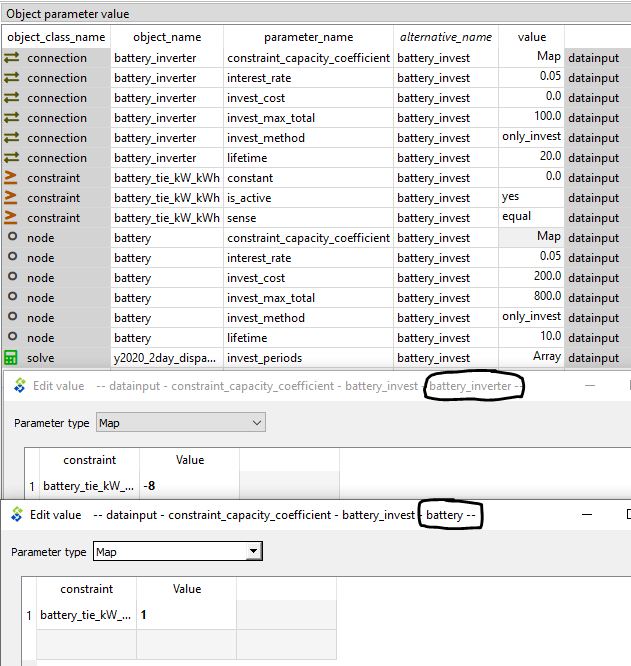
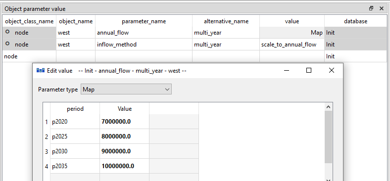
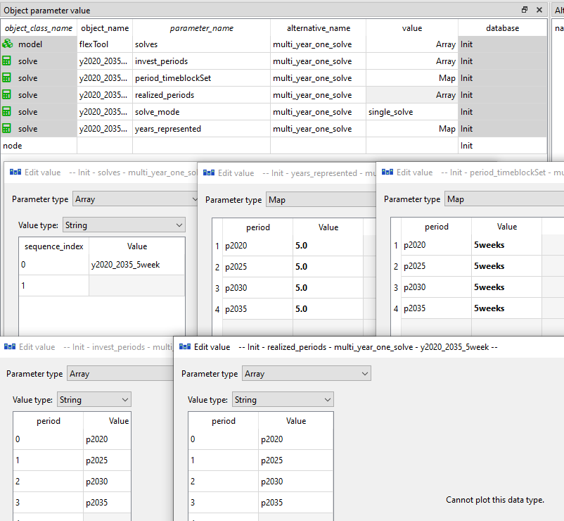
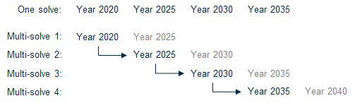
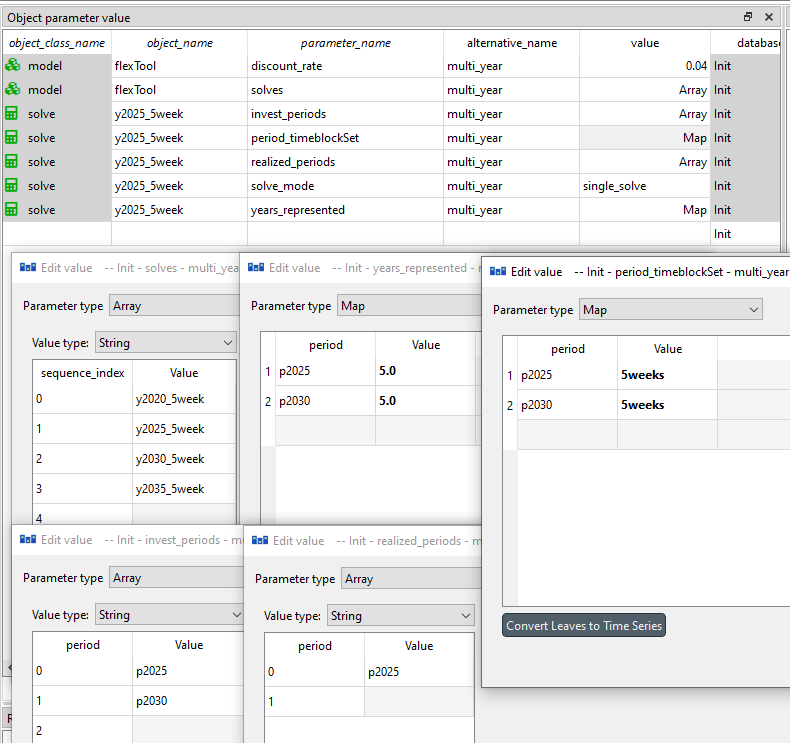

# Investment and multi-year models

##  How to make investments (storage/unit) 
**(examples.sqlite scenario: wind_battery_invest)**
***init - west - wind - battery - battery_invest***

Here we will use the previous battery scenario to represent the investment options in the tool.

The solve will invest only if it has an array of `invest_periods` set, telling the periods where it is allowed to make investment decisions. In a multi solve investment model (rolling investments) it can be useful to separately set `realized_invest_periods` so that the investment results get reported only from the chosen periods from each solve (in order to avoid overlapping reporting of investment decisions that are replaced by  investment decisions in later solves). Furthermore, `realized_periods` will define the solves and periods from which the dispatch results are output into results.

A period in `realized_invest_periods` must also be in the same solve's `invest_periods`; FlexTool stops with an error naming the solve and the periods otherwise. Each period's investments should be realized by only one solve: do not list the same period in the `realized_invest_periods` of two solves. If you do, FlexTool logs a warning naming both solves and the period. Dispatch timesteps, on the other hand, may be realized by more than one solve (for example an investment solve and a dispatch solve nested inside it that both have the same period in `realized_periods`). For the overlapping timesteps the solve that runs later is kept and the earlier solve's results are not reported. FlexTool logs one warning per pair of solves and period, giving the number of overlapping timesteps. Timesteps that only the earlier solve realizes are still reported from the earlier solve.

First, the investment parameters need to be included both for the *battery_inverter* and *battery* entities:

- `invest_method` - the modeller has options to limit the investment and retirement. Options are *not_allowed*, invest, retire or invest and retire. These have the sub options of no limit *invest_no_limit*, limit the amount per period: *invest_period*, limit the total amount invested *invest_total* or limit both the total investment and the investment per period *invest_period_total*. 

  - If the investment is limited, it requires the corresponding maximum/minimum investment (power [MW] or energy [MWh]) to the virtual capacity. This can be set to individual entities or groups of entities:
    
    - `invest_max_total`
    - `invest_max_period`
    - `invest_min_total`
    - `invest_min_period`
    - `retire_max_total`
    - `retire_max_period`
    - `retire_min_total`
    - `retire_min_period`
 
- `invest_cost` - overnight investment cost new capacity [currency/kW] for the *battery_inverter* and [currency/kWh] for the *battery*. Other one can be left empty or zero, since they will be tied together in the next phase. Here we will assume a fixed relation between kW and kWh for this battery technology, but for example flow batteries could have separate investments for storage and charging capacities.
- `discount_rate` - discount rate (WACC) [e.g. 0.05 means 5%] for the technology that reflects the financing cost and risk. Should be nominal when model `inflation_rate` > 0, real when `inflation_rate` = 0.
- `lifetime` - technical lifetime of the technology to calculate investment annuity (together with the discount rate)

Additional parameters:

- `lifetime_method`: Model can either be forced to reinvest when the lifetime ends (`reinvest_automatic`), have a choice (`reinvest_choice`), or be restricted to a one-shot build that retires after its lifetime without rebuild (`no_investment` — for physical one-off additions like plant refurbishments).
- `construction_lead_time` [years]: time from the investment decision until the capacity starts to operate. The start is rounded to the start of a period by `construction_lead_time_method` (below), on the periods of the whole model (all its solves). Constant or period (a map may set a different lead time per decision period). Default 0. Applies to `unit`, `connection` and `node` investments, deterministic and stochastic alike.
  - **Terms.** The *investment decision* is taken in a period of the solve's `invest_periods`. The capacity is *in construction* from the decision period until it *comes online* at the *start of operation*; from then on it is in service. Without a lead time, the capacity comes online in the decision period.
  - **Results.** In the capacity results (`unit_capacity__d`, `connection_capacity__d`, `node_capacity__d`) *invested* is the capacity that comes online in the period and *in_construction* the capacity decided but not yet operating (empty without a lead time); *total* is the capacity in service and does not include capacity in construction. Over combined solves (a chain of solves, invest then dispatch) every realized investment is counted once, in the period it comes online.
  - **Limits.** `invest_max_period` / `invest_min_period` (also of groups) count the capacity coming online in the period; the investment is decided earlier. `invest_max_total` / `invest_min_total` count every investment decision.
  - **Costs.** `invest_cost` is the overnight cost: construction time costs with their interest must be included in it. The annuity and the `fixed_cost` of new capacity are paid only over the years it operates within the model horizon, and the `invest_cost` (and `lifetime`, `discount_rate`) of the period it comes online is used. The `lifetime` starts when the capacity comes online.
  - **Horizon.** An investment whose rounded start of operation is after the end of the solve (including its look-ahead periods) or after the model horizon is not offered, with a warning naming the entity, the lead time and the solve. A chain of myopic solves whose horizon is not longer than the lead time therefore never invests in that technology: use a longer solve horizon or `construction_lead_time_method = immediate`.
- `construction_lead_time_method`: how the start of operation (decision year plus `construction_lead_time`) is rounded to the start of a period:
  - `immediate` — no lead time; the capacity operates from the decision period. This is also the effective default when no lead time is set.
  - `closest_seam` — the nearest period start; a tie goes to the later one. This is the effective default once a lead time **is** set but no method is chosen.
  - `previous_seam` — the period start before.
  - `next_seam` — the period start after.

    **Construction lead time and stochastics compose automatically.** Under recourse (`stochastic_invest_method = recourse`) with an invest non-anticipativity window (`shared_invest_periods`, see the stochastics how-to), a long-lead technology that must be online *after* the branch reveal has to be *ordered* before it — in a pre-reveal, tied period — so its investment is a single shared here-and-now decision, while a short-lead technology can be ordered at/after the reveal and react per scenario. This staging is emergent (no extra parameter): set the window to the pre-reveal periods and the lead time stages the technologies for you. Note the two knobs stay orthogonal — the window is the *information* boundary (which order periods are shared), the lead time is the *physics* (how early you must order); you need both, set consistently, for staging.

- `salvage_value`: Sets the extra value that can be gained for retiring [CUR/kW]. Only capacity that existed before the model run (`existing`) can be retired, until its end of life; the retirement saves its fixed cost over the periods it counts in and earns the salvage value as an annuity over `lifetime` (see [retirements](../reference/units.md#retirements)).
- `fixed_cost`: Annual cost for capacity [CUR/kW]

In many cases some of the investment decisions are tied to each other. Here the battery capacity and the connection capacity of the *battery_inverter* will be tied as they are simultaneously limited by the choice of the battery technology to be invested in.

To model this, a new constraint needs to be created that ties together the storage capacity of the *battery* and the charging/discharging capacity of the *battery_inverter*. 

A new `constraint` entity *battery_tie_kW_kWh* is created and added to an alternative in the `Entity Alternative` sheet.

It is given parameters `constant` and `sense`. Constant could be left out, since it is zero. The `sense` of the constraint must be *equal* to enforce the kw/kWh relation.

Both *battery_inverter* and *battery* need a coefficient to tell the model how they relate to each other. The equation has the capacity variables on the left side of the equation and the constant on the right side.

```
sum_i(`constraint_invested_capacity_coeff` * `v_invest`) = `constant`
      where i is any unit, connection or node that is part of the constraint
```

When the `constraint_invested_capacity_coeff` for *battery* is set at 1 and for the *battery_inverter* at -8, then the equation will force *battery_inverter* `v_invest` to be 8 times smaller than the *battery* `v_invest`. The negative term can be arranged to the right side of the equation, which yields:

```1 x *battery* = 8 x *battery_inverter*, which can be true only if *battery_inverter* is 1/8 of *battery*```

`constraint_invested_capacity_coeff` is not a parameter with a single value, but a map type parameter (index: constraint name, value: coefficient). It allows the entity to participate in multiple constraints. (In older databases this parameter was `constraint_capacity_coefficient`; migration renames it.)

To tie cumulative, built-up capacity rather than the current period's new build, use `constraint_cumulative_pre_built_capacity_coeff`. It takes the capacity in service at the start of the period: existing capacity plus the capacity that came online in earlier periods, minus earlier retirements. Capacity coming online in the period itself is in the invested term (`constraint_invested_capacity_coeff`, the capacity that comes online in the period; without a construction lead time, the capacity invested in that period). Paired with `constraint_invested_capacity_coeff`, it expresses period-over-period growth limits:

```
v_invest[e, d] <= growth_rate * pre_built[e, d]
```

is written as: `constraint_invested_capacity_coeff = { c: 1.0 }` and `constraint_cumulative_pre_built_capacity_coeff = { c: -growth_rate }` on entity `e`, with constraint `c` having `sense = less_than` and `constant = 0`. A 10% growth cap starting from 1000 MW of existing wind would allow 100 MW in period 1, 110 in period 2, 121 in period 3, and so on.

To tie the capacity in service in the period (the capacity that limits the flows, for example for a share of the fleet or a ratio between technologies), use `constraint_capacity_coeff`; for the capacity retired in the period, `constraint_retired_capacity_coeff`; for the capacity in construction (decided but not yet operating, only with a construction lead time), `constraint_in_construction_capacity_coeff`. Capacity in service = pre-built + invested − retired, with or without a construction lead time; capacity in construction is not in service.

Finally, FlexTool can mix several types of constraint coefficients: `constraint_invested_capacity_coeff`, `constraint_retired_capacity_coeff`, `constraint_cumulative_pre_built_capacity_coeff`, `constraint_capacity_coeff`, `constraint_state_coeff`, `constraint_online_coeff` and `constraint_flow_coeff` allowing the user to create custom constraints between any types of entities in the model for the main variables in the model (*flow*, *state*, *online* as well as *invest*). So, the equation above is in full form:

```
  + sum_i [constraint_invested_capacity_coeff(i) * v_invest]
           where i contains [node, unit, connection] belonging to the constraint
  + sum_i [constraint_retired_capacity_coeff(i) * v_divest]
  + sum_i [constraint_cumulative_pre_built_capacity_coeff(i) * pre_built]
           where pre_built = existing + Σ v_invest of earlier periods still in service − Σ v_divest of earlier periods
  + sum_i [constraint_capacity_coeff(i) * capacity_in_service]
           where capacity_in_service = existing + Σ v_invest still in service − Σ v_divest up to this period
  + sum_j [constraint_flow_coeff(j) * capacity]
           where j contains [unit--node, connection--node] belonging to the constraint
  + sum_k [constraint_state_coeff(k) * capacity]
           where k contains [node] belonging to the constraint
  + sum_m [constraint_online_coeff(m) * v_online]
           where m contains [unit, connection] with online variables belonging to the constraint,
           and v_online is the number of units online in the time step (of virtual_unitsize;
           without it, the largest existing capacity, else 1000 MW)
  =
  constant (a constant, or a period map giving each period its own value)

  where 'capacity' is existing capacity plus invested capacity
```



## How to create a multi-year model

A multi-year model is constructed from multiple periods, each presenting one year. In the example case, each year is otherwise the same, but the demand is increasing in the *west* `node`. This means that all periods can use the same timeset *5weeks* from the same timeline *y2020*, but one can also make separate timelines for each year, if data is available for this. The `inflow` time series are scaled to match the value in `annual_flow` that is mapped for each period. The model is using the `inflow_method` *scale_to_annual* in order to achieve this (default is *use_original* that would not perform scaling). There should also be an `inflation_rate` parameter set for the `model` entity *flexTool* if something else than the model default of 0 is to be used (set to expected inflation when inputs are in nominal terms).

**Discounting later years.** Only `inflation_rate` discounts the costs of later periods; with the default 0, a cost in the last period weighs the same as in the first. In a model in real terms, set `inflation_rate` to the social discount rate to get present values. See [Discounting between milestone years](../advanced_concepts.md#discounting-between-milestone-years).



A multi-year model could be solved at one go (multi_year_one_solve) or by rolling through several solves (multi-year) where each solve has a foresight horizon and a realisation horizon. Next we will go through both options.

### Multi year with one solve
**(examples.sqlite scenario: multi_year_one_solve)**

In this example, one solve is used for all the four periods. All the four periods need to be added to the solve arrays `invest_periods` and `realized_periods`. Here the same timeset is used for all the four periods, so only difference between them is the increasing inflow set above. The parameters that need to be added to the `solve` entity:

- `years_represented` parameter is used by the model to calculate the discounting factors for the periods in the model (often future years). It should state the number of years each period will be representing. For example, a period for 2025 could represent the years 2025-2029 if its `years_represented` is set to 5. Any investments would be taking place at the start of 2025 and discounted to the beginning of 2025, but the operational costs would accrue from each year in 2025-2029 each with a different discounting factor (decreasing based on the interest rate).
- `invest_periods` the periods in which the model is allowed to make investments.
- `realized_periods` the periods that will be realized in this solve (outputs dispatch results for these periods).
- `period_timeset` defines the set of representative 'periods' (timesets in FlexTool) to be used in each FlexTool `period`.



### Multi year with rolling solves 
**(examples.sqlite scenario: multi_year)**

If the solving time gets too big, there is an option to split the timeline into overlapping parts and solve them separately. This shortens the solving time as it increases exponentially as the model grows. Therefore, collection of smaller solves is faster. The drawback is that the accuracy will be affected if there are dependencies with a larger time interval than the split size. 

When dealing with investments the splitting only works if the different periods are similar, in most cases complete years. If the first solve is really windy, it would invest too much on wind which wouldn't produce enough energy in later solves and then it would need to invest again to something else. It can also be challenging to consider lifetimes. If the option of retiring is allowed, it might retire something that is needed for later solves. In this example, the periods are complete years and the only difference between periods is increased demand.

The model rolls through several solves and therefore, the `model` entity *flexTool* has four values in the `solves` array. Each value represents one solve and it's position in the sequence of solves. The next figure illustrates the realization (blue) and foresight horizons (grey). The first solve will solve both the year 2020 and year 2025, but it will only output the year 2020. The next will solve both 2025 and 2030 but only output 2025.



Next figure shows the values needed to define one solve (out of the four solves in the example). Each of these need to be repeated for each solve in the model.

- `years_represented` parameter is used by the model to calculate the discounting factors for the periods in the model (often future years). It should state the number of years each period will be representing. For example, a period for 2025 could represent the years 2025-2029 if its `years_represented` is set to 5. Any investments would be taking place at the start of 2025 and discounted to the beginning of 2025, but the operational costs would accrue from each year in 2025-2029 each with a different discounting factor (decreasing based on the interest rate).
- `invest_periods` the periods in which the model is allowed to make investments. To be given for each solve.
- `realized_periods` the periods that will be realized in this solve (outputs dispatch results for these periods). To be given for each solve.
- `realized_invest_periods` parameter states the periods that will realize the investment decisions. If not stated, it will use the `realized_periods` that are also `invest_periods`.
- `period_timeset` defines the set of representative 'periods' (timesets in FlexTool) to be used in each FlexTool `period`.

Note the the `solve_mode`: *rolling_window* is not used! This is not for investment runs (without nesting) as it rolls freely, and investments should only be made at the start of the period. This example is called 'manual rolling' later when those are discussed.

In the examples.sqlite, the solve entities can carry solver options in the `solver_arguments` map (e.g. `solver`, `parallel` and `presolve` for HiGHS). They only affect the speed and not the results, but usually the default values are good enough and the user should only change them if they understand how the solvers work.



## How to model CSP with thermal storage

**(examples.sqlite scenarios: csp_without, csp_existing, csp_fixed_design, csp_optimised_design, csp_gas_backup)**
***init - west - coal - csp_system - (plant and design alternatives)***

**Three entities.** A concentrating solar power (CSP) plant with thermal storage is three generic entities: a solar *field* unit that makes heat from a profile, a heat *storage* node, and a *turbine* unit that turns the heat into electricity. Each has its own capacity and its own investment, so the model can choose the solar multiple and the storage hours itself, or you can fix them with user constraints. The heat storage is a storage node like a battery (see [How to add a storage unit](storage_hydro.md#how-to-add-a-storage-unit-battery) and [Using nodes as storages](../reference/nodes.md#using-nodes-as-storages)). Storing MWh of heat is the same model as a two-tank molten-salt system at fixed temperatures.

**The example system.** The alternatives *init*, *west* and *coal* are the tutorial's system: the 48-hour solve *y2020_2day_dispatch*, the node *west* and the 500 MW *coal_plant* (coal 20 CUR/MWh of fuel, `efficiency` 0.4: 50 CUR/MWh of electricity), which is the backup. The other alternatives add:

| Alternative | Entity | Parameter | Value |
|---|---|---|---|
| *csp_system* | `node` *west* | `inflow` | −150 [MW] |
| *csp_system* | `profile` *csp_field_yield* | `profile` | a time series: 1.0 for t0007–t0018 and t0055–t0066 (clear days), 0.4 for t0031–t0042 (cloudy day), 0 otherwise |
| *csp_plant* | `unit` *csp_field* | `conversion_method`, `existing` | *none*, 500 [MW_th] |
| *csp_plant* | `unit__node__profile` (*csp_field*, *csp_heat*, *csp_field_yield*) | `profile_method` | *upper_limit* |
| *csp_plant* | `node` *csp_heat* | `node_type`, `existing` | *storage*, 2500 [MWh_th] |
| *csp_plant* | `node` *csp_heat* | `storage_binding_method` | *bind_within_timeblock* |
| *csp_plant* | `node` *csp_heat* | `penalty_up`, `penalty_down` | 1000, 1000 [CUR/MWh] |
| *csp_plant* | `unit` *csp_turbine* | `conversion_method`, `efficiency`, `existing` | *constant_efficiency*, 0.4, 100 [MW_e] |

**Entities.** *csp_plant* turns on *csp_field*, *csp_heat* and *csp_turbine* (Entity Alternative). *csp_field* has no input and one `unit__outputNode` (*csp_field*, *csp_heat*). *csp_turbine* has a `unit__inputNode` (*csp_turbine*, *csp_heat*) and a `unit__outputNode` (*csp_turbine*, *west*).

**The field-yield profile.** The profile is the heat the field delivers to the storage per MW_th of its design output, with the optical and receiver losses already taken off. Prepare it outside FlexTool, from the direct normal irradiance (DNI) of the site or from the hourly output of a plant simulation tool. The *upper_limit* lets the field deliver less than the profile: that is curtailment (defocusing), and it costs nothing.

**The results.** Totals over the 48 hours; the objective is the 48-hour cost × 8760 / 48 / 10⁶ plus the annuities.

| Scenario | Field used / curtailed [MWh_th] | Turbine [MWh_e] | Coal [MWh] | Objective [M CUR] |
|---|---|---|---|---|
| *csp_without* | – | – | 7200 | 65.700 |
| *csp_existing* | 7900 / 500 | 3160 | 4040 | 36.865 |
| *csp_fixed_design* | 7900 / 500 | 3160 | 4040 | 50.809 |
| *csp_optimised_design* | 12 000 / 2000 | 4800 | 2400 | 43.353 |
| *csp_gas_backup* | 7900 / 500, boiler 4100 | 4800 | 2400 | 31.877 |

**Only totals are unique.** The field's heat is free and coal costs the same in every hour, so the model does not care when the turbine runs. The totals, the capacities and the costs are unique; the hourly dispatch and the storage state are not. Compare scenarios with period results (`unit__outputNode__d`, `unit_capacity__d`, `node_capacity__d`, the costs), not with hourly ones.

### Existing plant

**(examples.sqlite scenario: csp_existing)**
***init - west - coal - csp_system - csp_plant***

**What it does.** On the clear day the field makes 500 MW_th for 12 hours, 6000 MWh_th. The turbine takes 250 MW_th (100 MW_e / 0.4) directly, 3000 MWh_th, and the tank stores the rest until it is full at 2500 MWh_th; the last 500 MWh_th are curtailed. After sunset the tank runs the turbine for 10 more hours. On the cloudy day the field makes 200 MW_th for 12 hours, 2400 MWh_th, and all of it is used. The turbine makes 0.4 × 7900 = 3160 MWh_e, and coal makes the other 4040 MWh.

### Fixed design: solar multiple and storage hours

**(examples.sqlite scenario: csp_fixed_design)**
***init - west - coal - csp_system - csp_plant - csp_invest_common - csp_fixed_design***

**Investment data.** *csp_invest_common* sets `invest_periods` [*p2020*] on the solve *y2020_2day_dispatch*, and on each of the three entities `existing` 0, `invest_method` *invest_total*, `lifetime` 25 and `discount_rate` 0.07:

| Entity | `invest_max_total` | `invest_cost` |
|---|---|---|
| `unit` *csp_turbine* | 100 [MW_e] | 500 [CUR/kW_e] |
| `unit` *csp_field* | 1000 [MW_th] | 150 [CUR/kW_th] |
| `node` *csp_heat* | 5000 [MWh_th] | 15 [CUR/kWh_th] |

**The recipe.** The solar multiple (SM) is the field's thermal capacity divided by the turbine's thermal input at design point, and the storage hours (h) are the tank capacity divided by the same input. The turbine's thermal input is its capacity divided by its design efficiency η_d. So the ties are field − (SM / η_d) × turbine = 0 and tank − (h / η_d) × turbine = 0. With SM 2, 10 hours and η_d 0.4 the coefficients are −5 and −25.

**The data.** *csp_fixed_design* adds the two constraints, both with `sense` *equal* and `constant` 0:

| Entity | Parameter | Value |
|---|---|---|
| `constraint` *csp_solar_multiple*, *csp_storage_hours* | `sense`, `constant` | *equal*, 0 |
| `unit` *csp_field* | `constraint_capacity_coeff` | (*csp_solar_multiple* \| 1) |
| `node` *csp_heat* | `constraint_capacity_coeff` | (*csp_storage_hours* \| 1) |
| `unit` *csp_turbine* | `constraint_capacity_coeff` | (*csp_solar_multiple* \| −5), (*csp_storage_hours* \| −25) |

**Use the capacity, not the investment.** `constraint_capacity_coeff` ties the capacity in service: existing + invested − retired. `constraint_invested_capacity_coeff` ties only the new build of a period, so it breaks the ratio when there is existing capacity or when the parts are built in different periods. The rows have only capacity terms, so they are written once per period (see [user constraints](../reference/user_constraints.md#example-storage-size-tied-to-turbine-capacity)).

**Use the design efficiency.** η_d in the coefficients is a constant, the turbine's efficiency at its design point, even when the turbine's `efficiency` is a time series (for example lower on hot days with dry cooling). For a solar multiple in a range instead of a fixed value, use two rows: *greater_than* with SM_min and *less_than* with SM_max.

**The results.** The plant pays: it saves 288 350 CUR per MW_e and year of coal, against 139 442 CUR of annuities, so the turbine is built to its bound of 100 MW_e. The ties then give a field of 500 MW_th and a tank of 2500 MWh_th, the plant of *csp_existing*, with the same dispatch. The annuities are (100 × 500 + 500 × 150 + 2500 × 15) × 1000 × 0.0858 (7 % over 25 years) = 13.944 M CUR, so the objective is 36.865 + 13.944 = 50.809 M CUR.

### Optimised design

**(examples.sqlite scenario: csp_optimised_design)**
***init - west - coal - csp_system - csp_plant - csp_invest_common***

**What it does.** Without the ties the model chooses the three capacities within their bounds. It can still build the fixed design, so its objective can only be lower or the same: 43.353 against 50.809 M CUR. Here it builds the turbine and the tank to their bounds (100 MW_e and 5000 MWh_th) and a field of 833 MW_th: a solar multiple of 3.3 and 20 storage hours, with the turbine running in every hour.

**Which bound decides what.** Two bounds bind. Each extra MW_e of turbine still pays: it saves 438 000 CUR of coal a year against about 285 000 CUR of turbine and field annuities. A tank MWh_th is cheaper than the field it replaces, so the tank also runs to its bound. The field of 833 MW_th is then set by the tank bound: a smaller tank needs a larger field to carry the cloudy day.

**Without the bounds.** With the tank bound lifted, the costs alone would choose a field of 714 MW_th and a tank of 5571 MWh_th (solar multiple 2.86, 22.3 h). With the turbine bound lifted, free heat against the flat 50 CUR/MWh of coal makes every MW_e pay until the plant meets the whole demand.

**What to do.** Set `invest_max_total` from real limits (land, grid connection, the planned plant size) and use realistic costs. If a bound binds without such a reason, the design is the bound's, not the model's: raise or remove the bound, or fix the ratios with the ties of the [previous section](#fixed-design-solar-multiple-and-storage-hours). Check `unit_capacity__d` and `node_capacity__d` against the bounds you set.

### Gas backup

**(examples.sqlite scenario: csp_gas_backup)**
***init - west - coal - csp_system - csp_plant - csp_gas_backup***

**The data.** *csp_gas_backup* adds a gas boiler that heats the storage node:

| Entity | Parameter | Value |
|---|---|---|
| `commodity` *natural_gas* | `price` | 12 [CUR/MWh] |
| `node` *natural_gas_market* | `node_type` | *commodity* |
| `unit` *csp_backup_boiler* | `conversion_method`, `efficiency`, `existing` | *constant_efficiency*, 0.9, 250 [MW_th] |

*csp_gas_backup* turns on *natural_gas_market* and *csp_backup_boiler*. The boiler has a `unit__inputNode` (*csp_backup_boiler*, *natural_gas_market*) and a `unit__outputNode` (*csp_backup_boiler*, *csp_heat*), and the `commodity__node` (*natural_gas*, *natural_gas_market*) links the price.

**What it does.** Boiler heat costs 12 / 0.9 = 13.3 CUR/MWh_th, which is 33.3 CUR/MWh_e through the turbine, less than coal. So the turbine runs at 100 MW_e in every hour. The field still delivers 7900 MWh_th (the tank is still full on the clear day) and the boiler makes the other 4100 MWh_th from 4555.6 MWh of gas. Coal makes 2400 MWh, and the objective is 31.877 M CUR.

**A share of the yearly output.** Rules such as "the boiler makes at most 15 % of the plant's heat over the year" are a user constraint with `constraint_period_method` *period_total*: one row per period over the year's total, not one per time step. Add a `constraint` *csp_gas_share* with `sense` *less_than*, `constant` 0 and `constraint_period_method` *period_total*, and the coefficients `constraint_flow_coeff` (*csp_gas_share* | 0.85) on `unit__outputNode` (*csp_backup_boiler*, *csp_heat*) and (*csp_gas_share* | -0.15) on `unit__outputNode` (*csp_field*, *csp_heat*). The row is boiler ≤ 0.15 × (field + boiler) over the year, written as 0.85 × boiler − 0.15 × field ≤ 0. The boiler may then make at most 15 % of the heat that the field and the boiler make together, in whichever hours it is most useful. (For a share of the field's heat alone, use 1 on the boiler.) See [Period total](../reference/user_constraints.md#period-total-units-and-weighting) for how the row is weighted.

**PV and an electric heater.** Another hybrid is a unit from the electricity node to *csp_heat* (an electric heater, `efficiency` about 0.99). Cheap PV power can then charge the tank in the middle of the day.

### Plant summary from the outputs

**One plant, three entities.** FlexTool reports the field, the tank and the turbine separately. The plant's figures come from the outputs as below; the values are those of *csp_existing* (the costs of *csp_fixed_design*). Mind the units: the `__d` tables are scaled to a full year (× 8760 / 48 here, one 48-hour period); divide by 182.5 for the sums over the 48 hours.

| Figure | Output | Value |
|---|---|---|
| Field potential | `unit_outputNode_VRE_potential__d` (*csp_field*, *csp_heat*) | 1 533 000 MWh_th/a (8400 × 182.5) |
| Field curtailed | `unit_curtailment__outputNode__d` (*csp_field*, *csp_heat*) | 91 250 MWh_th/a (500 × 182.5) |
| Curtailment share | `unit_outputNode_VRE_curtailment_share__d` | 91 250 / 1 533 000 = 5.95 % |
| Field used | `unit__outputNode__d` (*csp_field*, *csp_heat*) | 1 441 750 MWh_th/a (7900 × 182.5) |
| Turbine output | `unit__outputNode__d` (*csp_turbine*, *west*) | 576 700 MWh_e/a (3160 × 182.5) |
| Capacity factor | `unit_cf__outputNode__d` (*csp_turbine*, *west*) | 3160 / (100 × 48) = 65.8 % |
| Tank cycles | the decreases of `node_state__dt` (*csp_heat*) summed, divided by the tank capacity | at least 1 in the 48 h (the 2500 MWh_th stored on the clear day: day 1 must store ≥ 2500 MWh_th because the turbine can take only 3000 of the 5500 used) |
| Plant cost | the *investment* columns of `cost_unit_annualized__d` (*csp_field*, *csp_turbine*) and *storage investment* of `cost_node_annualized__d` (*csp_heat*) | 6.4355 + 4.2905 + 3.2179 = 13.944 M CUR/a |
| Levelised cost | plant cost / turbine output | 13.944 M / 576 700 = 24.2 CUR/MWh |
| Average price received | Σ turbine flow × `node_prices__dt` (*west*) / Σ turbine flow | 50 CUR/MWh (coal sets the price in every hour) |

**Not unique.** The tank cycles depend on the hourly timing, which is free in this example, so they are not unique. The levelised cost is the plant's own cost, not its value to the system: show the average price received next to it.

**Keep the heat out of the electricity indicators.** The field is a unit with an *upper_limit* profile, so FlexTool counts its curtailment as VRE curtailment. Do not put *csp_heat* in a `group` with `print_indicators` for electricity, or the field's curtailment counts in that group's VRE curtailment.

### Caveats and limitations

- **Net or gross output.** Use the net turbine efficiency (after the plant's own electricity use), so the turbine's output is the net output. For the own use as a separate flow, give the turbine a second input from the electricity node and tie it to the output with a user constraint.
- **Capacity margin.** The turbine runs from the heat tank, so the capacity margin counts it by its actual flow at each time step, not at its capacity. With a gas backup input whose `input_share_max` is 1 (the gas can run the turbine alone), it counts at its capacity.
- **Representative periods.** The tank cycles every day. Use hourly representative days or weeks with a `*_blended_weights` `storage_binding_method` (see [Nested Rolling window solves](solve_sequences.md#how-to-use-nested-rolling-window-solves-investments-and-long-term-storage)); a long `new_stepduration` loses the daily cycle.
- **Annual fossil share in rolling dispatch.** A *period_total* share (see [Gas backup](#gas-backup)) holds in an investment solve, in a single dispatch solve and in a rolling dispatch solve whose `rolling_solve_jump` is a whole number of periods. A rolling dispatch solve whose rolls are shorter than the period leaves it out, with a warning in the run log; if no solve of the run enforces it, the run stops with an error.
- **No start-up heat.** The turbine's start-up cannot draw heat from the tank; only a `startup_cost` is available.
- **Standing losses.** `self_discharge_loss` is a share of the content; a loss proportional to the tank's size is not available.
