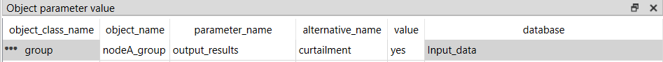
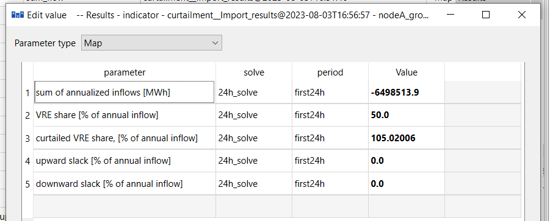
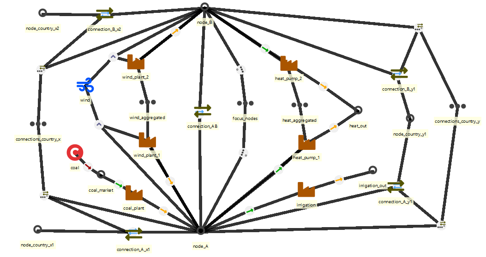
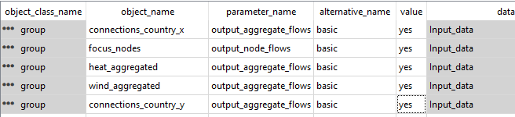
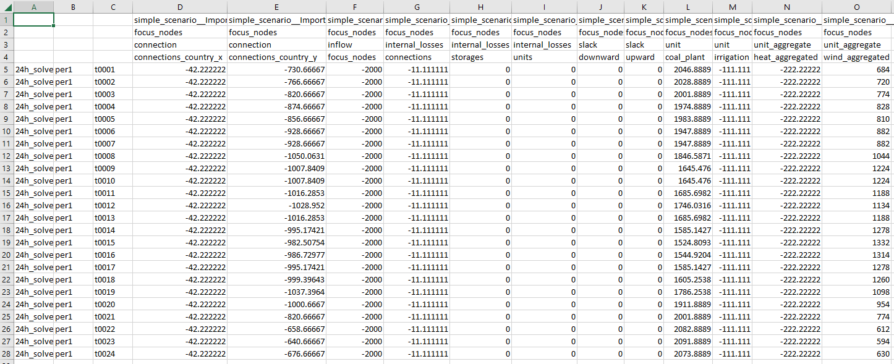
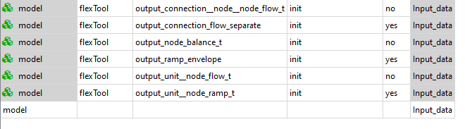

# Outputs, diagnostics and Excel templates

## How to see the VRE curtailment and VRE share results for a node
**(non_sync_and_curtailment.sqlite)**
***(scenario: curtailment)***

When the system has profile-units with the `profile_method`: upper_limit, the model can curtail the unit's flow to avoid penalties.

The curtailment could take place for several reasons:

- the supply is higher than the demand and the energy cannot be stored or transferred (further)
- non-synchronous limit
- extra flow constraints have been set
- other unit specific constraint affecting how VRE units or other units are forced to behave (ramp, start-up ...)

To see the curtailment results you need a `group` with `group__node` members (not a `flowGroup` with `flowGroup__unit__node` members!). The group then needs the parameter:

- `print_indicators`: yes

This produces the node-group summary indicator metrics — loss-of-load share, VRE share, curtailment share, excess-load share and annualised inflow — written to the Results database as `group: indicator` and to Excel as the *group_summary* table. `print_indicators` is the "summary" output for node groups; pair it with `print_dispatch` if you also want the per-timestep decomposition of the same nodes.

These changes were done to the previous non-sync example database. 

Note: *Curtailed VRE of demand* is the curtailment in relation to the inflow (demand), so it can exceed 100% as seen in the figure. *Curtailed VRE of potential VRE* is the curtailment in relation to the potential VRE generation and stays within 0–100%.

The figures show the layout of the results. Their values come from an earlier version, in which the battery connection inside *nodeA_group* still counted towards the non-synchronous limit (the battery cycled to loosen it); the current version gives less battery cycling, less wind and more coal in this example.





## How to create aggregate outputs

It is often desirable to output results that focus on particular aspects of the model. For example, you may want all flows going in and out of all electricity nodes, *without* the corresponding flows for other energy carriers (e.g. fuels used to produce the electricity). And if the model is large, some of those flows are easier to read when aggregated into a single column.

FlexTool splits these two concerns across a node `group` and a separate `flowGroup`:

| Intent | Set this | Role | Members |
|---|---|---|---|
| Pick a set of nodes and get a per-timestep *decomposition* of every flow crossing them (one column per contributing process/connection) | `print_dispatch: yes` on `group` | the *decomposition* — produces `group_flow_t` | `group__node` |
| Re-bucket a set of flows so they appear as a single aggregated band inside that dispatch output | `flow_aggregator: dispatch_plots_only` on `flowGroup` | a dispatch-band re-bucketer — no output on its own | `flowGroup__unit__node` or `flowGroup__connection__node` |

Together they work like this: `print_dispatch` builds the dispatch table for its node group; while doing so it inspects every flow touching those nodes, and if any of those flows are in a `flowGroup` whose `flow_aggregator` is `dispatch_plots_only` (or `both`), their columns are collapsed into a single band named after the flowGroup. A `dispatch_plots_only` flowGroup produces no output of its own — it only reshapes a dispatch table that a node group is producing.

> **Avoid double-counting.** If the same flow arc belongs to two flowGroups that are *both* dispatch-bound (`dispatch_plots_only` or `both`), that arc is counted twice in the node group's dispatch balance and the model emits a loud validation warning. For overlapping thematic aggregates, use `standalone_aggregator_only` instead — overlap is harmless there because those flowGroups report their own outputs and never feed a node-group dispatch table.

Concretely, to build a focused dispatch view for a collection of nodes:

- create or re-use a `group` (e.g. *electricity*)
- set the group's parameter **print_dispatch** to *yes*
- add the relevant nodes via `group__node` (e.g. *electricity__west*)

Then, to collapse a collection of flows inside that dispatch view:

- create or re-use a *separate* `flowGroup` (e.g. *all_VRE*)
- set the flowGroup's parameter **flow_aggregator** to *dispatch_plots_only*
- add the flows via `flowGroup__unit__node` or `flowGroup__connection__node` (e.g. *all_VRE__wind1__west*)

(Contrast with `flow_aggregator: standalone_aggregator_only`, which produces the flowGroup's own outputs — per-period `cumulative_flow` (MWh/a, scaled to a full year) / `average_flow` (MW) plus a signed net-flow timewise series — and does not interact with the dispatch table.)

"How to database" (**aggregate_output.sqlite**) aggregates results for the *nodeA* and *nodeB*. Both of the nodes have a wind power plant and nodeA has a coal power plant. The demand is divided to the electricity, heat and irrigation needs. This means that, besides an internal demand (**inflow**), both nodes output to the heat node while *nodeA* also outputs to the irrigation node. Additionally the nodes are connected to each other and the *node_country_y1*. The *nodeA* is connected to the *node_country_x1* and *nodeB* is connected to the *node_country_x2*. 

For the sake of the example, we are only interested in the *nodeA* and *nodeB*. Therefore, `group` *focus_nodes* is created and the nodes are added to it with `group__node` entities. To simplify the results, the flows from the two wind plants are aggregated as one. Same applies to the heat pumps. This is done by creating the `flowGroup`s *wind_aggregated* and *heat_aggregated*. The flows are added to each flowGroup with `flowGroup__unit__node`. 

Note that here the `node` has to be either *nodeA* or *nodeB*, not the heat node. The flowGroup only collapses columns whose node is inside the dispatch group's node set — e.g. *wind_aggregated__wind_plant_1__nodeA* is collapsed because *nodeA* is in *focus_nodes*. A `flowGroup__unit__node` row whose node is outside the dispatch group's nodes is simply ignored for that dispatch table.

Connections are simplified by creating flowGroups *connections_country_x* and *connections_country_y* and adding the relevant connections with `flowGroup__connection__node`. Again the `node` must be *nodeA* or *nodeB* to be collapsed in the dispatch output.



The *focus_nodes* group needs `print_dispatch: yes` and the unit and connection flowGroups need `flow_aggregator: dispatch_plots_only`. 



The resulting table has the flows to the *focus_nodes* group from units and connections. Additionally, the internal losses of the group are calculated. These are the flows between the nodes of the group and the storage losses. Here the losses come from the connection between *nodeA* and *nodeB*. Possible slacks to balance the nodes are included too.



## How to enable/disable outputs

Some of the outputs are optional. Some of these optional outputs are output by default while some are not (see below). Removing outputs speeds up the post-processing of results. The user can enable/disable them by changing the following parameters of the `model` entity:

- `output_node_balance_t`: Default: yes. Produces detailed inflows and outflows for all the nodes for all timesteps. Mainly useful to diagnose what is wrong with the model. 
- `output_connection__node__node_flow_t`: Default: yes. The flows between the nodes for each timestep.
- `output_unit__node_flow_t`: Default, yes. The flows from units to the nodes for each timestep.
- `output_connection_flow_separate`: Default, no. Produces the connection flows separately for both directions.
- `output_horizon`: Writes a raw dump of every LP variable and constraint over the whole horizon (forecast branches and rolling look-ahead included) to `output_parquet/<scenario>/horizon/`. The normal outputs are unchanged. Useful when constructing a stochastic or rolling model.



To get the numbers behind a plot, turn on **Write plotted data (CSV)** in the GUI's Png settings (or
`--write-plot-data` in the terminal, or `write_plot_data: true` in `plot_settings.yaml`): each plot file then gets
a CSV with the same name and the data drawn in it. See [Plotted data as CSV](../results.md#plotted-data-as-csv).

## How to read the LP scaling diagnostic report

Every solve runs the auto-scaling pipeline before handing the LP to the solver and writes a single audit artefact into `solve_data/`:

- `autoscale_<solve>.yaml` — YAML audit (Layer 1 ranges, Layer 2 per-quantity-type plan, Layer 3 `user_bound_scale` + escape-tier plan)

A 1-line console verdict is also printed after each solve. The YAML covers (in order):

- **Layer 1** — matrix / cost / bound / RHS log10 ranges and the cross-group max-ratio that gates whether Layers 2/3 fire
- **Layer 2** — per-quantity-type power-of-2 column scalers (energy, capacity, monetary, …) with post-Layer-2 ranges
- **Layer 3** — the `user_bound_scale` exponent HiGHS receives and any escape-valve folding

Auto-scaling never changes the LP optimum: every variable and constraint is unscaled back to the user's units before the solution is written out. The audit is purely diagnostic. Read it when:

- the solver runs slowly or hits its time limit
- HiGHS reports numerical trouble (ill-conditioning warnings, suspect infeasibility)
- you are about to file a bug — attaching the YAML saves a round-trip
- you are tuning a freshly-converted model and want to spot unit-mix mistakes early
- a rejected solve's hint flagged the *post-autoscale* LP as still wide-ranged (scaling *may* be implicated) — the YAML shows which layer (or which quantity type) could not compress the spread

The autoscale package lives at `flextool/engine/autoscale/` (`_ranges.py` / `_layer2.py` / `_layer3.py` / `_report.py`). For the user-facing guide and tuning tips, see [dev/scaling.md](../dev/scaling.md).

## How to export a partial Excel template (parameter-group picker)

When you only need a subset of the parameter universe — say, a small dispatch sandbox without investments or stochastics — you can export an Excel template restricted to selected parameter groups instead of the full reference template. The CLI supports this via the `--groups` flag on the export-to-tabular command:

```bash
python -m flextool.cli.cmd_export_to_tabular \
    sqlite:///input_data.sqlite \
    partial_template.xlsx \
    --groups "vre,storage,reserves"
```

The flag takes a comma-separated list of `parameter_group` names. Parameters outside the listed groups are dropped, and sheets with no surviving parameter columns are removed unless they are explicitly listed in `always_include_with_groups` in `flextool/export_to_tabular/export_settings.yaml`.

The following groups are **always kept** regardless of the `--groups` selection (declared as `required_groups` in `export_settings.yaml`):

- `timeline`
- `model`
- `solve_basics`
- `basics`

These provide the structural backbone of any FlexTool model. Implementation: `flextool/cli/cmd_export_to_tabular.py` and `flextool/export_to_tabular/sheet_config.py`. The FlexTool GUI exposes the same picker under the "Add empty FlexTool input Excel" action (3.32.0). See also [Excel interface](../excel_interface.md) for the Excel-as-input workflow.

## How to replace a dataset and keep the old one as an alternative

**The idea.** When new data arrives (a new demand forecast, updated cost assumptions), keep the old data and put the new values in an alternative of their own. A scenario with the new alternative on top then uses the new data, the old scenario still runs as before, and the two can be compared. Excel is handy for entering a large set of new values.

**1. Export a partial template.** Export only the parameter groups that hold the data you replace, as in [How to export a partial Excel template](#how-to-export-a-partial-excel-template-parameter-group-picker):

```bash
python -m flextool.cli.cmd_export_to_tabular sqlite:///input.sqlite new_demand.xlsx --groups basics
```

**2. Edit the workbook.**

- On each sheet, keep only the rows you replace and delete the others.
- Write the name of the new alternative, for example *demand_2024*, in the `alternative` column of those rows.
- Enter the new values. A new entity also needs `entity existence` *TRUE* in the new alternative.

    Rows that keep the name of an existing alternative do not change the database (see step 3), so they can stay,
    but deleting them keeps the workbook easy to check.

**3. Import into the same database, without purging.** Copy the database first. Then:

```bash
python -m flextool.cli.cmd_read_self_describing_tabular_input new_demand.xlsx sqlite:///input.sqlite --no-purge
```

!!! warning "Always give `--no-purge` when adding data"
    Without `--no-purge`, the import first deletes the entities, alternatives, scenarios and parameter values of the database and then writes the workbook's data: only the rows of your partial workbook would be left.

With `--no-purge`, the import adds the new alternatives, entities and values. A value that the database already has for the same entity, parameter and alternative is not changed: the import prints a message for it and goes on. So an edit under the old alternative name has no effect; the new values must be in the new alternative.

**4. Make the scenario.** Add a scenario with the alternatives of the old scenario and *demand_2024* last, in the Spine database editor or in the `scenario` sheet of the workbook before the import (a new column: the scenario name in the top row, then `base_alternative` and the other alternatives in order). The old scenario stays as it was.

**5. Run and compare.** Run both scenarios and open them in the comparison view of the [Result viewer](../flextool_gui_interface.md#result-viewer) (key X). The AI assistant's `compare_inputs` checks that the two scenarios differ only in the new data, and `compare_runs` shows how the results differ (see [The AI assistant](../ai_assistant.md#try-a-tool-from-the-terminal)). The same set-up runs one value change as a sensitivity: see [How to run a sensitivity](basics.md#how-to-run-a-sensitivity-one-alternative-on-top-of-a-scenario).

## How to make a data dictionary for your model

A project team that builds a model from its own data often needs a list of every input parameter: what it means, its unit, the shapes it accepts and its default, with room to note where the team's value comes from. FlexTool writes that list, the parameter catalogue, from its own database schema, so it always matches the installed version. The same table is on the web as the [Parameter catalogue (web docs)](../parameter_catalogue.md) page; the FlexTool assistant answers the same questions per parameter with its `describe_parameter` tool.

Write it as an Excel file, and mark the parameters your input database gives values to. The command runs in FlexTool's Python environment (see [Terminal workflow](../terminal_workflow.md) for how to open a terminal with it):

```bash
python -m flextool.docs_build --xlsx catalogue.xlsx \
    --input-db input_data.sqlite --scenario base
```

The file has three sheets:

- **Read me**: what the file is, the FlexTool and database versions, the input database, and one line per column of the parameters sheet, including what to write in **Source** and **How to replace**.
- **parameters**: one row per parameter (class, parameter, definition, unit, quantity type, allowed shapes, default, allowed values, parameter group) and three empty columns for the team: **Source**, **How to replace** and **Notes**. The header row and the class and parameter columns are frozen, so they stay visible when you scroll; the header has filters, so you can show, for example, only the parameters the database uses.
- **classes**: what each entity class (unit, node, `unit__outputNode`, ...) is.

- `--input-db` (optional) is the input database, as a file path or as a URL (`sqlite:///input_data.sqlite`). It adds the columns **used in DB** (`yes` when any entity has a value), **entities** (how many) and **alternatives** (in which). Only the keys of the stored values are read; the file is opened read-only, so it is not changed or migrated.
- `--scenario` (optional) counts only the values in the alternatives of that scenario. An entity that the scenario switches off (its entity alternative) still counts.
- A parameter that the database has but this FlexTool does not define gets its own row marked *not in this FlexTool version*. That happens with an older database whose parameters were renamed since: the command says so and names `flextool-migrate-database`; migrate the database (or a copy of it) to see its values under the current names.

The catalogue is a dictionary, not an input template: to fill in data, use [a partial Excel template](#how-to-export-a-partial-excel-template-parameter-group-picker) or the [Excel interface](../excel_interface.md).
