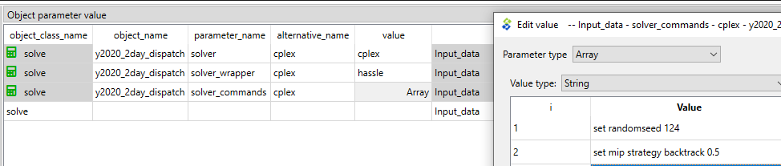

# Performance and solvers

## How to use CPLEX as the solver

CPLEX remains wireable as an advanced option for licensed users. Using CPLEX requires that you have installed the software, have a licence for it and have added it to PATH or to the environment where you are using the FlexTool, so that the tool can find the solver.

CPLEX is invoked via the **solve** parameter *solver*. FlexTool builds the LP in memory through polars + polar-high. The CPLEX path passes the problem to the [Interactive Optimizer](https://www.ibm.com/docs/en/icos/12.8.0.0?topic=cplex-interactive-optimizer) and produces two additional files in the work directory: a CPLEX log file and the solution file in CPLEX format.

Additional parameters:

- `solver_precommand` is not run. FlexTool 3 put it in front of the cplex call (for example to reserve a floating licence); FlexTool 4 does not run commands stored in a database, for safety, and warns when one is set. Use the solver's own licence server setup instead; see [Solver precommand](../solvers/index.md#solver-precommand-is-not-run).
- `solver_arguments` is a map of CPLEX parameter names to values (for example `mip.tolerances.mipgap` → `0.001`), set on top of the option file; see [Authoring `solver_arguments`](../solvers/index.md#authoring-solver_arguments-in-spine).

<!-- TODO: expand in dev/engine.md — document the exact CPLEX command line under the polars-based LP build. -->



## How to make the Flextool run faster

The list below contains potential ways to decrease the run-time of FlexTool models.

External changes (results will remain the same):

- Keep both the input database and Flextool on the same drive. If the database is on a different drive, it can slow the process. Avoid network drives.
- Try to ensure that there is sufficient memory available by closing other programs that use lot of memory. Linear optimization problems can require lot of memory.
- Use as fast computer as available. Both faster processors and more processors can decrease computation time.

Model changes (results will remain the same):

- Disable outputs that you don't need. This will speed up the result processing. See: [How to enable/disable outputs](outputs.md#how-to-enabledisable-outputs)
- Switch off the scenario plots (png) when the result viewer is enough; it shows every plot from the results. To see where a run's time goes, phase by phase, use `flextool-time-runs`. See: [Check that exercises run fast enough](../terminal_workflow.md#check-that-exercises-run-fast-enough)
- When using HiGHS solver: in your solve's `solver_arguments` map, you can set `presolve = on` and `parallel = on` to speed up the optimisation. However, it can be better to turn HiGHS parallel off when executing multiple scnearios in parallel.
- Especially with MIP problems, considering using a commercial solver like CPLEX (license required). See: [How to use CPLEX as the solver](#how-to-use-cplex-as-the-solver)

Model changes (results will be affected):

- Get rid of integer variables. Mixed integer programming can increase the solving time manyfold compared to the linear version especially if commercial solver is not available. MIP parameters are:
  - `transfer_method`: *exact*, change to *reqular*
  - `startup_method`: *binary*, change to *linear*

- **Set `virtual_unitsize` to the actual sub-unit size of the modeled plant when `startup_method = binary`.**  If you do not set it, FlexTool uses the full `existing` capacity as the commitment granularity — every on/off decision moves the entire plant at once.  For a large plant (say 1000 MW), that granularity is usually too coarse for the MIP to close to a useful tolerance in reasonable time: a realistic 3-day 3-representative-period UC problem with ~1 GW whole-unit commitment may run up against solver time limits at several percent MIP gap, while the same plant modelled with `virtual_unitsize` matching its real sub-units (e.g. five × 200 MW boilers → `existing = 5`, `virtual_unitsize = 200`) closes to < 0.2 % in about a minute.  **`virtual_unitsize` is not a free tuning knob** — picking an arbitrarily small value (say 50 MW for a plant with no 50 MW sub-units) would let the solver commit fractions that don't physically exist, mis-representing minimum load and startup behavior.  Choose the value that reflects the actual physical unit granularity of the modeled entity (e.g. individual boilers / turbines / strings).  The clustered unit-commitment approach (Palmintier & Webster 2012) is just this: represent each real sub-unit as one unit in the integer count.  When the modeled entity is inherently a single indivisible plant, leave `virtual_unitsize` unset (or use `existing = 1` with `virtual_unitsize` = the plant size) — and you may have to accept that the MIP is slow, use `startup_method = linear`, or aggregate differently.

Model changes (potentially large changes to the results --> need to understand how the particular analysis will be affected):

- Use representative periods for investment decisions. See: [How to create a multi-year model](investment.md#how-to-create-a-multi-year-model)
- Split the timeline into parts. The solving time increases exponentially with the model size. Multiple smaller solves can be faster. Splitting is best done with Rolling window solve and Nested rolling solve. See:
[How to use a rolling window for a dispatch model](solve_sequences.md#how-to-use-a-rolling-window-for-a-dispatch-model),
[How to use Nested Rolling window solves (investments and long-term storage)](solve_sequences.md#how-to-use-nested-rolling-window-solves-investments-and-long-term-storage)
- Aggregate data. Technological: Combine power plants that are using the same technology. Spatial: Combine nodes. Temporal: Use longer timesteps.

## How to use Benders decomposition (spatial)

Large systems that naturally split into regions (e.g. an interconnected pan-continental network where each country's internal grid is cheap but the joint solve is large) can be solved with a spatial Benders decomposition. A coordinating master holds the inter-regional trade flows and the trade-connection investment plus one recourse variable per region; each region is solved as an operational subproblem with the master's trade fixed, returning duals that become optimality cuts the master accumulates. The master objective is a valid lower bound and the loop converges on the optimality gap.

Set up the regions in the database:

- create one `group` per region, list its `node` members via `group__node`
- set the group parameter `decomposition_method` to *benders_regional* on each region group
- declare at least two such region groups in the active scenario

See the `group.decomposition_method` parameter in [Groups](../reference/groups.md#decomposition-spatial-benders) and the algorithm write-up in [dev/decomposition.md](../dev/decomposition.md).

Then turn on Benders decomposition **on the solve itself** — set the
`solve` parameter `decomposition` to *benders* on the solve(s) you want
decomposed (optionally tuning `benders_max_iter` and `benders_tolerance`;
they default to `50` / `1e-3`). Then run normally:

```bash
flextool-run \
    sqlite:///input_data.sqlite \
    --scenario-name multi_region
```

The choice is per solve, so a single chain can mix schemes (e.g. a
Benders investment solve followed by a monolithic dispatch solve — the
Benders invest solve's realised trade + in-region capacity threads into
the downstream dispatch). The per-solve routing is in
`flextool/engine/solve/_orchestration.py` and the coordinator (master +
cut loop) in `flextool/engine/solve/_benders.py`. `benders_max_iter`
caps the cut loop and `benders_tolerance` is the relative
optimality-gap threshold for declaring convergence. Use Benders when the
per-region solve is cheap but the monolithic solve is expensive; if the
regions are tightly coupled (i.e. cross-region flows dominate the
dispatch) the cut loop may need many iterations and a monolithic solve is
usually better.

Connections between regions (or between a region and the master) are
replaced by trade flows in the decomposition, so they cannot have a
`startup_method`, the *exact* transfer method or reserve: the run stops with
an error naming them. Binary online variables or *exact* connections inside a
region make the region subproblem a mixed-integer problem; the cuts are then
not exact (a warning is printed), so prefer `startup_method` *linear* in
decomposed solves.
