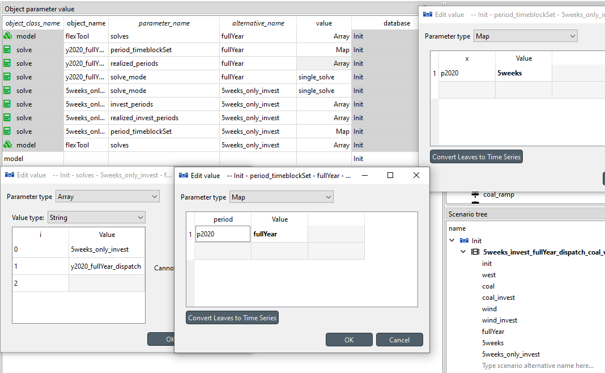
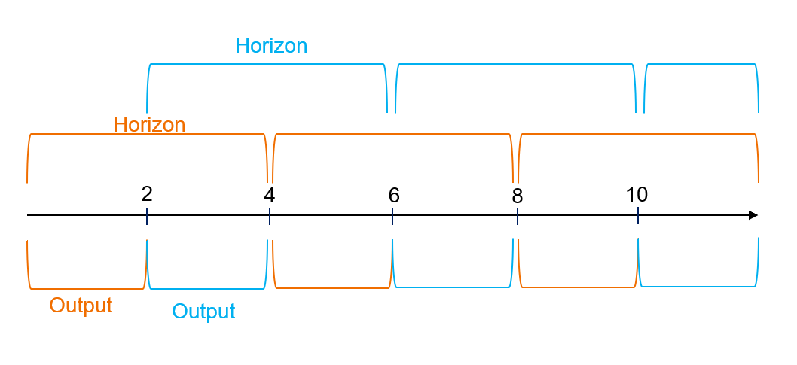
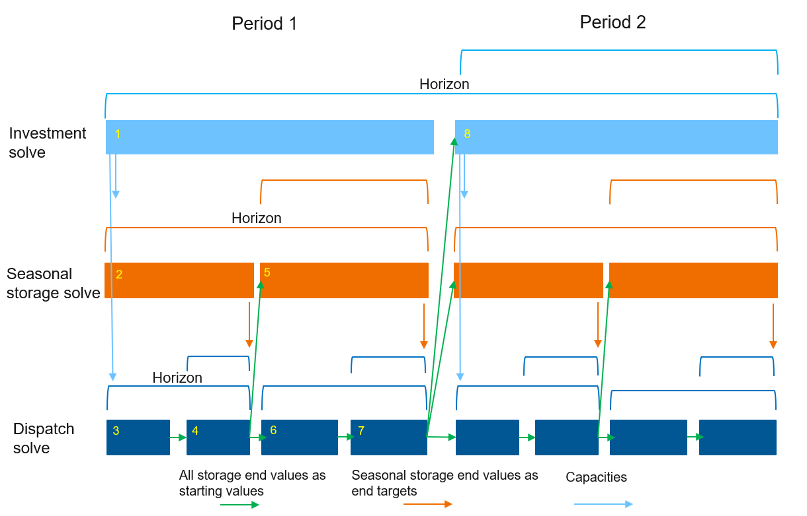
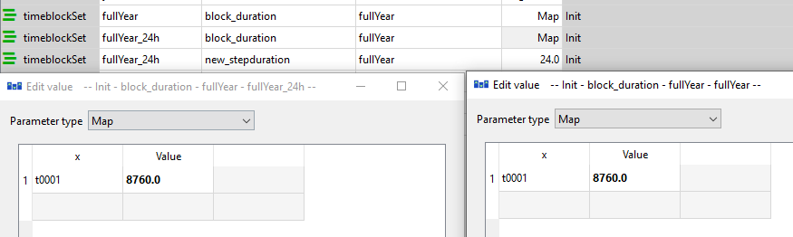
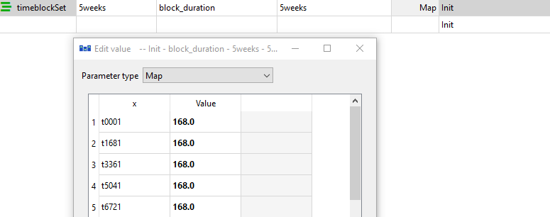
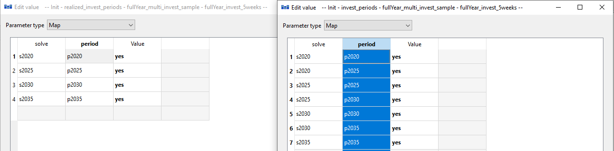

# Solve sequences, rolling and nested solves

## How to run solves in a sequence (investment + dispatch)
**(examples.sqlite scenario: 5weeks_invest_fullYear_dispatch_coal_wind)**

In this example, investment decisions are made using a five week sample of a year and then the dispatch is solved with the full year timeline using these investments. 

To do this you need two solves:

- Investment solve 
- Dispatch solve

Both solves should solve the *same* periods using *different* `timeset` to represent these periods. This example has only one period p2020 describing a year. The investment solve uses a representative sample `timeset` *5weeks* to do the investment decisions. These are then passed to the dispatch solve that uses complete timeline *fullYear*.

Investment solve requires the parameters:

- `Invest_periods`: Array of periods where investments can be made
- `realised_invest_periods`: Array of periods that are output for investment decisions
- `period_timeset`: Uses the *5weeks* as the timeset 

Note that the `realized_invest_periods` is used instead of `realized_periods`, because we want the investment solve to only output investments.
Additionally some of the units, connections or storages will need investment parameters (`invest_cost`, `lifetime`...) see [How to make investments (storage/unit)](investment.md#how-to-make-investments-storageunit)

The dispatch solve requires the parameters:

- `realized_periods`: Array of output periods
- `period_timeset`: Uses the *fullYear* as the timeset

The sequence of solves is defined by the `model` parameter `solves`. Here it is an array where the first item is an investment_solve *5weeks_only_invest* and the second is the dispatch solve *y2020_fullYear_dispatch*. This is enough for the model to know to pass the investment decisions of the period to the period of the same name in the second solve.

Note that the picture has two `model`: *solves* parameters defined one for each alternative. Only the parameter from the *5weeks_only_invest* is used as the lower alternatives in the scenario tree override the values from the higher alternatives and only one model can be run.



**Check the investment solve's capacity margin.** A group's capacity margin (`capacity_margin_method`) applies only
in a solve with investment periods, so here only the investment solve has it; the dispatch solve does not check it
again. When the investment solve leaves a shortfall (the plan does not hold the margin, because the penalty is
cheaper than the capacity or the capacity cannot be built), the run log says so right after that solve:

```
capacity margin shortfall: solve <solve>, group <group>, period <period>: <MW> MW at <time step> (penalty <M CUR> M CUR)
```

A period that is a look-ahead period of one investment solve and an investment period of the next gets a line from
each solve that leaves a shortfall in it: the solve name says which plan the line is about.

The results then show:

- `slack__capacity_margin__d`: the shortfall [MW] of the period, also when a later dispatch solve realizes the
  period, and its penalty in the costs (`capacity margin penalty` in `costs_discounted__d`).
- `capacity_margin__d`: the capacity margin of each solve with investment periods, under that solve's name, for
  each group and investment period (look-ahead and forecast branch periods included) at its binding step (the time
  step with the largest deficit): the margin, the demand, the requirement, what firm and VRE units, storage, other
  units, connections and consumption count, the shortfall, its penalty and the shadow price of the margin.
- `capacity_margin_entity__d`: what each unit, connection and node counts at that step, to see which capacity is
  missing or does not count.

See [Slack and penalty values](../results.md#slack-and-penalty-values).

## How to make an LP investment and a detailed dispatch check

Unit commitment (`startup_method` *binary*), min loads, ramps and reserves make an investment solve slow, and an
investment solve over many periods or a long sample may not finish at all. A common way out is to make the
investment solve an LP with less detail and then check the plan with a dispatch solve that has all the detail.

**Set up the two solves** as in [How to run solves in a sequence](#how-to-run-solves-in-a-sequence-investment-dispatch):
an investment solve that realizes the investments only (`realized_invest_periods`) and a dispatch solve that
realizes the operations (`realized_periods`). Then set on the investment solve:

- `reduce_unit_detail_method`: *online* (or *online_ramps* to also leave out ramp limits and ramp costs).

    The investment solve has no units online: no start-ups and start-up costs, no min load, no minimum up and down
    times. `min_load_efficiency` units run at their full-load efficiency, and `exact` connections behave as
    *regular*. Use *integers* instead to keep the units online but make them continuous (linear unit
    commitment), which keeps start-up costs and min loads.

- `reduce_system_detail_method`: *reserves* (or *reserves_inertia_non_synchronous* to also leave out the inertia and non-synchronous limits).

Leave both at *none* on the dispatch solve. The dispatch solve then commits the invested units with integer units
online, ramps and holds the reserves.

**An example to start from.** In *examples.sqlite*, the scenario `5weeks_invest_fullYear_dispatch_coal_wind` has
the investment solve `invest_1year_5weeks` (alternative *5weeks_only_invest*) and the dispatch solve
`y2020_fullYear_dispatch`. Give `coal_plant` `startup_method` *binary* (as the alternative *coal_min_load_MIP*
does), and set the two parameters on `invest_1year_5weeks`.

**What to check.** Read the investment solve's info line in the run log: it lists what was left out, for which
units and groups, and what that means for the detail that was kept (for example "the reserves of ... now come from
built capacity"). Then look at the dispatch solve's slack and penalty results (`slack__*` tables, the reserve
shortfall). A shortfall there means the plan does not hold with the detail the investment solve left out:
reserves in particular drive investment in flexible capacity, so an investment solve without them invests less
in it. Then add the detail back step by step (for example *integers* instead of *online*, or keep the reserves)
until the dispatch check passes.

**In the results** the investment solve realizes no operations, so the dispatch solve's tables are complete. If a
solve that realizes operations leaves a feature out, its cells of that feature are empty, not 0 (see
[Leaving out detail in a solve](../reference/entities_and_time.md#leaving-out-detail-in-a-solve)).

### Several milestones: representative-period investment, then a full-year dispatch of each

A multi-year plan often makes the investments on representative periods (a few sample weeks per milestone year)
and then checks each milestone with an hourly dispatch of the whole year (8760 h). FlexTool passes the investment
decisions of a period to the period of the same name in the solves that follow, so the dispatch solves see the
capacity built up to their milestone. There are two ways to set this up.

**Sequential: one dispatch solve per milestone.** List the solves in the `model` parameter `solves`, the
investment solve first: for example [*invest_rp*, *dispatch_2030*, *dispatch_2040*, *dispatch_2050*].

- The investment solve has every milestone in `invest_periods` and `realized_invest_periods`, the representative timeset of each milestone in `period_timeset`, and `years_represented` for each milestone. Leave `realized_periods` out.
- Each dispatch solve has one milestone in `period_timeset` (with the full-year timeset) and in `realized_periods`, and the same `years_represented` for it as the investment solve.

    A dispatch solve that realizes a later milestone gets the capacity invested in all the milestones up to it.
    One dispatch solve may also hold all the milestones, but its LP is then that many full years at once.

**Nested: the investment solve contains the dispatch solve.** Put only the investment solve in `model`
`solves` and give it `contains_solves`: *dispatch_solve*. The dispatch solve lists every milestone in
`period_timeset` (each with the full-year timeset) and in `realized_periods`, and it can be a rolling solve
(`solve_mode` *rolling_window*) so that each LP stays small. A storage solve can sit between the two for long-term
storage. With several investment solves (myopic investment, set with 2D maps of `invest_periods` and
`realized_invest_periods`), the same dispatch solve runs after each of them for the periods that investment solve
realized. See [How to use Nested Rolling window solves](#how-to-use-nested-rolling-window-solves-investments-and-long-term-storage).

**Leave detail out of the investment solve.** Set `reduce_unit_detail_method` and `reduce_system_detail_method`
on the investment solve and keep the full detail in the dispatch solves, as in
[How to make an LP investment and a detailed dispatch check](#how-to-make-an-lp-investment-and-a-detailed-dispatch-check)
(the options are in [Leaving out detail in a solve](../reference/entities_and_time.md#leaving-out-detail-in-a-solve)).

**Choose the representative periods with care.** Hours the sample leaves out can be short of capacity in the
full-year dispatch. The sections below help:
[force-include adequacy-critical weeks](#how-to-force-include-adequacy-critical-weeks-in-representative-period-selection),
[cluster on net load](#how-to-cluster-representative-periods-on-net-load) and
[add an energy margin](#how-to-add-an-energy-margin-for-investment-adequacy). The investment solve does not see
the dispatch results: if a dispatch solve shows unserved energy or reserve shortfall, change the sample or the
margins and run again.

**Examples.** In *examples.sqlite*, `5weeks_invest_fullYear_dispatch_coal_wind` is the sequential set-up with one
milestone, and `multi_fullYear_battery_nested_multi_invest` is a nested set-up with four milestones, investment
solves (each on the sample timeset of two milestones), a storage solve at 6 h steps and a rolling dispatch. To
run in seconds, these examples use short stand-ins: their *fullYear* timeset is 72 hours and *5weeks* is five
blocks of 4 hours. In a real model, the dispatch timeset covers the 8760 hours of the year and the sample holds
whole weeks.

## How to use a rolling window for a dispatch model

A rolling window can be used for example when a dispatch model gets too big to be solved on one go. It splits the problem into multiple consecutive smaller problems.

The rolling window solve splits the time dimension into overlapping parts and solves each one of them separately but in a sequence (and can therefore pass state information from the previous solve to the next one). For example, instead of a solving the full year in one go, you can split the year into six four-month long solves where each solve outputs only the first two months. The solves would therefore include the months:

- **Roll: Solve months -> Output months**
- 1: [1,2,3,4] -> [1,2]
- 2: [3,4,5,6] -> [3,4]
- 3: [5,6,7,8] -> [5,6]
- 4: [7,8,9,10] -> [7,8]
- 5: [9,10,11,12] ->[9,10]
- 6: [11,12] -> [11,12]



The rolling solve could be setup also manually as described in the 'How to run a multi year model' - just using shorter periods. 

However, this would be tedious if there are many solves. In a rolling window model, the user can set the `rolling_solve_jump` and `rolling_solve_horizon` parameters, which are expressed in hours. 

- `rolling_solve_horizon`: sets the length of the whole solve, in hours. In previous example 4 months (2880 hours). Horizon allows the model to see bit further in the future to improve the decision making for the period that will be output.

- `rolling_solve_jump`: sets the interval for the length of each 'jump' the model takes forward in reach roll. It is then both the interval of roll starting points and the length of the output for each roll. The `rolling_solve_jump` must be smaller than the `rolling_solve_horizon`. In the previous example the `rolling_solve_jump` would be 2 months (1440 hours).

In addition, the user can set the duration for how long the model will roll:

- `rolling_duration`: Optional (hours), the length of combined rolls. In the example, it could be set to 8640 hours which would divide evenly, or 8760 hours which means that the last roll will be shorter than the others. It is nicer to use `rolling_solve_jump` that is divisable with the `rolling_duration` to keep rolls even. If `rolling_duration` is not set, it defaults to rolling through the whole timeline.

When using rolling window solve, you are solving the model with less information. Therefore, the results will be less optimal since the model will not have the full information at once. It is therefore important to know how this could affect the results and what things to consider when implementing a rolling window model. It will have an impact on time dependant parts of the model: for example, storages or cumulative flow constraints. If the model can see only a few months to the future, it can't see how much energy needs to be stored after that. 

Investments should not be used with this free rolling solve (`solve_mode`: *rolling_window*) as investments should only be done at the start of the periods. *Both the long-term storage and the investments can be taken into account with nested rolling solves that have a separate how-to*.

Short term storages also are operated less optimally in a rolling window model. There is a positive side to this as well, since perfect foresight linear optimization models are 'too optimal'. They don't reflect the forecast errors present in real life. So, a rolling window model might operate a bit more *realistically* than a *single_solve* model. A *single_solve* model can consider things happening far in the future when setting the storage level at present, even though in reality that information is not available. So, the total cost of a *rolling_window* model should always be higher than the total cost from a complete *single_solve* model that has perfect information.

To set a dispatch rolling window model you need to set the entity `solve` parameters:

- `solve_mode`: *rolling_window*
- `rolling_solve_jump`: Hours, the desired length of the solve interval
- `rolling_solve_horizon`: Hours, the desired length of each roll solve
- `rolling_duration`: (Optional) Hours, the length of the combined outputs. If not set, the whole timeline is used.

Considerations on the rolling times:

- The `rolling_solve_jump` and `rolling_solve_horizon` must be large enough to make the model faster. If too small intervals are used, the creation of solves and moving data from solve to another might take too much time.
- If you are not using 1-hour timesteps, preferably use multiples of the timestep you are using as the `rolling_solve_jump` and `rolling_solve_horizon`. The steps included in each solve are calculated by summing the step durations until they are larger or equal to the hours given. So, if multiples are not used, the rolls might not be exactly the same size.
- The model can roll over timeset and period jumps, which might cause some issues if storage constraints are used. Using timeset length or its multiples is therefore recommended. For example, the `rolling_solve_jump` could be a half of a timeset and the `rolling_solve_horizon` whole timeset or `rolling_solve_jump` a timeset and `rolling_solve_horizon` three timesets. Of course, when running e.g. a full year dispatch, there is only one timeset of 8760 hours, which makes the choices more simple.

Considerations on storage parameters:

- `storage_solve_horizon_method` *use_reference_value* or *use_reference_price* are the preferred means to bind storage values. They can be used together with the `storage_state_start_end_method`: *start*, which would then set the initial storage state. These methods bind either the storage value or the storage price at the end of *horizon* (not the end of *jump*). This allows the storage to use the part of the horizon that is not output to improve the behaviour of the storage in the part that is output (as defined by `rolling_solve_horizon` and `rolling_solve_jump`). 
- `bind_within_timeblock` does not work correctly if the rolls don't include whole timeblocks. Instead, it will bind the first step of the roll (whatever it is) to the end of the timeblock. Do not use in nested solves if you are not using whole timeblocks or its multiples as `rolling_solve_jump`. The storage level is not carried from roll to roll for this method (nor for `bind_within_period` and `bind_within_solve`): each roll cycles on its own, so the storage level jumps at each roll start, and the reported state change at that step is that jump.
- the same applies to the `bind_within_period` (but in relation to periods - do not use this unless you are `rolling_solve_jump` is as long as a period or its multiples).
- `bind_intraperiod_blocks` loops the blocks of a period only in the rolls that hold the whole period. In a period that a roll holds only in part, the blocks chain forward and the storage level is carried from roll to roll, as for `bind_forward_only`. The blocks of a roll also end at the end of its realized part. Use a `rolling_solve_jump` of a whole number of periods to keep every realized period looping (otherwise a warning is given).
- The representative-period variants (`bind_within_solve_blended_weights`, `bind_within_period_blended_weights`, `bind_forward_only_blended_weights`) are not applied in a rolling solve on representative periods: their base-period chain spans the whole period and cannot be cut into rolls. Those nodes bind forward only (`bind_forward_only`) and the storage state is passed directly from roll to roll; a warning names them once per solve.
- `storage_start_end_method` can be used to set the first timestep of the first roll and/or the last timestep of the entire model (in conjunction with `storage_state_start` and `storage_state_end`); the end value applies in every roll whose horizon contains the model's last timestep (usually the last roll only). Every later roll starts from the storage state realised by the previous roll. It is meant for simple models: `storage_state_reference_value` with `storage_solve_horizon_method` *use_reference_value* is usually the better choice.
- `bind_within_solve` binds the start state to the end state of each *roll* not the start and end of the whole model timeline. Use with caution (and probably best not to use together with `storage_solve_horizon_method` *use_reference_value*).

## How to use Nested Rolling window solves (investments and long-term storage)

The basic rolling solve can have problems in dealing with long term storage and with investments. If the model only sees a few weeks to the future, it really can't see how much energy should be stored in long term storages. Problems with investments can also be serious: If the first roll is really windy, the model would overinvest in wind power that is not profitable in the later rolls. Similarly, if the model is allowed to retire capacity, it might retire something that is actually needed in the later rolls. 

Nested solve sequences can first solve the investments and long-term storage levels and pass them to the dispatch solve. Both storage solve and dispatch solve can be rolling solves. The dispatch solves can then send the end storage values to the investment and long-term storage solves as start values to reduce the error of these solves.

When to use nested solves?

- Dispatch model is taking too long to solve, but simple rolling window solve would not represent the long-term storages correctly. (Nesting without the investment solve)
- Investment model takes too long to solve, even with manual rolling [How to create a multi-year model](investment.md#how-to-create-a-multi-year-model). With nesting you can have smaller rolls for dispatch solve than the investment solve. (Nesting without the storage solve)
- Investment model takes too long and you have long term storages to consider. (Three level nesting, graph below)



However, the obvious issue is that investment and storage solves cannot be solved using the old complete solve as it wouldn't make the solve time any shorter. Therefore, we need to decrease the information for investment and storage solves as well. There are a few options for this:

1. Use lower resolution (longer timesteps). This can work quite well for a long-term storage.
2. Use representative periods from the full timeline when performing investments. There is a large body of literature and methods on how to pick the representative weeks.
3. Split the investment timeline (myopic investments) by manually creating a solve sequence for the investment solves like in: [How to create a multi-year model](investment.md#how-to-create-a-multi-year-model) section. This can be combined with the first or second option. 

Each of these have their pros and cons:

- Using the lower resolution can speed-up the model considerably, but it also means that everything that happens faster than the new timestep duration will be lost as the timestep varying parameters are averaged or summed for the new timestep. For example, consider a model with investment options to solar and storage. If the step duration is changed to 24 hours, the model won't invest in enough storage to mitigate the diurnal variation in PV. When these investments are then passed to the dispatch solve, the invested portfolio will have trouble meeting the demand.
- Using the sample can be effective if the sample is chosen well, but all the needs that are not in these samples are not included. The speed is heavily dependent on the number and size of those samples.
- Splitting the investment timeline for multi-year models can be seen as a relatively realistic approach, since investment decisions would have a lot of uncertainty in the longer time frame anyway.

The investment decisions with less information are always less optimal than with complete solves. Therefore, when they are passed to the dispatch solve, it will in some cases cause penalties in the results when the invested portfolio is not sufficient to meet the demand at all times.

The long term storage solve can be implemented using a lower resolution solve. The storage state behaviour from the storage solve is used as a target for the dispatch solve. There are three options for doing this: 

- *fix_quantity* creates a constraint that forces the end storage state to be the same as in the storage solve at this timestep.
- *fix_usage* does the same but not taking into account the inflow or slacks. Forces the summed usage of the storage during the dispatch solve to be the same as during the same time span in the storage solve. This avoids infeasibilities when modelling inflow stochastics in comparison to the *fix_quantity*.
- *fix_price* takes the storage node's price (`price_t`, the value of one more MWh of stored energy) from the storage solve at the end timestep of the dispatch solve and uses it in the objective function to give a value to the stored energy at the end of the horizon. 

The `rolling_solve_jump` and `rolling_solve_horizon` in the storage solve have to be longer than in the dispatch solve. You can set which storages are included as "long term storages" whose value will be transferred to the dispatch solve.

To create a nested solve sequence, you need two or three `solve` entities. Either the investment solve or the storage solve can be left out. When using nested solve sequence, the sequence is not set with the `model`: `solves` parameter. Only the topmost solve is put there. Instead, the nested levels are set by the `solve` parameter `contains_solves`: *solve_name*. The investment solve is always on the top followed by the storage solve and dispatch solve:

- *investment_solve* `solve` parameter `contains_solves`: *storage_solve_name* 
- *storage_solve* `solve` parameter `contains_solves`: *dispatch_solve_name*

To create a storage solve:

- `solve` parameter `fix_storage_periods`: Array of periods where the storage values are fixed in the lower solve. Should be the same as `realized_periods` for the dispatch solve.
- `node` parameter `storage_nested_fix_method`: *fix_quantity*, *fix_price* or *fix_usage*

To create an investment_solve:

- `solve` parameter `invest_periods`: Array of periods where the model can invest.
- `solve` parameter `realized_invest_periods`: Array of periods where the model will realize investment decisions to the lower solves and results.
- `solve` parameter `realized_periods`: Should not be used in this solve! You don't want the dispatch results from this solve, but from the dispatch solve.

In addition, the rolling dispatch solve should be created as in the *How to use rolling window solve for dispatch*. To set a dispatch rolling window model you need to set the entity `solve` parameters:

- `solve_mode`: *rolling_window*
- `rolling_solve_jump`: Hours, the desired length of the solve interval
- `rolling_solve_horizon`: Hours, the desired length of each roll solve
- `rolling_duration`: (Optional) Hours, the length of the combined outputs. If not set, the whole timeline is used.
- `realized_periods`: Array of periods that are realized

The other model parameters apply to *all* of the solves. Therefore, the considerations of the storage value binding that were discussed in the [How to use a rolling window for a dispatch model](#how-to-use-a-rolling-window-for-a-dispatch-model) should be taken into account here as well.

- Storage levels can be fixed with `storage_solve_horizon_method`: *use_reference_value* or *use_reference_price*, these will fix the end of each horizon not each jump.
- `storage_start_end_method` fixes the start of each solve level (the first step of the first roll) and/or the end of the entire model. The end value applies to the last timestep of the model in every solve whose horizon contains it: the investment, storage and dispatch solves when each of them reaches the end of the model, but not a solve (or roll) that ends earlier. It is meant for simple models: in nested solves `storage_state_reference_value` with `storage_solve_horizon_method` *use_reference_value* is usually the better choice. The start applies where a level appears for the first time; every later solve or roll of a level (also the first dispatch roll under a later storage roll, and the next investment or storage solve of a split investment timeline) starts from the latest storage state realised before it at that level or below (usually by the dispatch solve). The upper solves only fix the end of a lower solve's horizon (`storage_nested_fix_method`). At the model's last timestep in a lower-level solve, an upper-level *fix_quantity* or *fix_usage* overrides `storage_state_end`; a *fix_price* only values that end, so `storage_state_end` still applies.
- In most cases the `bind_storage_method` should be left as *bind_forward_only*
- Do not use `bind_within_timeblock` if you are not using full timeblock or its multiples as the `rolling_solve_jump` in the dispatch model, otherwise you might cause an infeasible problem. 
- Do not use `bind_within_period` if you are not using full periods or its multiples as the `rolling_solve_jump` in the dispatch model, otherwise you might cause an infeasible problem. 
- Do not use `bind_within_solve`

The recommended storage parameters with nested solves are:

- `storage_start_end_method`: *fix_start*
- `storage_solve_horizon_method`: *fix_quantity*
- `storage_state_start` and `storage_state_reference_value`: use the same value

This way the start and end states of the system are the same. Each end of the horizon (not the output) has that value as well, which keeps the model from emptying the storages at the end of the roll. In the dispatch solve, the fixed storage value from the storage solve overrides the horizon end value if a conflict exist. 

How to create the three lower information solve types for investment and storage solves discussed above?

To create a lower resolution (longer timesteps) solve:

- Make a new `timeset`, but use the same `timeline` and `timeset_duration` for it as with the high resolution solve
- In the `solve` use this new `timeset` in the `period_timeset`
- Set `solve` parameter `new_stepduration`: Hours

The model will create a new timeline for this solve with the `new_stepduration`. Each time series gets one value per new time step, by a rule that depends on the parameter (see [`new_stepduration` in the reference](../reference/entities_and_time.md)): `inflow` and `energy_margin_adder` are summed over the time steps that form each new time step (a constant counts once per time step it combines); prices, costs, limits, availability, `min_load`, penalties, reservations, `self_discharge_loss`, weights and profiles are averaged over them, weighted by their durations; `efficiency` and `efficiency_at_min_load` take the mean of 1/efficiency (exact fuel use at a constant flow); `storage_state_reference_value` takes the value at the new step's end. Stochastic (branch) time series are combined the same way, branch by branch. `peak_inflow` stays per time step of the timeline: `scale_to_annual_and_peak_flow` scales each time step of the timeline as without `new_stepduration` and a new time step gets their sum, so the peak is matched by the timeline's time step, not by the average of a new time step. The `new_stepduration` must be a whole multiple of the timeline's time steps; on a timeline with time steps of different lengths every new time step must end where a time step of the timeline ends. FlexTool stops with an error otherwise. Steps are aggregated from the start of each block of the `timeset_duration`; if a block is not a multiple of the `new_stepduration` its last timestep will be shorter than the rest. A gap between two blocks stays a gap, so storage, ramps and on-line status treat the blocks as they do without `new_stepduration`. When several timesets of the solve share a timeline (e.g. one timeset per period), each period keeps its own timesteps; if a block of one timeset starts or ends inside a timestep of another timeset's block, that timestep is cut there (a warning names both timesets). A timeset used by a solve with `new_stepduration` cannot also be used by a solve without it, or by a solve with a different `new_stepduration`: give such solves their own timesets.


Some nodes can also be balanced at a coarser step than the rest of the solve: put them in a `group` with its own `new_stepduration` (e.g. hydrogen and its storage at 24 h while electricity stays hourly). Each node of the group is balanced once per coarse step, summing its flows over the step, and a storage node of the group keeps one state per coarse step. A unit or connection with a node outside the group keeps the solve's time step: an electrolyser between an hourly electricity node and a daily hydrogen node uses electricity in every hour it produces hydrogen. A unit or connection whose nodes are all coarse (e.g. a hydrogen liquefier or a hydrogen pipeline between daily nodes) has one flow per coarse step, which makes the model smaller. Its limits (capacity, availability, profiles, efficiency) apply to their average over the step, and ramp limits apply between coarse steps. The result is the same as with hourly flows when at most one limit of each flow varies within the step and its cost and efficiency do not; otherwise it can differ a little. A unit with online variables between coarse nodes decides its units online, start-ups and shut-downs once per coarse step, and its minimum up and down times count whole coarse steps; with ramp limits, its start-up and shut-down capacity reduction uses the coarse step (the average output over the whole step of a unit that starts at its start, ramping up from minimum load). A unit or connection between coarse nodes that provides reserves holds one reserve per coarse step: its reserve limits apply to the average over the step (with the average availability or profile), its reserve ramp room is the smallest of the step's time steps, and the reserve requirement is still checked at every time step of the solve, so it must be met by the step's one reserve in each of them. Nodes of a coarse group can be in reserve groups. An `exact` connection between coarse nodes chooses its direction once per coarse step, and DC power-flow lines between coarse nodes have one flow per coarse step (with one voltage angle per coarse step at the nodes of a DC network whose lines are all coarse; a DC network with an hourly line keeps every angle hourly). Rows that combine several units and connections — capacity margin, inertia and non-synchronous limits of a group, flow group instant limits, user constraints and DC power flow — are averaged over the coarse step when all their units and connections use it: they then see the step mean of demand, inflows, profiles and limits (a capacity margin on daily steps covers the mean net demand of the day, not its peak hour). A row that mixes coarse and hourly units or connections is still checked at every time step, with the coarse flows constant through their step. Only units and connections with a delay keep the solve's time step (and, in a Benders decomposition, flows that cross regions or live in the master; in a stochastic solve, those whose coarse step is tied between the forecasts over only part of it). An info line names the units and connections that keep the solve's step and the reason, and a database upgraded from an earlier FlexTool version prints a notice naming the coarse ones whose results can differ from hourly flows. Results are written at every time step: flows, units online and reserves hold the same value through the coarse step, and start-ups and shut-downs are written at the first time step of their coarse step. Listing a unit or connection in such a group has no effect on time resolution. The group step must be a multiple of the solve's time step.

Note that if the last timestep of the dispatch horizon is not in the storage solve timeline, it will use the last available timestep to fix the storage. This can happen at the end of the timeline when the dispatch solve with a lower step size can fit an extra step after the last time step of the storage solve.
Other reason might be that both dispatch and storage solves are aggregated with the `new_stepduration`. In that case, it is usually best to use values for the `new_stepduration` that are dividable.  

To create a sample solve with representative periods:

The tutorial contains an example of representaive periods under alternative *5weeks* where the year is represented with five sample weeks. It is done with the `timeset` parameter `timeset_duration` where instead of choosing the whole timeline by setting the first timestep and the duration of whole timeline, you choose multiple starting points with smaller durations. The example for the *5weeks* is below.



To create an investment solve sequence, you have two options:

- Create manually a series of solves and set the `invest_periods` and `realized_invest_periods` individually for the solves. [How to create a multi-year model](investment.md#how-to-create-a-multi-year-model) has an example of this with the difference that here you use `realized_invest_periods` instead of `realized_periods` and that each of the higher level solves requires the `contains_solves` parameter. **This does not work yet when the investment solves look ahead** (`invest_periods` with more periods than `realized_invest_periods`, as in the examples below): the run stops with an error in the lower level solves. Use the 2D maps below for such a nested investment sequence.

If you have many splits, this option can get tedious and prone to mistakes.

The other option is to use only one investment `solve` entity:

- The `invest_periods` and `realized_invest_periods` should then be set with a 2D map where the first column tells the solve (you don't have to create separate `solve` entities for these) and the second column tells the period. To get a 2D map, choose the parameter type as *Map* and then right click the table and choose *Insert column after/before*. The value column does not matter. The model will generate these solves, with the periods given. Note that the solve names should match in both 2D-maps. Each generated solve is named `<solve>_<name in the first column>` and is the same solve as the one you would write by hand: it has every other parameter of the solve (of `stochastic_branches` only the rows of the periods it realizes, see [Investing year by year under uncertainty](stochastics.md#investing-year-by-year-under-uncertainty-fan-realize-next-year); also `new_stepduration`, `dispatch_realization_method` and the solver settings), the timesets of its own periods, of a 1D period list only its own periods, and `years_represented` counted from its own first period. The generated solves run where the solve is in `model.solves`. A generated name must not be the name of another solve, and each period can be realized by one generated solve only (FlexTool stops with an error otherwise). When a generated solve realizes one period of a solve it contains, that contained solve runs as `<contained solve>_<period>`, whatever the name in the first column.  

You can use the same lower level solve with each the investment solves as the lower level solves will exclude the periods that are not included in either of the upper level realized periods: `realized_invest_periods` or `fix_storage_periods`. So, the lower level solve should have all the periods that it is used for in any the solves.




Note that the results of a nested rolling solve run are not fully optimal, because the information in the model is decreased. This is the price you pay for the speed. Therefore, the results should not be taken as they are, instead it is important to know how to interpret the results: What phenomena are missing? How will they affect the results? Where should extra investments go to satisfy the demand (there is a possibility to use the `capacity_margin` method to force extra investments)?

In the examples.sqlite there are four example scenarios related to this:

- *multi_fullYear_battery*: The four period full year single solve, with coal, wind, battery storage with unlimited investment possibilities. Running this is still possible but takes a few minutes. This is here as a reference for the nested solves.
- *multi_fullYear_battery_nested_24h_invest_one_solve*: This has the nested structure and the investment solve is done with 24h timesteps and storage solve 6h timesteps.
- *multi_fullYear_battery_nested_sample_invest_one_solve*: This has the investment solve as 5weeks sample but all the four periods are included in the same investment solve. Nested structure with 6h storage solve timesteps.
- *multi_fullYear_battery_nested_multi_invest*: This has split the investment to four solves with each having two period 5weeks sample period horizon. Nested structure with 6h storage solve timesteps.

The 24h timestep is clearly too long as it invests too little for storage and coal. A large upward penalty ensues.

The sample one solve invest also invests too little, as the largest demand-supply ratio weeks are not in the five week sample. However, the investments are spread more accurately.

The split sample investment run produces in this case similar results as the one solve sample run. This is not always the case! Here the only difference between the periods was linearly increased demand.

### How to force-include adequacy-critical weeks in representative-period selection

When a nested solve builds its investment stage on representative periods (see [How to use Nested Rolling window solves](#how-to-use-nested-rolling-window-solves-investments-and-long-term-storage)), those periods are picked by greedy convex-hull clustering, which optimises a whole-year approximation of the *shape* of the profiles and inflows. A sustained low-VRE / high-demand stress week can have an unremarkable within-period shape and so never get selected — the investment stage then never sees that week as a hard balance constraint and under-builds. Force-include fixes the *representation*: it injects the worst base period under an explicit net-load signal so the stress week becomes a hard row in the invest LP. This is complementary to the energy-margin lever below — force-include corrects *which* weeks the invest stage sees, whereas the energy margin applies a deliberate margin on top of whatever weeks are chosen.

The selection runs from the command line:

```bash
python -m flextool.representative_periods.preprocess <db_url> <scenario> <n_rp> <period_length> [options]
```

The force-include options (all off by default):

- `--force-highest-net-load` — force-include the base period with the greatest *sustained* net load (Flag B, energy-adequacy — the main fix; rewards a whole low-VRE / high-demand week rather than one spiky hour).
- `--force-peak-load` — force-include the base period with the highest *instantaneous* net load (Flag A, capacity-adequacy; noisier for energy-constrained systems).
- `--force-window N` — sub-window length in timesteps for the sustained score (default: the whole period).
- `--vg-weight W` — convex blend in [0,1] between the VG-shortfall term and the inflow-demand term of the net-load signal; the inflow term gets `1 - W` (default 0.5).
- `--region-groups G1,G2,…` — opt-in node-group demand-weighting of the VG term (see below).

The VG-shortfall term of the net-load signal has two weighting modes. By default it is the unweighted, system-coincident mean shortfall over all profile series — best for a simple system or when no node-group information is available. With `--region-groups G1,G2,…` each region's VG shortfall is instead weighted by that region's demand `D_r`, so a coincident trough in the high-demand regions dominates the selection. The mapping is derived structurally — profile→node via `unit__node__profile`, node→region via `group__node` membership, and `D_r` = Σ|scalar demand| over the region's member nodes — with no name conventions. Each named region group must therefore contain BOTH the VG (profile) nodes and the demand nodes of that region.

For example, on the H2_trade model:

```bash
python -m flextool.representative_periods.preprocess <db_url> y2050_rp 5 168 --force-highest-net-load --region-groups decomp_AUS,decomp_JAP,decomp_KOR
```

forces the low-VRE week starting 2050-10-15 (base period 41), which the unseeded hull ({3, 8, 14, 22, 49}) misses entirely, and the timeset is written as `hull_5rp_168h+f1`. Without `--region-groups` on this multi-region trade model the top-scoring week happens to already be a hull pick, so the timeset name is unchanged — a documented limitation of the unweighted signal on such systems; use `--region-groups` there.

Forced periods **seed** the greedy hull: they are guaranteed into the set as its initial vertices, and the clustering then fills the remaining slots to *complement* them (never re-selecting a period a forced extreme already represents). The total stays pinned at `n_rp` — a forced period consumes one of the `n_rp` slots, it never grows the set beyond `n_rp`. The `+f{n}` suffix counts the forced periods that displaced a clustered pick (i.e. that the unseeded hull would not have selected). With no `--force-*` flag the run is byte-identical to the pure-hull selection and keeps the plain `hull_{n_rp}rp_{period_length}h` timeset name, so force-include never overwrites the pure-hull timeset.

### How to cluster representative periods on net load

By default the greedy hull clusters on the *shape* of every normalized profile and inflow series. `--netload-clustering` instead clusters on a real-MW **net-load** signal — demand minus available VRE — so the selected periods are the ones the *net* demand actually stresses rather than the ones with the most distinctive individual profile shapes:

```bash
python -m flextool.representative_periods.preprocess <db_url> <scenario> <n_rp> <period_length> --netload-clustering [--vre-penetration P]
```

- `--netload-clustering` — cluster on `demand − Σ VRE·availability`. VRE is any generation unit whose `unit__node__profile` arc uses `profile_method = upper_limit` (the default). The iteration-0 VRE fleet is sized by a **demand-match** default (each aggregation unit's investable VRE is grown until its energy plus existing VRE energy covers the unit's demand energy). The timeset is written as `netload_{n_rp}rp_{period_length}h`.
- `--vre-penetration P` — scale the demand-match energy-share target (`1.0` = full-energy match; default `1.0`). Ignored without `--netload-clustering`.

**Per-group vs per-node granularity.** Set the `group.use_for_representative_periods` (`yes_no`) flag to `yes` on one or more region groups to sum each flagged group's member-node net load into a single regional signal; when no group carries the flag, each node is clustered as its own net-load signal.

**Iterating on solved capacities.** The single-shot mode above sizes VRE with the demand-match default. To instead feed a solve's *realised* investments back into the selection, use the iteration driver, which reselects and re-solves until the representative set stabilises:

```bash
python -m flextool.representative_periods.netload_iterate <db_url> <scenario> --n-rp 5 --period-length 168 --iterations 3 [--keep-best]
```

Each iteration runs an invest-only solve and feeds its invested capacities into the next net-load selection; the loop stops early once the selected set stops changing. `--keep-best` additionally dispatches each mature iteration over the full year and keeps the representative set with the lowest full-year cost. Run `... netload_iterate --help` for the full flag list (`--invest-solves`, `--dispatch-solves`, `--vre-penetration`, `--work-dir`, `--output-location`, `--alternative-name`, `--warm-start`).

### How to add an energy margin for investment adequacy

In a nested solve the investment stage is optimised over representative periods and the full-year dispatch is solved separately. The representative periods can be systematically optimistic about variable-renewable (VRE) availability: their average VRE availability tends to exceed the true annual average. The investment stage then under-builds, and the full-year dispatch has to cover the shortfall with large forced unserved-energy (upward-slack) penalties.

The energy-margin lever lets you de-rate a node's energy balance in the investment stage so that it builds enough capacity to meet the true demand under the true (lower) annual VRE availability. It is set per node with a method and one of two value parameters:

- `energy_margin_method` - *none* (default, off), *inflow_multiplier*, or *inflow_adder*.
- `energy_margin_multiplier` - the factor (default 1.0). When `energy_margin_method = inflow_multiplier`, the node's demand (inflow) is multiplied by this factor **in the investment solve only** — the dispatch solves always see the true demand. A value of 1.1 makes the investment stage build for about 10% more demand, so the real capacity is enough to meet the real demand under the true annual VRE. A value of 1.0 has no effect.
- `energy_margin_adder` - the extra demand in MWh per time step of the timeline (default 0.0). When `energy_margin_method = inflow_adder`, this many MWh of extra demand (negative inflow) is added to every time step at the node **in the investment solve only**; the dispatch solves always see the true demand. When the investment solve has `new_stepduration`, a solve step gets the sum over the time steps it combines, like `inflow`. A value of 0.0 has no effect.

For example, to build about 10% more into a demand node, set `energy_margin_method = inflow_multiplier` and `energy_margin_multiplier = 1.1` on that node.

The energy margin enters only the node balance. The reserve requirement, the non-synchronous limit and the capacity margin of a group follow the real demand; use `capacity_margin` for a capacity surplus. Combined with a capacity margin, the energy margin does not lower or raise the capacity requirement: storage and imports count with the power they deliver at a step, also when it serves the energy margin's added demand, and firm output that serves it leaves the capacity margin unchanged.

Use `inflow_adder` as the additive alternative to the multiplier. Because the multiplier scales the node's *existing* demand, it is a no-op on a node whose native inflow is zero — a common shape for a bare adequacy / slack node that carries no demand series of its own. `inflow_adder` instead adds a fixed block of demand at the node: it deepens the node's demand where it already has inflow and, crucially, **creates** the demand where the node had none, adding the same MWh to every investment-stage time step (a constant adder; on a timeline of 24 h time steps a margin of 10 MW needs a value of 240), or placing per-period values if authored as a period map. Set `energy_margin_method = inflow_adder` and `energy_margin_adder = <MWh>` on the node to raise investment-stage adequacy headroom without touching dispatch demand.

The margin is extra demand for the investment decision only, not load: it does not raise reserve requirements (a reserve group's `increase_reserve_ratio` follows the un-margined demand).

The energy margin is a per-node lever for regions whose adequacy gap is driven by VRE optimism and can be closed by building more of an investable response (more VRE, storage, or imports). It cannot help a region whose VRE collapses to near zero during the stress period when the only investable response is more VRE that serves the same demand — those regions need firm capacity or imports instead.

It is complementary to the `capacity_margin_method` (see the [group reference](../reference/groups.md#the-capacity-margin)): `capacity_margin_method` targets peak-capacity adequacy (firm and VRE capacity above the demand at every time step), whereas the energy margin targets sustained-energy adequacy across the year.

### Peak memory in long rolling and nested chains

The cascade keeps several solves' worth of state alive in RAM at once — the LP and its solution while outputs and the hand-off to the next roll are written, the next roll's input data, and the parked Provider state from earlier sub-solves. On continental-scale rolling or nested chains this can push peak RSS into the 10-30 GB range. Two CLI knobs help when peak RSS is the bottleneck rather than wall time:

- `--save-memory` (or `FLEXTOOL_SAVE_MEMORY=1`) — after each LP is built, drops polar-high's polars/numpy LP source, writes the LP to a temp MPS file, and solves it in a separate HiGHS subprocess (via `cmd_solve_mps`) so the solver's working set lives outside the FlexTool address space. Frees ~5–10 GB on large models at a cost of ~+90 s I/O per sub-solve. Also disables warm-LP reuse, so every sub-solve cold-rebuilds. Use when the machine OOMs, not as a default.
- `--presolve off` — HiGHS' presolve is the largest single contributor to peak RSS on highly-structured LPs (continental power grids, dense capacity-expansion). Turning it off slows the solve but can free several GB. Pair with `--save-memory` for the largest savings.

Both flags are documented in [Terminal / CLI](../terminal_workflow.md). The FlexTool GUI's side menu has a **Save memory** checkbox that passes `--save-memory` through to each scenario run.

## How to use representative-period clustering with scalar profiles

The representative-period preprocessor in `flextool/representative_periods/preprocess.py` builds its clustering matrix from time-varying `profile` and `node.inflow` series. Constant-valued (scalar) profiles and inflows are dropped from the clustering input: a constant series has zero variance and contributes no information to the period-similarity distance. The preprocessor prints a one-line note such as `Skipping 3 scalar profile(s) and 1 scalar inflow(s) — clustering only considers time-varying series.` so you can see exactly how many series were filtered out. There is nothing to configure: scalar profiles and inflows are still used by the model as constants, they just do not take part in choosing the representative periods.
