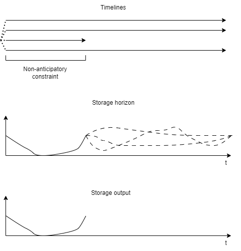
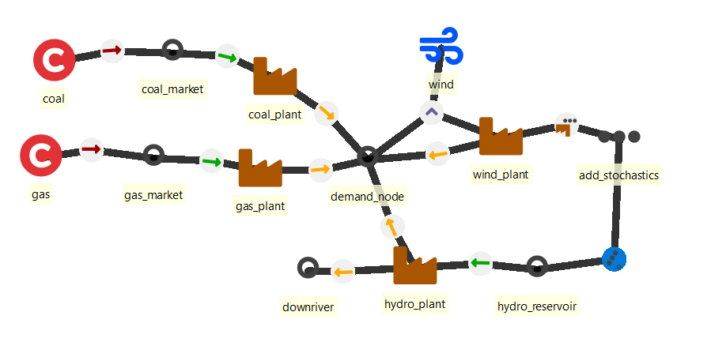
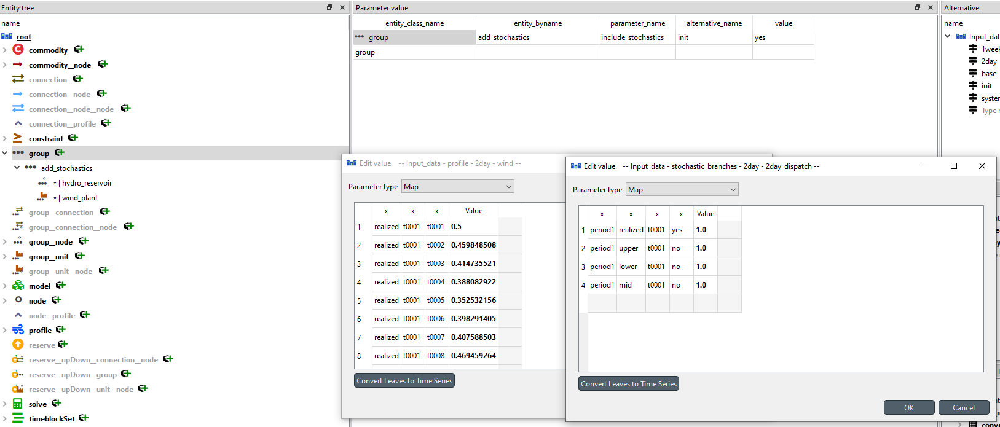
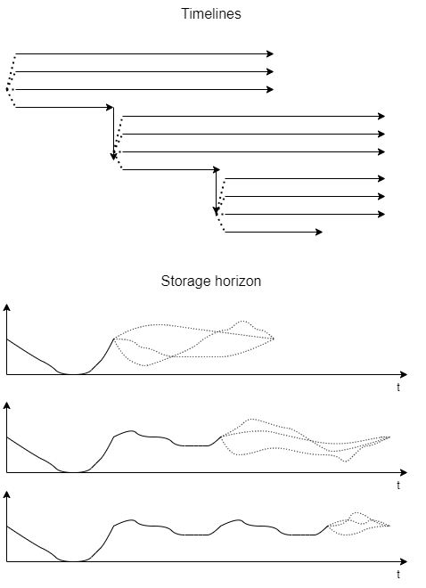
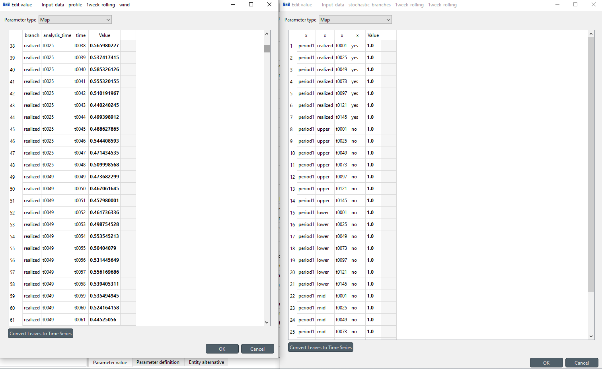

# Stochastics

## How to use stochastics (representing uncertainty)
**(stochastics.sqlite)**

Stochastics are used to represent the uncertainty of the future in the decision making. The main idea is to represent the distribution of possible futures by a set of discrete, probability-weighted **forecast branches**. The branches fan out from a common branching point, and each carries a probability weight; the weights sum to one. The model minimises the **expected** (probability-weighted) cost across all the forecast branches.

Because the decision maker does not yet know which future will occur, decisions that must be committed *before* the uncertainty is revealed cannot differ between the forecasts. A **non-anticipativity** constraint therefore forces the forecast branches to agree with each other on those here-and-now decisions over the committed part of the horizon — and that agreement *is* the (non-anticipative) realization of each such decision. The tied decision types are investments, storage usage and unit online (commitment) status; energy flows are always left free so each forecast dispatches them independently. (`min_uptime`, `min_downtime` and ramp limits are separate physics, always active within each branch's own trajectory — they are not part of the non-anticipativity tie.)

There is **no "realized" branch among the weighted forecasts.** "Realized" is an *optional* designation — at most one branch per branching point — that marks which branch's data are treated as the actuals; it is never a weighted member of the fan. The stochastic solve optimises over the forecasts only, so its operations inside the fan have no realized answer of their own. With a designated branch, FlexTool runs a **realization dispatch** right after the stochastic solve: a deterministic solve over the same committed window that reads the designated branch's data, keeps the stochastic solve's investments and inherits the units online and the reserves tied across the forecasts (the value of the first forecast branch in sorted order). Its results are the realized operational results. Without a designation (a forecasts-only fan) the results hold the investment decisions and the operations of the periods before the reveal, but no realized operation inside the fan. A solve reports only these committed / realized results, never the individual forecast branches (the `output_horizon` debug option, below, writes them to a separate raw dump).

For the stochastics to have an effect on the results, the system needs parameters that change between the forecast branches. These could be e.g. wind power generation or fuel prices. The model then carries separate variables in every branch for all the decisions it can take (e.g. investment, storage state, online, flow), and minimises their probability-weighted (expected) cost. The committed decisions — tied across the branches as described above — therefore hedge against the whole distribution of forecasts rather than optimising for any single one.

In this example, we show two ways to use stochastics: single solve and rolling horizon. They all share the same test system that includes: 

- A demand node 
- Coal, gas and wind power plants 
- Hydro power plant with a reservoir and a downriver nodes

The demand and the downriver nodes have a constant negative inflow. Therefore, the hydro plant capacity is partly in use at all times. The varying timeseries are the wind profile and the water inflow the reservoir. The coal commodity is more expensive than the gas, so the system will try to use the reservoir water to minimize the usage of coal. This will be affected by the forecast of the wind and the forecast of the water inflow. These are the stochastic timeseries in these examples. 

You can have stochastics in multiple timeseries in the same solve, but these will have to share the branches. This means that for example if you have two wind plants with two different stochastic wind profiles with three branches (upper, mid and lower estimates) you need to think if it is best to use only three branches and put both of the upper estimates to the same 'upper' branch or should you use combinatorics to make nine branches. However, note that the tool will not do the combinatorics for you and the solving time will be heavily affected by extra branches. Consequently, the usual practice is to present all the stochastics using just e.g. three branches and consider the correlations between the stochastic parameters in the pre-processing of the input data.

Notes about the storage options with stochastics:

- The best options to use are:

  - `storage_state_start_end_method`: fix_start or fix_start_end (and the their values)
  - `storage_solve_horizon_method`: fix_value or fix_price (and their values)

- `storage_binding_method` works per path of the stochastic tree (a path runs from the solve's first step through the trunk periods, the shared periods before the split, to the end of one forecast branch). With *bind_within_solve* the cycle closes once per path: the last step of every forecast branch ends at the level the solve's first step starts from. When the fan opens in the solve's first period, each forecast's first step continues from the last step of its own path, and since all the paths end at the same level, all the forecasts start from it too. With *bind_forward_only* (the default) a fan that opens later continues from the trunk's last step, and the forecasts of a fan that opens in the solve's first period all start from the same level: the solve's start state (the `storage_state_start` value, or the state carried in from the previous roll or solve), or, with neither (*fix_nothing*), one free level shared by all the forecasts. With `storage_start_end_method` *fix_start* (or *fix_start_end*) the start of each forecast is pinned to the given share (`storage_state_start`) of that forecast's own storage capacity, so where the capacity differs by forecast (investment or divestment per forecast) the starting energy differs although the share is the same; without a fixed start all the forecasts start from the same level. 

- Representative periods (a timeset with `representative_period_weights`) work in stochastic solves: each forecast branch period uses the representative periods of the period it branches from (all branches share that selection). The *_blended_weights* methods follow the same rules per branch: the first branch period continues from the last base period of the trunk period (the shared period before the split), a later one from the previous period of the same branch; *bind_within_solve_blended_weights* closes once per path, so every branch's last period ends at the level the trunk period starts from; *bind_within_period_blended_weights* closes each branch period on itself. When the fan opens in the solve's first period, the forecasts start from the same level (the fan has only forecasts, no realized member, so this equal start is what ties them). For a node in an `include_stochastics` group the start levels of the representative blocks are tied across the forecasts inside the non-anticipativity window, like the storage state.

### What the model ties across branches (dispatch vs. investment defaults)

Wherever the branches still share the same information — the committed part of the horizon, before the forecast is revealed — the model **ties** some decisions so that all forecast branches agree on them (the branches are tied *to each other*, not to any realized branch) and lets the rest **diverge**. What is tied depends on whether the solve invests.

**Any stochastic solve (dispatch or investment) assumes, by default:**

- **Storage state, unit commitment (online status) and reserves are tied** across the forecast branches over the solve's committed periods — every branch must take the same storage and start-up decisions while they still share information, so these decisions are genuinely non-anticipative. In a **single** solve whose committed periods span the whole horizon this ties them over the whole horizon (so only the flows differ between branches); in a **rolling** solve the tie covers only each roll's committed (jump) slice, and the branches operate freely in the forecast horizon beyond the reveal.
- **Energy flows are always free** — each forecast dispatches its flows independently.
- **Continuity is ordinary temporal carry-in.** Only the model's very first timestep starts from the given history / initial state; every later timestep continues from the previous one. At a branching point each child branch continues from its parent branch's last step, so sibling branches start from the same state simply because they share a parent.

**An investment solve additionally assumes, by default:**

- **A single, shared here-and-now investment plan** for all branches (`stochastic_invest_method = none`) — you commit one set of investments regardless of which future occurs.

So a plain **dispatch** solve = commit the committed part (shared storage / online / reserve), forecast the rest, flows free. An **investment** solve = the same operational tie **plus** one shared investment plan.

**Overriding the defaults:**

- *Investment* — set `stochastic_invest_method = recourse` for per-scenario (wait-and-see) investment, or declare a mid-horizon reveal for a genuine two-stage hedge (see *Stochastic investment* below).
- *Operations* — set the `solve` array parameter `shared_operation_periods` to change the operational tie window: an **empty array** frees operations from the first timestep (each forecast operates freely — combined with a single shared investment this is the classic two-stage capacity-expansion model), or a **list of periods** ties operations only over those periods. See *Stochastics over multiple periods* for the details.

### Single solve stochastics
**(stochastics.sqlite scenario: 2_day_stochastic_dispatch)**

In this scenario a near-term operating window is committed with an uncertain forecast for the following day over a 48-hour timeset.
To set up a stochastic solve, we need three things: the stochastic branch information, the stochastic timeseries, and choosing which parts of the model use stochastic timeseries.

The information about the branches is set with the *solve* parameter `stochastic_branches`. This is a 4-dimensional map. (Edit -> choose map -> right click -> add columns.)
The columns are: period, branch, analysis_time (starting time of the branch), realized (yes/no), and the value is the branch's **probability weight**. In this example we have forecast branches (e.g. mid, upper and lower) representing the wind forecasts. The weights set each branch's probability in the objective function (expected model cost) and are normalized so that the total weight is always one across the forecast branches at each start time. The *realized* flag is optional: at most one branch per start time may be flagged `yes`, and it only designates which branch's data are the actuals used by the realization dispatch (above) — a realized-flagged branch is **not** counted among the weighted forecasts. In this example all four branches (realized, upper, lower and mid) are forecasts and none is flagged `yes`: the fan is pure forecasts, so the solve reports no realized dispatch (its normal results are empty apart from the objective), and the example sets `output_horizon` (below) to write the forecast branches to the raw dump. Flag one branch `realized: yes` to get a realization dispatch of the 48 hours.

The stochastic wind timeseries are set with the same *profile* parameter `profile`, but with a three-dimensional map instead of the regular one-dimensional one. The tool recognizes a stochastic timeseries from the dimensions of the data. The three dimensions are: branch, analysis_time and time. The model reads the branch-specific series for each forecast branch; where a forecast branch period has no stochastic data available for part of the horizon, it falls back to the profile's non-stochastic value, if one is given. A forecast branch period reads the series whose `analysis_time` is the solve's fan start (the step at which the solve branches): the solve decides then, so it uses only the forecasts made then. One series per branch given at the fan's `analysis_time` serves every later period of the horizon, and it must cover them: where it has no value for a time step of a later period but a series given later (at that period's own first time step, for example the forecast meant for the next solve) has one, the run stops with a configuration error naming the entity, the parameter, the solve and the time steps. Where the fan's series has a value, a series given later is not read by this solve; it serves the solve or roll that fans out at its `analysis_time`. Every period before the reveal (before the forecasts branch out) reads only the series of the realized branch given at the solve's start, its first time step: never the fan-start series and never a series given at a later period's own first time step (a forecast made after the solve starts, information the solve does not have yet). That series must cover every time step of these periods; where it does not, the run stops with a configuration error naming the entity, the parameter, the solve, the period, the time steps and the forecasts made at other times that do have values there (FlexTool never fills them with a later forecast or a default value). A forecasts-only fan (no branch marked `realized: yes`) has no series for the periods before it, and FlexTool does not pick one of the forecasts: a stochastic value read there is a configuration error too. Designate a realized branch (it provides the shared data before the fan) or give the parameter a value without forecasts. A model whose first periods are deterministic (for example 2030 and 2035) and whose later period fans out (2040) therefore gives one series under the realized branch at the solve's start that covers 2030 and 2035, and the forecasts at 2040's first step.
The other parameters documented as "stochastic time" in the reference (`availability` of units and nodes, unit `efficiency` and `min_load`, `other_operational_cost` of unit inputs and outputs, `reservation`, `penalty_up` and `penalty_down`, node `inflow`) take the same three-level map and are read the same way; an entity's value is read regardless of whether it is in an `include_stochastics` group — the group changes HOW it is read, not whether it is read at all (below). Giving a value to only some of a reveal's forecast branches and leaving the rest out is a configuration error (naming the entity, the parameter and the branches left out); give every branch a value, or none.

The parts of the model that will use stochastic data **per branch** are chosen with a *group* parameter `include_stochastics`: the units, nodes and connections added to this group read the matching forecast branch's own value on every branch period (if available). Here we add the unit *wind_plant* to this group. A profile is read per profile, not per user: when any unit, node or connection that uses a stochastic-time profile is in an `include_stochastics` group, every user of that profile reads the forecast branch's own series, including users outside the group. To keep one of two wind plants on a single series, give it its own non-stochastic profile. An entity with a stochastic-time value that is in no such group still reads the series — every one of its branch periods reads the single value of the designated realized branch rather than its own branch's value. A forecasts-only fan (no branch flagged `realized: yes`) has no such value, so a stochastic-time value of an entity outside every `include_stochastics` group is a configuration error there, naming the entity and the parameter — add the entity to the group, designate a realized branch, or give the parameter a non-stochastic value. Inside the group a forecasts-only fan is valid: every forecast reads its own branch. The period label (the original name of the period that opens the fan, see "Stochastics over multiple periods") has no dispatch, so it needs no value of its own. The realization dispatch reads the designated branch's value for every entity. A deterministic solve that declares no `stochastic_branches` at all takes the designated realized branch's value too, so authoring a stochastic-time value there without one is a configuration error, unless a realized branch elsewhere (e.g. the stochastic solve whose realization dispatch it is) was projected onto it.

An option exists to look at the stochastic (forecast-branch) horizons for debugging your system: the *model* parameter `output_horizon`. It does not change the normal results (they hold the realized rows only, with or without the option); instead `output_parquet/<scenario>/horizon/` gets one raw parquet per LP variable and constraint with every row of every solve (forecast branches and rolling look-ahead included), a `realized` column marking the rows that reach the normal results, and the raw primal values, reduced costs and duals (see [Results](../results.md)). The values are raw solver values, without cost processing.

If you change the weights of the stochastic branches, you should see the results change.

The figure shows the dispatch of the forecast branches; those rows are in the raw `horizon/` dump, not in the normal results or plots.

### Stochastics over multiple periods

When the solve's horizon spans periods beyond the branching period, the branches extend through all the remaining periods: every forecast branch with a nonzero weight gets a synthetic `<period>_<branch>` copy of the branching period and of each later period, and the operations of the stochastic solve live only on these copies. The real period names of the periods from the reveal onwards are **period labels**: they hold only period-level bookkeeping — the shared investment (under `stochastic_invest_method = none`, seen by every forecast), the years represented and the discounting — and have no dispatch (no time-step rows, empty operational results). Under `recourse` a period label has no investment either: every forecast invests on its own. The designated realized branch gets no copy: its data feed the realization dispatch, which dispatches the real period names, and the periods strictly before the reveal, which read its series (see above). A forecasts-only fan has no data for those periods, so they can use only plain (non-stochastic) values. The branch probability weights carry forward along each branch, so the weighting is constant along a branch's period chain and sums to one across the forecast branches of each period.

Notes for multi-period stochastic solves:

- If `years_represented` is defined for the solve, it must cover **all** of the solve's periods. A configuration that defines it for only some periods fails with a configuration error (older versions silently ran on a truncated horizon instead).
- The forecast branch weights are normalized to sum to one across the forecasts at each period; a realized designation adds no weight to the fan (it is not a weighted member).
- In a single solve whose committed periods span the whole horizon, the non-anticipativity constraints cover the whole horizon: the shared decision types (storage usage, online status, reserve) stay tied across the forecast branches through the later periods, and post-branching divergence shows up only in the flow variables. Use a rolling solve when the branches should be free to commit differently after the information is revealed — each roll then commits only its jump slice and the non-anticipativity window ends at the reveal.
- To free the operational branches within a *single* solve (without moving to a rolling solve), set the `solve` array parameter `shared_operation_periods`. Left unset (the default) it keeps the behaviour above — the operational non-anticipativity window equals the realized-dispatch timesteps (plus any `fix_storage` timesteps), so operations stay tied across the whole committed horizon. Set it to an **empty array** to free operations from the first timestep: the shared decision types then branch freely per forecast while the investment plan is still a single shared decision (`stochastic_invest_method = none`) — this is the classic two-stage capacity-expansion structure (one here-and-now investment, wait-and-see operations). Set it to a **list of periods** to tie operations only over those periods (e.g. a mid-horizon reveal: tie the pre-reveal periods, free the rest); the listed periods' timesteps are intersected with the solve's active timeline, and a curated list *replaces* (does not add to) the default realized-dispatch window. The dispatch output window is unaffected — `realized_periods` still governs which periods are reported.
- Give the `realized: yes` row only where the solve (or, in a rolling solve, each roll) fans out. The designated branch is then the realized branch of every later period of the solve or roll: from the fan's period onwards the realization dispatch reads that branch's series given at the fan's `analysis_time`, at each period's own time steps, in the same way as the forecasts (next notes); the periods before the reveal read the series given at the solve's start (see "Single solve stochastics" above). To give the realization different data in a later period, change that branch's series; a second `realized: yes` row is not needed. A `realized: yes` row at a later period, where no solve or roll fans out, is an error in a single or a rolling solve, and so are `realized: yes` rows that name different branches at the fan points of one solve's rolls.
- A solve fans out once, at its first reveal. Forecast branches declared in `stochastic_branches` at a later period of the same solve are ignored, with one warning per run listing them (solve, period, analysis time and branches; for the rolls of a rolling solve, see "Rolling horizon stochastics"): the branches of the first fan continue through every later period and read the series given at the fan's `analysis_time` there. To branch again later, use a separate solve (or the rolls of a rolling solve).
- The branching period's label has no dispatch, so it reads no stochastic-time value; its forecast copies read their own branch's value, and the realization dispatch reads the designated branch's.
- Each forecast copy of a later period reads its branch's series given at the fan's `analysis_time`, never a series given later (from the fan's period onwards, the realization dispatch and the entities outside every `include_stochastics` group read the realized branch the same way; before the reveal they read the realized branch's series given at the solve's start). Give one forecast per branch at the fan's `analysis_time`, covering the whole horizon. The rolls of a rolling solve follow the same rule (see "Rolling horizon stochastics").
- The realization dispatch of a single solve dispatches only the periods from the first to the last period the solve realizes (`realized_periods`), not its look-ahead: dispatching a look-ahead period with the realized data would decide the realized periods' operation (for example the storage left at their end) knowing later actuals. The storage at the end of the last realized period then follows the storage node's own end rules (`storage_solve_horizon_method`, `storage_state_reference_price`, ...), as at the end of each roll's jump in a rolling solve, and the next solve starts from it. A period between two realized periods that is not realized (for example 2035 in a solve over 2030, 2035 and 2040 that realizes 2030 and 2040 to report only those) is dispatched too, so storage runs through it, but it is not reported. A realization solve you configure yourself keeps the periods you give it; when it also holds a period outside the stochastic solve's first to last realized period, a warning says that it dispatches that period with the realized data. With `dispatch_realization_method = separate_dispatch`, a solve without `realized_periods` (for example an invest-only solve) gets no realization dispatch.
- A single solve that realizes several periods, with its fan opening in a later one of them (a mid-horizon reveal), has one realization dispatch over all of them: the earlier periods are dispatched knowing the realized data of the later committed period, as within one roll's jump. To keep them apart, put the earlier periods in a solve of their own.
- When a solve commits time steps inside a forecasts-only fan and a later solve (e.g. the next roll) continues from them, the units online and the reserves on the tied steps are the same in every forecast: the next solve continues from them (the first forecast branch in sorted order). Storage state, ramp-limited flows, the cumulative commodity ladder, the CO2 total cap and recourse investment are decided per forecast there, so such a run stops before the LP with an error naming the solve and these families: designate a `realized: yes` branch (FlexTool then adds the realization dispatch), configure a realization solve right after it, or end the committed window before the reveal.

### Investing year by year under uncertainty (fan → realize → next year)

A decision maker who invests once a year, each time knowing the past but not the future, is a chain of stochastic investment solves: each solve invests against the forecasts of its own year, the realized year is then dispatched with the actual data, and the next solve starts from what was built and realized.

1. Make one `solve` per decision year (`solve_mode` *single_solve*) and list them in order in the *model* parameter `solves`. Each has `period_timeset` and `years_represented` for its periods, `invest_periods` = [its own period] (add the following periods to look ahead), and `realized_invest_periods` = `realized_periods` = [its own period].
2. Give each solve one fan, at the start of its own period, in `stochastic_branches`: {own period: {each forecast branch: {first time step of the own period: {no: weight}}, one realized branch: {the same time step: {yes: 0}}}}. The realized branch is not a weighted forecast; it names the data the realization uses.
3. Give the stochastic time series (for example a wind `profile`) as (branch, analysis_time, time) maps with an `analysis_time` at each solve's fan start, put the entities that should read them per branch in an `include_stochastics` group, and keep `stochastic_invest_method` *none* (one shared investment for all the forecasts).
4. What runs: `<solve>` invests against the forecasts; FlexTool then adds `<solve>__realized_dispatch`, which keeps that investment and dispatches the realized branch; the next solve starts from the capacity and storage of the realization. The results hold the investments of each solve and the operations of the realization dispatches only.
5. The same chain can be written as one solve: 2-D maps of `invest_periods`, `realized_invest_periods` and `realized_periods` with one row per year (the row names are free, for example *y2030*, *y2040*; see [2D maps](solve_sequences.md)) and one `stochastic_branches` holding the fan of every year. Each generated solve keeps only the fan rows of the periods it realizes (or, when it realizes none with a fan, those of its first period with a fan, a fan in its look-ahead). A fan row that no generated solve keeps is a configuration error naming the solve and the period: remove the row, or add its period to `realized_periods` (or `realized_invest_periods`) in the row of the 2-D maps whose solve should realize it.
6. With look-ahead: each solve reads the forecasts given at its fan's `analysis_time` for its look-ahead periods too, so give them for the whole horizon; the forecasts given for the next solve's fan are not read (a time step only those cover is a configuration error). The look-ahead shapes the investment. The realization dispatch runs over the solve's own period only, with the realized data: the storage it hands to the next solve follows the storage node's end rules at the end of that period, not the look-ahead (see "Stochastics over multiple periods").
7. Perfect-foresight benchmark: to compare the chain with decisions made knowing the actuals (the value of perfect information, or of the stochastic solution), run a separate deterministic scenario: leave out the alternative that holds `stochastic_branches` and the forecast maps, and include one that gives the actual series as plain (non-stochastic) values. The realization dispatch is not such a benchmark: it keeps the stochastic solve's investments and dispatches only the committed period.

### Rolling horizon stochastics
**(stochastics.sqlite scenario: 1_week_rolling_wind)**

In this scenario we extend the previous timeline to one week and roll through it one day at a time with additional three day stochastic horizon:

*solve*: `rolling_solve_jump` = 24 and `rolling_solve_horizon` = 96. 

The stochastic data should be given so that it can serve the rolling structure: `rolling_solve_jump` dictates the duration of the committed (jump) part of each solve and the interval of forecast updates. So, for every `analysis_time` there needs to be a time series in each forecast branch that extends to the end of the horizon (as defined by `rolling_solve_horizon`). The branches continue to the end of the horizon without branching again. Each roll fans at its first step into the forecast branches; the non-anticipativity tie covers the committed jump slice, and the branches then diverge over the forecast tail. Only the committed jump is carried forward to the next roll as the realized state.

For the *solve* parameter `stochastic_branches` this means an `analysis_time` at each roll start (here t0001, t0025, t0049, t0073, t0097, t0121 and t0145).

A roll that does not fan out at its start (a fan that opens in its look-ahead, even several periods after the roll's start, or a jump that does not match the forecast times, so that a roll starts inside a period) reads, in every period before its fan, the realized branch's forecast given at its own start, as a single solve does. Such a forecast must exist and cover all the steps before the fan; otherwise the run stops with a configuration error naming the roll (a forecast given earlier is not used instead, nor one given later). A forecasts-only fan has no series for those steps, so stochastic data there is an error as in a single solve. Give a forecast at each roll start, or set `rolling_solve_jump` so that the rolls start at the forecast times.

Each roll fans out at the first reveal in its horizon; the reveals later in its horizon belong to the rolls that fan out there. Forecasts declared inside a roll's horizon at a point where no roll fans out are ignored, with one warning per run naming them and the rolls that reach them. A `realized: yes` row there is an error naming the roll. Every roll needs a forecast: at its start or where it fans out later in its horizon. A roll whose horizon reaches no forecast of `stochastic_branches` stops the run with a configuration error naming the roll, its start and its horizon. The `realized: yes` row where each roll fans out names the same branch (one realization series); each roll reads that branch's series at its own `analysis_time`.

**Look-ahead periods.** A roll uses only the forecasts available when it decides, at its fan's `analysis_time`. Every period of the roll after the fan's period (the look-ahead periods, and also the later committed periods of a multi-period jump) reads the forecast given at the roll's own fan `analysis_time`, even where a later roll's forecast is given at that period's first time step. The roll's fan forecast must therefore cover the roll's whole horizon, look-ahead included: where it has no value for a time step of such a period but a forecast given later (at the period's own first time step) has one, the run stops before the roll is solved with an error naming the entity, the parameter, the roll and the uncovered time steps. A time step that no forecast covers reads the non-stochastic value, as before. The realization dispatch of a rolling solve reads the designated branch the same way, over each roll's jump only. Data that is not stochastic (a plain time series) is read as before. A single (non-rolling) solve follows the same rule (see "Stochastics over multiple periods").

Each roll fans at its first step, so its committed jump lies inside the fan. In this example branch *realized* is designated `realized: yes` at every roll start: FlexTool runs a realization dispatch after each stochastic roll over that roll's jump, with the designated branch's data, and the next roll continues from the realization dispatch's end state (storage, units online, ramps). Without a designation the jump is realized only for the families tied across the forecasts (units online and reserves); a model with storage (as here), ramp limits or cumulative caps then stops with a configuration error (see "Stochastics over multiple periods"). A fan that opens only in a roll's look-ahead needs no designation for the continuation (the next roll continues from the committed steps before the reveal), but the steps before the fan read the realized branch's series: when the forecasts differ (stochastic-time data, which the same entities also read before the fan), designate a realized branch; with a forecasts-only fan only plain (non-stochastic) data can be read before it (see "Single solve stochastics"). The `solve` parameter `dispatch_realization_method` sets how the realization runs:

- `within_solve` (default): no second solve unless a branch is designated `realized: yes`, which adds the realization dispatch as described above (with `stochastic_invest_method = none`; under `recourse` a warning says that no realization dispatch is added).
- `separate_dispatch`: always splits realization into a dedicated downstream dispatch pass (committed investments/decisions fixed) as a separate realized-dispatch solve. It dispatches the branch designated `realized: yes`; without such a branch the run stops with an error naming the solve. This is the 2-stage seed of a future multi-stage sequential-market structure.

The selection is engine-managed rather than something you normally set per roll; `separate_dispatch`'s automatic-selection defaults are still being refined.

Otherwise there is no difference to the previous example.

### Stochastic investment

By default (`solve.stochastic_invest_method = none`) a stochastic model makes a **single** investment plan shared by every branch — one plan for all futures. The stochastic-investment modes below differ in *what is decided before the uncertainty is revealed*.

#### Standard two-stage stochastic investment (the main mode)

The usual goal is a genuine two-stage plan: **one shared here-and-now investment decision, made before the uncertainty resolves, with every scenario then operating that fleet freely from the first timestep** according to its own realization. The investment is the first-stage (non-anticipative) decision; *all operations are second-stage recourse* — nothing operational is tied across the branches.

For a model that invests in a single period this is available today: keep `stochastic_invest_method = none` (one shared investment) and set `shared_operation_periods = []` (operations branch freely from t0 — see *What the model ties across branches* above). The result is the classic stochastic capacity-expansion model — commit one fleet, minimise the probability-weighted cost of operating it across the scenarios.

For a **multi-period** investment horizon the ideal is that only the *first* period's investment is shared (the genuine here-and-now decision) while later-period investment adapts per scenario (recourse), since by then some uncertainty has resolved. This is delivered by the **investment non-anticipativity window** — the `solve` array parameter `shared_invest_periods`. Compose three knobs:

- `stochastic_invest_method = recourse` (so per-branch investment variables exist to tie);
- `shared_invest_periods = [<first period>]` (tie the first period's `v_invest`/`v_divest` across branches — a single shared here-and-now decision — while later periods invest per-branch);
- `shared_operation_periods = []` (operations branch freely from t0).

The result is the standard two-stage stochastic capacity-expansion structure: **shared first-period investment + per-branch (recourse) investment later + free operations**. Set `shared_invest_periods` to more than one period to extend the shared window (e.g. `[p2035, p2040]` shares the first two periods, recourse from the third). Left unset (the default) or set to an empty array it adds no tie — `recourse` stays per-branch everywhere, byte-identical to before. Both invest and divest are tied over the window, so the *net* first-stage capacity (existing + invest − divest) is genuinely shared. The window requires `recourse`; on a `none` solve it is a harmless no-op (investment is already shared across all periods).

#### Per-scenario (wait-and-see) investment

`stochastic_invest_method = recourse` lets each forecast branch invest on its own data at and after the branching period, with probability-weighted investment costs and per-branch limits. When branches start at the solve's **first** step this is a *wait-and-see* analysis — each forecast has perfect foresight, so the objective is an EVPI lower bound, **not** a committed plan (it typically costs less than any single plan can). Useful for scenario screening and per-branch capacity ranges; it is not a plan you can build. Forecast-branch (unrealized) investments are not in the normal results; they are in the raw dump of `model.output_horizon` (a debug flag). Committed results report the committed / realized region. `recourse` is incompatible with Benders decomposition (the solver rejects the combination).

#### Hedged mid-horizon reveal (first periods deterministic for investment *and* operations)

A third structure keeps the first periods **fully deterministic — single shared pre-reveal periods for both investment and operations** — and lets the branches fan out only from a later period. Set the branching period of the `stochastic_branches` map to that later period, with the branches' analysis time at that period's first step (the reveal must fall on a period boundary — investment is period-granular).

The pre-reveal periods read their stochastic-time data (profiles, inflows, ...) from the realized branch's series given at the solve's start, which must cover all of them; without a realized branch they can only use plain (non-stochastic) data (see "Stochastics over multiple periods" above). The pre-reveal periods stay single real-named periods with one shared `v_invest` *and* one shared operational schedule — non-anticipativity holds by construction (there is only one variable per pre-reveal period, so nothing to tie). The post-reveal periods fan per branch (second-stage recourse). Note how this differs from the standard mode above: here the **near-term operations are shared (committed) too**, not just the investment — appropriate when the first periods genuinely are deterministic (a committed near-term operating schedule) rather than a first period that should already be operated per forecast. The objective sits strictly *between* the wait-and-see bound and the deterministic mean-value plan (positive EVPI and VSS); only the pre-reveal periods' committed results and the investment decisions are output (plus the realized operation of the fan when a branch is designated realized). Mid-horizon reveal is a general stochastics capability — it works for dispatch-only hedged stochastics too, not only for `recourse` investment.
