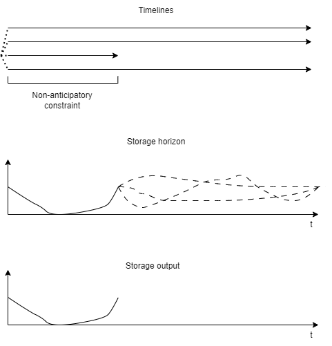
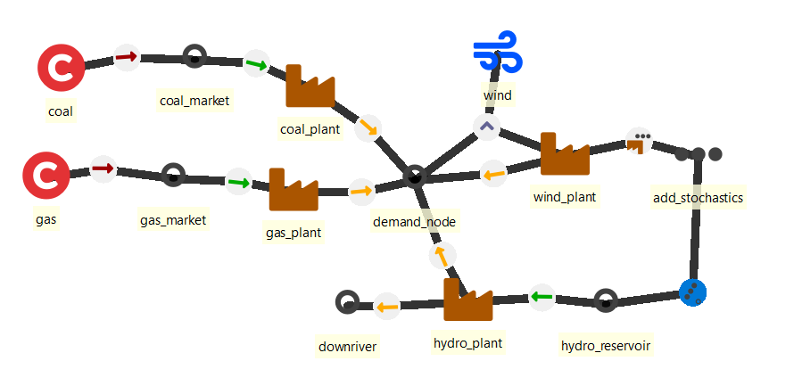
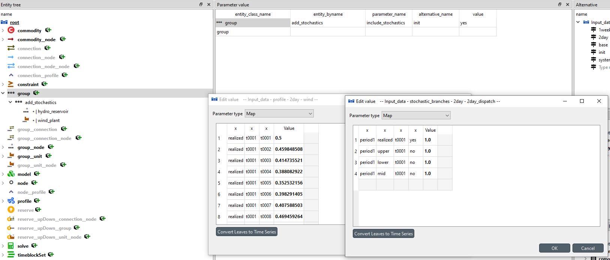
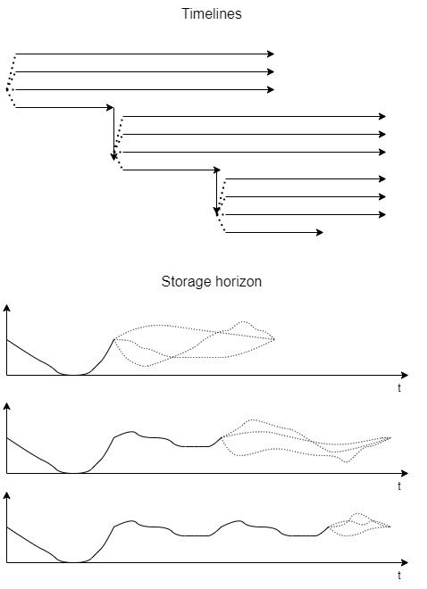
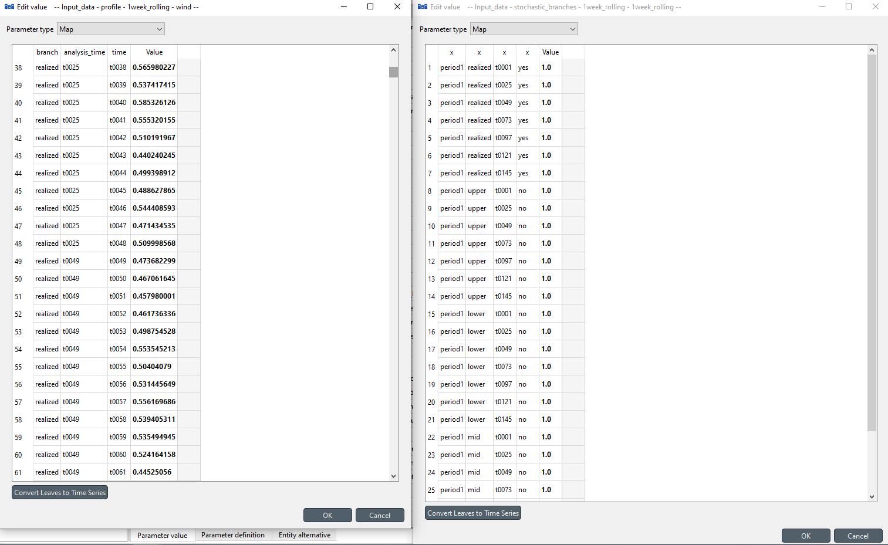

# Stochastics

## How to use stochastics (representing uncertainty)
**(stochastics.sqlite)**

Stochastics are used to represent the uncertainty of the future in the decision making. The main idea is to represent the distribution of possible futures by a set of discrete, probability-weighted **forecast branches**. The branches fan out from a common branching point, and each carries a probability weight; the weights sum to one. The model minimises the **expected** (probability-weighted) cost across all the forecast branches.

Because the decision maker does not yet know which future will occur, decisions that must be committed *before* the uncertainty is revealed cannot differ between the forecasts. **Non-anticipativity** constraints therefore force the forecast branches to agree with each other on those here-and-now decisions — and that agreement *is* the (non-anticipative) realization of each such decision. Which decisions are tied depends on the kind of solve (see "What the model ties across branches" below): a dispatch solve ties storage usage, unit online (commitment) status and reserves over its committed part of the horizon; an investment solve shares its investments as `invest_solve_branching_method` says and lets each forecast operate on its own. Energy flows are always left free so each forecast dispatches them independently. (`min_uptime`, `min_downtime` and ramp limits are separate physics, always active within each branch's own trajectory — they are not part of the non-anticipativity tie.)

There is **no "realized" branch among the weighted forecasts.** "Realized" is an *optional* designation — at most one branch per branching point — that marks which branch's data are treated as the actuals; it is never a weighted member of the fan. The stochastic solve optimises over the forecasts only, so its operations inside the fan have no realized answer of their own. With a designated branch, FlexTool runs a **realization dispatch** right after the stochastic solve: a deterministic solve over the same committed window (for an investment solve, from the reveal period on: see "Stochastic investment") that reads the designated branch's data, keeps the stochastic solve's investments and inherits the units online of the units and connections with `startup_method` *linear_fix_in_uc* or *integer_fix_in_uc* (*integer_fix_in_uc* also when `reduce_unit_detail_method` relaxes integers) tied across the forecasts (the value of the first forecast branch in sorted order). The units online of *linear* and *integer* units are not kept: the realization dispatch decides them again with the realized data, their minimum up and down times and the history of the previous realization. `_fix_in_uc` acts only in a separate realization solve; in a rolling `within_solve` solve (and in a solve without a `realized: yes` branch) a member and its `_fix_in_uc` variant are the same. A realization dispatch that inherits nothing (no `_fix_in_uc` units online and no investments) does not depend on the stochastic solve: in a single solve it is a dispatch of the committed window without look-ahead, in a rolling `separate_dispatch` solve a dispatch of each jump that looks ahead with the forecasts made at the end of the jump (without that look-ahead in a model with delayed units and for a realization solve you configure yourself); note W-0588 says so. A rolling `within_solve` solve has no realization dispatch: each roll realizes its own jump (see "Rolling horizon stochastics"; in a model with delayed units it keeps a realization dispatch without look-ahead). Reserve is not inherited: the realization dispatch meets the reserve requirements again with the realized data, from its units online and every other reserve provider (units without online variables, connections, storage). Its results are the realized operational results. Without a designation (a forecasts-only fan) the results hold the investment decisions and the operations of the periods before the reveal, but no realized operation inside the fan. A solve reports only these committed / realized results, never the individual forecast branches (the `output_horizon` debug option, below, writes them to a separate raw dump).

For the stochastics to have an effect on the results, the system needs parameters that change between the forecast branches. These could be e.g. wind power generation or fuel prices. The model then carries separate variables in every branch for all the decisions it can take (e.g. investment, storage state, online, flow), and minimises their probability-weighted (expected) cost. The committed decisions — tied across the branches as described above — therefore hedge against the whole distribution of forecasts rather than optimising for any single one.

In this example, we show two ways to use stochastics: single solve and rolling horizon. They all share the same test system that includes: 

- A demand node 
- Coal, gas and wind power plants 
- Hydro power plant with a reservoir and a downriver nodes

The demand and the downriver nodes have a constant negative inflow. Therefore, the hydro plant capacity is partly in use at all times. The varying timeseries are the wind profile and the water inflow the reservoir. The coal commodity is more expensive than the gas, so the system will try to use the reservoir water to minimize the usage of coal. This will be affected by the forecast of the wind and the forecast of the water inflow. These are the stochastic timeseries in these examples. 

You can have stochastics in multiple timeseries in the same solve, but these will have to share the branches. This means that for example if you have two wind plants with two different stochastic wind profiles with three branches (upper, mid and lower estimates) you need to think if it is best to use only three branches and put both of the upper estimates to the same 'upper' branch or should you use combinatorics to make nine branches. However, note that the tool will not do the combinatorics for you and the solving time will be heavily affected by extra branches. Consequently, the usual practice is to present all the stochastics using just e.g. three branches and consider the correlations between the stochastic parameters in the pre-processing of the input data.

Notes about the storage options with stochastics:

- The best options to use are:

  - `storage_state_start_end_method`: fix_start or fix_start_end (and the their values)
  - `storage_solve_horizon_method`: fix_value or fix_price (and their values)

- `storage_binding_method` works per path of the stochastic tree (a path runs from the solve's first step through the trunk periods, the shared periods before the split, to the end of one forecast branch). With *bind_within_solve* the cycle closes once per path: the last step of every forecast branch ends at the level the solve's first step starts from. When the fan opens in the solve's first period, each forecast's first step continues from the last step of its own path, and since all the paths end at the same level, all the forecasts start from it too. With *bind_forward_only* (the default) a fan that opens later continues from the trunk's last step, and the forecasts of a fan that opens in the solve's first period all start from the same level: the solve's start state (the `storage_state_start` value, or the state carried in from the previous roll or solve), or, with neither (*fix_nothing*), one free level shared by all the forecasts. With `storage_start_end_method` *fix_start* (or *fix_start_end*) the start of each forecast is pinned to the given share (`storage_state_start`) of that forecast's own storage capacity, so where the capacity differs by forecast (investment or divestment per forecast) the starting energy differs although the share is the same; without a fixed start all the forecasts start from the same level. 

- Representative periods (a timeset with `representative_period_weights`) work in stochastic solves: each forecast branch period uses the representative periods of the period it branches from (all branches share that selection). The *_blended_weights* methods follow the same rules per branch: the first branch period continues from the last base period of the trunk period (the shared period before the split), a later one from the previous period of the same branch; *bind_within_solve_blended_weights* closes once per path, so every branch's last period ends at the level the trunk period starts from; *bind_within_period_blended_weights* closes each branch period on itself. When the fan opens in the solve's first period, the forecasts start from the same level (the fan has only forecasts, no realized member, so this equal start is what ties them). For a node in an `include_stochastics` group the start levels of the representative blocks are tied across the forecasts inside the non-anticipativity window, like the storage state.

### Two kinds of stochastic solve

FlexTool reads different settings for the two kinds of stochastic solve, and the rest of this page is organised by them:

- **[Stochastic period solve (investment or multi-period)](#stochastic-period-solve-investment-or-multi-period)**: a solve that is not rolling (`solve_mode` *single_solve*), over one period or several.
  - An **investment solve** is such a solve with `invest_periods` or `realized_invest_periods` (a solve of a 2-D period map counts by its own rows). It always solves its forecasts, and `invest_solve_branching_method` says which investments all the forecasts share (see [Stochastic investment](#stochastic-investment)). It does not read `dispatch_realization_method`, `deterministic` included; a `separate_dispatch` there is ignored with a warning (W-0640). For a perfect-foresight benchmark, run a scenario without `stochastic_branches` (see [Results and benchmarks](#results-and-benchmarks)).
  - A solve without investments is a **dispatch solve** over its periods: `dispatch_realization_method` says whether and how its forecasts are solved, as for a rolling solve.
- **[Stochastic rolling dispatch](#stochastic-rolling-dispatch)**: a rolling solve (`solve_mode` *rolling_window*). It is always a dispatch solve (its rolls build no investment) and is set up with `dispatch_realization_method`. Representative periods are refused there.

`invest_solve_branching_method` on a dispatch solve (rolling or without investments), or on a solve without `stochastic_branches`, stops the run with an error naming the solve.

### What the model ties across branches

Wherever the branches still share the same information, the model **ties** some decisions so that all the forecast branches agree on them (the branches are tied *to each other*, not to any realized branch), and lets the rest **diverge**. What is tied depends on the kind of solve:

- **A dispatch solve** ties the **storage state, unit commitment (online status) and reserves** across the forecast branches over its committed window: the time steps of its realized periods (`realized_periods`, in a rolling solve the jump; plus any `fix_storage_periods` time steps). Every branch takes the same storage and start-up decisions while they still share information, so these decisions are non-anticipative. In a **single** solve whose realized periods span the whole horizon this ties them over the whole horizon (so only the flows differ between branches); the periods it does not realize are look-ahead, and the branches operate them freely. In a **rolling** solve that keeps the earlier realization (listed in "Rolling horizon stochastics") the tie covers only each roll's committed (jump) slice, and the branches operate freely in the forecast horizon beyond the reveal. A realization dispatch (below) inherits the tied units online of the *linear_fix_in_uc* and *integer_fix_in_uc* units, but not those of the *linear* and *integer* units (it decides them again) and not the tied reserve: it allocates reserve again with the realized data. With `dispatch_realization_method` `separate_dispatch` the first, stochastic solve ties only those *_fix_in_uc* units online, and a rolling `within_solve` solve dispatches each jump as one path with the realized data, so nothing needs a tie there (see "Rolling horizon stochastics").
- **An investment solve** shares its **investments** as `invest_solve_branching_method` says (by default every period's investment is one plan for all the forecasts) and ties **none of its operations**: from the reveal period on, each forecast operates on its own (its own storage, units online and reserves). The periods before the reveal have one copy only, so their investment and operation are one decision for every forecast by construction.
- **Energy flows are always free**: each forecast dispatches its flows independently.
- **Continuity is ordinary temporal carry-in.** Only the model's very first timestep starts from the given history / initial state; every later timestep continues from the previous one. At a branching point each child branch continues from its parent branch's last step, so sibling branches start from the same state simply because they share a parent.

So a **dispatch** solve commits its committed part (shared storage / online / reserve), forecasts the rest, and leaves the flows free; an **investment** solve commits a plan of investments (as much of one as its setting shares) and operates it per forecast.

## Stochastic period solve (investment or multi-period)

A stochastic period solve is a solve that is not rolling, over one period or several, with `stochastic_branches`. With `invest_periods` or `realized_invest_periods` it is an investment solve, set up with `invest_solve_branching_method` (see "Stochastic investment" below); without them it is a dispatch solve over its periods, set up with `dispatch_realization_method` (the methods are listed under "Stochastic rolling dispatch" and apply to single solves too).

### Single solve stochastics
**(stochastics.sqlite scenario: 2_day_stochastic_dispatch)**

In this scenario a near-term operating window is committed with an uncertain forecast for the following day over a 48-hour timeset.
To set up a stochastic solve, we need three things: the stochastic branch information, the stochastic timeseries, and choosing which parts of the model use stochastic timeseries.

The information about the branches is set with the *solve* parameter `stochastic_branches`. This is a 4-dimensional map. (Edit -> choose map -> right click -> add columns.) The example is a dispatch solve (it invests nothing): its forecasts are solved only when it also sets `dispatch_realization_method` to `within_solve` (as the example does) or `separate_dispatch`; with the default, `deterministic`, the solve uses only the data of its `realized: yes` branch (see "Rolling horizon stochastics" for the three methods). An investment solve solves its forecasts without that setting (see "Stochastic investment").
The columns are: period, branch, analysis_time (starting time of the branch), realized (yes/no), and the value is the branch's **probability weight**. In this example we have forecast branches (e.g. mid, upper and lower) representing the wind forecasts. The weights set each branch's probability in the objective function (expected model cost) and are normalized so that the total weight is always one across the forecast branches at each start time. The *realized* flag is optional: at most one branch per start time may be flagged `yes`, and it only designates which branch's data are the actuals used by the realization dispatch (above) — a realized-flagged branch is **not** counted among the weighted forecasts. In this example all four branches (realized, upper, lower and mid) are forecasts and none is flagged `yes`: the fan is pure forecasts, so the solve reports no realized dispatch (its normal results are empty apart from the objective), and the example sets `output_horizon` (below) to write the forecast branches to the raw dump. Flag one branch `realized: yes` to get a realization dispatch of the 48 hours.

The stochastic wind timeseries are set with the same *profile* parameter `profile`, but with a three-dimensional map instead of the regular one-dimensional one. The tool recognizes a stochastic timeseries from the dimensions of the data. The three dimensions are: branch, analysis_time and time. The model reads the branch-specific series for each forecast branch; where a forecast branch period has no stochastic data available for part of the horizon, it falls back to the profile's non-stochastic value, if one is given. A forecast branch period reads the series whose `analysis_time` is the solve's fan start (the step at which the solve branches): the solve decides then, so it uses only the forecasts made then. One series per branch given at the fan's `analysis_time` serves every later period of the horizon, and it must cover them: where it has no value for a time step of a later period but a series given later (at that period's own first time step, for example the forecast meant for the next solve) has one, the run stops with a configuration error naming the entity, the parameter, the solve and the time steps. Where the fan's series has a value, a series given later is not read by this solve; it serves the solve or roll that fans out at its `analysis_time`. Every period before the reveal (before the forecasts branch out) reads only the series of the realized branch given at the solve's start, its first time step: never the fan-start series and never a series given at a later period's own first time step (a forecast made after the solve starts, information the solve does not have yet). That series must cover every time step of these periods; where it does not, the run stops with a configuration error naming the entity, the parameter, the solve, the period, the time steps and the forecasts made at other times that do have values there (FlexTool never fills them with a later forecast or a default value). A forecasts-only fan (no branch marked `realized: yes`) has no series for the periods before it, and FlexTool does not pick one of the forecasts: a stochastic value read there is a configuration error too. Designate a realized branch (it provides the shared data before the fan) or give the parameter a value without forecasts. A model whose first periods are deterministic (for example 2030 and 2035) and whose later period fans out (2040) therefore gives one series under the realized branch at the solve's start that covers 2030 and 2035, and the forecasts at 2040's first step.
The other parameters documented as "stochastic time" in the reference (`availability` of units and nodes, unit `efficiency` and `min_load`, `other_operational_cost` of unit inputs and outputs, `reservation`, `penalty_up` and `penalty_down`, node `inflow`) take the same three-level map and are read the same way; an entity's value is read regardless of whether it is in an `include_stochastics` group — the group changes HOW it is read, not whether it is read at all (below). Giving a value to only some of a reveal's forecast branches and leaving the rest out is a configuration error (naming the entity, the parameter and the branches left out); give every branch a value, or none.

The parts of the model that will use stochastic data **per branch** are chosen with a *group* parameter `include_stochastics`: the units, nodes and connections added to this group read the matching forecast branch's own value on every branch period (if available). Here we add the unit *wind_plant* to this group. A profile is read per profile, not per user: when any unit, node or connection that uses a stochastic-time profile is in an `include_stochastics` group, every user of that profile reads the forecast branch's own series, including users outside the group. To keep one of two wind plants on a single series, give it its own non-stochastic profile. An entity with a stochastic-time value that is in no such group still reads the series — every one of its branch periods reads the single value of the designated realized branch rather than its own branch's value. A forecasts-only fan (no branch flagged `realized: yes`) has no such value, so a stochastic-time value of an entity outside every `include_stochastics` group is a configuration error there, naming the entity and the parameter — add the entity to the group, designate a realized branch, or give the parameter a non-stochastic value. Inside the group a forecasts-only fan is valid: every forecast reads its own branch. The period label (the original name of the period that opens the fan, see "Stochastics over multiple periods") has no dispatch, so it needs no value of its own. The realization dispatch reads the designated branch's value for every entity. A deterministic solve that declares no `stochastic_branches` at all takes the designated realized branch's value too, so authoring a stochastic-time value there without one is a configuration error, unless a realized branch elsewhere (e.g. the stochastic solve whose realization dispatch it is) was projected onto it.

An option exists to look at the stochastic (forecast-branch) horizons for debugging your system: the *model* parameter `output_horizon`. It does not change the normal results (they hold the realized rows only, with or without the option); instead `output_parquet/<scenario>/horizon/` gets one raw parquet per LP variable and constraint with every row of every solve (forecast branches and rolling look-ahead included), a `realized` column marking the rows that reach the normal results, and the raw primal values, reduced costs and duals (see [Results](../results.md)). The values are raw solver values, without cost processing.

If you change the weights of the stochastic branches, you should see the results change.

The figure shows the dispatch of the forecast branches; those rows are in the raw `horizon/` dump, not in the normal results or plots.

### Stochastics over multiple periods

When the solve's horizon spans periods beyond the branching period, the branches extend through all the remaining periods: every forecast branch with a nonzero weight gets a synthetic `<period>_<branch>` copy of the branching period and of each later period, and the operations of the stochastic solve live only on these copies. The real period names of the periods from the reveal onwards are **period labels**: they hold only period-level bookkeeping — the shared investment (seen by every forecast, under `invest_solve_branching_method` `operations_only`), the years represented and the discounting — and have no dispatch (no time-step rows, empty operational results), except in a roll of a rolling `within_solve` or `separate_dispatch` realization whose jump ends inside a period: that period dispatches the jump's time steps under its own name, with the realized data, and its forecast copies hold the rest of the period (see "Rolling horizon stochastics"). Where the investments are per forecast (the periods after the reveal period under `investments_after_reveal_period`, from the reveal period on under `investments_at_reveal_period`) a period label has no investment either: every forecast invests on its own. Under `investments_after_reveal_period` the reveal period's investment is on the forecast copies too, one value in all of them, and it is reported under the period label. The designated realized branch gets no copy: its data feed the realization dispatch, which dispatches the real period names, and the periods strictly before the reveal, which read its series (see above). A forecasts-only fan has no data for those periods, so they can use only plain (non-stochastic) values. The branch probability weights carry forward along each branch, so the weighting is constant along a branch's period chain and sums to one across the forecast branches of each period.

Notes for multi-period stochastic solves:

- If `years_represented` is defined for the solve, it must cover **all** of the solve's periods. A configuration that defines it for only some periods fails with a configuration error (older versions silently ran on a truncated horizon instead).
- The forecast branch weights are normalized to sum to one across the forecasts at each period; a realized designation adds no weight to the fan (it is not a weighted member).
- In a single dispatch solve whose realized periods span the whole horizon, the non-anticipativity constraints cover the whole horizon: the shared decision types (storage usage, online status, reserve) stay tied across the forecast branches through the later periods, and post-branching divergence shows up only in the flow variables. Use a rolling solve when the branches should be free to commit differently after the information is revealed — each roll then commits only its jump slice and the non-anticipativity window ends at the reveal. An investment solve ties none of its operations: each forecast operates on its own from the reveal period.
- A dispatch solve ties its operations over its committed window only: the realized-dispatch time steps (plus any `fix_storage` time steps). The periods it does not realize are look-ahead, and the forecasts operate them freely, so the choice of `realized_periods` is the choice of the tied periods. (The `shared_operation_periods` setting of earlier versions is gone: the upgrade to data version 84 names the solves that had it, note W-0637.)
- Give the `realized: yes` row where the solve (or, in a rolling solve, each roll) fans out; a rolling `within_solve` solve whose realization looks ahead also takes one at its start, where it does not fan out (every other solve, a `within_solve` one that keeps the earlier realization included, needs forecasts in each cohort it reads). The designated branch is then the realized branch of every later period of the solve or roll: from the fan's period onwards the realization dispatch reads that branch's series given at the fan's `analysis_time`, at each period's own time steps, in the same way as the forecasts (next notes); the periods before the reveal read the series given at the solve's start (see "Single solve stochastics" above). To give the realization different data in a later period, change that branch's series; a second `realized: yes` row is not needed. In a single solve and in the rolling solves that keep the earlier realization (see "Rolling horizon stochastics"), a `realized: yes` row anywhere else, where no solve or roll fans out (also next to forecasts that are ignored there), is an error. In a rolling `within_solve` or `separate_dispatch` solve whose realization looks ahead, each jump reads the realized branch over all its `realized: yes` rows as one timeline, so such a row is read as one more realized series. In every solve, `realized: yes` rows that name different branches are an error.
- A solve fans out once, at its first reveal. Forecast branches declared in `stochastic_branches` at a later period of the same solve are ignored, with one warning per run naming them (solve, period and analysis time; the debug log gives the branches; for the rolls of a rolling solve, see "Rolling horizon stochastics"): the branches of the first fan continue through every later period and read the series given at the fan's `analysis_time` there. To branch again later, use a separate solve (or the rolls of a rolling solve).
- The branching period's label has no dispatch, so it reads no stochastic-time value; its forecast copies read their own branch's value, and the realization dispatch reads the designated branch's. (The jump time steps that a realization roll dispatches under the period's own name read the designated branch, see "Rolling horizon stochastics".)
- Each forecast copy of a later period reads its branch's series given at the fan's `analysis_time`, never a series given later (from the fan's period onwards, the realization dispatch and the entities outside every `include_stochastics` group read the realized branch the same way; before the reveal they read the realized branch's series given at the solve's start). Give one forecast per branch at the fan's `analysis_time`, covering the whole horizon. The rolls of a rolling solve follow the same rule (see "Rolling horizon stochastics").
- The realization dispatch of a single solve dispatches only the periods from the first to the last period the solve realizes (`realized_periods`; for an investment solve, from the reveal period if that is later, see "Stochastic investment"), not its look-ahead: dispatching a look-ahead period with the realized data would decide the realized periods' operation (for example the storage left at their end) knowing later actuals. The storage at the end of the last realized period then follows the storage node's own end rules (`storage_solve_horizon_method`, `storage_state_reference_price`, ...), as at the end of each roll's jump in a rolling solve, and the next solve starts from it. A period between two realized periods that is not realized (for example 2035 in a solve over 2030, 2035 and 2040 that realizes 2030 and 2040 to report only those) is dispatched too, so storage runs through it, but it is not reported. A realization solve you configure yourself keeps the periods you give it; when it also holds a period outside the stochastic solve's first to last realized period, a warning says that it dispatches that period with the realized data. With `dispatch_realization_method = separate_dispatch`, a solve without `realized_periods` gets no realization dispatch.
- A single dispatch solve that realizes several periods, with its fan opening in a later one of them (a mid-horizon reveal), has one realization dispatch over all of them: the earlier periods are dispatched knowing the realized data of the later committed period, as within one roll's jump. To keep them apart, put the earlier periods in a solve of their own. An investment solve does not dispatch them again: its realization dispatch starts at the reveal period, and the earlier periods' results come from the investment solve itself (see "Stochastic investment").
- When a solve commits time steps inside a forecasts-only fan and a later solve (e.g. the next roll) continues from them, the units online and the reserves on the tied steps are the same in every forecast, so these steps have one result for them (the first forecast branch in sorted order), and the next solve continues from the units online. Storage state, ramp-limited flows, the cumulative commodity ladder, the CO2 total cap and investments that are per forecast are decided per forecast there, so such a run stops before the LP with an error naming the solve and these families: designate a `realized: yes` branch (FlexTool then adds the realization dispatch; a rolling `within_solve` solve realizes each jump in the roll itself), configure a realization solve right after it (a solve with `contains_solves` cannot have one), or end the committed window before the reveal.

### Stochastic investment

An investment solve (a solve that is not rolling and has `invest_periods` or `realized_invest_periods`) with `stochastic_branches` solves its forecasts; no `dispatch_realization_method` is needed. From the **reveal period** on, each forecast operates on its own. Which investments all the forecasts share is set by the `solve` parameter `invest_solve_branching_method`; choose it by what the plan should answer:

| You want | `invest_solve_branching_method` | Investments shared by all forecasts | Investments per forecast |
|---|---|---|---|
| One fleet for all futures | `operations_only` (default) | every period | none |
| Invest now, adapt later | `investments_after_reveal_period` | the periods up to and including the reveal period | the periods after the reveal period |
| Decide after the reveal | `investments_at_reveal_period` | the periods before the reveal period | the reveal period and the later periods |

For the same data the objectives are in this order: `investments_at_reveal_period` ≤ `investments_after_reveal_period` ≤ `operations_only`, since each value shares more decisions than the one before it. Both invest and divest (retirement) decisions follow the setting, so the net capacity of a shared period (existing + invest − divest) is one value for all the forecasts.

#### Where to set the reveal

The reveal period is the period where the forecasts start: the first period, in the solve's period order, that has a forecast row (`realized: no`) in `stochastic_branches`. Give the forecast rows at that period, with the branches' `analysis_time` at its first time step. Investments are decided per period, so the reveal is always at the start of a period.

- **Reveal at the solve's first period**: every period reads the forecasts. This is the usual set-up when the forecasts stand for weather, profiles or inflows of every period.
- **Reveal at a later period (a mid-horizon reveal)**: the periods before it are single, real-named periods, with one investment *and* one operation for every forecast (nothing to tie: there is one variable per period). They read their stochastic-time data from the realized branch's series given at the solve's start, which must cover all of them; without a realized branch they can use only plain (non-stochastic) data (see "Stochastics over multiple periods"). Use it when the first periods are known well enough to be committed (a near-term operating schedule included) and the uncertainty opens later, for example at a policy review.

A period whose investments are per forecast cannot be realized. Under `investments_after_reveal_period` a period after the reveal period, and under `investments_at_reveal_period` the reveal period or a later one, in `realized_periods` or `realized_invest_periods` stops the run with an error naming the solve and the periods: leave them in the look-ahead, and realize them in a later solve.

#### One fleet for all futures (`operations_only`, the default)

Every period's investment is one decision, made before the forecasts are known, and each forecast operates that fleet in its own way. The objective is the investment cost plus the probability-weighted operating cost of the forecasts. With one investment period this is the classic two-stage stochastic capacity expansion model. Over several periods it suits uncertainty that recurs in every period and teaches nothing about the later investments: weather years, wind and solar profiles, hydro inflow, hourly demand.

#### Invest now, adapt later (`investments_after_reveal_period`)

The investment of the reveal period is still one decision for all the forecasts; from the next period on, each forecast invests on its own. Use it when the uncertainty is about the longer term (a policy target, a fuel price level, demand growth, technology costs) and capacity decided after learning it cannot be online before the next period: the reveal period's investment is the "what do we build now" answer, and the later periods show how each future would adapt. It is the same as `operations_only` for a solve with one investment period at or before the reveal period (with the one investment period after the reveal, that investment is per forecast here). Realize the periods up to the reveal period; the per-forecast investments of the later periods are look-ahead.

#### Decide after the reveal (`investments_at_reveal_period`)

From the reveal period on, each forecast invests on its own; only the periods before the reveal share their investments. With the reveal at the second period or later this is "act, then learn" without a construction lead time: the earlier periods form a plan you can build, and the investment of the reveal period already responds to the forecast it is in. It is the usual convention for long-term uncertainty in multi-period energy-system models, and fits periods long enough that the capacity decided at the start of the period can be online in it (multi-year periods, assets with short lead times). Realize the periods before the reveal; the solve gets no realization dispatch (the reveal period cannot be realized).

With the reveal at the solve's **first** period no decision is shared: each forecast is a deterministic plan that knows its own future, and the objective is the probability-weighted cost of these plans (the wait-and-see value: no single plan can do better, and the objective of `operations_only` or `investments_after_reveal_period` minus it is the expected value of perfect information). Nothing can be realized, so the solve gets no realization dispatch and the normal results hold no investment or operation of the forecasts: the per-forecast plans are written only by the `model.output_horizon` dump (see "Single solve stochastics"). Warning W-0639 names the solve. Ordinary deterministic scenarios, one per forecast, give the same plans; this setting gives them in one run, with the weighted total.

With a `construction_lead_time`, an investment counts in the period it is ordered in: a long-lead technology that must be online after the reveal has to be ordered in a period whose investments are shared, while a short-lead one can be ordered in a per-forecast period (see [Investment parameters](investment.md)).

#### The realization dispatch of an investment solve

With a `realized: yes` branch (at the reveal period, beside the forecasts), FlexTool adds `<solve>__realized_dispatch` right after the investment solve under `operations_only` and `investments_after_reveal_period`: a deterministic dispatch with the realized branch's data. It keeps the investments of the investment solve (the shared reveal-period investment included); the investment solve ties none of its operations across the forecasts, so the realization decides the units online again, also those of the *_fix_in_uc* units. It:

- dispatches from the later of the solve's first realized period and the reveal period to its last realized period. The periods before the reveal are operated once, for every forecast, in the investment solve itself, and their results come from it: the realization does not dispatch them again (so it does not decide them knowing the realized data of the later periods);
- starts its storage at the level the investment solve ended the period before the reveal with, and, where the reveal period continues that period in time, also its units online, ramps and the minimum up and down time history.

Its results are the realized operations of the fan. Without a realized branch the results hold the investments and the operations of the periods before the reveal, but no realized operation inside the fan. A realization solve you configure yourself (the next solve in `model.solves`, deterministic, with the same `solve_mode`, realizing the periods the fan commits) keeps the periods you give it.

#### An investment solve followed by a dispatch solve

`dispatch_realization_method` `separate_dispatch` is for dispatch solves: on an investment solve it is ignored, with a warning (W-0640) that points to this structure. To invest first and then dispatch in a separate step (for example: invest on representative periods and dispatch the realized year in full, or decide the commitment against forecasts made closer to the operation), use two solves:

1. **The investment solve**: `invest_periods`, `realized_invest_periods`, `stochastic_branches` and `invest_solve_branching_method`; no `dispatch_realization_method`. Leave the periods to be dispatched out of its `realized_periods`, but keep them in its `realized_invest_periods` (see below).
2. **After it in `model.solves`, a dispatch solve** without `invest_periods`: `realized_periods` = those periods, its own `stochastic_branches` with a `realized: yes` branch, and `dispatch_realization_method` `separate_dispatch` (or `within_solve`). It can be a single solve, or a rolling solve with its jump on the forecast times (see "Stochastic rolling dispatch"). It starts from the investments the investment solve realized.
3. To do this year by year, alternate the solves in `model.solves` (invest 2030, dispatch 2030, invest 2035, …): a 2-D map cannot interleave two solves.

A solve dispatches a period (`realized_periods`) only after the period's investments are decided for good: when another solve lists the period in `invest_periods`, an investment solve up to and including the dispatching one must list it in `realized_invest_periods`, or the run stops with an error naming the solve, the period and the investment solves, before anything solves. A per-forecast investment cannot be realized, so with `investments_after_reveal_period` the dispatch solve can realize the periods up to the reveal period, with `investments_at_reveal_period` those before it; a later period needs a later investment solve that realizes its investments. The realization dispatch FlexTool adds dispatches on the investments its investment solve realized, so it passes when that solve realizes the investments of the periods it dispatches.

#### Results and benchmarks

The normal results of an investment solve hold the shared investments at their full amount (under `investments_after_reveal_period` the reveal period's investment under its own period name), the operations of the periods before the reveal (from the investment solve) and those of the realization dispatch. The per-forecast investments and operations are only in the `model.output_horizon` dump. To compare with decisions made knowing the actuals (a perfect-foresight benchmark), run a scenario without `stochastic_branches`, with the actual series as plain values (see "Investing year by year under uncertainty"); an investment solve does not read `dispatch_realization_method`, so `deterministic` does not make one. Benders decomposition does not take stochastic branches: the run stops with an error.

### Investing year by year under uncertainty (fan → realize → next year)

A decision maker who invests once a year, each time knowing the past but not the future, is a chain of stochastic investment solves: each solve invests against the forecasts of its own year, the realized year is then dispatched with the actual data, and the next solve starts from what was built and realized.

1. Make one `solve` per decision year (`solve_mode` *single_solve*) and list them in order in the *model* parameter `solves`. Each has `period_timeset` and `years_represented` for its periods, `invest_periods` = [its own period] (add the following periods to look ahead), and `realized_invest_periods` = `realized_periods` = [its own period].
2. Give each solve one fan, at the start of its own period, in `stochastic_branches`: {own period: {each forecast branch: {first time step of the own period: {no: weight}}, one realized branch: {the same time step: {yes: 0}}}}. The realized branch is not a weighted forecast; it names the data the realization uses.
3. Give the stochastic time series (for example a wind `profile`) as (branch, analysis_time, time) maps with an `analysis_time` at each solve's fan start, put the entities that should read them per branch in an `include_stochastics` group, and leave `invest_solve_branching_method` unset (`operations_only`: one shared investment for all the forecasts).
4. What runs: `<solve>` invests against the forecasts; FlexTool then adds `<solve>__realized_dispatch`, which keeps that investment and dispatches the realized branch; the next solve starts from the capacity and storage of the realization. The results hold the investments of each solve and the operations of the realization dispatches only.
5. The same chain can be written as one solve: 2-D maps of `invest_periods`, `realized_invest_periods` and `realized_periods` with one row per year (the row names are free, for example *y2030*, *y2040*; see [2D maps](solve_sequences.md)) and one `stochastic_branches` holding the fan of every year. Each generated solve keeps only the fan rows of the periods it realizes (or, when it realizes none with a fan, those of its first period with a fan, a fan in its look-ahead). A fan row that no generated solve keeps is a configuration error naming the solve and the period: remove the row, or add its period to `realized_periods` (or `realized_invest_periods`) in the row of the 2-D maps whose solve should realize it.
6. With look-ahead: each solve reads the forecasts given at its fan's `analysis_time` for its look-ahead periods too, so give them for the whole horizon; the forecasts given for the next solve's fan are not read (a time step only those cover is a configuration error). The look-ahead shapes the investment. The realization dispatch runs over the solve's own period only, with the realized data: the storage it hands to the next solve follows the storage node's end rules at the end of that period, not the look-ahead (see "Stochastics over multiple periods").
7. Perfect-foresight benchmark: to compare the chain with decisions made knowing the actuals (the value of perfect information, or of the stochastic solution), run a separate scenario without `stochastic_branches`: leave out the alternative that holds `stochastic_branches` and the forecast maps, and include one that gives the actual series as plain (non-stochastic) values. An investment solve does not read `dispatch_realization_method`, so `deterministic` does not make it a benchmark; on the dispatch solves of the chain it reads the `realized: yes` branch only (warning W-0593). The realization dispatch is not such a benchmark: it keeps the stochastic solve's investments and dispatches only the committed period.

## Stochastic rolling dispatch

A rolling solve (`solve_mode` *rolling_window*) with `stochastic_branches` is a dispatch solve: its rolls build no investment (invest in a solve before it), so `invest_solve_branching_method` is refused there. `dispatch_realization_method` sets how its forecasts are solved and realized (the methods are listed below; they apply to single dispatch solves too). Representative periods are refused in a rolling solve.

### Rolling horizon stochastics
**(stochastics.sqlite scenario: 1_week_rolling_wind)**

In this scenario we extend the previous timeline to one week and roll through it one day at a time with additional three day stochastic horizon:

*solve*: `rolling_solve_jump` = 24 and `rolling_solve_horizon` = 96. 

The stochastic data should be given so that it can serve the rolling structure: `rolling_solve_jump` dictates the duration of the committed (jump) part of each solve and the interval of forecast updates. So, for every `analysis_time` there needs to be a time series in each forecast branch that extends to the end of the horizon (as defined by `rolling_solve_horizon`). The branches continue to the end of the horizon without branching again. With `within_solve` and `separate_dispatch` each roll dispatches its jump once with the realized data and branches at the end of the jump into the forecasts made there (with `separate_dispatch` the roll's first, stochastic solve branches at the roll's first step, see the methods below). In the solves that keep the earlier realization (listed after the methods) each roll fans at its first step into the forecast branches; the non-anticipativity tie covers the committed jump slice, and the branches then diverge over the forecast tail. Only the committed jump is carried forward to the next roll as the realized state.

For the *solve* parameter `stochastic_branches` this means an `analysis_time` at each roll start (here t0001, t0025, t0049, t0073, t0097, t0121 and t0145).

A rolling `within_solve` or `separate_dispatch` solve needs forecasts at the times given in the method list below; a roll without them stops the run with an error naming the roll and the time step. In the rolling stochastic solves that keep the earlier realization (listed after the methods), a roll that does not fan out at its start (a fan that opens in its look-ahead, even several periods after the roll's start, or a jump that does not match the forecast times, so that a roll starts inside a period) reads, in every period before its fan, the realized branch's forecast given at its own start, as a single solve does. Such a forecast must exist and cover all the steps before the fan; otherwise the run stops with a configuration error naming the roll (a forecast given earlier is not used instead, nor one given later). A forecasts-only fan has no series for those steps, so stochastic data there is an error as in a single solve. Give a forecast at each roll start, or set `rolling_solve_jump` so that the rolls start at the forecast times.

Each roll fans out once: a realization roll (`within_solve`, and the realization of `separate_dispatch`) at the end of its jump, the other rolls at the first reveal in their horizon; the reveals later in its horizon belong to the rolls that fan out there. Forecasts declared inside a roll's horizon at a point where no roll fans out are ignored, with one warning per run naming them (the debug log gives the rolls that reach them). A `realized: yes` row there is an error naming the roll in the rolling solves that keep the earlier realization; in the others the jumps read it as one more realized series. Every roll needs a forecast: at its start or where it fans out later in its horizon. A roll whose horizon reaches no forecast of `stochastic_branches` stops the run with a configuration error naming the roll, its start and its horizon. The `realized: yes` row where each roll fans out names the same branch (one realization series); each roll reads that branch's series at its own `analysis_time`.

**Look-ahead periods.** A roll uses only the forecasts available when it decides, at its fan's `analysis_time`. Every period of the roll after the fan's period (the look-ahead periods and, in the solves that keep the earlier realization, also the later committed periods of a multi-period jump) reads the forecast given at the roll's own fan `analysis_time`, even where a later roll's forecast is given at that period's first time step. The roll's fan forecast must therefore cover the roll's whole horizon, look-ahead included: where it has no value for a time step of such a period but a forecast given later (at the period's own first time step) has one, the run stops before the roll is solved with an error naming the entity, the parameter, the roll and the uncovered time steps. A time step that no forecast covers reads the non-stochastic value, as before. The realization of a rolling `within_solve` or `separate_dispatch` solve reads the designated branch over each jump as one timeline (each time step from the realized series that covers it; where several do, the one made nearest to the start of the roll), and after the jump the forecasts made at the end of the jump. Data that is not stochastic (a plain time series) is read as before. A single (non-rolling) solve follows the same rule (see "Stochastics over multiple periods").

In this example branch *realized* is designated `realized: yes` at every roll start, and each jump is realized with the designated branch's data, read as one timeline, every committed period of a multi-period jump included: with `within_solve` (as in the example) in the roll itself, with `separate_dispatch` in a realization solve after the roll's stochastic solve (see the methods below); either branches at the end of the jump into the forecasts made there. In the solves that keep the earlier realization each roll fans at its first step, so its committed jump lies inside the fan. The next roll continues from the end state of the realized jump (storage, units online, ramps). At the first step of the first roll, and of a period that does not continue the previous one, the stochastic roll (in every forecast branch that starts there) and its realization both choose the units online freely, with no start-up there, so the realization never owes a start-up that the stochastic roll did not plan. (A realization solve that starts at a later period than its stochastic solve starts free at that period even where the stochastic solve continued it from the period before; see [How to add a minimum load, start-up and ramp](thermal_chp.md#how-to-add-a-minimum-load-start-up-and-ramp).) A rolling `within_solve` or `separate_dispatch` solve without a designation stops the run with an error naming the solve. In the solves that keep the earlier realization, without a designation the jump is realized only for the families tied across the forecasts (units online and reserves); a model with storage (as here), ramp limits or cumulative caps then stops with a configuration error (see "Stochastics over multiple periods"). A fan that opens only in a roll's look-ahead needs no designation for the continuation (the next roll continues from the committed steps before the reveal), but the steps before the fan read the realized branch's series: when the forecasts differ (stochastic-time data, which the same entities also read before the fan), designate a realized branch; with a forecasts-only fan only plain (non-stochastic) data can be read before it (see "Single solve stochastics"). The `solve` parameter `dispatch_realization_method` sets how the realization runs:

- `deterministic` (default for a dispatch solve): the forecasts are ignored. The solve is solved as a deterministic solve, with the data of the branch designated `realized: yes` only (no realization dispatch); a warning (W-0593) names the solve. The method governs dispatch solves only: an investment solve (a solve that is not rolling and has `invest_periods` or `realized_invest_periods`) does not read it, `deterministic` included; it solves its forecasts under its `invest_solve_branching_method` and gets the realization dispatch described in "Stochastic investment" (for a perfect-foresight benchmark, run a scenario without `stochastic_branches`). The realized series of the different analysis times are read as one timeline: each time step takes the value of the realized series that covers it. The series should not overlap; where several cover a time step, the one made nearest to the start of the solve (in a rolling solve: of the roll being solved) is used; the distance is counted in time steps of the period's timeline, so a series made before the solve's first time step (for example a series of the whole year read by a solve of one week) is read too. The rolls only cut this timeline, so a single realized series given at the first analysis time serves every roll. A time step that no realized series covers stops the run with an error naming the solve and the time step, and so does a solve without a `realized: yes` branch. A `stochastic_branches` with only the `realized: yes` branch is allowed here. Set `within_solve` or `separate_dispatch` to solve the forecasts. A solve without `stochastic_branches` reads its plain data as before, whatever the method.
- `within_solve`: the forecasts are solved together. A rolling solve solves each jump location once: each roll dispatches its jump with the data of the branch designated `realized: yes` (one path, every decision the same in all forecasts, reported under the period's own name) and, from the last step of the jump on, looks ahead with each forecast made at the end of the jump, with its probability; then it rolls on. It needs a `realized: yes` branch and forecasts made at the end of each jump (the start of the next roll). The last roll, whose horizon ends with its jump, is solved with the realized data only. A single solve has no second solve unless a branch is designated `realized: yes`, which adds the realization dispatch as described above. On an investment solve `within_solve` is the same as no method (see "Stochastic investment").
- `separate_dispatch`: each jump location is solved twice. (1) A stochastic solve over the forecasts made at the start of the roll (a single solve: at its fan), branching from its first step; across the forecasts it ties only the units online of the units and connections with `startup_method` *linear_fix_in_uc* or *integer_fix_in_uc*, the commitment the realization keeps, and the start level of a storage node that starts free (no fixed start and no state carried in), so that every forecast starts from the same level (everything else is decided per forecast). (2) A realization solve keeps that commitment over the jump, dispatches the jump with the data of the branch designated `realized: yes` and, in a rolling solve, looks ahead from the last realized step with each forecast made at the end of the jump, with its probability; the next roll continues from the end of its jump. A single solve's realization dispatches its realized periods only (see "Stochastics over multiple periods"). Without a `realized: yes` branch the run stops with an error naming the solve, and a rolling solve also needs forecasts made at the start of each roll and at the end of each jump. `separate_dispatch` is for dispatch solves: on an investment solve it is ignored, with a warning (W-0640) that points to an investment solve followed by a dispatch solve (see "Stochastic investment").

With timeset weights that are not equal, the cost reported for a realized jump uses the scale of the whole roll (jump and look-ahead), as a deterministic rolling solve does.

Some rolling stochastic solves keep the earlier realization: each roll is solved over the forecasts made at its start, and a realization solve after it dispatches the jump alone, without look-ahead. These are the solves in a model with units that have a `delay` (note W-0594 names them; the forecasts after a jump would all wrap into the roll's first time steps) and the solves followed by a realization solve you configure yourself. Their first solve shares only the `_fix_in_uc` commitment as in the other `separate_dispatch` solves, so note W-0636 names the `separate_dispatch` ones of an upgraded database too; its full notice says that their realization dispatches each jump alone. A rolling stochastic solve that contains other solves, or is contained in one (`contains_solves`), cannot have its jumps realized: the run stops with an error when its `realized: yes` branch reaches the committed window of a roll (remove that branch, or move the solves out of `contains_solves`). A rolling solve with `separate_dispatch` there stops always, also without `stochastic_branches`, since FlexTool cannot add the realization solve that method needs; set `dispatch_realization_method` to `deterministic` (a deterministic rolling solve can contain other solves).

Otherwise there is no difference to the previous example.

