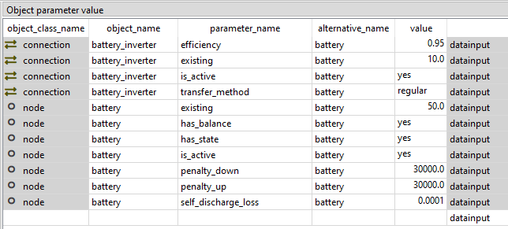
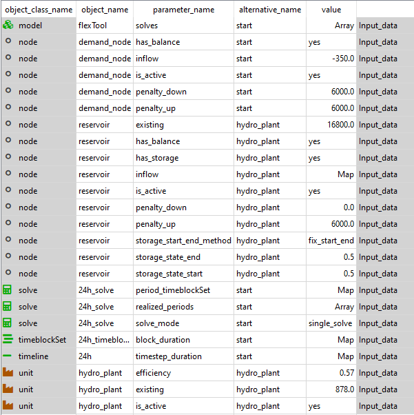
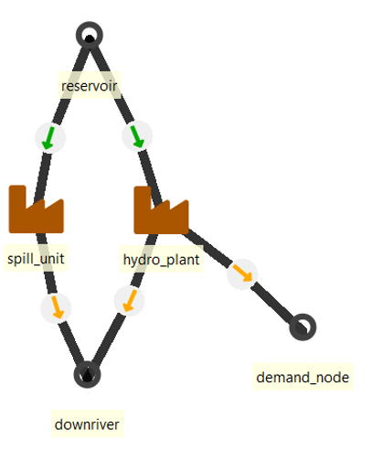
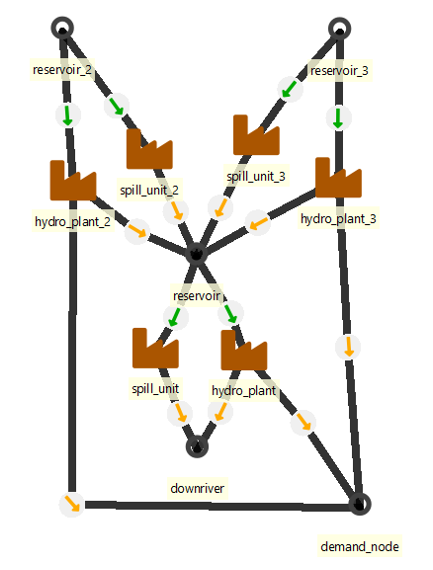
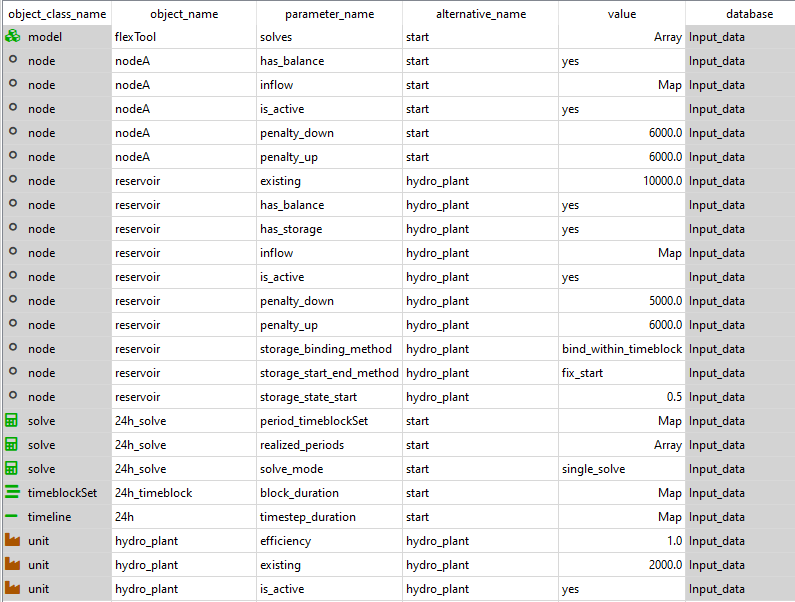
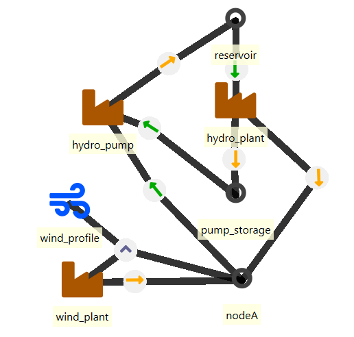
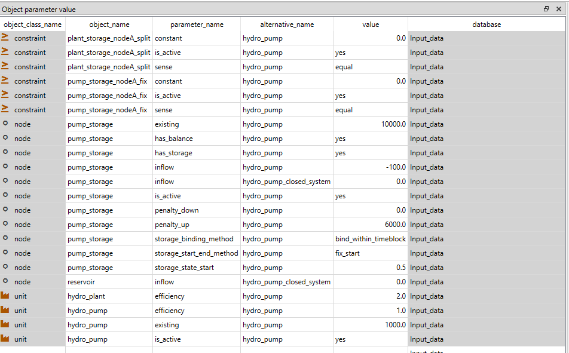
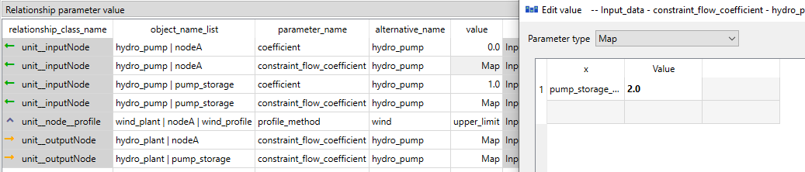

# Storage and hydro

## How to add a storage unit (battery) 

**(examples.sqlite, scenario: wind_battery)**
***init - west - wind - battery***

In the ***Init*** SQLite database, there is a `scenario` *wind_battery*.
In the example, the *wind_plant* alone is not able to meet the load in all conditions, but the *battery* will help it to improve the situation.

In FlexTool, only `nodes` can have storage. `Nodes` can therefore be demand nodes, storage nodes or both. 

The `node` needs to be added to an alternative in the `Entity Alternative` sheet. 

To make a storage node one the required parameters are:

- `node_type`: storage
- `existing`: The maximum storage size of battery as the potential energy [MWh]
- `penalty_up`: a large number to prefer not creating energy from nowhere
- `penalty_down`: a large number to prefer not creating energy from nowhere

Additional parameters:

- `self_discharge_loss` The fraction of energy lost in each hour (0.01: the content shrinks by 1/1.01 per hour). It is applied continuously, so it is exact for time steps of any length; energy charged within a step is treated as spread evenly over the step.

Storage states can be tied to a value. For this three methods are introduced:

- `storage_start_end_method`: Fixes start and/or end state of the storage to a chosen value. This is for the start and the end of the whole model timeline (not for individual solves in case the model is rolling forward): the end value applies to the model's last timestep in every solve whose horizon contains it. It is meant for simple models; with several solves or rolls `storage_state_reference_value` with `storage_solve_horizon_method` *use_reference_value* is usually the better choice. A later roll or a later solve of a solve sequence starts from the storage state realised at the end of the realised part of the previous roll or solve.
    -  `storage_state_start` and `storage_state_end` set these values.
- `storage_bind_method`: Forces the start and end values to be the same for the chosen  time interval (timeset, period or solve)
- `storage_solve_horizon_method`: Fixes the state of the storage at the end of the solve horizon or sets a price for the stored energy at the end of the solve horizon
    - `storage_state_reference_value` and `storage_state_reference_price` set these values
  
> **Note on end-of-horizon valuation.**  When
> `storage_solve_horizon_method = use_reference_price` is set, the
> `storage_state_reference_price` is applied *in the solver
> objective* (the model sees a credit for leaving energy in the
> storage at the end of the horizon).  However, this credit is
> **not** included in the calculated cost totals reported in
> `costs_discounted_*` and `summary_solve.csv` — end-of-horizon
> storage valuation has several valid interpretations (reference
> price × end state, difference between initial and final state
> priced at an average commodity price, opportunity cost, or simply
> book value) and is typically done as post-analysis rather than as
> part of the optimization cost breakdown.  If you need the credit
> as a reported line item, compute it yourself in post-processing
> from the `v_state` last-timestep values and the
> `storage_state_reference_price`.

Having multiple storage methods can create infeasible problems. This is why some of the combinations shouldn't (and cannot) be used at the same time. If multiple methods are used, some of them might be ignored by the method hierarchy. More information can be found from [Model Parameters: Using nodes as storages](https://irena-flextool.github.io/flextool/reference). 

Battery also needs charging and discharging capabilities. These could be presented either with a `connection` or by having a charging `unit` and a discharging `unit`. In here, we are using a `connection` called *battery_inverter*. Please note that the `efficiency` parameter of the `connection` applies to both directions, so the round-trip `efficiency` will be `efficiency` squared.

The `transfer_method` can be used by all types of connections, but in this case it is best to choose *regular*, which tries to avoid simultaneous charging and discharing, but can still do it when the model needs to dissipate energy. *exact* method would prevent that, but it would require integer variables and make the storage computationally much more expensive. Model leakage will be reported in the results (forthcoming).

The `connection` needs to be added to an alternative in the `Entity Alternative` sheet. 

The required paremeters of the connection are:

- `existing`: The capacity of energy transsmission [MW]
- `transfer_method`: (see above)

Additional parameters:

- `efficiency`: by default 1

Finally `connection_node_node` is needed between inverter, the battery and the demand node (west). 



## How to create a hydro reservoir
**hydro_reservoir.sq**

### Simple hydro reseroir
***(scenario: hydro)***

The objective is to create a hydro power plant with a reservoir and connect it to a demand node.

Hydro reservoir power plant requires three components:

- Reservoir `node`
- Hydro `unit`
- Output `node`

It can be useful to create a new alternative for these components to be able to include and exclude them from the scenarios.

The reservoir is made with a node as only nodes can have storage in FlexTool. The incoming water can be represented by the inflow parameter. It can be a constant or a time variant. 

There are two ways to handle the water to electricity coefficient. In this example we store the water as volume and convert it to electricity in the unit. 
This option is better when modelling river systems with multiple reservoirs. Note that in the results, the state of the reservoir is then as volume.
For the other option of converting the volume to potential energy in the reservoir, look at the start of the 'How to create a hydro pump storage'.

In this implementation of reservoir hydro power, there is an option to spill water from the storage so that it does not run through the plant. The simplest way of allowing spilling is setting the downward penalty of the node to 0. This way the energy can disappear from the storage without a cost. The quantity of spilled water can be seen from the results as the 'downward slack' of the node.

Add the *reservoir* node to an alternative in the `Entity Alternative` sheet. 

The required parameters of the reservoir node are (node_c and node_t sheets if using Excel input data):

- `node_type`: storage
- `inflow`: Mapping of the incoming water as volume [m^3/h]
- `existing`: The maximum size of the reservoir [m^3]
- `penalty_up`: a larger number than with the demand node to not allow creating extra water if not enough electricity is being created
- `penalty_down`: 0 or a large number (spilling or not)
- a `storage_method` to set the behaviour on how the storage levels should be managed - for short duration storages *bind_within_timeblock* may be best and for seasonal storages it could be best to use *bind_within_solve*. If historical storage level time series are available, it can be beneficial to use *fix_start* in the `storage_start_end_method` together with `storage_solve_horizon_method` *use_reference_value*, which will pick the storage level at the end of each solve from the time series provided as a reference (*storage_state_reference_value*). See `flextool/schemas/spinedb_schema.json` for the full enumeration of `storage_binding_method` values and the silent-degrade behaviour of the `*_blended_weights` variants; DB migration v55 renamed several legacy names (e.g. `bind_within_timeset` → `bind_within_timeblock`).

The `unit` is connected to the *reservoir* `node` and the output `node` *demand_node* (unit_c and unit_node_c in excel):

- Add the unit to an alternative in the `Entity Alternative` sheet.
- The `efficiency` of the plant is the coefficient of transfering an unit of volume to an unit of electricity (using piecewise linear efficiency is naturally possible), here we use 0.57. 
- Set `existing` capacity [MW]
- Create entities `unit__inputNode`: *hydro_plant*|*reservoir* and `unit__outputNode`: *hydro_plant*|*demand_node*.



### River system with multiple reservoirs
**(scenario: hydro_with_downriver_spill_unit)**
**(scenario: river_system)**

In this example, we create a hydro system with multiple reseroirs and downriver water demand. Here the the reservoir content is represented as volume of water (m3) and the conversion factor to electricity (MWh) is expressed in the hydro power plant parameters. This could also be done the other way around where the reservoir content is expressed as energy (MWh). Especially in a cascading river system it is better to use the first approach.

The reservoir and demand node are the same as above. The `penalty_down` of the reservoir now needs to be the other than 0 as the spilled water needs to flow to the downriver node

Let's start with the downriver demand. 

The downriver node represents the requirement to pass a minimum amount of water through the plant to not dry out the river. The downriver node needs:

- To be added to an alternative in the `Entity Alternative` sheet.
- `node_type`: balance
- `inflow`: Minimum requirement of water flow as the potential power (Map or constant)[m^3/h]
- `penalty_up`: a large number to prefer not creating energy from nowhere
- `penalty_down`: 0, this makes the requirement to be at least the amount of water as the demand, not the equal to it

The hydro plant unit now also needs the relation `unit_outputNode`: *hydro_plant*|*downriver* . 

The hydro plant now needs to both pass the water to downriver and the electricity to the demand node. Also, it needs to handle the water to electricity transformation as the reservoir now has volume not energy. The user needs to get the water to electricity coefficient ie. how much energy does one unit of volume create when passing the unit in this example the coefficient is 0.57. As the unit creates both the water and the electricity, the efficiency now is the sum of the two. 

- `efficiency`: 1 + coefficient

Now the unit creates enough stuff to output, but the model can still choose how it will distribute it between the two output nodes. We still need to fix the ratio of output flows. This is done with an user constraint. Here we call this constraint *hydro_split*. First, it needs to be added to an alternative in the `Entity Alternative` sheet.

The constraint needs parameters:

- `sense`: equal
- `constant`: 0

As we are fixing the output flows, the we need to add the flows with their coefficients to this constraint. This is done with the unit_outputNode parameter `constraint_flow_coeff`:

- `unit_outputNode`(*hydro_plant*|*downriver*): `constraint_flow_coeff`: Map (hydro_split| 0.57)  
- `unit_outputNode`(*hydro_plant*|*demand_node*): `constraint_flow_coeff`: Map (hydro_split| -1)

These create the constraint: 
```
-flow_to_demand_node + 0.57 flow_to_downriver = 0
```

The capacity of an unit is the sum of outputs. With the electrical capacity of 500MW and water to elecricity coefficient of 0.57 the water flow capacity is 878 (m^3). Making the total unit capacity 1378 (m^3 / MW). Now at full power, 878 units of water flow to downriver and 500MW of electricity flow to the demand node.

To add a spill option to the reservoir we need to create another unit. This is because just making extra water disappear with the `penalty_down`: 0, will not transfer this water to the downriver node to fulfil its needs. 
This spill unit has to be in entities:

- `unit_inputNode` (*spill_unit*|*reservoir*)
- `unit_outputNode` (*spill_unit*|*downriver*)

It needs to be added to an alternative in the `Entity Alternative` sheet.

And parameters:

- `efficiency`: 1
- `existing`: A large enough number to not be a limit



The database also includes an example of a river system with two additional reservoirs and plants. Both of them flow to the reservoir already made in this how to. These two are created the exact same way as above, but with just different values and the relation `unit_outputNode`: (hydro_plant_2| reservoir) and `unit_outputNode`: (hydro_plant_3| reservoir).

In principle you can create as large river systems as you want, but each reservoir adds extra computational burden. Think about the possibility to combine the reservoirs and plants in the system and what information you lose with this approximation.



## How to create a hydro pump storage
**(hydro_with_pump.sqlite)**

For a hydro pump storage one needs the following components:

- Demand `node` 
- hydro_plant `unit` with 
- storage `node`, 
- hydro_pump `unit` with 
- pump storage `node` 
- a source for external energy (pumped storage plant will lose energy due to charging losses). Wind power plant will be used as a source for external energy.

There are two ways to handle the water to electricity coefficient. Here, we convert the reservoir capacity and inflow to potential energy. 
The inflow should be the energy that can be created from the incoming water of each time step at maximum efficiency [MWh] per time step (on hourly steps, the potential power in MW). In the same way, the existing storage capacity should be the maximum amount of stored energy that the reservoir can hold [MWh].
In this implementation of reservoir hydro power, there is an option to spill water (energy) from the storage so that it does not run through the plant. The simplest way of allowing spilling is setting the downward penalty of the node to 0. This way the energy can disappear from the storage without a cost. The quantity of spilled energy can be seen from the results as the 'downward slack' of the node.

The *reservoir* `node` needs to be added to an alternative in the `Entity Alternative` sheet.

The required parameters of the reservoir node are (node_c and node_t sheets if using Excel input data):

- `node_type`: storage
- `inflow`: Mapping of the incoming water as the potential energy [MWh] per time step (on hourly steps, the potential power in MW)
- `existing`: The maximum size of the reservoir as the potential energy [MWh]
- `penalty_up`: a large number to prefer not creating energy from nowhere
- `penalty_down`: 0 or a large number (spilling or not)
- a `storage_method` to set the behaviour on how the storage levels should be managed - for short duration storages *bind_within_timeblock* may be best and for seasonal storages it could be best to use *bind_within_solve*. If historical storage level time series are available, it can be beneficial to use *fix_start* in the `storage_start_end_method` together with `storage_solve_horizon_method` *use_reference_value*, which will pick the storage level at the end of each solve from the time series provided as a reference (*storage_state_reference_value*). See `flextool/schemas/spinedb_schema.json` for the full enumeration of `storage_binding_method` values and the silent-degrade behaviour of the `*_blended_weights` variants; DB migration v55 renamed several legacy names (e.g. `bind_within_timeset` → `bind_within_timeblock`).

The `unit` is connected to the *reservoir* `node` and the output `node` *nodeA* (unit_c and unit_node_c in excel):

- It needs to be added to an alternative in the `Entity Alternative` sheet.
- The `efficiency` of the unit can be set to 1 as the inflow time series are directly expressed in MWh (using piecewise linear efficiency is naturally possible).
- Set `existing` capacity [MW]
- Create entities `unit__inputNode`: *hydro_plant*|*reservoir* and `unit__outputNode`: *hydro_plant*|*nodeA*.



Next create the pump_storage. This is the downstream storage from the hydro plant. Again it should be added to an alternative in the `Entity Alternative` sheet and have same the parameters as the reservoir:

- `node_type`: storage
- `existing`: The maximum size of the storage [MWh]. Note that this really represents the mass of the water and it should be converted as the potential of the energy of the reservoir-plant system. So that 1 liter of water has the same energy in both storages.
- `penalty_up`: a large number to avoid creating energy from nowhere
- `penalty_down`: 0

In this example database, we have both a closed system and a river system. The difference is that in the closed system the inflow is zero in both reservoir and pump_storage. In river system we have the incoming water for the reservoir as in the reservoir example. In the downstream pump storage, we implement an outflow as the negative inflow representing the minimum amount of water that has to flow out of the system at each timestep to not dry out the river. The `penalty_down` is set as 0 to allow it let more water go when it needs to, otherwise the storages will keep filling up if the incoming water is larger than the minimum outgoing water.

The storage level fixes should be the same in both storages (reservoir and pump storage). Here:

- `fix_start_end_method`: *fix_start*
- `storage_state_start`: 0.5
- `bind_storage_method`: *bind_with_timeset*

This sets the starting storage levels to be 50%. The binding will also constrain the state of the storage at the end of of each timeset to be the same as in the beginning of the timeset.

Then create the pump unit and add it to an alternative in the `Entity Alternative` sheet. 

It only needs three parameters:

- `efficiency` = 1, The real efficiency of the pump is set elsewhere, so use 1.0 here. 
- `existing`: The wanted capacity

Set the entities as follows:

- `unit_outputNode` for (hydro_plant | nodeA), (hydro_plant | pump_storage ), (hydro_pump | reservoir)
- `unit_inputNode` for (hydro_plant | reservoir), (hydro_pump | pump_storage), (hydro_pump | nodeA)

Your system should look something like:



Next comes the tricky part of preserving the water and energy as both are represented as generic energy in the model. This is done by setting extra coefficents and constraints to the flows. First the hydro_plant needs to both create the energy for the demand node and pass the mass to the pump_storage. This is done by doubling the efficiency in this example to 2 and setting a extra constraint to force the output flows to both the demand node and the storage to be the same. 

For the hydro plant:

- `Efficiency`:  2 

Create a new constraint (here *plant_storage_nodeA_split*), add it to an alternative in the `Entity Alternative` sheet and add the parameters:

- `sense`: equal
- `constant`: 0.0

And for the `unit_outputNodes`:

- (hydro_plant | nodeA) `constraint_flow_coeff` Map: plant_storage_nodeA_split , 1
- (hydro_plant | pump_storage) `constraint_flow_coeff` Map: plant_storage_nodeA_split , -1
- Meaning: 
```
flow to nodeA - flow to pump_storage = 0
```

As for the pump storage, we will have to make sure that the same amount of water leaves the pump_storage and enters the reservoir. Also it still should use electricity from the demand node without increasing the amount of water that is moving from storage to another. 
First to prevent the energy from the demand node from increasing the water flow, add a coefficient to the flow between the demand node and the pump.

`unit_inputNode` (hydro_pump|nodeA):

- `Coefficient`: 0 (Default is 1) 

This prevents the water amount from increasing as:
```
unit_output_flow = coeff1 * unit_input_flow1 + coeff2 * unit_input_flow2.
```
We still have to make the unit to consume electricity even though it does not affect the unit output directly. This is done by setting a new constraint to tie the flows to the pump unit from pump storage and the nodeA. Add a constraint (here *pump_storage_nodeA_fix*), add it to an alternative in the `Entity Alternative` sheet , and add the parameters:

- `sense`: equal
- `constant`: 0.0

And setting parameters for `unit_inputNode`:

- (hydro_pump | nodeA) `constraint_flow_coeff` Map: *pump_storage_nodeA_fix* , 2
- (hydro_pump | pump_storage) `constraint_flow_coeff` Map: *pump_storage_nodeA_fix* , -1

```
2 * flow_from_nodeA - flow_from_pump_storage = 0
```
Note that here the (`constraint_flow_coeff ` Map: plant_storage_nodeA_split , 2) actually sets the efficiency of the pump. 
This means that here only half of the electricity used by the pump can be recovered when that amount of water is used by the hydro_plant. (Two units of energy are used to move 1 unit of water_energy)
The `constraint_flow_coeff` for pump_input should therefore be (1/efficiency)



