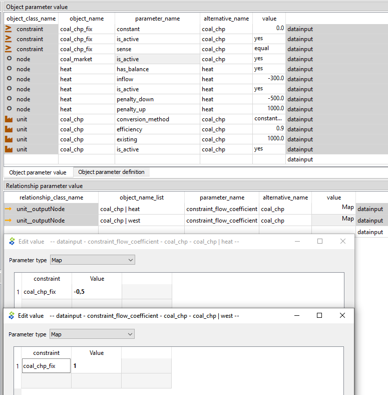
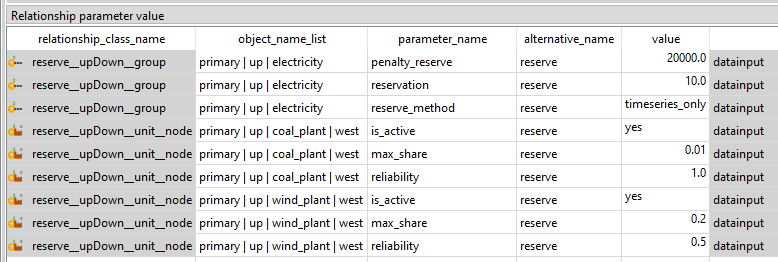
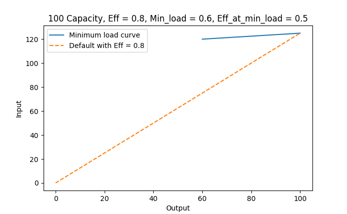
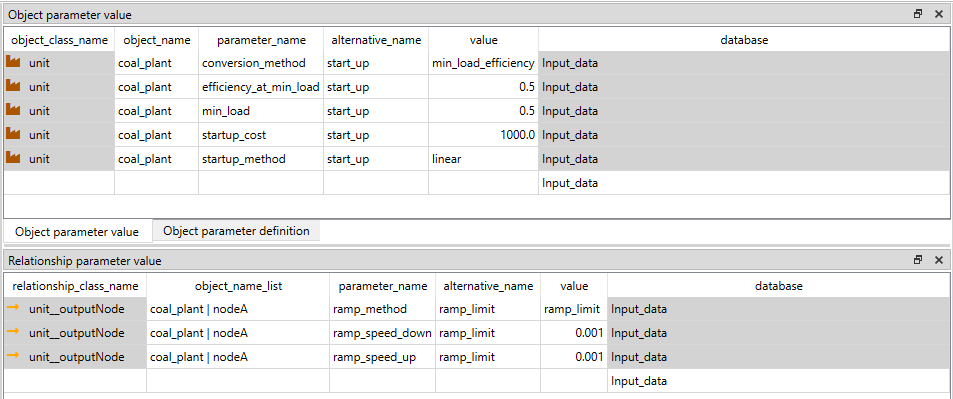

# Thermal, CHP and reserves

## How to create combined heat and power (CHP) 

**(examples.sqlite scenario: coal_chp)**
***init - west - coal_chp - heat***

First, a new *heat* `node` is added with the necessary parameters. The `nodes` can be used for energy form of energy or matter, so the heat demand node does not differ from the electricity demand node. 

The *heat* `node` needs to be added to an alternative in the `Entity Alternative` sheet. 

The required parameters are:

- `node_type`: balance
- `inflow`: Map for the heat demand (negative) [MW]
- `penalty_up`: a large number to prefer not creating energy from nowhere
- `penalty_down`: a large number to prefer not creating energy from nowhere

The heating systems tend to have some level of storage capability, so one could also add storage parameters to the node as well, but here they are not used.

Then the *coal_chp* `unit` is made with a high `efficiency` parameter, since CHP units convert fuel energy to power and heat at high overall rates. In FlexTool, `efficiency` is a property of the unit - it demarcates at what rate the sum of inputs is converted to the sum of outputs. However, without any additional constraints, the `unit` is free to choose in what proportion to use inputs and in what proportion to use outputs. In units with only one input and output, this freedom does not exist, but in here, the *coal_chp* needs to be constrained as otherwise the unit could produce only electricity and no heat at 90% efficiency, which is not feasible. 

This CHP plant is an another example where the user defined `constraint` (see the last equation in the previous example) is used to achieve the desired behaviour. In a backpressure CHP, heat and power outputs are fixed - increase one of them, and you must also increase the other. In an extraction CHP plant the relation is more complicated - there is an allowed operating area between heat and power. Both can be represented in FlexTool, but here a backpressure example is given. An extraction plant would require two or more *greater_than* and/or *less_than* `constraints` to define an operating area: the extraction CHP of [How to model cogeneration with desalination](#how-to-model-cogeneration-with-desalination) is built this way. The shipped *coal_chp_extraction* alternative takes another way: it turns *coal_chp_fix* off (`is_enabled` *no*) and shapes the operating area with `conversion_flow_coeff` and `capacity_max_coeff` on the outputs, as the next paragraph explains.

For extraction CHP specifically, the `unit__inputNode` / `unit__outputNode` coefficients interact. `conversion_flow_coeff` multiplies into the edge's contribution in the conversion equation (`conversion_indirect`) — a higher coefficient means more input energy per unit of that edge's output, so a premium electricity output might use `conversion_flow_coeff = 2` while a byproduct heat output uses `0.2`. The unit capacity caps the sum of the outputs, and `capacity_max_coeff` on an output adds a per-output upper cap. With a minimum load (`min_load` plus a `startup_method`), the floor `electricity + heat >= min_load × online capacity` applies once, to the sum of the outputs, so both the pure-condensing mode (heat = 0) and the pure-heat mode (electricity = 0) remain available while online with the default coefficients. Only if an output must carry part of the minimum load on its own, set `capacity_min_coeff` on that output (e.g. 1 on electricity: `electricity >= min_load × online capacity`, which rules out the pure-heat mode). On the inputs, `input_share_max` limits the share of the full-load input a single input may supply (default 1: no effective limit) and `input_share_min` sets the smallest share of the current input an input must supply while the unit runs (default 0). Without the capacity-coefficient split, each output would be capped individually at `conversion_flow_coeff × capacity`, which prevents the model from using the full operating envelope.

Electricity and heat outputs are fixed by adding a new `constraint` *coal_chp_fix* where the heat and power co-efficients are fixed. You need to create the two entities `unit__outputNode`, for *coal_chp--heat* and *coal_chp--west*. As can be seen in the bottom part of the figure below, the `constraint_flow_coeff` parameter for the *coal_chp--heat* and *coal_chp--west* is set as a map value where the `constraint` name matches with the *coal_chp_fix* `constraint` entity name. The values are set so that the constraint equation forces the heat output to be twice as large as the electricity output.

Create constraint *coal_chp_fix*, add it to an alternative in the `Entity Alternative` sheet and add parameters:

- `sense`: equal
- `constant`: 0.0

Create `unit_outputNode` (coal_chp|heat):

- `constraint_flow_coeff` : *coal_chp_fix*, -0.5

Create `unit_outputNode` (coal_chp|west):

- `constraint_flow_coeff` : *coal_chp_fix*, 1


Again, the negative value can be turned positive by arranging it to the right side of the equality, creating this:

```
1 x *electricity* = 0.5 x *heat*, which is true only if *heat* is 2 x *electricity*
```



## How to model cogeneration with desalination

**(examples.sqlite scenarios: desal_backpressure, desal_extraction, desal_ro_invest, desal_water_storage)**
***init - west - coal - desal_system - (one desalination alternative)***

**Water is one more node.** A desalination plant turns heat or electricity into fresh water. In FlexTool the water is a `node` like any other, and its unit of measure is your choice. Here the node *water* is in m³: its flows are in m³/h, its demand in m³/h and its storage in m³. A thermal desalination unit (for example multi-effect distillation, MED) takes heat from a CHP plant. A reverse-osmosis (RO) unit takes electricity. The four examples show a backpressure CHP, an extraction CHP, an RO investment and a water storage.

**The example system.** The alternatives *init*, *west* and *coal* are the tutorial's system: the 48-hour solve *y2020_2day_dispatch*, the node *west* and the 500 MW *coal_plant* fed from *coal_market*. Coal costs 20 CUR/MWh of fuel; at `efficiency` 0.4 that is 50 CUR/MWh of electricity. The alternative *desal_system* adds:

| Alternative | Entity | Parameter | Value |
|---|---|---|---|
| *desal_system* | `node` *west* | `inflow` | −300 [MW] |
| *desal_system* | `node` *desal_heat* | `node_type`, `penalty_up`, `penalty_down` | *balance*, 1000, 1000 [CUR/MWh] |
| *desal_system* | `node` *water* | `node_type`, `inflow` | *balance*, −3000 [m³/h] |
| *desal_system* | `node` *water* | `penalty_up`, `penalty_down` | 50, 50 [CUR/m³] |
| *desal_system* | `unit` *bp_chp* | `conversion_method`, `efficiency`, `existing` | *constant_efficiency*, 0.85, 600 [MW] |
| *desal_system* | `constraint` *bp_chp_ratio* | `sense`, `constant` | *equal*, 0 |
| *desal_system* | `unit__outputNode` (*bp_chp*, *west*) | `constraint_flow_coeff` | (*bp_chp_ratio* \| 1) |
| *desal_system* | `unit__outputNode` (*bp_chp*, *desal_heat*) | `constraint_flow_coeff` | (*bp_chp_ratio* \| −0.5) |
| *desal_system* | `unit` *med_desal* | `conversion_method`, `efficiency`, `existing` | *constant_efficiency*, 12 [m³/MWh], 3000 [m³/h] |

**Entities.** *desal_system* turns on the nodes *desal_heat* and *water* and the units *bp_chp* and *med_desal* (Entity Alternative). *bp_chp* has a `unit__inputNode` (*bp_chp*, *coal_market*) and two `unit__outputNode` entities, (*bp_chp*, *west*) and (*bp_chp*, *desal_heat*). *med_desal* has a `unit__inputNode` (*med_desal*, *desal_heat*) and a `unit__outputNode` (*med_desal*, *water*).

**The results.** The results per hour are the same in all 48 hours. The objective is the cost per hour × 8760 / 10⁶ (the 48 hours scaled to a year).

| Scenario | Water [m³/h] | CHP [MW] | *coal_plant* [MW] | Cost per hour [CUR] | Objective [M CUR] |
|---|---|---|---|---|---|
| *desal_backpressure* | MED 3000 | *bp_chp*: heat 250, power 125, fuel 441.18 | 175 | 17 573.5 | 153.944 |
| *desal_extraction* | MED 3000 | *ext_chp*: heat 250, power 300, fuel 750 | 0 | 15 000 | 131.400 |
| *desal_ro_invest* | MED 1000, RO 2000 | *bp_chp*: heat 83.33, power 41.67 | 266.33 | 16 257.8 + the RO annuity | 147.233 |
| *desal_water_storage* | MED 3000 (demand 2000 or 4000) | *bp_chp*: heat 250, power 125 | 175 | 17 573.5 | 153.944 |

### Backpressure CHP and thermal desalination

**(examples.sqlite scenario: desal_backpressure)**
***init - west - coal - desal_system***

**What it does.** *med_desal* makes 12 m³ of water per MWh of heat, so 3000 m³/h needs 250 MW of heat. *bp_chp_ratio* is power − 0.5 × heat = 0, so heat = 2 × power, as in the [CHP example](#how-to-create-combined-heat-and-power-chp). The water demand therefore fixes the CHP: heat 250 MW, power 125 MW and fuel (125 + 250) / 0.85 = 441.18 MW. *coal_plant* makes the other 175 MW. This is the demand-driven must-run of [option 5](#option-5-demand-driven-running): nothing forces *bp_chp* to run except the water demand.

**The water slack price.** The `penalty_up` of *water* (50 CUR/m³) must be above the cost of the dearest real way to make a cubic metre, including the cost of the power the CHP is forced to make with it. Otherwise the model leaves water demand unserved instead. In a winter with low electricity demand, the power made with the water can exceed the demand; the model then weighs dumping that power at the `penalty_down` of *west* against unserved water. Check that `node_slack_up` of *water* is 0, and give the system flexibility through RO, water storage or heat storage rather than a low penalty.

**Own electricity use.** A real MED or MSF plant also draws about 1.5–4 kWh of electricity per m³ for its pumps; the example leaves this out. To include it, give *med_desal* a second `unit__inputNode` (*med_desal*, *west*) with `conversion_flow_coeff` 0, so it stays out of the conversion. Then tie it to the water output with an *equal* user constraint: electricity input − 0.0025 × water output = 0 for 2.5 kWh/m³.

**One equality.** A backpressure plant has one degree of freedom: the ratio fixes power and heat together. One *equal* user constraint is enough.

**Efficiency above 1.** `efficiency` is output / input in the units of the nodes, here m³ per MWh. A value above 1 is fine. The unit's capacity is on its output side, so `existing` 3000 is in m³/h. At full load its input capacity factor (`unit_cf__inputNode`) is therefore 1/`efficiency`.

**Very large ratios.** With a very large ratio the input coefficients can fall below the `model` parameter `small_number_threshold` and become 0, so the unit would make water for free; see `efficiency` in [units](../reference/units.md#main-data-items-for-units). Rescale the unit of measure (for example 1000 m³) if that happens.

### Extraction CHP: an operating region

**(examples.sqlite scenario: desal_extraction)**
***init - west - coal - desal_system - desal_extraction***

**The data.** *desal_extraction* turns *bp_chp* off (its Entity Alternative is *false*) and turns on the unit *ext_chp*, with the same input and outputs as *bp_chp*:

| Entity | Parameter | Value |
|---|---|---|
| `unit` *ext_chp* | `conversion_method`, `efficiency`, `existing` | *constant_efficiency*, 0.45, 1000 [MW] |
| `unit__outputNode` (*ext_chp*, *west*) | `conversion_flow_coeff` | 1 |
| `unit__outputNode` (*ext_chp*, *desal_heat*) | `conversion_flow_coeff` | 0.15 |
| `constraint` *ext_chp_backpressure_line* | `sense`, `constant` | *greater_than*, 0 |
| `constraint` *ext_chp_max_heat* | `sense`, `constant` | *less_than*, 0 |
| `unit__outputNode` (*ext_chp*, *west*) | `constraint_flow_coeff` | (*ext_chp_backpressure_line* \| 1) |
| `unit__outputNode` (*ext_chp*, *desal_heat*) | `constraint_flow_coeff` | (*ext_chp_backpressure_line* \| −0.5), (*ext_chp_max_heat* \| 1) |
| `unit` *ext_chp* | `constraint_capacity_coeff` | (*ext_chp_max_heat* \| −0.6) |

**What it does.** The conversion is 0.45 × fuel = power + 0.15 × heat: each MWh of heat costs 0.15 MWh of power (the power-loss ratio). The two constraints draw the operating region. *ext_chp_backpressure_line* is power − 0.5 × heat ≥ 0: the plant cannot make more heat than on its backpressure line. *ext_chp_max_heat* is heat − 0.6 × capacity ≤ 0: a flow term and a capacity term in one row, written for every time step. Inside the region the model chooses power and heat freely.

**What the capacity caps.** The unit's capacity (`existing` 1000) caps power + heat, the sum of the outputs (see `capacity_max_coeff` in [units](../reference/units.md#main-data-items-for-units)), not the fuel. So the top edge of the region is power + heat ≤ 1000, not the iso-fuel line power + 0.15 × heat ≤ constant that is drawn for an extraction turbine. For an iso-fuel edge, add a *less_than* row with the flow coefficients power 1 and heat 0.15 and a `constraint_capacity_coeff` −c on the unit, with c the full-condensing power per unit of capacity. Size the capacity so that the sum cap does not cut that edge: power + heat is largest on the backpressure line, at 1.5 / 0.65 = 2.31 × the full-condensing power. A minimum condensing flow or a minimum power line is one more *greater_than* row of the same kind.

**The results.** Power from *ext_chp* costs 20 / 0.45 = 44.4 CUR/MWh, less than the 50 of *coal_plant*. So *ext_chp* makes all 300 MW of power and the 250 MW of heat, with fuel (300 + 0.15 × 250) / 0.45 = 750 MW. Power ≥ 0.5 × heat holds (300 ≥ 125) and the heat limit (600 MW) does not bind.

**A constraint with nothing in it.** *bp_chp_ratio* still exists here, but all its coefficients are on flows of *bp_chp*, which is off. Its row reads 0 = 0, so FlexTool leaves it out of the model and prints a warning that names it: in *desal_extraction* this warning is expected. To switch a constraint off on purpose, set its `is_enabled` to *no*, as the *coal_chp_extraction* alternative does.

### Reverse osmosis investment

**(examples.sqlite scenario: desal_ro_invest)**
***init - west - coal - desal_system - desal_ro_invest***

**The data.** *desal_ro_invest* turns on the unit *ro_desal*, with a `unit__inputNode` (*ro_desal*, *west*) and a `unit__outputNode` (*ro_desal*, *water*), and sets `invest_periods` [*p2020*] on the solve *y2020_2day_dispatch*:

| Entity | Parameter | Value |
|---|---|---|
| `unit` *ro_desal* | `conversion_method`, `efficiency` | *constant_efficiency*, 250 [m³/MWh] |
| `unit` *ro_desal* | `invest_method`, `invest_max_total` | *invest_total*, 2000 [m³/h] |
| `unit` *ro_desal* | `invest_cost` | 30 (= 30 000 CUR per m³/h) |
| `unit` *ro_desal* | `lifetime`, `discount_rate` | 20, 0.05 |

**invest_cost is per kW of the unit's capacity unit.** FlexTool reads every capacity as if it were in MW, and `invest_cost` is per kW, that is per 0.001 of the capacity unit. For a capacity in m³/h, enter the cost per m³/h divided by 1000: 30 000 CUR per m³/h is `invest_cost` 30. The same holds for `fixed_cost`. The capacities themselves are entered in m³/h unchanged: `existing`, `invest_max_total` and `invest_min_total` of 2000 m³/h are 2000, not 2. An `other_operational_cost` on a water flow is per m³ directly (it is per MWh of flow, no ÷ 1000).

**MED or RO.** A cubic metre from MED costs 1/12 MWh of heat. The heat costs 1.5/0.85 MWh of fuel at 20 CUR/MWh, but the CHP also makes 0.5/12 MWh of power that *coal_plant* would otherwise make at 50 CUR/MWh: 2.941 − 2.083 = 0.858 CUR/m³. A cubic metre from RO costs 0.004 MWh of power at 50 CUR/MWh = 0.2 CUR/m³. The saving, 0.658 CUR/m³ × 8760 h = 5 764 CUR per m³/h and year, is more than twice the annuity (30 000 × 0.0802 = 2 407 CUR per m³/h and year at 5 % over 20 years).

**The results.** *ro_desal* is invested to its 2000 m³/h limit and uses 8 MW of power. MED makes the other 1000 m³/h, with 83.33 MW of heat, so *bp_chp* makes 41.67 MW of power and *coal_plant* 300 + 8 − 41.67 = 266.33 MW. The operation costs 16 257.8 CUR/h (142.419 M CUR a year) and the RO annuity is 2000 × 30 000 × 0.0802 = 4.815 M CUR: 147.233 M CUR. The investment is in `unit_capacity__d` and in the *unit investment & retirement* row of the costs.

### Water storage

**(examples.sqlite scenario: desal_water_storage)**
***init - west - coal - desal_system - desal_water_storage***

**The data.** *desal_water_storage* makes *water* a storage and gives it a demand that changes during the day:

| Entity | Parameter | Value |
|---|---|---|
| `node` *water* | `node_type`, `existing` | *storage*, 15 000 [m³] |
| `node` *water* | `storage_binding_method` | *bind_within_timeblock* |
| `node` *water* | `storage_start_end_method`, `storage_state_start` | *fix_start*, 0 |
| `node` *water* | `inflow` | a time series: in each day 12 h at −2000, then 12 h at −4000 [m³/h] |

**What it does.** The mean demand is 3000 m³/h, the capacity of MED. Without the storage, MED could not cover the 4000 m³/h hours and the water slack would pay 50 CUR/m³. With it, MED runs flat at 3000 m³/h in every hour: the storage fills to 12 000 m³ in the 12 hours of low demand and empties in the 12 hours of high demand, twice. The cost is that of *desal_backpressure*. The case is tight by design (the MED capacity equals the mean demand), so the storage state is unique: see `node_state__dt`.

**Storage in m³.** A water storage is a storage node in the water's own unit. `existing` is in m³ here, and for a storage `invest_cost` enter the cost per m³ ÷ 1000 (as per kWh for an MWh storage), the same rule as for RO.

## How to add a reserve
**(examples.sqlite: scenario network_coal_wind_reserve)**

In FlexTool, reserves are defined for a group of nodes. If there is a need to have a reserve requirement for a single node, it needs its own group. Therefore, when creating a reserve, the first step is to add a new `group` (e.g. *electricity*) with all member nodes (e.g. *west*, *east* and *north*) using the `group__node` entity. Then, a new reserve categories can be added (e.g. *primary*) to the `reserve` entity. 
Finally, make sure there are *up* and *down* entities in the `UpDown' entity. These are hard-coded names in FlexTool and need to be used when creating reserves.

Next, the reserve requirement will be defined. An entity between the `reserve__upDown__group` class (e.g. *primary--up--electricity*) allows to define the reserve parameters `reserve_method`, `reservation` (i.e. the amount of reserve) and `penalty_reserve` (i.e. the penalty cost in case of lack of reserve). For example, a constant of 10 MW could be used. Even though the name of the `reserve_method` is *timeseries_only*, it can also accept a constant value - it's an exogenous reserve requirement whereas the other two reserve methods are endogenous. Dynamic reserve method calculates the reserve requirement from generation and loads according to user defined factors (`increase_reserve_ratio`). Largest failure method will force enough reserve to cope with a failure of the chosen unit and connection flows.

Parameters from the `reserve__upDown__unit__node` class should be used to define how different units can contribute to different reserves. Note that the entities in this class need to be added to the `Entity Alternative` sheet. Parameter `max_share` says how large a share of the unit's capacity at that node (its built capacity: existing + invested − retired; at a node the unit consumes from, its full-load input there) can be held for this reserve category (e.g. *coal_plant* may be limited by ramp constraint to provide only 1% of its capacity to an upward primary reserve.) Meanwhile, parameter `reliability` affects what portion of the reserved capacity actually contributes to the reserve (e.g. *wind_plant* may contribute only 80% of its generation to reserve due to uncertainty).

If the reserve is provided by a **battery** or other storage (a unit discharging from, or a connection/charger tied to, a storage node), set `reserve_duration` (hours) on the `reserve__upDown__group` entity so the storage actually holds enough energy to sustain the committed reserve power. For example, a 4-hour upward reserve from a battery uses `reserve_duration = 4`: the model then guarantees the battery's stored energy can back its reserve commitment for 4 hours (corrected by the round-trip efficiency). Without `reserve_duration` the reserve is instantaneous-power-only — the battery could commit reserve it has no energy to deliver. The coupling only applies to storage-backed providers; ordinary fuel-fed units are unaffected.

 

## How to add a minimum load, start-up and ramp
**(ramp_and_start_up.sqlite)**

Some plants cannot vary their output freely, but have some cost and limits associated with it. In this example we will add the minimum load behaviour to a *coal_plant* `unit` and add the cost and limits for starting up and ramping the plant respectively.

Minimum load requires that the unit must have an online variable in addition to flow variables and therefore a `startup_method` needs to be defined and an optional `startup_cost` can be given. The `startup_cost` is added to the total cost every time the unit is required to start-up. Here we use a value 1000 (Currency/MW started up).

The options for the `startup_method` are *no_startup*, *linear* and *binary*. *binary* would require an integer variable so *linear* is chosen. However, this means that the unit can startup partially. The minimum online will still apply, but it is the minimum of the online capacity in any given moment (*sum of output flows* >= *min_load* x *capacity* x *online*), where 0 <= *online* <= 1. The minimum load applies once per unit, to the sum of its outputs; a unit with several inputs can run on any mix of them.

The units online in a time step are linked to the units online in the previous step along the timeline, in the same way as ramp limits: also from the last step of a period into a period whose time steps continue it on the same timeline, and into the first step of a forecast branch. A step without a previous step — the first step of a solve, the first step of a period that does not continue the previous one (e.g. a period that reuses the same timeset), the first step after a gap in the timeline and the first step of a representative period — is linked to the last step of its own stretch of the timeline (the steps up to the next gap or the end of the period): the commitment cycles within that stretch and never across a gap, a representative-period start or into another period. So a stretch that ends offline starts up (and pays `startup_cost`) at its first step when it needs the unit there. Only the start of a stretch wraps: the step before a gap has no next step, so no pre-shutdown output limit applies there. In a rolling solve the units online that the previous roll realized are carried to the steps of the next roll that continue its last realized step on the timeline (also when the next solve has longer time steps: it continues the finer step that ends where its previous step ends); a roll that starts after a gap, at a new year that reuses the timeset or at a representative-period start takes no carry and cycles within its stretch.

The online variable also allows to change the efficiency of the plant between the minimum and full loads. A unit with a part-load efficiency will obey the following equation:

```
  + sum_i[ input(i) * input_coefficient(i) ]
  =
  + sum_o[ output(o) * output_coefficient(o) ] * slope
  + online * section

where   slope = 1 / efficiency - section
  and section = 1 / efficiency 
                - ( 1 / efficiency - min_load / efficiency_at_min_load) / ( 1 - min_load )
```

By default, `input_coefficient` and `output_coefficient` are 1, but if there is a need to tweak their relative contributions, these coefficients allow to do so (e.g. a coal plant might have lower efficiency when using lignite than when using brown coal).

The input is required at different ouput levels is shown in the figure below, when Capacity = 100, Efficiency = 0.8, Minimum load = 0.6 and Efficiency at minimum load = 0.5.



Next we will add ramp limits. With the ramping limits, the user can force the change of a flow from a unit to be below a certain value each timestep. The ramping is an attribute of the flow. Therefore it does not require the minimum load behaviour and its parameters are added to the `unit_outputNode` entity:

- `ramp_method`: ramp_limit, ramp_cost or both. `ramp_limit` uses the speeds below, `ramp_cost` the cost below, `both` uses both.
- `ramp_speed_up`: Limit on how fast the plant can ramp up. (fraction of unit / min) ie. Value 0.01 allows the change of 60% of capacity per hour; with 2-hour time steps, 120% (i.e. no limit). The change between two time steps of different length uses their average length.
- `ramp_speed_down`: Limit on how fast the plant can ramp down. (fraction of unit / min) ie. Value 0.01 allows the change of 60% of capacity per hour.

The first time step of a solve, the first step after a gap in the timeline and the first step of a representative period have no ramp limit (there is no previous step to ramp from). A rolling window ramps from the flow of the previous window where it continues the previous window's last realized step on the timeline; a solve with longer time steps continues the finer step that ends where its own previous step ends (by position in time). Unlike the online status, the ramp has no cyclic link from the first step of a stretch to its last step.

- `ramp_cost`: The cost of changing the flow [CUR/MW]: every MW of change from the previous time step costs this much, up and down alike, whatever the length of the steps (a change is an event, like a start-up). It uses the same previous step as the ramp limit above, so there is no cost at the first step of a solve, after a gap or at the start of a representative period, and a rolling window is charged once for the change from the previous window's realized flow. A start-up from zero pays both the startup cost and the ramp cost. The cost is reported in the cost category *ramps*. With a ramp cost, the price at a node where a ramp-costed unit sets the price and its flow does not change is not unique: it can lie up to 2 × `ramp_cost` / step duration [CUR/MWh] above or below that unit's marginal cost.



## How to give a unit a start-up fuel or start-up heat

A start-up can use energy that the running unit does not: a coal unit is started on oil, a gas turbine burns gas to warm up, a CSP turbine takes steam from its tank before it delivers power. The input arc of the unit (`unit__inputNode`) says what it supplies, with `startup_input_method`:

- *just_input* (default) - the normal input flow;
- *startup_and_input* - the normal input flow, and each start-up also takes `startup_energy` × MW started from the node;
- *startup_only* - only the start-up energy: the arc has no flow, and it takes no part in the unit's conversion, capacity, input shares or ramps.

`startup_energy` is in MWh per MW started (constant or period). The unit needs online variables: `startup_method` *linear* or *binary* (or a `minimum_time_method`). With *linear* start-ups a start-up of 0.6 units of a 100 MW unit is 60 MW started; the model stays an LP.

**Coal started on oil.** A coal unit *coal_plant* with its fuel input (*coal_plant*, *coal_market*) gets a second input arc (*coal_plant*, *oil_market*) with `startup_input_method` *startup_only* and `startup_energy` 2. A start-up of 60 MW then takes 120 MWh of oil from *oil_market* in the step it starts in, priced as the oil commodity and with the oil's `co2_content`. The oil arc is not a flow, so the unit stays a one-input, one-output unit (no extra flow variable, no conversion row), and the oil cannot be used to run the unit.

**CSP turbine started on tank heat.** A turbine whose start-up heat comes from the tank uses its normal input: on (*csp_turbine*, *csp_heat*) set `startup_input_method` *startup_and_input* and `startup_energy` (for example 0.5 MWh_th per MW_e started). A start-up of 20 MW takes 10 MWh_th from the tank on top of the heat the turbine converts.

**Results.** `unit_startup_energy__dt` [MWh in the step] and `unit_startup_energy__d` [MWh/a] show the start-up input per unit and node. The unit's input from the node (`unit__inputNode__dt` / `__d`), the commodity costs, the CO2 emissions and costs and the node balance include it.

**Caveats.** The start-up input is not part of user constraints (`constraint_flow_coeff`), flow groups or the capacity margin. A solve whose `reduce_unit_detail_method` leaves out the online variables (*online*, *online_ramps*) also leaves out the start-up input, as it leaves out the start-up cost: an investment solve at that level under-counts both. See the `startup_input_method` / `startup_energy` entries in [Units](../reference/units.md#properties-of-unit-inputnode-and-unit-outputnode-entities).

## How to add minimum uptime and downtime

Some power plants cannot be started and stopped freely due to thermal stress, safety requirements, or operational constraints. Minimum uptime forces a unit to stay online for a specified duration after starting up. Minimum downtime forces a unit to stay offline for a specified duration after shutting down.

To add minimum uptime and/or downtime constraints to a `unit`:

1. Set the `minimum_time_method` parameter on the unit:
    - *min_uptime* - only enforce minimum uptime
    - *min_downtime* - only enforce minimum downtime
    - *both* - enforce both constraints
    - *none* - no minimum time constraints (default)

2. Set the duration parameters (in hours):
    - `min_uptime` - e.g. 8 for an 8-hour minimum online time
    - `min_downtime` - e.g. 4 for a 4-hour minimum offline time

Setting `minimum_time_method` to anything other than *none* will automatically activate online variables for the unit (at least linear startup), even if `startup_method` is not explicitly defined. This means you do not need to separately set `startup_method` to *linear* or *binary*, although you can if you also want startup costs or binary commitment.

The minimum time constraints work with variable timestep durations. The constraint checks that the cumulative duration of consecutive online (or offline) timesteps meets the minimum requirement, rather than simply counting timesteps.

The look-back follows the timeline in the same way as ramp limits: it continues into a period whose time steps continue the previous period's on the same timeline and into the steps before a forecast branch starts, and stops at a gap in the timeline (the minimum time restarts after the gap), at the start of a representative period, at a period that reuses the same timeset as the previous one and at the first step of a solve. In rolling window solves, the start-ups and shut-downs that the previous roll realized count for the time steps of the next roll that continue its last realized step on the timeline, in the same way as the ramp continues: the same period, a period that continues it and every forecast branch that starts there (not a period that reuses the same timeset, a step after a gap or a representative-period start). So the solve horizon overlap does not need to cover the minimum times. A solve with longer time steps (for example a 6-hour storage roll after an hourly dispatch) continues the realized hourly step that ends where its own previous step ends, by position in time. A warning is printed only when a solve continues the timeline of an earlier solve but its first step neither follows nor ends at the earlier solve's last realized step (a hole or an overlap between the two), since no realized on-line history reaches it then.

If the unit also has ramp limits (`ramp_method` with `ramp_speed_up`, `ramp_speed_down`), the model additionally tightens the maximum output in the startup and pre-shutdown timesteps based on how fast the unit can ramp within one timestep. A unit that starts in a timestep reaches on average at most `min_load + ½ × ramp_speed_up × 60 × timestep duration` of the started capacity in that step (it synchronises at minimum load and then ramps up: half a step's ramp on average), and in the step before it shuts down at most `min_load + ½ × ramp_speed_down × 60 × timestep duration` (both capped at full output and by `availability`). A unit online for a single step gets the smaller of the two. On an input with a ramp limit of a unit with several inputs or outputs, the limit is on the input it draws (at minimum load it needs the input of its minimum-load output). Without ramp limits, the unit can reach full output immediately after starting.

Startups and shutdowns count exactly the units coming online and going offline. A unit with online variables ramps on its online capacity: the units online in both steps change by at most the ramp; a unit starting in a step reaches at most the startup-step output above, and a unit shutting down drops from at least its minimum load (and, in the step before, at most the pre-shutdown output). Starting and stopping units in the same step therefore gives no extra ramp room on a unit's output. On an input, or on one output of a unit with several outputs, a start/stop pair can still gain up to the minimum-load share of that flow, which the startup cost pays for.

## How to make a unit run all the time (must-run)

**(examples.sqlite scenarios: must_run_none, must_run_profile, must_run_constraint_one, must_run_fleet_output_floor, must_run_flowgroup, must_run_heat_demand, must_run_fleet_two_online, must_run_min_load_only)**
***init - west - coal - wind - must_run_system - (one must-run alternative)***

**No single switch.** FlexTool has no must-run parameter. A unit runs when the optimisation wants it to, so a must-run is a floor that you put on its flow or on its units online. The table lists the ways to do it. The examples are the same small system with a different floor each.

| Option | Where it is set | LP or MIP | What it forces | When to use it |
|---|---|---|---|---|
| 1. Profile lower limit | `unit__node__profile`, `profile_method` *lower_limit* | LP | flow ≥ profile × availability × capacity | A share of the capacity that follows investments or changes in time |
| 2. User constraint on one flow | `constraint` + `constraint_flow_coeff` on `unit__outputNode` | LP | flow ≥ `constant` [MW] | A fixed MW floor on one unit, constant or per period |
| 3. User constraint on a fleet's output | the same, with a coefficient on each unit | LP | sum of the flows ≥ `constant` [MW] | A floor on a group of units; the model picks the cheapest ones |
| 4. flowGroup minimum flow | `flowGroup` + `flowGroup__unit__node`, `min_instant_flow` | LP | sum of the member flows ≥ `min_instant_flow` [MW] | As option 3, also with a floor that changes in time |
| 5. Demand-driven | the unit's other output has a demand (heat, steam, water) | LP | nothing directly: the unit runs because its other product is needed | CHP and other plants that run for a heat or process demand |
| 6. User constraint on the units online | `constraint` + `constraint_online_coeff` on `unit` | MIP with *binary* startup (LP with *linear*) | at least N units online, each at least at `min_load` | A requirement for N machines on line, for example for system strength |

**The example system.** The alternatives *init*, *west*, *coal* and *wind* are the tutorial's system: the 48-hour solve *y2020_2day_dispatch*, the node *west*, the 500 MW *coal_plant* fed from *coal_market* and the 1000 MW *wind_plant*. Coal costs 20 CUR/MWh of fuel at `efficiency` 0.4, i.e. 50 CUR/MWh of electricity. The other alternatives add:

| Alternative | Entity | Parameter | Value |
|---|---|---|---|
| *must_run_system* | `node` *west* | `inflow` | −300 [MW] |
| *must_run_system* | `unit__outputNode` (*wind_plant*, *west*) | `other_operational_cost` | 1 [CUR/MWh] |
| *must_run_fleet* | `unit` *steam_1*, *steam_2*, *steam_3* | entity alternative | on |
| *must_run_fleet* | `unit` *steam_k* | `conversion_method`, `efficiency`, `existing` | *constant_efficiency*, 0.4, 100 [MW] |
| *must_run_fleet* | `unit__outputNode` (*steam_k*, *west*) | `other_operational_cost` | 0, 1 and 2 [CUR/MWh] |

**Entities of the fleet.** Each *steam_k* also needs a `unit__inputNode` (*steam_k*, *coal_market*) and a `unit__outputNode` (*steam_k*, *west*). The `other_operational_cost` is on the output flow, not on the unit. The costs of 0, 1 and 2 CUR/MWh make the model always prefer the units in that order.

**The results.** Wind can cover the demand in every hour, so without a floor no coal runs. The results per hour are the same in all 48 hours:

| Scenario | Dispatch [MW] | Cost per hour [CUR] | Objective [M CUR] |
|---|---|---|---|
| *must_run_none* | wind 300 | 300 | 2.628 |
| *must_run_profile* | baseload_plant 200, wind 100 | 10 100 | 88.476 |
| *must_run_constraint_one* | coal_plant 150, wind 150 | 7 650 | 67.014 |
| *must_run_fleet_output_floor* | steam_1 100, wind 200 | 5 200 | 45.552 |
| *must_run_flowgroup* | steam_1 100, wind 200 | 5 200 | 45.552 |
| *must_run_heat_demand* | coal_chp 150 (and 300 heat), wind 150 | 10 150 | 88.914 |
| *must_run_fleet_two_online* | steam_1 50, steam_2 50, wind 200 | 5 250 | 45.990 |
| *must_run_min_load_only* | wind 300 | 300 | 2.628 |

**Floors are hard.** None of these floors has a slack of its own. If a floor forces more output than the node can use, the extra energy goes to the node's downward slack, which costs `penalty_down` (with `penalty_method` *off* on the node, the model is infeasible instead). If the unit's capacity or another floor cannot meet a floor, the model is infeasible.

**Set the sense.** Without `sense`, a constraint is *equal*: always set *greater_than* for a floor.

### Option 1: profile lower limit

**(examples.sqlite scenario: must_run_profile)**
***init - west - coal - wind - must_run_system - must_run_profile***

**The data.** Create a `profile` (here *must_run_share*) with `profile` 0.4 and connect it to the flow with a `unit__node__profile` entity (*baseload_plant*, *west*, *must_run_share*) with `profile_method` *lower_limit*. *baseload_plant* is a coal unit like *coal_plant*: `unit__inputNode` (*baseload_plant*, *coal_market*), `unit__outputNode` (*baseload_plant*, *west*), `conversion_method` *constant_efficiency*, `efficiency` 0.4 and `existing` 500 [MW]. The alternative *must_run_profile* holds all of these values and turns *baseload_plant* on.

**What it does.** In every time step the flow is at least profile × `availability` × capacity, here 0.4 × 500 = 200 MW. The capacity includes invested capacity, so the floor grows with investments. The `profile` can be a constant, a period, a time series or both (see [units constrained by profiles](../reference/units.md#units-constrained-by-profiles)), so the floor can change from hour to hour.

!!! tip "Give the profile a value"
    A `unit__node__profile` entity whose `profile` has no value in the scenario would hold the flow at 0: `profile_method` defaults to *upper_limit*, and a missing profile value is 0. FlexTool stops with an error that names the link. Entities are the same in every scenario, so fix it with one of these:

    - give the `profile` a value in an alternative that every scenario uses;
    - set `profile_method` *lower_limit* in such an alternative (a missing value is then a floor of 0, which does nothing);
    - put the profile on a unit that is on only where the profile is used, as the example does with *baseload_plant*.

### Option 2: user constraint on one flow

**(examples.sqlite scenario: must_run_constraint_one)**
***init - west - coal - wind - must_run_system - must_run_constraint_one***

**The data.** Create a `constraint` *coal_plant_floor* with `sense` *greater_than* and `constant` 150. On `unit__outputNode` (*coal_plant*, *west*) set `constraint_flow_coeff` to the map (*coal_plant_floor* | 1).

**What it does.** In every time step, the flow from *coal_plant* to *west* is at least 150 MW. The `constant` is in MW (the unit of the flow times its coefficient). It can be a constant or a period map, not a time series. The floor does not follow investments; use a `constraint_capacity_coeff` term on the unit (see [user constraints](../reference/user_constraints.md)) if it should.

### Option 3: user constraint on a fleet's output

**(examples.sqlite scenario: must_run_fleet_output_floor)**
***init - west - coal - wind - must_run_system - must_run_fleet - must_run_fleet_output_floor***

**The data.** Create a `constraint` *steam_fleet_output_floor* with `sense` *greater_than* and `constant` 100, and set `constraint_flow_coeff` (*steam_fleet_output_floor* | 1) on the output flow of each of *steam_1*, *steam_2* and *steam_3*.

**What it does.** The sum of the three flows is at least 100 MW in every time step. The model chooses how to share it: here *steam_1*, the cheapest, runs at 100 MW and the other two stay off. Use this when the requirement is on the fleet, not on each unit.

### Option 4: flowGroup minimum flow

**(examples.sqlite scenario: must_run_flowgroup)**
***init - west - coal - wind - must_run_system - must_run_fleet - must_run_flowgroup***

**The data.** Create a `flowGroup` *steam_fleet*, add the flows with `flowGroup__unit__node` entities (*steam_fleet*, *steam_k*, *west*) and set `min_instant_flow` to 100.

**What it does.** The same as option 3: the sum of the member flows is at least 100 MW (output flows count positive, input flows negative). `min_instant_flow` can also be a time series or a period+time map, so the floor can change in time (see [flow groups](../reference/flow_groups.md#cumulative-and-instant-flow-limits)). A user constraint is the better choice when the flows need different weights.

### Option 5: demand-driven running

**(examples.sqlite scenario: must_run_heat_demand)**
***init - west - coal - wind - must_run_system - coal_chp - heat***

**The data.** The alternatives *coal_chp* and *heat* of the [CHP example](#how-to-create-combined-heat-and-power-chp) add a node *heat* with `inflow` −300 [MW] and the unit *coal_chp*, with input *coal_market*, outputs *west* and *heat* and `efficiency` 0.9. The constraint *coal_chp_fix* (`sense` *equal*) has the coefficient 1 on the *west* output and −0.5 on the *heat* output.

**What it does.** Many plants that run all the time do so because their other product is needed. Here *coal_chp* must make 300 MW of heat for the *heat* node, and *coal_chp_fix* ties its electricity to half of the heat. So it makes 150 MW of electricity in every hour, although wind could cover the whole electricity demand. Model the demand that makes the plant run instead of forcing its output, when you know that demand. The heat demand, not an artificial floor, is then what makes the plant run, and the heat node's price shows what it costs. A water demand works the same way: see [How to model cogeneration with desalination](#how-to-model-cogeneration-with-desalination).

### Option 6: user constraint on the units online

**(examples.sqlite scenario: must_run_fleet_two_online)**
***init - west - coal - wind - must_run_system - must_run_fleet - must_run_fleet_two_online***

**The data.** On each of *steam_1*, *steam_2* and *steam_3* set `startup_method` *binary*, `min_load` 0.5 and `constraint_online_coeff` (*steam_fleet_two_online* | 1). Create a `constraint` *steam_fleet_two_online* with `sense` *greater_than* and `constant` 2. The example also sets `solver_mip_gap` 0 on the solve, so the solver proves the best integer solution.

**What it does.** In every time step at least two of the three units are online, and each online unit makes at least its minimum load: *steam_1* and *steam_2* are online at 50 MW each. The count is in units of `virtual_unitsize`; without it, of the unit's existing capacity (here 100 MW, so each unit is one), else of 1000 MW. Set `virtual_unitsize` on a unit that is invested. A `constraint_online_coeff` on a unit without online variables is an error. See the [two of three units online](../reference/user_constraints.md#example-two-of-three-units-online) example.

**Output floor or count.** The output floor of option 3 and this count cost almost the same here (5 200 against 5 250 CUR/h), but they force different things. The floor asks for 100 MW from any units; the count asks for two machines on line, whatever their output. Use the count only when the requirement really is about machines (for example inertia or short-circuit power from several units); it needs integer online variables, which makes the solve slower.

**Binary or linear.** With *binary* startup the count is a whole number, so ≥ 1.5 needs two units online. With *linear* startup the count is continuous: ≥ 1.5 keeps 1.5 units' worth of capacity online (150 MW here), with the minimum load applying to that capacity, not two whole machines. Linear is an LP and solves fast; binary gives the exact count.

**An exact count.** To fix the number of units online, use the same data with `sense` *equal* and `constant` N. The `constant` can be a constant or a period map, not a time series. There is no parameter that fixes a unit's online status directly; only a stochastic realization solve fixes it internally.

### min_load is not a must-run

**(examples.sqlite scenario: must_run_min_load_only)**
***init - west - coal - wind - must_run_system - must_run_fleet - must_run_min_load_only***

**What it does.** The steam units have `startup_method` *binary* and `min_load` 0.5, but no floor. The minimum load applies only while a unit is online, and the model is free to keep it offline, so all three stay off and wind covers the demand (the same result as *must_run_none*). `min_load` limits how low an online unit can go; it does not make the unit run.

### Avoid a negative cost as a must-run bonus

**Why not.** A large negative `other_operational_cost` makes the unit run, but it pays the unit for every MWh it makes. The bonus is then in the node prices, the cost results and the objective, so none of them is the system's real cost.

**Dumped energy.** Once the bonus, less the unit's own costs, is larger than the node's `penalty_down`, the unit runs above the demand and the extra energy is dumped through the downward slack. Use one of the floors above instead: they force exactly the output you want and show it as a constraint.
