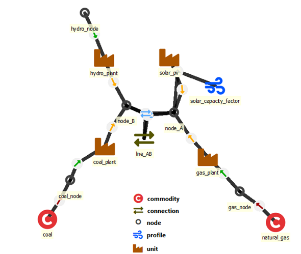
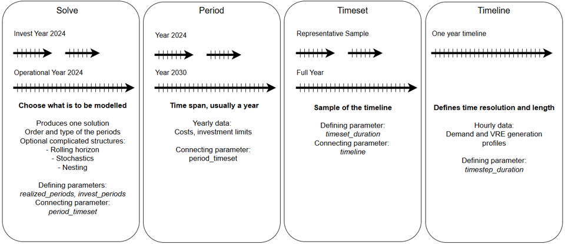
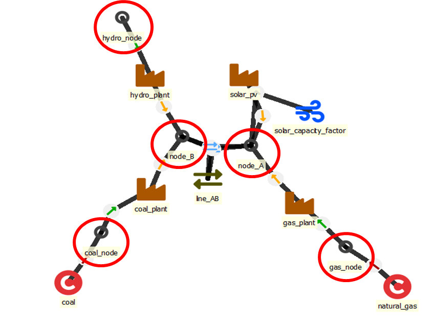
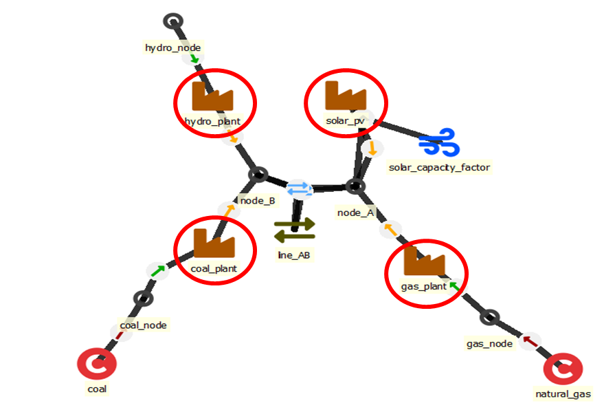
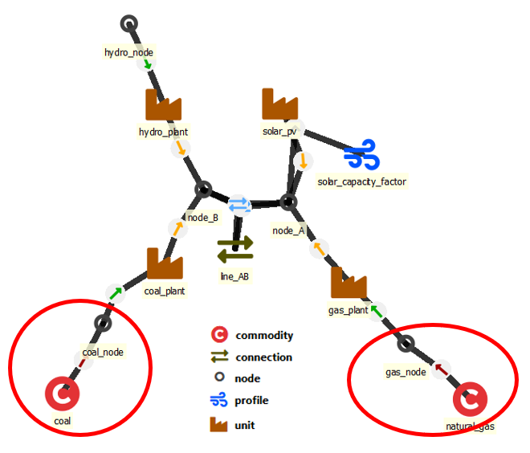

# Main entities to define a power/energy system

Elemental entities (one dimensional):

- [`node`](#nodes): maintain a balance between generation, consumption, transfers and storage state changes (nodes can also represent storages)
- [`unit`](#units): power plants or other conversion devices that take one or more inputs and turn them into one or more outputs
- [`connection`](#connections): transmission lines or other transfer connections between nodes
- [`commodity`](#commodities): fuels or other commodities that are either purchased or sold at a price outside of the model scope
- [`profile`](#units-constrained-by-profiles): timeseries that can be used to constraint the behaviour of units, connections or storages
- [`reserve`](#reserves): reserve categories to withhold capacity to cope with issues outside of model scope

Entities with two or more dimensions:

- `unit__inputNode` and `unit__outputNode`: defines the inputs, outputs and their properties for the conversion units
- `connection__node__node`: defines which nodes a connection will connect
- `unit__node__profile` and `connection__profile`: defines a profile limit (upper, lower or fixed) for an energy flow
- `node__profile`: defines a profile limit (upper, lower, or fixed) for the storage state of the node
- `commodity__node`: defines if a node is a source or sink for a commodity
- `reserve__upDown__unit__node` and `reserve__upDown__connection__node`: reserve capacity from a source to the target node

See below for more detailed explanations.




## How to define the temporal properties of the model

### Timesteps and periods

FlexTool has two different kinds of time varying parameters. The first one represents a regular timeline based on timesteps. The duration of each timestep can be defined by the user. There can be multiple timelines in the database - the user needs to define which timeline to use (and what parts of the timeline should be used, as will be explained later). The timestep names in the timeline are defined by the user - they can be abstract like 't0001' or follow a datetime format of choice. However, the timestep names between different timelines must remain unique (usually there should be only one timeline in a database and therefore no issues).

The second time varying dimension is `period`, which is typically used to depict assumptions about the future. One model can include multiple `solves` that the model will solve in sequence (to allow multi-stage modelling). Each solve can include multiple `periods` (so that the user can change parameter values for different parts of the future).

A parameter of particular type can be either constant/time-varying or constant/period-based. For example `inflow` is either a constant or time-varying, but it cannot be period-based (a period-keyed `inflow` is rejected; use `annual_flow` for demand that varies by period).

**Recommendation — name the Map index for parameters that accept both `period` and `time`.** A few parameters accept *either* a period map or a time series (for example the flowGroup `min_instant_flow` / `max_instant_flow` limits, which accept "Constant, period, time or period+time"). Period and time Maps look structurally identical in Spine Toolbox — both are 1-dimensional Maps — so FlexTool tells them apart from the Map's `index_name`. Set it explicitly to **`period`** or **`time`** when authoring such a Map. If you leave the default (Spine stores it as `x`), FlexTool falls back to inspecting the Map's index *values* and matching them against the model's period and timestep names to guess the intended axis; this works when the keys clearly belong to one set, but is ambiguous if they don't. The guess is made per entity: a map whose keys are neither periods nor timesteps of the solve gives that entity no value in that solve (the same as if nothing had been authored for it, so the parameter's own default applies) — it never affects any other entity's value. Keys that match *both* a period and a timestep name are an error. Setting `index_name` removes the guesswork. (Parameters that accept only one of the two — e.g. `inflow` is time-only — are never ambiguous and need no `index_name`.)

### Timesets

Timesets pick one or more sections from the `timeline` to form a `timeset`. Each timeset defines a start and a duration. The aim of timesets is to allow the modeller to create models with representative periods often used in the investment planning.



### Definitions

- `model`: model defines the sequence of solves to be performed (e.g. first an investment solve and then a dispatch solve)

  - *solves*: sequence of solves in the model represented with an array of solve names.
  - *inflation_rate*: [e.g. 0.02 for 2%] Model-wide inflation rate applied to all future costs. When inputs are in real (constant-price) terms, set to 0 (default). When inputs are in nominal terms, set to expected inflation.
  - *inflation_offset_investment*: [years] Offset from the period (often year) start to the first payment of the investment cost annuity.
  - *inflation_offset_operations*: [years] Offset from the period (often year) start to the payment of operational costs.
  - *periods_available*: (Optional) Array of periods available for the model. Use this for periods that are in the data, but are not in period_timeset.
  - *max_flow_for_unconstrained_variables*: [MW] Upper bound assigned to LP variables that have no other cap (e.g. flows on edges with `invest_method = no_limit` and no `existing` capacity). Acts as a numerical safety net to keep the LP bounded. Default is large; lower it when scaling problems appear (see [dev/scaling.md](dev/scaling.md)).
  - *debug*: Instruction set for performing model debugging and testing.
  - *version*: Database schema version. Written by the migration chain — do not edit manually.
  
- `solve`: each solve is built from an array of periods (e.g. one period for 2025 and another for 2030). Periods use timesets to connect with a timeline. Parameters are split into two parameter-group tags in the master template — `solve_basics` (knobs a typical user touches) and `solve_advanced` (rolling/nested/stochastic structures, solver options, cross-solve handoff). The split is purely cosmetic in the Spine DB editor; behaviour is identical.

  - *period_timeset*: map of periods with associated timesets that will be included in the solve. Index: period name, value: timeset name.
  - *new_stepduration*: Hours. Creates a new `timeline` from the old for this `solve` with this timestep duration. The new timeline will sum or average the other timeseries data like `profile` and `inflow` for the new timesteps. All timesets used by the solve must resolve to the same underlying timeline. Steps are aggregated from the start of each `timeset_duration` block (a block that is not a multiple of the step ends with a shorter step); a gap between blocks stays a gap, and when several timesets share the timeline each period keeps its own timesteps. A timeset used by this solve cannot be used by a solve without `new_stepduration` or with a different one. See also the group-level `new_stepduration` for flex-temporal decomposition.
  - *realized_periods*: these are the periods the model will 'realize' - i.e., what periods will be reported in the results from this solve
  - *realized_invest_periods* Array of the periods that will realize the investment decisions. If this is not defined when the invest_periods exist, the realized_periods are used to realize the invests as well
  - *invest_periods*: array of periods in which investments can be decided in this solve (applies only to entities that can be invested in). With a construction lead time, the capacity comes online later.
  - *years_represented*: Map to indicate how many years the period represents before the next period in the solve. Used for discounting. Can be below one (multiple periods in one year). Index: period, value: years.
  - *solver*: choice of a solver. HiGHS is the default and only fully supported backend (called via the `highspy` Python bindings). CPLEX can still be wired in as an advanced option for licensed users via `solver_precommand` / `solver_arguments`; see the how-to.
  - *solver_arguments*: Map of solver option name → value, forwarded verbatim to the active solver. This is where the former `highs_*` shortcuts now live. For HiGHS, set `solver` to choose the method ('simplex' or 'ipm' which is interior point method; use 'choose' for MIP models, since 'simplex' and 'ipm' will not work), `parallel` ('on' or 'off') to control parallelisation of single solves (it can be better to turn it off when executing multiple scenarios in parallel), and `presolve` ('on' or 'off') to toggle presolve (which can have a large impact on solution time when solves are large). These only affect speed, not results.
  - *solve_mode*: a single solve or a set of rolling optimisation windows solved in a sequence
  - *timeline_hole_multiplier*: [unitless, default 1.0] Multiplier applied to the inverse-step-duration term in the `nodeBalance_eq` for variable-step timelines. Tunes how strongly an unrepresented gap between two timesteps is amortised into the storage state equation. Leave at the default unless investigating large-step / sparse-timeline numerical issues.
  - Rolling window parameters:

    - *rolling_solve_jump*: Hours, (Required if rolling_window solve). Interval between the start points of the rolls. Also the output interval. This should be smaller than the horizon
    - *rolling_solve_horizon*: Hours, (Required if rolling_window solve). The length of the horizon of the roll. How long into the future the roll sees. For an individual roll, horizon is the solve length and jump is the output length.
    - *rolling_duration*: Hours, (Optional). Duration of rolling, if not stated, assumed to be the whole timeline of the solve

  - Nested solve sequence parameters:

    - *contains_solve*: Array of solves that are run with after this solve using the realized data of this solve. Read 'How to use Nested Rolling window solves (investments and long term storage)'
    - *fix_storage_periods*: Array of periods where this solve produces a storage-state handoff for the contained solve at the end of each listed period. The handoff carries any subset of three metrics — `fix_storage_quantity`, `fix_storage_price`, `fix_storage_usage` — selected per node by the node parameter `storage_nested_fix_method`.
  
  - Stochastic parameters:

    - *stochastic_branches*: 4D-map defining the solve's **forecast branches** — the probability-weighted possible futures. Index columns: *period*, *branch*, *analysis_time* (the branch's start timestep), *realized* (yes/no), and the value is the branch's **probability weight**. The weights are normalized to sum to one across the forecast branches at each start time. The *realized* flag is an **optional designation** (at most one branch per start time) marking which branch's data are treated as the actuals for the committed / realized-dispatch results; a realized-flagged branch is **not** a weighted member of the forecast fan. A period-indexed value (a map keyed by period, e.g. efficiency, startup cost, commodity price, availability, variable cost or a per-period limit) also applies to that period's forecast branches; a value authored for a branch period itself takes precedence. See 'How to use stochastics' for more information.
    - *stochastic_invest_method*: `none` (default) or `recourse`. `none` makes a single shared here-and-now investment plan across all forecast branches (operations still fan per branch). `recourse` gives per-branch (wait-and-see) investment: each forecast branch invests on its own data at and after the branching period, with probability-weighted investment costs and per-branch investment limits, and reports EVPI/VSS-style stochastic value. Forecast-branch (unrealized) investments are not in the normal outputs, only in the raw dump of `model.output_horizon` (a debug flag). Incompatible with Benders decomposition. See 'How to use stochastics' for the interpretation caveats.
  
  - For commercial solvers:

    - *solver_precommand* the commandline text in front of the call for the commercial (CPLEX) solver. For a possibility of reserving a floating licence for the duration of the solve
    - *solver_arguments* Array of additional commands passed to the commercial solver. Made for setting optimization parameters.

- `timeset`: timesets are sets of time with a start (from timeline) and a duration (number of time steps)

  - *timeset_duration* a map with index *timestep_name* that starts the timeset and value that defines the duration of the timeset (how many timesteps)
  - *timeline* The name of the timeline that the timeset uses. (String)
  - *timeset_weights*: Optional per-timestep weight map (index: timestep name, `index_name` *time* or left empty; value: float) applied to cost and slack terms in the objective. Use for non-RP models where timesteps represent unequal fractions of the year — e.g. a coarse OSeMOSYS-style timeslice structure where wet-season steps cover more year-hours than dry-season ones. Weights are normalized per period to sum to 1 and then scaled by the number of active timesteps, so uniform input reproduces weight = 1 per step (the default). Must not be combined with `representative_period_weights` on the same timeset — the runner errors out if both are set. The stochastic forecast branches of a period use the weights of the period's timeset. Any other shape (a scalar, a map indexed by *period*) is an error.


- `timeline`: continuous timeline with a user-defined duration for each timestep. Timelines are used by time series data.

  - *timestep_duration*: a map with *timestep_name* as an index and *duration* as a value.
  - *timeline_duration_in_years* Total duration of the timeline in years. Used to relate operational part of the model with the annualized part of the model.

### Time structure assumptions

The tool includes some assumptions about the time structure, in case something parts are missing. These will work if there is only one option for the model to choose. The assuptions are the following:

 - If `timeset`: `timeline` is not set and only one `timeline` is defined, it is used
 - If no `timeset` is exist and only one `timeline` is defined, create a full timeline timeset
 - If `period_timeset` is defined, but no `realized_periods` or `invest_periods` exists, all periods are realized
 - If `period_timeset` does not exist and only one `timeset` exists, create `timesets` for all `realized_periods` and `invest_periods`
 - If `model`: `solves` does not exist, and only one `solve` exists, that it is used
 - If a `solve` in `model`: `solves` does not exist, create a `solve` where all `periods_available` are realized
 
 For example in the case above, it would have been possible to not fill the `timeset`: `timeline` as there is only one `timeline` to choose. Leaving out the `period_timeset` would result in an error as there are multiple `timesets` to choose.


## Nodes

### Defining how the node functions

These parameters will define how the node will behave and use the data it is given (available choices are marked in *italics*):

- `name` - unique name identifier (case sensitive)
- `node_type` - role of the node in the LP (default *balance*):
    - *commodity* - price-exposed source/sink with no balance constraint (fuel imports, no storage)
    - *balance* - energy balance maintained every timestep
    - *storage* - balance plus a state variable (battery, reservoir)
    - *balance_within_period* - balance aggregated over the whole period (e.g. an annual gas budget)
- `invest_method` - Choice of investment method: either *not_allowed* or then a combination of 
    - *invest* and/or *retire* 
    - investment limits for each *period* and/or for all periods (*total*) or *no_limit* 
    - *cumulative_limits* considers investments, retirements and existing together, requires `cumulative_max_capacity` and/or `cumulative_min_capacity`
- `inflow_method` - choice how to treat inflow time series
    - *use_original* - does not scale the original time series (no value defaults here)
    - *no_inflow* - ignores any inserted inflow time series
    - *scale_to_annual_flow* - will scale the time series to match the `annual_flow` so that the sum of inflow is multiplied by 8760/`hours_in_solve`
    - *scale_in_proprotion* - calculates a scaling factor by dividing `annual_flow` with the sum of time series inflow (after it has been annualized using `timeline_duration_in_years`)
	- *scale_to_annual_and_peak_flow* - scales the time series to match the 'annual_flow' target while transforming the time series to match the highest load with the 'peak_inflow'
 - `is_active` - is the model/node/unit active in a specific scenario: *yes* (if not defined, then not active).
Only exist in Toolbox 0.7, before 5/2024. It is replaced by `Entity Alternative` sheet.



### Data for nodes

Input data is set with the following parameters:

- `inflow` - [MWh] Inflow into the node (negative is outflow). Constant or time series.
- `annual_flow` - [MWh] Annual flow in energy units (always positive, the sign of inflow defines in/out). Constant or period.
- `peak_inflow` - [MWh] Highest flow for scaling the inflow. Used only with `inflow_method = scale_to_annual_and_peak_flow`.
- `energy_margin_method` - How the node's investment-stage energy margin is applied. Options: *none* (default, off, no scaling), *inflow_multiplier* (multiply this node's inflow by `energy_margin_multiplier` in the investment solve only) and *inflow_adder* (add `energy_margin_adder` MWh of extra demand in the investment solve only). See [How to add an energy margin for investment adequacy](how_to.md#how-to-add-an-energy-margin-for-investment-adequacy).
- `energy_margin_multiplier` - [factor] Multiplier applied to the node's inflow in the investment solve only, when `energy_margin_method = inflow_multiplier`. Default 1 (no effect). A value of 1.1 makes the investment stage build for ~10% more demand, so the built capacity meets the true demand under the true (lower) annual VRE availability. Dispatch solves always see the true, un-margined inflow. The margin does not enter the reserve requirement (a group `increase_reserve_ratio`), the non-synchronous limit or the capacity margin, which follow the real demand (set `capacity_margin` for a capacity surplus). Constant.
- `energy_margin_adder` - [MWh] Extra demand (negative inflow) added to the node in the investment solve only, when `energy_margin_method = inflow_adder`. Default 0 (no effect). Adds a fixed amount of demand rather than scaling existing demand, so it also works on a node with no native inflow (e.g. a zero-inflow slack node) where the multiplier is a no-op. Dispatch solves always see the true, un-margined inflow. Like the multiplier, the added demand does not enter the reserve requirement, the non-synchronous limit or the capacity margin. Constant, period or period+time.
- `existing` - [MWh] Storage capacity that already exists (requires `node_type=storage`). With `virtual_unitsize`, the number of units is `existing` / `virtual_unitsize`. Constant or period.
- `invest_cost` - [CUR/kWh] Overnight investment cost of new storage capacity. It is paid as an annuity over the years the storage capacity operates. Construction time costs with their interest must be included here. Constant or period: the value of the period when the storage capacity is built (comes online) is used.
- `salvage_value` - [CUR/kWh] Salvage value of the storage. A retirement earns it spread over the years the retirement counts (see [retirements](#retirements)). Constant or period.
- `lifetime` - [years] Operating lifetime of the storage capacity. It starts when the storage capacity starts to operate: with a construction lead time, after the construction. Used with the discount rate to calculate the annuity. What happens at the end of the lifetime depends on `lifetime_method`: *reinvest_automatic* keeps the storage capacity to the end of the model horizon, *reinvest_choice* retires it, *no_investment* retires it once. The `existing` storage ends at the first year of the model run plus the `lifetime` of the first period (in every solve of a chain of solves). Constant or period.
- `construction_lead_time` - [years] Time from the investment decision until the storage capacity starts to operate. The start is rounded to the start of a period (see `construction_lead_time_method`). Investments whose rounded start is after the end of the solve or the model horizon are not offered, with a warning. Constant or period. Default 0. See [construction lead time](how_to.md#how-to-make-investments-storageunit).
- `construction_lead_time_method` - How the start of operation (decision year plus `construction_lead_time`) is rounded to the start of a period: *immediate* (no lead time, the storage capacity operates from the decision period), *closest_seam* (the nearest period start; a tie goes to the later one), *previous_seam* (the period start before), *next_seam* (the period start after). Without a value: *immediate* when there is no lead time, else *closest_seam*.
- `discount_rate` - [e.g. 0.05 equals 5%] Discount rate for investments (WACC). Reflects the financing cost and risk for this technology. Should be nominal when model `inflation_rate` > 0, real when `inflation_rate` = 0. Constant or period.
- `invest_max_total` - [MWh] Largest allowed total storage investment over all solves. Every investment decision counts, also reinvestments and investments that are no longer in service; retirements and existing capacity do not reduce it (to limit the capacity in service, use `cumulative_max_capacity`). Constant.
- `invest_max_period` - [MWh] Largest allowed storage capacity coming online in each period. Existing capacity and retirements do not change it. With a construction lead time, the investment is decided earlier. Constant or period.
- `invest_min_total` - [MWh] Smallest required total storage investment over all solves, counted as for `invest_max_total`. Constant.
- `invest_min_period` - [MWh] Smallest required storage capacity coming online in each period, counted as for `invest_max_period`. Constant or period.
- `retire_max_period` / `retire_min_period` - [MWh] Largest allowed / smallest required retirement of storage capacity in each period. Counts only what is retired in that period. Only `existing` storage can be retired (see [retirements](#retirements)). Constant or period.
- `retire_max_total` / `retire_min_total` - [MWh] Largest allowed / smallest required total retirement over all solves. Investments and existing capacity do not change it. Constant.
- `cumulative_max_capacity` - [MWh] Maximum cumulative capacity (considers existing, invested and retired capacity). Constant or period.
- `cumulative_min_capacity` - [MWh] Minimum cumulative capacity (considers existing, invested and retired capacity). Constant or period.
- `fixed_cost` - [CUR/kWh] Annual fixed cost for storage. New storage capacity pays it only while it operates. Constant or period.
- `penalty_up` - [CUR/MWh] Penalty cost for energy not served (decreasing consumption) in the node. The cost scales with both the magnitude (MW) and the duration (hours) of the violation. Default value is 10 000. Constant, period, time, period+time or stochastic time. The default applies to every node without a value of its own, and to the periods and timesteps that a map leaves out.
- `penalty_down` - [CUR/MWh] Penalty cost for excess energy (increasing consumption) in the node. The cost scales with both the magnitude (MW) and the duration (hours) of the violation. Default value is 10 000. Constant, period, time, period+time or stochastic time. The default applies to every node without a value of its own, and to the periods and timesteps that a map leaves out.
- `virtual_unitsize` - [MWh] Size of a single storage unit. `existing` stays in MWh; the number of units is `existing` / `virtual_unitsize`. Without a value, the unit size is the existing capacity, or 1000 MWh without it. Used for integer investments (lumped investments).
- `self_discharge_loss` - [e.g. 0.01 means the content shrinks by the factor 1/1.01 every hour] Loss of stored energy over time: the content decays continuously at ln(1 + loss) per hour, for every modelled time step whatever its length; energy charged or discharged within a step is treated as spread evenly over the step. Constant, period, time or period+time (a time-varying loss decays each step at its own rate; a coarse step or timeset block decays by the sum of its hours' losses; this is exact for stored energy, while energy charged within such a step is weighted as if the loss were constant over the step, which overstates what is kept when the loss changes a lot inside the step).
- `availability` - [e.g. 0.9 means 90%] Fraction of capacity available for storage. Constant, period, time, period+time or stochastic time.
- `invest_forced` - [MWh] Forces exactly this much new storage capacity to come online in the period, overriding the investment optimisation (as setting `invest_min_period` and `invest_max_period` equal). Constant or period.
- `constraint_state_coeff` - A map of coefficients (Index: constraint name, value: coefficient) placing the storage state variable on the left side of a user-defined `constraint`.
- `constraint_invested_capacity_coeff` - A map of coefficients (Index: constraint name, value: coefficient) putting the storage capacity that comes online in each period on the left side of a user-defined `constraint`. Without a construction lead time, this is the storage capacity invested in that period. Coefficient per MWh.
- `constraint_cumulative_pre_built_capacity_coeff` - A map of coefficients (Index: constraint name, value: coefficient). Puts the storage capacity in service at the start of each period on the left side of the user constraint. This is existing capacity plus capacity that came online in earlier periods, minus earlier retirements. Capacity coming online in the period itself is in the invested term. Coefficient per MWh.
- `constraint_capacity_coeff` - A map of coefficients (Index: constraint name, value: coefficient). Puts the node's storage capacity in service in each period on the left side of the user constraint (existing plus investments still in service minus retirements). Coefficient per MWh. Capacity in construction is not included.
- `constraint_retired_capacity_coeff` - A map of coefficients (Index: constraint name, value: coefficient). Puts the storage capacity retired in each period on the left side of the user constraint. Coefficient per MWh.
- `constraint_in_construction_capacity_coeff` - A map of coefficients (Index: constraint name, value: coefficient). Puts the storage capacity in construction in each period on the left side of the user constraint. Capacity is in construction from the period of the investment decision until it comes online. It is zero without a construction lead time. Coefficient per MWh.


### Using nodes as storages

FlexTool manages storages through nodes. A regular node maintains an energy/material balance between all inputs and outputs (`node_type=balance`). A storage node includes an additional state variable, which means that the node can also use charging and discharging of the storage while maintaining the energy balance. A storage node is created by setting `node_type=storage` and by adding storage capacity using the `existing` parameter and/or by letting the model invest in storage capacity (`invest_method`, `invest_cost`, `invest_max_period` and `invest_max_total` parameters).

Since FlexTool allows different temporal structures (multi-periods, rolling optimization, etc.) there needs to be ways to define how the storages behave when the model timeline is not fully consequtive. By default, storages are forced to match start level to the end level within timesets. This is an acceptable setting for small storages that do not carry meaningful amounts of energy between longer time periods in the model.

There are three methods associated with storage start and end values: `storage_binding_method`, `storage_start_end_method` and `storage_solve_horizon_method`. 

- The most simple one of these is the `storage_start_end_method` and it overrides the other methods, since it forces the start and/or the end state of the storage to a predefined value based on the proportional parameters `storage_state_start` and `storage_state_end` (proportional means that the parameter needs to be set between 0-1 and will be scaled by the storage capacity in the model). The default is *fix_nothing* (the start and the end are not fixed). *fix_start* needs `storage_state_start` on the node and *fix_end* needs `storage_state_end`; *fix_start_end* needs both. A node that fixes a start or an end without its value stops the run with an error naming every such node, the method and the missing parameter (set the value, or a method that does not fix that end). Before database version 77 the default was *fix_start*, and a fix without its value was not applied, or pinned the node at 0 when another node had a value; the upgrade rewrites such stored methods to what they did (*fix_nothing*, or a value of 0) where every scenario of the database used them the same way, and lists them (results unchanged). A node that used the old default with its own `storage_state_start` gets *fix_start* written in that value's alternative (results unchanged). Where scenarios differ, the method is left and the error names the scenarios. Storage nodes that relied on the old default now start free; in a model where another node had a `storage_state_start` they started at 0 (or at their own value) before, and runs of an upgraded database name them (see "Behaviour-change notices" below). These two parameters affect only the first and the last timesteps of the entire model (even when the model has more than one solve). A later solve or roll starts from the storage state realised before it: the end of the realised part of the previous roll or solve at the same nesting level or below (so a storage or investment solve continues from the dispatch solved below it). In nested solves the start applies to the first step of each nested level where the level first appears; a cyclic binding method (*bind_within_timeblock*, *bind_within_period*, *bind_within_solve*, a looping *bind_intraperiod_blocks*) cycles within each later solve without the start value, and a representative-period node (*_blended_weights*) starts each block from its own free start state. The end value (*fix_end*, *fix_start_end*) applies to the last timestep of the entire model, in every solve whose horizon contains that timestep: e.g. both an investment solve and the last dispatch solve (or roll) when both reach the end of the model, the solve of each nested level that contains it, and a roll whose look-ahead reaches it; a solve whose horizon ends earlier is not pinned. In a stochastic solve each terminal branch ends at it. Where an upper-level solve fixes the storage at that step with `storage_nested_fix_method` *fix_quantity* or *fix_usage*, the upper solve's value takes precedence; *fix_price* only values that end, so the end value still applies. `storage_start_end_method` is meant for simple models: in a model with several solves or rolls `storage_state_reference_value` with `storage_solve_horizon_method` *use_reference_value* is usually the better choice, since it guides the storage at the end of every solve horizon (from a time series when one is available), not only at the end of the model.
- `storage_binding_method` chooses the cycle-closure scope for the storage state over discontinuities in the model timeline. There are seven cycle-scope methods plus one orthogonal aggregation method. See the parameter description in `flextool/schemas/spinedb_schema.json` for the canonical enumeration; in short:
    - *bind_within_timeblock* — state cycles within each timeblock (block start = block end + flows); in a rolling solve within the timeblock's part in the roll. With `fix_start` the start state is pinned at the last step of the first timeblock (in a rolling solve, of its part in the roll), the state the first step starts from.
    - *bind_within_period* — state cycles within each FlexTool period; blocks chain inside the period; in a rolling solve within the period's part in the roll.
    - *bind_within_solve* — state cycles across the whole solve horizon; in a rolling solve across each roll. With `fix_start` the start state is pinned at the last step of the solve, the state the first step starts from (*bind_within_period*: at the last step of the first period).
    - With these three methods the storage level is not carried from one roll of a rolling solve to the next.
    - *bind_forward_only* (default) — state chains forward across the solve; no end-to-start closure.
    - *bind_within_solve_blended_weights*, *bind_within_period_blended_weights*, *bind_forward_only_blended_weights* — representative-period variants of the three above. They apply RP weighting on top of the same cycle scope. With several periods each period uses its own representative periods and base periods (also when periods share a timeset); *bind_within_solve_blended_weights* and *bind_forward_only_blended_weights* chain the periods in solve order like *bind_within_solve* / *bind_forward_only*. With a blended variant every period of the solve needs a timeset with `representative_period_weights`. Representative periods cannot be combined with stochastic branches (there is no realistic use for it, so the run stops with an error), and the blended variants are not available in rolling solves (also an error).
    - *bind_intraperiod_blocks* — orthogonal aggregation method: state is held constant within each block and the energy balance of the node is summed over each block (every flow stays at the solve's time step); the blocks of a period form a loop, and the state of a block is its state at the end of the block. With `fix_start` the start state is pinned at the end of the first period's last block, the state the first block starts from. In a rolling solve (`solve_mode` *rolling_window*) the blocks of each roll also end at the end of the roll's realized part. A period that the roll holds whole loops as above (so a single roll over the whole timeline gives the same result as a solve that is not rolling). In a period that the roll holds only in part, the blocks chain forward: the first block of the period continues from the previous step of the roll, and the storage level is carried from roll to roll, as for *bind_forward_only*. When the roll's first period is held in part, the roll starts from `fix_start` (first roll) or from the level carried from the previous roll. With neither (`fix_nothing`), the first block has no state change, so its flows must balance on their own. Without a loop, `storage_solve_horizon_method` sets the end of the roll; it also sets the end of a period held in part when the next period of the roll is held whole (that period loops, so nothing continues from the end of the part). A `rolling_solve_jump` that is a whole number of periods keeps every realized period looping; otherwise a warning is given.
  - Silent-degrade behaviour: any `*_blended_weights` method on a node in a solve whose active timeset has no `representative_period_weights` is automatically downgraded to the corresponding non-RP variant for that solve. The same storage entity can therefore drive an RP investment solve and a chronological dispatch solve back-to-back without changing the parameter value.
  - Migration history: DB schema v54 collapsed the previously array-valued parameter to a single scalar (priority-based reduction). v55 then renamed the three legacy members (*bind_within_timeset* → *bind_within_timeblock*, *bind_using_blended_weights* → *bind_within_solve_blended_weights*, *bind_within_model* → *bind_within_solve*) and added the two new blended-weights variants. Users updating older DBs should run `migrate_database` to pick up these renames automatically.
- `storage_solve_horizon_method` is meant for models that roll forward between solves and have an overlapping temporal window between those solves (e.g. a model with 36 hour horizon rolls forward 24 hours at each solve - those 12 last hours will be overwritten by the next solve). In these cases, the end state of the storage will be replaced by the next solve, but it can be valuable to have some guidance for the end level of storage, since it will affect storage behaviour. There are three methods: *free* is the default and will simply let the model choose where the storage state ends (usually the storage will be emptied, since it would have no monetary value). *use_reference_value* will use the value set by `storage_state_reference_value` (a share of the storage capacity in the period, invested storage included) to force the end state in each solve (the last step of its last period and of each stochastic branch of it) to match the reference value (not for a node whose `storage_binding_method` ties its end to its start: *bind_within_timeblock*, *bind_within_period*, *bind_within_solve* and *bind_intraperiod_blocks* (in a rolling solve only when the roll holds its last period whole: otherwise its blocks chain forward and the pin applies, also at the end of a period held in part that a period held whole follows), including a *_blended_weights* node in a solve without representative periods, which uses the method without *_blended_weights*). In a solve with representative periods the *_blended_weights* nodes keep the end pin: it applies to the state at the end of the last representative block, which their base-period chain does not tie to the start. *use_reference_price* assigns a monetary value (in CUR per energy unit, consistent with other commodity prices) to the storage content at the end of the solve horizon — only at the last `(d, t)` of the solve's last period (and of each stochastic branch of it), not at every roll boundary or at the end of an earlier period of a multi-period solve, also when the periods share a timeset — using the `storage_state_reference_price` parameter; the model is then free to choose how much it stores at the end of horizon based on this monetary value. In a nested lower-level solve, where the upper-level solve fixes the storage at the end of the horizon (`storage_nested_fix_method` *fix_quantity*, *fix_usage* or *fix_price*), the upper solve's value overrides the *use_reference_value* end value at that step. The objective term is **negative** (`−Σ storage_state_reference_price × v_state_end × unitsize × weight_factors`), so a higher terminal state reduces the objective, offsetting the operational cost of leaving energy in storage.

  > **Note: reference-price credit is in the solver objective but
  > not in the calculated cost totals.**  The credit above influences the
  > solver's optimization but is **omitted** from the
  > `costs_discounted_d_p` / `costs_discounted_p_` parquet files and
  > the `summary_solve.csv` totals — it is an artificial endogenous
  > valuation, not a real-world cost. End-of-horizon storage valuation
  > has several valid interpretations and is typically computed as
  > post-analysis rather than as part of the reported cost breakdown.
  > If needed, compute the credit from last-timestep `v_state` values
  > and the `storage_state_reference_price` parameter yourself.

-Method hierarchy:

  1. `storage_start_end_method`
  2. `storage_binding_method`
  3. `storage_solve_horizon_method`

-Meaning:

  - The `storage_binding_method` is ignored (exeption *bind_forward_only*), if `storage_start_end_method` has the value *fix_start_end*: such a node chains forward like *bind_forward_only* (a *_blended_weights* method like *bind_forward_only_blended_weights*), so that the start and the end can take different values. A *bind_intraperiod_blocks* node keeps its timeset blocks, which then chain forward from period to period instead of looping within each period,
  - The `storage_solve_horizon_method` *use_reference_value* is ignored, if other storage state methods are used. Only exeptions are *fix_start* or *bind_forward_only*

-Nested Parameters:

- `storage_nested_fix_method`: Sets this storage as a long-term storage whose end state at the period boundary is passed to the contained lower-level solve as a constraint. Available choices:
    - *fix_nothing* (or *no*) — no handoff for this node (default).
    - *fix_quantity* — pins the lower solve's storage state at the boundary to the parent-solved level (`v_state` equality at the last `(d, t)` of each `fix_storage_periods` entry, via `node_balance_fix_quantity_eq_lower`).
    - *fix_price* — gives the lower solve a per-MWh price tier `p_fix_storage_price` (taken from the parent solve's node price `price_t` at the fix step, or from `storage_state_reference_price`); the lower solve then chooses its own boundary state, paying this price for the energy it holds. Uses the same `storage_state_reference_price`-driven objective term described in the `use_reference_price` paragraph.
    - *fix_usage* — passes the *change* in storage between the solve start and the boundary (i.e. net energy charged or discharged across the dispatch window) as a less-than-or-equal cap `p_fix_storage_usage`, enforced by `node_storage_usage_fix_le`. Useful when the parent solve cares about total throughput rather than the absolute level.
  A parent solve may set any subset of the three metrics per node — the carriers are independent and each travels as its own `handoff/fix_storage_*` Provider key.


## Units

Units convert energy (or matter) from one form to another (e.g. open cycle gas turbine), but the can also have multiple inputs and/or outputs (e.g. combined heat and power plant). The input nodes are defined with the entity `unit--inputNode` while the output nodes are defined through the entity `unit--outputNode`.

### Defining how the unit functions

- 'conversion_method' to define the way unit converts inputs to outputs 
- `startup_method` - Choice of startup method. 'Linear' startup means that the unit can start partially (anything between 0 and full capacity) but will face startup cost as well as minimum load limit based on the capacity started up. 'Binary' startup means that the unit is committed in whole-unit steps — the online status is a general-integer variable in [0, capacity / unit_size], so the solver must branch on integer commitment.  The time penalty relative to linear is **not** from "binary vs integer" — FlexTool uses one general-integer variable per process per timestep in both binary and the virtual-unitsize cluster form, never N independent 0/1 plants.  The penalty comes from the **granularity** of the decision: if `unit_size` equals the full plant (say 1000 MW), every on/off flip moves 1000 MW of dispatch, the LP relaxation rounds badly, and primal heuristics struggle.  Setting `virtual_unitsize` to a smaller value (e.g. 50–200 MW) keeps the whole-unit semantics but represents the fleet as finer commitment decisions; this is the clustered-UC form and is normally essential to solve a UC model in reasonable time.  See also the [How to make the Flextool run faster](./how_to.md) note.
- `minimum_time_method` - Choice between minimum up- and downtimes: *none* (default, no constraints), *min_uptime*, *min_downtime*, *both*. When set to anything other than *none*, online variables are automatically activated (at least linear startup) even if `startup_method` is not explicitly set. This enables the unit commitment tracking needed for minimum time constraints.
- Online status along the timeline: the units online in a step are linked to the previous step as ramp limits link flows (within a period, into a period that continues the previous one on the same timeline, into a forecast branch's first step). A step with no previous step (the first step of a solve or of a period that does not continue the previous one, the step after a gap in the timeline, a representative-period start) is linked to the last step of its own stretch of the period (up to the next gap or the period end): the commitment cycles within the stretch and never across a gap, a representative-period start or into another period. In a rolling solve the units online that the previous roll realized carry over to the next roll's steps that continue its last realized step on the timeline, by position in time (so also into a solve with longer time steps); a roll starting after a gap, at a new year that reuses the timeset or at a representative-period start takes no carry. The same applies to connections with `startup_method`.
- `is_active` to state the alternative where the unit becomes active. Only exist in Toolbox 0.7, before 5/2024. It is replaced by `Entity Alternative` sheet.

### Main data items for units

- Capacity: `existing` - [MW] Capacity that already exists. With `virtual_unitsize`, the number of units is `existing` / `virtual_unitsize` — see `virtual_unitsize` below. Constant or period.
- Technical: `efficiency`, `min_load`, `efficiency_at_min_load`, `min_uptime`, `min_downtime`
	- `efficiency` - [factor] Efficiency of the unit. Constant, period, time, period+time or stochastic time.
	- `min_uptime` - [hours] Minimum time the unit must stay online after starting up. Requires `minimum_time_method` set to *min_uptime* or *both*. The constraint looks back over the time steps before each step and adds up their durations, so it accounts for variable timestep durations. The look-back follows the timeline as ramp limits do: it continues into a period whose time steps continue the previous period's on the same timeline and, in a stochastic solve, into the steps before a forecast branch starts; it stops at a gap in the timeline (the minimum time restarts after the gap), at the start of a representative period, at a period that reuses the same timeset as the previous one and at the first step of a solve (no cyclic wrap). In a rolling solve the start-ups that the previous roll realized count for the steps of the next roll that continue its last realized step on the timeline (as the ramp continues: also into a continuing period and every forecast branch that starts there); a solve with longer time steps continues the realized step that ends where its own previous step ends (by position in time). A warning is printed only when a solve continues the timeline of an earlier solve with a hole or an overlap between its first step and the earlier solve's last realized step, since no realized on-line history reaches it. Constant.
	- `min_downtime` - [hours] Minimum time the unit must stay offline after shutting down. Requires `minimum_time_method` set to *min_downtime* or *both*. The look-back works as for `min_uptime`, with shut-downs. Constant.
	- `min_load` - [0-1] Minimum load of the unit. Applies only if the unit has an online variable. With linear startups, it is the share of capacity started up. Constant, period, time, period+time or stochastic time. Applied once per unit, for all timesteps:
  
      - the sum of the unit's output flows >= min_load * online capacity
      
      The output flows are the ones that define the unit's capacity: all outputs with a non-zero `conversion_flow_coeff` (for a unit with one input and one output, its single flow; for a unit without outputs, its input). Inputs never have their own minimum: a unit with several inputs can run on any mix of them (use `input_share_min` to require a share of an input). The floor is not scaled by `availability`, so a unit whose availability falls below `min_load` cannot be online. `capacity_min_coeff` on an output does not lower this floor; to lower or switch off the minimum load, lower `min_load` (0 switches it off; no value means 0, so a unit with an online variable does not need a `min_load`). Downward reserve (and upward reserve at an input node, i.e. reduced consumption) offered by the unit cannot take its outputs below this floor (see [Reserves](#reserves)).
	- `efficiency_at_min_load` - [e.g. 0.4 means 40%] Efficiency of a `min_load_efficiency` unit at its minimum load; the fuel use is linear between minimum load at this efficiency and full load at `efficiency`. Matters only for a unit with a `min_load` above 0 (with `min_load` 0 the unit uses `efficiency`). Without a value (or for the periods or timesteps a map leaves out) the unit uses `efficiency` at minimum load too, i.e. a flat curve as with *constant_efficiency*, while its minimum load still applies; a warning names such units. Constant, period, time or period+time.


  - `availability` - [e.g. 0.9 means 90%] Fraction of capacity available for flows from/to the unit. For online units, the online variable is multiplied by the availability. Constant, period, time, period+time or stochastic time.
- Economic: `startup_cost` ([CUR/MW] cost of starting up one MW of capacity; constant or period), `fixed_cost` (fuel cost comes through the use of fuel commodities and other variable costs are defined for flows between unit and node, see below)

### Investment parameters for capacity expansion

- `invest_method` - Choice of investment method: either *not_allowed* or then a combination of 
    - *invest* and/or *retire* 
    - investment limits for each *period* and/or for all periods (*total*) or *no_limit* 
    - *cumulative_limits* considers investments, retirements and existing together, requires `cumulative_max_capacity` and/or `cumulative_min_capacity`
- `lifetime_method` to choose how the investments behave after unit runs out of lifetime. Automatic reinvestment (reinvest_automatic - default) causes the model to keep the capacity until the end of model horizon and applies the annualized investment cost until the end of model horizon without further choice by the model. Choice of reinvestment (reinvest_choice) removes the capacity at the end of the lifetime and the model needs to decide how much new capacity is to be built. One-shot investment (no_investment) allows the model to invest freely within the first-period lifetime window (subject to the usual invest_method / invest_max_period caps) but pins v_invest to zero for any period after that window — the asset retires once and cannot be rebuilt. Use for physical one-off additions such as plant refurbishments that cannot be repeated at the same cost. If there is a need to remove the possibility to invest after lifetime, then the investment limits can be used.
- `invest_cost` - [CUR/kW] Overnight investment cost of new capacity. It is paid as an annuity over the years the capacity operates. Construction time costs with their interest must be included here. Constant or period: the value of the period when the capacity is built (comes online) is used.
- `salvage_value` - [CUR/kW] Salvage value of the unit capacity. A retirement earns it spread over the years the retirement counts (see [retirements](#retirements)). Constant or period.
- `lifetime` - [years] Operating lifetime. It starts when the capacity starts to operate: with a construction lead time, after the construction. Used with the discount rate to calculate the annuity. What happens at the end of the lifetime depends on `lifetime_method`: *reinvest_automatic* keeps the capacity to the end of the model horizon, *reinvest_choice* retires it, *no_investment* retires it once. The `existing` capacity ends at the first year of the model run plus the `lifetime` of the first period (in every solve of a chain of solves). Constant or period.
- `construction_lead_time` - [years] Time from the investment decision until the capacity starts to operate. The start is rounded to the start of a period (see `construction_lead_time_method`). Investments whose rounded start is after the end of the solve or the model horizon are not offered, with a warning. Constant or period. Default 0. See [construction lead time](how_to.md#how-to-make-investments-storageunit).
- `construction_lead_time_method` - How the start of operation (decision year plus `construction_lead_time`) is rounded to the start of a period: *immediate* (no lead time, the capacity operates from the decision period), *closest_seam* (the nearest period start; a tie goes to the later one), *previous_seam* (the period start before), *next_seam* (the period start after). Without a value: *immediate* when there is no lead time, else *closest_seam*.
- `discount_rate` - [e.g. 0.05 equals 5%] Discount rate for investments (WACC). Reflects the financing cost and risk for this technology. Should be nominal when model `inflation_rate` > 0, real when `inflation_rate` = 0. Constant or period.
- `invest_max_total` - [MW] Largest allowed total investment over all solves. Every investment decision counts, also reinvestments and investments that are no longer in service; retirements and existing capacity do not reduce it (to limit the capacity in service, use `cumulative_max_capacity`). Constant.
- `invest_max_period` - [MW] Largest allowed capacity coming online in each period. Existing capacity and retirements do not change it. With a construction lead time, the investment is decided earlier. Constant or period.
- `invest_min_total` - [MW] Smallest required total investment over all solves, counted as for `invest_max_total`. Constant.
- `invest_min_period` - [MW] Smallest required capacity coming online in each period, counted as for `invest_max_period`. Constant or period.
- `retire_cost` - [CUR/kW] Retirement cost for new capacity. Constant or period.
- `retire_max_total` - [MW] Largest allowed total retirement over all solves. Investments and existing capacity do not change it. Constant.
- `retire_max_period` - [MW] Largest allowed retirement in each period. Counts only what is retired in that period; existing capacity and investments do not change it. Constant or period.
- `retire_min_total` - [MW] Smallest required total retirement over all solves. Constant.
- `retire_min_period` - [MW] Smallest required retirement in each period. Constant or period.
- Only `existing` capacity (the capacity before the model run) can be retired, until its end of life; a required retirement (`retire_min_period`, `retire_min_total`) that the existing capacity cannot supply stops the run with an error naming the entity and the period. See [retirements](#retirements).
- `cumulative_max_capacity` - [MW] Maximum cumulative capacity (considers existing, invested and retired capacity). Constant or period.
- `cumulative_min_capacity` - [MW] Minimum cumulative capacity (considers existing, invested and retired capacity). Constant or period.
- `fixed_cost` - [CUR/kW] Annual fixed cost for capacity. New capacity pays it only while it operates. Constant or period.
- `delay` - [hours] A time delay between the input nodes and the output nodes of the unit. Either a constant (the delay in hours) or a map of delays (index: delay in hours, value: weight, the share of the input flow arriving after that delay; the weights should sum to 1). Requires that the time resolutions in the model are always integer multiples of these delays. Used when modelling process delays (e.g. heat-storage charge cycles or production lag).
- `constraint_invested_capacity_coeff` - A map of coefficients (Index: constraint name, value: coefficient) putting the unit's capacity that comes online in each period on the left side of a user-defined `constraint`. Without a construction lead time, this is the capacity invested in that period. Coefficient per MW.
- `constraint_cumulative_pre_built_capacity_coeff` - A map of coefficients (Index: constraint name, value: coefficient). Puts the capacity in service at the start of each period on the left side of the user constraint. This is existing capacity plus capacity that came online in earlier periods, minus earlier retirements. Capacity coming online in the period itself is in the invested term. Coefficient per MW.
- `constraint_capacity_coeff` - A map of coefficients (Index: constraint name, value: coefficient). Puts the unit's capacity in service in each period on the left side of the user constraint (existing plus investments still in service minus retirements). Coefficient per MW. Capacity in construction is not included.
- `constraint_retired_capacity_coeff` - A map of coefficients (Index: constraint name, value: coefficient). Puts the capacity retired in each period on the left side of the user constraint. Coefficient per MW.
- `constraint_in_construction_capacity_coeff` - A map of coefficients (Index: constraint name, value: coefficient). Puts the capacity in construction in each period on the left side of the user constraint. Capacity is in construction from the period of the investment decision until it comes online. It is zero without a construction lead time. Coefficient per MW.
- `virtual_unitsize` - [MW] Size of a single unit, in MW. `existing` stays in MW; the number of units is `existing` / `virtual_unitsize`, and investments and retirements move whole units of this size. Without a value, the unit size is the existing capacity, or 1000 MW without it. Also used, in conjunction with `startup_method = binary`, for unit commitment granularity: there, an unset `virtual_unitsize` falls back to the unit's whole built capacity, so every commitment decision moves the full plant — correct only when the modeled entity is inherently a single indivisible unit. **Set this to the actual physical sub-unit size** (e.g. the size of one boiler, turbine, string or module inside the modeled entity) for finer commitment decisions.
    - FlexTool represents unit commitment with a single general-integer variable per process per timestep, counting how many sub-units are online. Its upper bound is `existing` / `virtual_unitsize` (plus any invested/retired units) when `virtual_unitsize` is set and used as the commitment granularity. So `existing = 1000` MW and `virtual_unitsize = 200` MW describes a 1000 MW plant built from five physical 200 MW units (commitment variable ∈ [0, 5]) — the same MIP as if the plant were entered directly as five separate 200 MW units.
    - **`virtual_unitsize` is not a free tuning knob.**  Picking a value smaller than the real sub-unit size (e.g. 50 MW for a plant whose boilers are actually 200 MW) lets the solver commit fractions that don't physically exist, mis-representing minimum load, startup fuel use and minimum-uptime/downtime behavior.  Pick the value that reflects reality.  If reality genuinely is a single 1 GW boiler, accept the slower MIP or use `startup_method = linear`; see [How to make the Flextool run faster](./how_to.md) for the trade-offs.




### Discount calculations

Each asset that can be invested in should have `invest_cost`, `lifetime` and `discount_rate` parameters set and could have an optional `fixed_cost`. These are used to calculate the annuity of the investment. Annuity is used to annualize the investment cost, since FlexTool scales all costs (operational, investment and fixed) to annual level in order to make them comparable. Annuity is calculated as follows:

`invest_cost` * `discount_rate` / { 1 - [ 1 / ( 1 + `discount_rate` ) ] ^ `lifetime` } + `fixed_cost`

The next step is to consider inflation adjustment - future costs are adjusted to a common price base. There is a model-wide assumption for the `inflation_rate`. By default it is 0 (i.e. no inflation, real inputs), but it can be changed through the `inflation_rate` parameter set for the *flexTool* `model` entity. The inflation adjustment factor for every period in the model is calculated from the `inflation_rate` using the `years_represented` parameter of each `solve`, which defines how many years the period represents. Values for `years_represented` are used to calculate how many `years_from_solve_start` each year is. The formula is:

[ 1 / ( 1 + `inflation_rate` ) ] ^ `years_from_solve_start`

Operational costs are also adjusted for inflation using the same `inflation_rate`. However, with operational costs it is assumed that they take place on average at the middle of the year whereas investment costs are assumed to take place at the beginning of the year (they are available for the whole year). These can be tweaked with the `inflation_offset_investment` and `inflation_offset_operations` parameters (given in years). Please note that given this formulation, **`invest_cost` should be the overnight built cost**, also with a `construction_lead_time`: the financing costs of the construction period need to be included in your cost assumptions. The annuity and the fixed cost of new capacity are paid only over the years it operates (from the period it comes online), and the `invest_cost` (and `lifetime`, `discount_rate`) of the period it comes online is used.

The model has a model horizon based on the `years_represented` parameters. The model will not include investment annuities after the model horizon (in other words, the investments are 'returned' at the end of the model horizon). Naturally also operational costs are included only until the end of the model horizon.

Finally, the retirements work similar to investments using the same `inflation_rate` and `discount_rate` parameters but with `salvage_value` as the benefit from retiring the unit.

#### Retirements

- Only capacity that existed before the model run (`existing`) can be retired; investments of the model are not. A period where the entity has no existing capacity (none given, or past its end of life) has no retirement option. An entity with a retire option in `invest_method` but no existing capacity gets a warning; its retired-capacity terms of user constraints are 0.
- A retirement removes the capacity from its period until the end of life of the existing capacity: for `reinvest_choice` and `no_investment` the first year of the model run plus the `lifetime` (counted from the start of the run also in a chain of solves), for `reinvest_automatic` the end of the model horizon. From the end of life on, the existing capacity is gone anyway.
- The capacity retired and still in effect in a period cannot exceed the existing capacity of that period (also with an `existing` that declines over the periods).
- The retirement saves the fixed cost the retired capacity would have paid in each of those periods (each period's `fixed_cost`, discounted as the fixed cost of existing capacity), and earns the `salvage_value` as an annuity over the years of those periods.
- A required retirement (`retire_min_period`, `retire_min_total`, also of a group) that the existing capacity cannot supply stops the run with an error naming the entity (or group) and the period.

### Entities between units and nodes 

- If the unit’s outputs are flowing into the node, the node acts as output for the unit.
- If the unit’s inputs are flowing out of the node (into the unit), the node acts as input for the unit.
- Not all units necessary have both an input and an output node. E.g. VRE generators have only output nodes and their generation is driven by profiles

### Properties of unit--inputNode and unit--outputNode entities

- `is_non_synchronous` - Chooses whether the unit is synchronously connected to this node.
- `conversion_flow_coeff` - [factor, default 1] Fuel-equivalent energy per unit of this flow's native units. Folded into the unit's efficiency/conversion equation (the slope and section of its fuel-use curve), not applied as a separate multiplier on both sides of the node balance — the node always receives/draws the native `v_flow`. For a direct-method (one input, one output) unit: `input·source_flow_coef = output·sink_flow_coef·slope⁰ + section⁰·online` (`nodeBalance_eq`); for an indirect-method (multi-flow) unit the same equation sums over its arcs: `Σ v_flow_source × source_flow_coef = Σ v_flow_sink × sink_flow_coef × slope + section × online` (`conversion_indirect`). Higher coefficient = more fuel consumed per unit of this edge. Use for fuel-grade energy scaling (e.g. fuel₂ = 2 MWh per flow-unit → `conversion_flow_coeff = 2`), CHP output weighting (a premium electricity output that costs more fuel per unit can have a higher coefficient than a byproduct heat output), or unit-of-measurement conversions. With a `min_load_efficiency` section and a sink coefficient ≠ 1, the authored `efficiency` / `efficiency_at_min_load` are no longer the unit's energy efficiencies — the section is per unit of native output capacity, not weighted by the sink coefficient; the full-load energy efficiency is `sink_flow_coef / (sink_flow_coef·slope⁰ + section⁰)`. Setting `conversion_flow_coeff = 0` removes the edge from every per-edge capacity / ramp / min-load constraint — the hydro-pass-through pattern (and keeps its "uncapped edge" meaning here too: a zero coefficient is not folded into the slope/section, which would otherwise divide by zero or make the input free). Constant.
- `capacity_max_coeff` (unit--outputNode) - [factor, default 1] Fraction of the unit's capacity (existing + invested − retired) available to this output's upper cap; `0` is a zero cap (to take an edge out of the capacity constraints use `conversion_flow_coeff = 0`). The unit capacity itself caps the *sum* of the outputs of a multi-output (indirect) unit; `capacity_max_coeff` is an additional per-output cap. Applied in `maxFlow`, `maxToSource` (reverse-direction 2-way), `minToSink_1var` (reverse-direction 2-way 1-var cap), the online flow cap and the ramp constraints (both up and down — the ramp limit always scales by the capacity ceiling). Constant.
- `capacity_min_coeff` (unit--outputNode) - [factor 0..1, default 0] Optional extra floor on this output of a unit with several outputs: while the unit is online, `output >= capacity_min_coeff × min_load × online capacity`. The unit's own minimum load (`min_load`) applies once to the sum of its outputs and is not scaled by this coefficient. 0 (default) = no separate floor on this output. Has no effect on a unit with a single output. Downward reserve on this output cannot take it below this floor. Constant.
- `input_share_max` (unit--inputNode) - [factor, default 1] Largest share of the unit's full-load input energy (flow × `conversion_flow_coeff`) that this input may supply. The input flow is limited to `input_share_max × availability × capacity × L`, where `L` is the input flow that runs the unit at full output from this input alone: `L = (slope × W + section) / conversion_flow_coeff_input`, and `W` is the most output-side input energy per unit of capacity the outputs can demand (fill the outputs in descending `conversion_flow_coeff` order, each up to its `capacity_max_coeff`, until their sum reaches the capacity; `W = Σ conversion_flow_coeff × fill`). The default 1 lets the input alone run the unit at full output, i.e. no effective limit (values above 1 have the same effect as 1); with two inputs at 0.6 each, neither can run the unit at full output alone but together they can. A lower-energy input needs no smaller share — its `conversion_flow_coeff` already raises its flow limit. When the unit has no investment or retirement in the solve the limit is a bound on the flow variable, otherwise it scales with invested and retired capacity in `maxFlow`. For a unit with a single input and output (direct conversion) an authored `input_share_max` caps the flow at `input_share_max × capacity` (combined with the output's `capacity_max_coeff` by taking the smaller); for a unit without outputs it is the fraction of the unit's capacity available to the input. The source-side ramp limits scale with the same input limit. Inputs with `conversion_flow_coeff = 0` are not limited. Renamed from `capacity_max_coeff` in schema v70 (databases migrate automatically). Constant.
- `input_share_min` (unit--inputNode) - [factor 0..1, default 0] While the unit is running, the smallest share of the unit's *current* input energy (flow × `conversion_flow_coeff`, summed over its inputs with a non-zero `conversion_flow_coeff`) that this input must supply: `conversion_flow_coeff_s × input_s >= input_share_min_s × Σ conversion_flow_coeff × input`. 0 (default) = no minimum. It applies with or without online variables (when the unit has no input the requirement is trivially met). Note the different references: `input_share_max` is a share of the *full-load* input, `input_share_min` a share of the *current* input; a share above the same input's `input_share_max` is an error, and so are shares outside 0..1, shares of a unit's inputs summing above 1, and a share on a unit that has an input with a negative `conversion_flow_coeff`. Setting `input_share_min` on every input with shares summing to 1 fixes the blend. A required share makes the unit unable to run whenever that input cannot supply. No effect on an input with `conversion_flow_coeff = 0` or on a unit with a single input (a warning is given). Schema v70 renamed the old `capacity_min_coeff` on unit--inputNode to `input_share_min` and deleted its stored values, which had a different meaning. Constant.

Typical use patterns for the coefficients:

| case | conversion_flow_coeff | capacity_max_coeff / input_share_max | capacity_min_coeff / input_share_min |
|---|---|---|---|
| standard unit, 1 source + 1 sink | 1 (default) | 1 (default) | 0 (default; the unit's `min_load` applies to its output) |
| hydro pass-through (water sink on hydro plant) | 0 | any (skipped) | any (skipped) |
| extraction CHP, electricity output (premium, costs more input energy per unit) | 2 (say) | 1 | 0 (default) — or 1 if electricity alone must reach `min_load` while online (this rules out the pure-heat mode) |
| extraction CHP, heat output (byproduct, cheap per unit of input energy) | 0.2 (say) | 1 (allow full-heat mode) | 0 (default; allows the zero-heat pure-condensing mode) |
| input with lower energy content (e.g. 1.5 flow units per MWh of input energy) | 1.5 | input_share_max 1 (it can still run the unit alone) | – |
| two inputs, each limited to 60 % of the full-load input | 1 | input_share_max 0.6 on each input | – |
| an input must supply at least 30 % of the unit's input while it runs | 1 | 1 (default) | input_share_min 0.3 on that input |

Note that in the case of unit--outputNode the `conversion_flow_coeff` affects *after* the capacity and the other unit constraints — it only shows up in the node balance and in the efficiency equation. The capacity caps themselves are set by `capacity_max_coeff`; the floors by the unit's `min_load` (on the sum of outputs) and the optional per-output `capacity_min_coeff`.
- `other_operational_cost` - [CUR/MWh] Other operational variable costs for energy flows. Constant, period, time, period+time or stochastic time. 
- `inertia_constant` - [MWs/MW] Inertia constant for a synchronously connected unit to this node. Constant.
- `ramp_method` - Choice of ramp method. 'ramp_limit' poses a limit on the speed of ramp. 'ramp_cost' poses a cost on ramping the flow (NOT FUNCTIONAL AS OF 19.3.2023).
- `ramp_cost` - [CUR/MW] Cost of ramping the unit. Constant.
- `ramp_speed_up` - [per unit / minute] Maximum ramp up speed, as a share of capacity per minute. Between two consecutive time steps the flow may rise by at most `ramp_speed_up × 60 × (average duration of the two steps in hours) × capacity` (the capacity of that side: `capacity_max_coeff` × capacity on an output, the input limit of `input_share_max` on an input). Time steps aggregated with a solve's `new_stepduration` ramp from each other as consecutive steps. A unit or connection between coarse nodes (a group's `new_stepduration`) ramps between its coarse steps, with their durations: with 24-h steps a speed of 1/1440 or more never binds within a period. No limit applies across a gap in the timeline, at the start of a representative period or at the first step of a solve; a period whose time steps continue the previous period's on the same timeline (consecutive parts of one timeline; a forecast branch that continues the timeline in a stochastic solve) ramps from the previous period's last step, while periods that reuse the same timeset (the usual multi-year setup) do not ramp from each other; a rolling window continues from the flow of the previous window where it continues the previous window's last realized step on the timeline, by position in time (a solve with longer time steps continues the finer step that ends where its own previous step ends). A speed of 1/60 or more on hourly steps never binds within a period. For a unit with online variables the ramp applies to the capacity online in both steps — units starting or stopping in the step are limited instead by the startup / shutdown output below, not by the online capacity's own ramp — and it also limits the output in the step the unit starts in to `min_load + ½ × ramp_speed_up × 60 × step duration` of the started capacity (and `ramp_speed_down` the step before a shutdown); see [How to add a minimum load, start-up and ramp](./how_to.md#how-to-add-a-minimum-load-start-up-and-ramp). An online unit with a ramp limit that something keeps online (`p_fix_online`, a minimum-uptime carry, a fixed profile, a `min_load` time series jumping more than the step's ramp room) while its reachable flow moves faster than the ramp is now infeasible — previously, free fake starts/stops rescued it; units without online variables already behaved this way. Constant.
- `ramp_speed_down` - [per unit / minute] Maximum ramp down speed, as `ramp_speed_up` for decreases. Constant.
- `constraint_flow_coeff` - A map of coefficients (Index: constraint name, value: coefficient) placing this flow variable on the left side of a user-defined `constraint`. Applied per timestep to the directional flow between the unit and the node.

### Units constrained by profiles

Some generators (e.g. VRE) are not converting energy from one node to the other. Instead, their generation is determined (or limited) by a specific generation profile set by a `profile` entity with a `profile_method`, thats state whether the profile forces an *upper_limit*, *lower_limit* or *equal*ity. Finally `profile` entity is given a `profile` value: constant, period (applies to all timesteps of that period), time, period+time or stochastic time. One needs to use `node__profile`, `unit__node__profile` or `connection__profile` to apply the profile to specific energy flow (or storage state in the case of `node__profile`).

## Connections

Connections can transfer energy between two nodes. Parameters for the connection are defined in the `connection` entity, but the two `nodes` it connects are defined by establishing an entity between `connection--leftNode--rightNode`.

### Defining how the connection functions

- `transfer_method` to define the way the connection transfers energy between the nodes
- `startup_method` gives the connection online capacity. *linear*: the online capacity is anything between 0 and the built capacity; *binary*: whole units of the connection (of `virtual_unitsize`, else the whole connection), computationally more demanding. The connection's flow in each direction is limited by its online capacity × availability, its reserve by its online capacity, and `startup_cost` is paid per MW brought online. Connections have no minimum load or minimum up/down times. Not available for connections in a `dc_power_flow_with_angles` group, other than `is_DC` connections (an error: switching a DC power-flow line off would need line-switching constraints).
- `invest_method` to define investment and retirement limits: either *not_allowed* or then a combination of 
    - *invest* and/or *retire* 
    - investment limits for each *period* and/or for all periods (*total*) or *no_limit* 
    - *cumulative_limits* considers investments, retirements and existing together, requires `cumulative_max_capacity` and/or `cumulative_min_capacity`
- `lifetime_method` to choose how the investments behave after unit runs out of lifetime. Automatic reinvestment (reinvest_automatic - default) causes the model to keep the capacity until the end of model horizon and applies the annualized investment cost until the end of model horizon without further choice by the model. Choice of reinvestment (reinvest_choice) removes the capacity at the end of the lifetime and the model needs to decide how much new capacity is to be built. One-shot investment (no_investment) allows the model to invest freely within the first-period lifetime window (subject to the usual invest_method / invest_max_period caps) but pins v_invest to zero for any period after that window — the asset retires once and cannot be rebuilt. Use for physical one-off additions such as plant refurbishments that cannot be repeated at the same cost. If there is a need to remove the possibility to invest after lifetime, then the investment limits can be used.
- `is_active` to state the alternative where the connection becomes active. Only exist in Toolbox 0.7, before 5/2024. It is replaced by `Entity Alternative` sheet.

### Main data items for connections

- `existing` - [MW] Capacity that already exists. With `virtual_unitsize`, the number of units is `existing` / `virtual_unitsize`. Constant or period.
- `efficiency` - [factor, typically between 0-1] Efficiency of a connection. Constant, period, time or period+time.
- `delay` - [hours] Not yet applied to connections (planned). A connection `delay` is ignored: the connection is modelled exactly as if no delay were set (the flow arrives in the same time step) and the model prints a warning naming the connection. To model a delayed flow between two nodes, use a unit with `delay` instead.
- `startup_cost` - [CUR/MW] Cost of starting up one MW of capacity (used when `startup_method` activates online variables on the connection). Constant or period.
- `reactance` - [p.u.] Per-unit reactance of the transmission line. Used for DC power flow when the enclosing `group__node` has `transfer_method = dc_power_flow_with_angles`.
- `constraint_invested_capacity_coeff` - A map of coefficients (Index: constraint name, value: coefficient) putting the capacity that comes online in each period on the left side of the user-defined constraint. Without a construction lead time, this is the capacity invested in that period. Coefficient per MW. Renamed from `constraint_capacity_coefficient`; the old expression summed `v_invest` once per active investment period, giving incorrect results in multi-period models.
- `constraint_cumulative_pre_built_capacity_coeff` - A map of coefficients (Index: constraint name, value: coefficient). Puts the capacity in service at the start of each period on the left side of the user constraint. This is existing capacity plus capacity that came online in earlier periods, minus earlier retirements. Capacity coming online in the period itself is in the invested term. Enables learning-effect and period-over-period growth limits (pair with `constraint_invested_capacity_coeff` on the same constraint). Coefficient per MW.
- `constraint_capacity_coeff` - A map of coefficients (Index: constraint name, value: coefficient). Puts the connection's capacity in service in each period on the left side of the user constraint (existing plus investments still in service minus retirements). Coefficient per MW. Capacity in construction is not included.
- `constraint_retired_capacity_coeff` - A map of coefficients (Index: constraint name, value: coefficient). Puts the capacity retired in each period on the left side of the user constraint. Coefficient per MW.
- `constraint_in_construction_capacity_coeff` - A map of coefficients (Index: constraint name, value: coefficient). Puts the capacity in construction in each period on the left side of the user constraint. Capacity is in construction from the period of the investment decision until it comes online. It is zero without a construction lead time. Coefficient per MW.
- `other_operational_cost` - [CUR/MWh] Other operational variable cost for trasferring over the connection. Constant, period, time or period+time.
- `fixed_cost` - [CUR/kW] Annual fixed cost. New capacity pays it only while it operates. Constant or period.
- `invest_cost` - [CUR/kW] Overnight investment cost of new capacity. It is paid as an annuity over the years the capacity operates. Construction time costs with their interest must be included here. Constant or period: the value of the period when the capacity is built (comes online) is used.
- `discount_rate` - [e.g. 0.05 equals 5%] Discount rate for investments (WACC). Reflects the financing cost and risk for this technology. Should be nominal when model `inflation_rate` > 0, real when `inflation_rate` = 0. Constant or period.
- `lifetime` - [years] Operating lifetime. It starts when the capacity starts to operate: with a construction lead time, after the construction. Used with the discount rate to calculate the annuity. What happens at the end of the lifetime depends on `lifetime_method`: *reinvest_automatic* keeps the capacity to the end of the model horizon, *reinvest_choice* retires it, *no_investment* retires it once. The `existing` capacity ends at the first year of the model run plus the `lifetime` of the first period (in every solve of a chain of solves). Constant or period.
- `construction_lead_time` - [years] Time from the investment decision until the capacity starts to operate. The start is rounded to the start of a period (see `construction_lead_time_method`). Investments whose rounded start is after the end of the solve or the model horizon are not offered, with a warning. Constant or period. Default 0. See [construction lead time](how_to.md#how-to-make-investments-storageunit).
- `construction_lead_time_method` - How the start of operation (decision year plus `construction_lead_time`) is rounded to the start of a period: *immediate* (no lead time, the capacity operates from the decision period), *closest_seam* (the nearest period start; a tie goes to the later one), *previous_seam* (the period start before), *next_seam* (the period start after). Without a value: *immediate* when there is no lead time, else *closest_seam*.
- other investment parameters: `invest_max_total`, `invest_max_period`, `invest_min_total`, `invest_min_period`, `salvage_value` (only `existing` capacity can be retired, see [retirements](#retirements))
- `is_DC` - A flag whether the connection is DC: its flow into a node of a group with a *non_synchronous_limit* counts as non-synchronous (both directions; between two nodes of the same group it does not count). Default false. An `is_DC` connection inside a `dc_power_flow_with_angles` group is not a DC power-flow line: it keeps its own `transfer_method` and needs no `reactance`.
- `virtual_unitsize` - [MW] Size of a single unit of the connection. `existing` stays in MW; the number of units is `existing` / `virtual_unitsize`. Without a value, the unit size is the existing capacity, or 1000 MW without it. Used for integer (lumped) investments and for commitment granularity with `startup_method = binary`.
- `availability` - [e.g. 0.9 means 90%] Fraction of capacity available for connection flows. Constant, period, time or period+time.

### Investment parameters for connections

These are the same as for units, see [here](#investment-parameters-for-capacity-expansion)

### connection__node (per-endpoint properties)

On the membership entity between a `connection` and one of its endpoint `node`s:

- `constraint_flow_coeff` - A map of coefficients (Index: constraint name, value: coefficient) placing this connection-to-node flow variable on the left side of a user-defined `constraint`. Applied per timestep.

## Commodities

Some `nodes` can act as a source or a sink of commodities instead of forcing a balance between inputs and outputs. To make that happen, commodities must have a `price` and be connected to those `nodes` that serve (or buy) that particular `commodity` at the given `price`. In other words, `commodity` is separate from `node` so that the user can use the same `commodity` properties for multiple nodes. Commodities can also have a `co2_content`. The `commodity` and its `nodes` are connected by establishing a new entity between the `commodity` and each of its `nodes` (e.g. *coal--coal_market*).

- `price` - [CUR/MWh or other unit] Price of the commodity. Constant, period or time.
- `co2_content` - [CO2 ton per MWh] Constant.
- `price_method` - How the commodity price enters the LP. `price` (default) treats `price` as the marginal cost of every traded MWh. `price_ladder_annual` / `price_ladder_cumulative` activate a stepped supply curve authored via the parameters below; the engine then represents commodity trade as a sum of tier variables, one per ladder step.
- `price_ladder_annual` - Stepped supply curve for `price_method = price_ladder_annual`. 2d map of (tier, period) → price/volume entries. Each tier's `quantity` is a per-year amount; a solve covering less than a full year (a short solve, or one roll of a rolling solve) is only allowed its own share of that year's quantity, in proportion to the hours it covers. In a stochastic solve the forecast branches of a period use that period's ladder.
- `price_ladder_cumulative` - Stepped supply curve for `price_method = price_ladder_cumulative`. 2d map with rolling cumulative breakpoints.
- Ladder tiers (both ladders): a tier label is a name, kept as written (`1`, `01` and `a` are three different tiers); the model buys the tiers by price, whatever their labels or order. Every tier needs a `price` (a tier without one is an error). A tier without a `quantity` is unlimited.
- `unitsize` - Numeric scaling for the `v_trade` variable (analogous to `virtual_unitsize` on units). Used with the price-ladder methods to keep tier-step variables well scaled; default 1.0.



## Groups

Groups are used to make constraints that apply to a group of nodes, units and/or connections. A group is defined by creating a group entity and then creating an entity between the group and its members. The membership entity classes are `group__node`, `group__unit`, `group__connection` and `reserve__upDown__group`. The choice of group members depends on what the group is trying to achieve. For instance a group that limits investments could have a set of `units` included in the group.

Flow aggregation (flow limits and aggregated flow outputs) lives on a separate [`flowGroup`](#flow-groups-flowgroup) class with its own 3-dim membership classes `flowGroup__unit__node` and `flowGroup__connection__node`; see that section below.

### Capacity limits for nodes, units and connections

- `invest_method` - How the group limits investment and retirement of its members (a value list of its own, `group_invest_methods`). *not_active* (default): the group sets no limits. *invest* / *retire* / *invest_retire*: which decisions the limits apply to; *_period* uses the `…_period` limits, *_total* the `…_total` limits, *_period_total* both; *no_limit*: no limits even if values are set; *cumulative_limits* uses the cumulative capacity limits. Before database version 77 *not_active* was called *not_allowed*; the upgrade renames stored values, and a database that still holds *not_allowed* for a group stops the run with an error.
- `invest_max_total` / `invest_min_total` - [MW or MWh] Largest allowed / smallest required total investment of the group over all solves, summed over its units and connections (MW) and storage nodes (MWh). Every investment decision counts; retirements do not reduce it. Constant.
- `invest_max_period` / `invest_min_period` - [MW or MWh] Largest allowed / smallest required capacity coming online in each period, summed over the group's members. With a construction lead time, the investment is decided earlier. Constant or period.
- `retire_max_period` / `retire_min_period` - [MW or MWh] Largest allowed / smallest required retirement in each period, summed over the group's members. Needs a *retire …_period* option in the group's `invest_method`. Constant or period.
- `retire_max_total` / `retire_min_total` - [MW or MWh] Largest allowed / smallest required total retirement of the group over all solves. Needs a *retire …_total* option in the group's `invest_method`. Constant.
- `cumulative_max_capacity` - [MW or MWh] Maximum cumulative capacity for a group of entities (considers existing, invested and retired capacity). Constant or period. Only applies when `invest_method` is `cumulative_limits`.
- `cumulative_min_capacity` - [MW or MWh] Minimum cumulative capacity for a group of entities (considers existing, invested and retired capacity). Constant or period. Only applies when `invest_method` is `cumulative_limits`.

### Transfer method override for connections in a group

- `transfer_method` - Overrides the `transfer_method` chosen on each individual `connection` whose both endpoints belong to this group (`group__node`). Options: *use_connection_transfer_methods* (default, no override), *no_losses_no_variable_cost*, *regular*, *exact*, *variable_cost_only*, *unidirectional*, *dc_power_flow_with_angles*. The connection-level options work exactly as in the [connection reference](#defining-how-the-connection-functions); *dc_power_flow_with_angles* activates B-theta DC power flow on the subnet and requires each member connection to have `reactance`; `is_DC` connections are not overridden and need no `reactance`. A connection with both endpoints in several groups that set different overrides is an error.
- `base_MVA` - [MVA] Base power for the per-unit system used in DC power flow. Default 100. Only relevant when this group's `transfer_method = dc_power_flow_with_angles`.
- `reference_node` - Name of the reference bus node (angle fixed to zero) for DC power flow. Optional; if not set the engine picks one deterministically.
- `candidate_precapacity_to_avoid_big_m` - [MW] Small pre-existing capacity assigned to investment-candidate connections in DC power-flow subnets to avoid big-M angle constraints. Tuning parameter for numerical stability of the angle formulation.

### Limits for nodes

- `has_inertia` - A flag whether the group of nodes has an inertia constraint active. Default *no*. Without *yes* the group has no inertia constraint, even if `inertia_limit` is given.
- `inertia_limit` - [MWs] Minimum for synchronous inertia in the group of nodes. Used only when `has_inertia` is *yes*; no value (or 0) means no requirement. Constant or period.
- `penalty_inertia` - [CUR/MWs] Penalty for violating the inertia constraint. The cost scales with the duration of the violation. Default 5000, applied to every group without a value of its own (and to the periods a map leaves out); 0 makes the violation free. Constant or period.
- `has_non_synchronous` - A flag whether the group of nodes has the non-synchronous share constraint active. Default *no*. Without *yes* the group has no non-synchronous constraint, even if `non_synchronous_limit` is given.
- `non_synchronous_limit` - [share, e.g. 0.8 means 80%] The maximum share of non-synchronous generation in the node group, of the group's supply measured with the real demand (without an energy margin). Flows between the group's nodes are excluded. Used only when `has_non_synchronous` is *yes*; with the flag and no value (or 0), no non-synchronous infeed is allowed (violations are penalised). Constant or period.
- `penalty_non_synchronous` - [CUR/MWh] Penalty for violating the non synchronous constraint. Default 5000, applied to every group without a value of its own (and to the periods a map leaves out); 0 makes the violation free. Constant or period.
- `capacity_margin_method` - How the group of nodes enforces a capacity margin constraint in the investment mode. Options: *none* (default, no constraint) and *manual* (require the group to have `capacity_margin` MW of capacity above the peak net load of the real demand; an energy margin does not count). The constraint applies in the investment periods of each solve (and their stochastic branch periods); a solve without `invest_periods` (dispatch, rolling dispatch) has none.
- `capacity_margin` - [MW] How much capacity a node group is required to have in addition to the peak net load in the investment time series. Used only by the investment mode when `capacity_margin_method = manual`, in the investment periods of a solve; without that method the value is ignored. No value (or 0) requires capacity to cover the peak net load. Constant or period.
- `penalty_capacity_margin` - [CUR/kW] Penalty for violating the capacity margin constraint. Uses operational discounting (not annualized over lifetime like investment costs), so a penalty of e.g. 1000 CUR/kW is not comparable to an investment cost of 1000 CUR/kW which would be annualized to a much lower annual cost. Default 5000, applied to every group without a value of its own (and to the periods a map leaves out); 0 makes the violation free. In a stochastic fan each forecast branch period has its own shortfall, and its penalty is weighted by the forecast's probability. Constant or period.
- `share_loss_of_load` - Force the upward slack of the nodes in this group to be equal or inflow (demand) weighted

### CO2 costs and limits

- `co2_method` - Choice of the CO2 method or a combination of methods: no_method, price, period, total, price_period, price_total, period_total, price_period_total.
- `co2_price` [CUR/ton] CO2 price for a group of nodes. Constant or period. A period-indexed Map may cover *more* periods than the current solve realises — extra entries are silently ignored, so the same shared CO2-price dataset can drive solves with different period subsets. If the active solve activates `co2_price` topology (a priced commodity is wired up) but no `co2_price` or `co2_content` value is supplied for a needed period, the engine logs a warning and skips the CO2 cost term for that period rather than raising an error.
- `co2_max_period` [tCO2/a] Annualized maximum limit for emitted CO2 in each period (tonnes per year of the period). Constant or period. In a rolling solve each roll applies the limit to its own window (realized part and look-ahead): its emissions are annualised over the window's hours of each period. The limit is carried across the rolls: each roll may emit the share of the period's limit reached by the end of its horizon, minus the emissions earlier rolls already realized in the period, so the realized emissions of a period stay within the limit. In a rolling solve the reported CO2 price of a period is the shadow price of the last roll that covers the period.
- `co2_max_total` [tCO2] Cumulative limit for emitted CO2 over the whole solve horizon: each period's annualized emissions times the years it represents (`years_represented`), summed over the periods, so the model chooses when to emit. In a rolling solve or a chain of solves the limit is carried: each roll or solve may emit the part of the limit allotted to the periods it reaches (in a rolling solve, the `years_represented`-weighted share of the solve's periods reached by the end of the roll's horizon; a solve of a chain reaches all of its own periods) minus what earlier rolls and solves already realized, counted the same way (annualized and times `years_represented`). The realized emissions of the whole chain therefore stay within the limit, but an early solve of a chain may use up what later solves would have needed. In a stochastic solve each forecast path gets the whole remaining limit.

The emissions that the CO2 price and the limits apply to are the fuel drawn from the group's nodes times the commodity's `co2_content`, including the extra fuel that `min_load_efficiency` units burn at part load.

### Stochastics

- `include_stochastics` Flag to choose if stochastic timeseries are to be used for the units/nodes/connections of this group 

### Decomposition (spatial Benders)

- `decomposition_method` (on `group`) - Decomposition strategy to apply to this group. Currently supported: `none` (no decomposition; default) and `benders_regional` (the group becomes a spatial region when a solve sets `decomposition = benders` — the `_region` suffix emphasises that this is the *geographic* flavour, distinct from any future temporal variant). See [dev/decomposition.md](dev/decomposition.md) for the algorithm, gap tolerances, and the membership classes the decomposer expects.
- `decomposition` (on `solve`) - Whether *this solve* decomposes. `none` (default) solves monolithically; `benders` routes the solve through the spatial Benders coordinator (master trade flows + trade invest + per-region recourse, optimality cuts) over the `benders_regional` groups. Chosen per solve, so one chain can mix schemes. The optional knobs `benders_max_iter` (default `50`) and `benders_tolerance` (default `1e-3`) cap the cut loop and set the relative optimality-gap threshold.

### Flex-temporal decomposition (per-group step duration)

- `new_stepduration` - Hours. The balance and storage nodes of this group are balanced once per coarse step of this length when it is longer than the solve's time step (e.g. hourly electricity nodes next to daily hydrogen nodes). The energy over each coarse step balances (the node may shift energy freely within the step) and a storage node's state is constant within the step. A unit or connection with a node outside the coarse groups keeps the solve's time step, and a coarse node sums its flows over the step, so an arc between an hourly and a daily node conserves energy at both ends. A unit or connection whose balance nodes are all coarse uses the coarse step: it has one flow per coarse step, a rate that stays the same over the step. If its nodes have different coarse steps, it takes the shortest one when that step divides the others; otherwise it keeps the solve's step. Nodes without a balance (commodity and price nodes, `balance_within_period` nodes) do not count, so a unit that also buys fuel can be coarse; it pays the average price of the step. Its capacity, availability, profile, efficiency and input-share limits apply to the average over each coarse step. This gives the same result as hourly flows when each arc has at most one limit that varies within the step and its cost, efficiency and prices do not vary within the step. Otherwise the result can differ: with a cost or efficiency that varies, hourly flows could use the cheapest or most efficient hours; with two or more varying limits the averaged limits are looser. Ramp limits apply between consecutive coarse steps, with the average duration of the two steps (`ramp_speed_up` below); inside a coarse step the flow does not change. These units and connections keep the solve's time step: those with online variables (start-ups, minimum up or down time) or a minimum load, those that provide reserves, those with a delay, DC power-flow lines, `exact` connections, those with a flow in a user `constraint` (`constraint_flow_coeff`), those in a flow group with an instant flow limit, and those connected to a node of a capacity-margin, inertia or non-synchronous group. In a Benders decomposition, flows that cross regions and every flow in the master keep the solve's step. In a stochastic solve, a unit or connection at a stochastic node keeps the solve's step when the forecasts are tied over only part of one of its coarse steps. An info line lists the units and connections that use a coarse step, and those that keep the solve's step with the reason. Their flows are written at every time step of the solve (the same value through each coarse step). Listing a unit or connection in the group has no effect (a warning names those that touch a node outside the group). The group step must be a multiple of the solve's time step (a shorter group step is ignored with a warning). Coarse steps start from the start of each timeset block and restart after a gap in the timeline, at each representative period and at the end of the realized part of a roll; a block that is not a multiple of the step ends with a shorter step (with representative periods the step must divide the representative period). Storage binding methods, `fix_start`, `storage_solve_horizon_method`, nested fix methods and the roll carry apply to coarse nodes as to others; `bind_intraperiod_blocks` cannot be combined with a coarse group. A coarse node's price is the dual of its coarse-step balance, the same at every time step of the step.

### Controlling outputs

Two `group`-level flags drive the extra outputs computed from a node `group`, and the `flow_aggregator` method (on the [`flowGroup`](#flow-groups-flowgroup) class) drives the flow-aggregation outputs. Each has a specific intent and requires a matching membership class; setting it without the right members yields an empty result (the runner will log a warning).

| You want … | Set this on … | Must contain |
|---|---|---|
| Summary metrics (loss of load, VRE share, curtailment, excess load, annualised inflow) for a collection of nodes | `print_indicators: yes` on `group` | `group__node` rows |
| A per-timestep in/out decomposition (`group_flow_t`) of a node collection, one column per contributing process/connection | `print_dispatch: yes` on `group` | `group__node` rows |
| Member flows shown as aggregated bands inside a node group's dispatch table | `flow_aggregator: dispatch_plots_only` on `flowGroup` | `flowGroup__unit__node` or `flowGroup__connection__node` rows |
| The flowGroup's own aggregated outputs (per-period `cumulative_flow`/`average_flow` plus a signed net-flow timewise series) | `flow_aggregator: standalone_aggregator_only` on `flowGroup` | `flowGroup__unit__node` or `flowGroup__connection__node` rows |
| Both of the above | `flow_aggregator: both` on `flowGroup` | `flowGroup__unit__node` or `flowGroup__connection__node` rows |

- `print_indicators` (on `group`) — emits aggregate indicator metrics (loss-of-load share, VRE share, curtailment share, excess-load share and annualised inflow) over the node members. Acts as a *summary* of the node group. Requires `group__node` members.
- `print_dispatch` (on `group`) — emits the per-timestep in/out *decomposition* of the node group, with one column per contributing process or connection (units feeding the group, connections crossing its boundary, storage, slacks). Requires `group__node` members. If any of those contributing flows belong to a `flowGroup` whose `flow_aggregator` is `dispatch_plots_only` or `both`, their columns are replaced by a single aggregated band named after the flowGroup.

See [Flow groups (`flowGroup`)](#flow-groups-flowgroup) for the `flow_aggregator` method values and the flow-limit parameters.

## Flow groups (`flowGroup`)

A `flowGroup` aggregates a set of *flows* — where each flow is a `(process, node)` arc. Members are declared through the 3-dim membership classes `flowGroup__unit__node` and `flowGroup__connection__node`. A `flowGroup` carries the flow-limit parameters and the `flow_aggregator` method; it does not carry any of the node-group / system-constraint / investment parameters (those stay on [`group`](#groups)).

### Cumulative and instant flow limits

- `max_cumulative_flow` - [MW] Maximum average flow, which limits the cumulative flow for a group of connection_nodes and/or unit_nodes. The average value is multiplied by the model duration to get the cumulative limit (e.g. by 8760 if a single year is modelled). Applied for each solve. Constant or period.
- `min_cumulative_flow` - [MW] Minimum average flow, which limits the cumulative flow for a group of connection_nodes and/or unit_nodes. The average value is multiplied by the model duration to get the cumulative limit (e.g. by 8760 if a single year is modelled). Applied for each solve. Constant or period.
- `max_instant_flow` - [MW] Maximum instantenous flow for the aggregated flow of all group members. Constant, period, time or period+time.
- `min_instant_flow` - [MW] Minimum instantenous flow for the aggregated flow of all group members. Constant, period, time or period+time.

When authoring `min_instant_flow` / `max_instant_flow` as a Map, set the Map's `index_name` to `period` or `time` so the period-vs-time axis is unambiguous — see [the note on naming the Map index](#timesteps-and-periods) above.

### Flow aggregation method

- `flow_aggregator` — choice of flow-aggregation method for this flowGroup (default `none`). Values:
    - `none` (default) — no aggregated output; the flowGroup exists only for flow limits / investment.
    - `dispatch_plots_only` — member flows are shown as aggregated bands inside a node group's dispatch table (the table produced by `print_dispatch` on a `group`). Produces no output file of its own.
    - `standalone_aggregator_only` — emits the flowGroup's own outputs: the per-period `cumulative_flow` and `average_flow` totals, plus a signed net-flow timewise series (see [Results](results.md)). Does not feed any node-group dispatch table.
    - `both` — both of the above.

**Double-counting guard.** If a flow arc belongs to two flowGroups that are *both* dispatch-bound (`dispatch_plots_only` or `both`), the arc is double-counted in the node-group dispatch balance; the model emits a loud validation warning in this case. For overlapping thematic aggregates, use `standalone_aggregator_only` — overlap is harmless there.

Some of the outputs are optional. They can be removed to speed up the post-processing of results. The user can enable/disable them by changing parameters of the the `model` entity:

- `output_node_balance_t`: Default: yes. Produces detailed inflows and outflows for all the nodes for all timesteps. Mainly useful to diagnose what is wrong with the model. 
- `output_connection__node__node_flow_t`: Default: yes. The flows between the nodes for each timestep.
- `output_unit__node_flow_t`: Default, yes. The flows from units to the nodes for each timestep.
- `output_ramp_envelope`: Default, no. Includes seven parameters that form the ramp room envelope. How much there is additional ramping capability in a given node. (Parameter node_ramp_t)
- `output_connection_flow_separate`: Default, no. Produces the connection flows separately for both directions.
- `output_unit__node_ramp_t`: Default, no. Produces the ramps of individual units for all timesteps.

Additionally a model level option to exclude all node, connection and unit level outputs and only leave group and model level results. This will significantly increase the speed of importing data to the result database.

- model: `exclude_entity_outputs`: Default, no. Excludes results on node, unit and connection level, but preserves group level results

A further debug option writes everything the LP holds over the model horizon to a separate raw dump: the look-ahead of each roll after `rolling_solve_jump` and the forecast branches of stochastic solves. The normal outputs keep only the realized results, with or without it.

- model: `output_horizon`: Default, no. Writes one raw parquet per LP variable and constraint, with every row of every solve and a `realized` column, to `output_parquet/<scenario>/horizon/` (see [Results](results.md)). The normal outputs are unchanged.


## Reserves

The user defines reserve categories through `reserve` entity. Reserves are reservations of capacity (either upward or downward) and that capacity will not therefore be available for other use (flowing energy or commodities). There are three different ways how a reserve requirement can be calculated: timeseries, large_failure and dynamic. 

- Timeseries requires that the user provides a pre-defined time series for the amount of reserve to be procured in each time step. 
- Large_failure requires that the user defines the energy flows that could be the largest failure in the system. The highest possible failure (flow multiplied by `large_failure_ratio`) in each timestep will then set the reserve requirement for that timestep. Each failing unit or connection is checked separately, and the reserve it holds itself does not count towards covering its own failure. For upward reserve the failure is the loss of the flow into the group's nodes; for downward reserve it is the loss of a large consumption (flow out of the group's nodes). Every unit or connection given a `large_failure_ratio` adds one small reserve constraint per reserve group and time step (its failure against the group's total reserve minus its own reserve), so the model grows with the number of such units plus the number of reserve providers. Still give the ratio only to the units and connections whose failure can be the largest, since each one adds constraints. 
- Dynamic means that there is a requirement based on user chosen energy flows - each participating flow is multipled by `increase_reserve_ratio` and then summed to form the reserve requirement, for upward and downward reserve alike (the ratio stands for the variability of the flow, which can go either way). This can be useful for covering variability within timesteps. Also demand variability can be included through `increase_reserve_ratio` parameter in `reserve__upDown__group` entity: the requirement then also grows with the demand of the group's nodes (see below).

When the same reserve category (e.g. primary upward) has more than one of these (timeseries, large_failure and dynamic) in use, then the largest requirement will apply for that timestep. If they are separated into different reserves, then they need to be fulfilled separately.

Reserve requirement is defined for groups of nodes. This means that multiple nodes can have a common reserve requirement (but it is also possible to make a group with only one node). One node can be in multiple groups and therefore subject to multiple overlapping reserve requirements. Only units can generate reserve, but connections can move reserve from one node to another (therefore, there is no impact if the nodes are in the same reserve group, but it can be useful to import reserve from outside the group).

### Reserve groups

For `reserve__upDown__group` entities:

- `reserve_method` - Choice of reserve method (`no_reserve`, `timeseries_only`, `dynamic_only`, `large_failure_only` or their combinations). A dynamic or large_failure requirement needs no `reservation`: it applies once a unit or connection at a node of the group has an `increase_reserve_ratio` (dynamic; or the group has one) or a `large_failure_ratio` (large_failure) for this reserve.
- `reservation` - [MW] Amount of reserve required. Constant, period, time, period+time or stochastic time.
- `penalty_reserve` - [CUR/MW] Penalty cost for not fulfilling the reserve requirement, per MW of shortfall and hour. Constant. Default 5000 (applied to every reserve group without a value of its own, so a reserve requirement is never free to leave unmet). The unmet part (reserve shortfall) can cover the whole requirement of every method and is always priced with this penalty: for a timeseries requirement the shortfall is at most `reservation`; for a dynamic requirement at most the sum of the participating flows' capacities × `increase_reserve_ratio` (at a node a unit consumes from, its full-load input), plus the group's demand term; for a large_failure requirement at most the largest failing unit's or connection's capacity × `large_failure_ratio` (summed over its flows into the group, or the full-load input it draws from the group for downward reserve) (capacity = existing plus the most that can be invested by that period; with unlimited investment `max_flow_for_unconstrained_variables` is used). A group combining methods adds these up.
- `increase_reserve_ratio` - [factor] For a group with a dynamic `reserve_method`: in each time step the requirement increases by this ratio times the demand of the group's nodes in that step (the negative part of each node's inflow, in MW: the step's inflow divided by the step duration; a node with positive inflow does not count and does not offset another node's demand). The extra demand of an `energy_margin` does not count: the requirement follows the real demand. Ignored (with a warning) for other methods. Constant.
- `reserve_duration` - [h] Time span over which committed reserve power must be sustainable from storage. Constant. Absent or 0 means the reserve is instantaneous-power-only (legacy behaviour); no storage-energy coupling is added.

#### Storage-backed reserve energy adequacy (`reserve_duration`)

By default a reserve reservation only withholds *power* (MW of headroom) from
the provider. `reserve_duration` additionally requires the provider to hold
enough *energy* to actually sustain that committed power for the given number
of hours, when the provider draws on (upward reserve) or charges into
(downward reserve) a storage node. This is a single-scalar simplification of
Backbone's duty-cycle formulation (self-discharge over the window is ignored
in this first version).

For each committed reserve MW the required energy is `reservation_MW ×
reserve_duration`, corrected by the provider's efficiency:

- **Upward / discharge** — the storage node is the provider's *source*, so the
  energy drawn is divided by the efficiency (`÷ η`): a lossy discharge must
  draw more stored energy to deliver the same MW. The stored energy floor is
  `v_state · unitsize ≥ Σ reservation_MW · reserve_duration / η`.
- **Downward / charge** — the storage node is the provider's *sink*, so the
  energy stored is multiplied by the efficiency (`× η`): a lossy charge stores
  less per MW of charging. The free-headroom bound is
  `v_state · unitsize + Σ reservation_MW · reserve_duration · η ≤ capacity`
  (with the same invest/divest capacity replication as the storage state
  bound).

The coupling is storage-only: reserve provided by non-storage units (e.g. a
gas turbine drawing on a fuel commodity) is unaffected. The obligation uses the
provider's full committed MW — the trust derating (`reliability`) is
deliberately excluded, since the physical energy required is independent of how
much of the reservation is counted towards the requirement.

Limitation under representative periods: the constraints reference the
intra-representative-period storage state (`v_state`) only. Under the
representative-period *blended-weights* storage modes the seasonal inter-period
state is bounded separately and is not aligned to the reserve's time index, so
`reserve_duration` couples reserve to intra-period state only — matching
FlexTool's own intra-period capacity approximation.

### Reserve provision by units

For `reserve__upDown__unit__node` entities:

- `max_share` - [factor] Maximum share of the unit's capacity at this node that can be held as this reserve: `max_share` × built capacity (existing + invested − retired), also for units with online variables (their online capacity limits the reserve separately, see below). At a node the unit consumes from, the capacity is the unit's full-load input there (for a unit with one input and one output: capacity / efficiency; for a unit with several inputs: `input_share_max` × full-load input). Without a value the unit offers no reserve. Constant.
- `reliability` - [factor] The share of the reservation that is counted to reserves (sometimes reserve sources are not fully trusted). Constant.
- `increase_reserve_ratio` - [factor] The reserve requirement is increased by the flow between the unit and the node multiplied by this ratio, for upward and downward reserve alike. At a node the unit consumes from, the flow is what the unit draws there (output / efficiency, as in the node balance). Constant.
- `large_failure_ratio` - [factor] Each unit using the N-1 failure method will have a separate constraint to require sufficient reserve to cover a failure of the unit generation (multiplied by this ratio); for downward reserve, the loss of the consumption the unit draws from the group's nodes (output / efficiency). The failing unit's own reserve does not count towards covering its own failure. Constant.
- `is_active` - Can the unit provide this reserve. Empty indicates not allowed. Use 'yes' to indicate true. Only exist in Toolbox 0.7, before 5/2024. It is replaced by `Entity Alternative` sheet.

A unit can only offer reserve that reduces its flow as far as its flow allows: downward reserve at a node the unit feeds, and upward reserve at a node the unit consumes from (a consumption cut), cannot exceed the flow, and for an online unit cannot take the sum of its outputs below `min_load` × online capacity, nor an output with `capacity_min_coeff` below its own floor. The effective limit is the smaller of this and `max_share` × capacity. An upward reserve at the input node of a unit with one input and one output is converted to output flow by the unit's efficiency. A unit with several outputs or inputs that offers upward reserve at an input node is only kept from cutting that input below zero; together with downward reserve on its outputs it can then end up below `min_load`.

Reserve that raises a unit's flow needs headroom: upward reserve at a node the unit feeds and downward reserve at a node it consumes from (consuming more) cannot exceed the free capacity of that flow (built capacity; online capacity for a unit with online variables), so a unit at full consumption offers no downward reserve at its input, and an offline unit none. A downward reserve at the input node of a unit with one input and one output is converted to output flow by the unit's efficiency; such a unit with several outputs needs the headroom on each output. A unit with several inputs is only kept within that input's capacity, and its upward reserve at an output and downward reserve at an input (both "burn more") are each checked against the unit's capacity separately, not together. The effective limit is the smaller of these and `max_share` × capacity. A connection's reserve at a node is limited by its net position there: upward reserve by its free capacity towards the node plus the flow it sends away from the node (which it can stop), downward reserve by the flow it brings to the node plus its free capacity away from it (power at the node, after losses). A one-way connection can therefore offer upward reserve at its sending node only up to what it draws there. For a connection with online variables the online capacity counts; for an *exact* connection, the capacity of the direction it is set to.

A unit with online variables (`startup_method` `linear` or `binary`, or a `minimum_time_method` other than *none*) holds upward reserve only from its online capacity: at a node the unit feeds, its output plus the upward reserve it holds there cannot exceed online capacity × availability (× `capacity_max_coeff`), and for a unit with several outputs the sum of its outputs plus the upward reserve held at them cannot exceed online capacity × availability. An offline unit therefore offers no upward reserve, and an upward reserve requirement can make it worth committing a unit. This is a simplification: offline units are assumed unable to start within the reserve's activation time (reserve activation time versus unit start-up time is not modelled yet). Units without online variables are limited by their built capacity.

A unit with ramp limits (`ramp_method` `ramp_limit` or `both`) can hold upward reserve only within its upward ramp room of the time step after the change of its flow from the previous step, and downward reserve within its downward ramp room: the flow plus the upward reserve may rise from the previous step's flow by at most `ramp_speed_up × 60 × (average duration of the two steps) × capacity`, and the flow minus the downward reserve may fall by at most the same with `ramp_speed_down` (so a unit ramping down in a step can hold more upward reserve in it). "Consume more" downward reserve at a node the unit consumes from uses the ramp room of that input (an upward input ramp), converted by the efficiency on a unit with one input and one output; upward reserve there (consume less) uses the downward room. In the first step of a solve, and after a gap in the timeline, the reserve alone is limited to one step's room, using the online capacity for a unit with online variables. For units with online variables the reserve uses the ramp room of the unit's online capacity: a unit starting or stopping in a step is limited by its startup / shutdown output there instead (see the how-to on start-ups), not by any extra room from declaring the start or stop itself. The ramp room is per model step; the reserve's activation time is not considered.

### Reserve transfer by connections

For `reserve__upDown__connection__node` entities:

- `max_share` - [factor] Maximum share of the connection's built capacity (existing + invested − retired) that can be held as this reserve at this node. Constant.
- `reliability` - [factor] The share of the reservation that is counted to reserves (sometimes reserve sources are not fully trusted). Constant.
- `increase_reserve_ratio` - [factor] The reserve requirement is increased by the flow between the connection and the node, in either direction, multiplied by this ratio, for upward and downward reserve alike (at the node the connection takes from: the flow it draws there, including its losses; a *no_losses_no_variable_cost* or DC power-flow connection's reverse flow counts too). Constant.
- `large_failure_ratio` - [factor] Each connection using the N-1 failure method will have a separate constraint to require sufficient reserve to cover a failure of the connection (multiplied by this ratio): for upward reserve the loss of its flow into the group's nodes, for downward reserve the loss of the flow it draws from them, in either direction (a *no_losses_no_variable_cost* or DC power-flow connection's reverse flow counts too). The failing connection's own reserve does not count towards covering its own failure. Constant.
- `is_active` - Can the unit provide this reserve. Empty indicates not allowed. Use 'yes' to indicate true. Only exist in Toolbox 0.7, before 5/2024. It is replaced by `Entity Alternative` sheet.

## Parameter groups (metadata)

Spine's `parameter_definition` table carries an optional `parameter_group_name` field — a lightweight category label that the Spine DB editor uses to group related parameters visually. FlexTool historically left this field blank. Schema v43 introduced the mechanism with a narrow `Outputs` foothold, and schema v44 populates it fully: every parameter_definition row in the master template is now tagged with one of 15 groups.

The scheme has no semantic meaning to the solver — it is purely metadata consumed by the Spine DB editor and anything else that walks `parameter_group_name`. Names are lowercase snake_case (FlexTool convention). Priorities are sparse by design so future groups can slot in without renumbering.

The groups are organised in three informal tiers — **asset physics** (what the thing is and how it runs), **decision overlays** (investment, retirement, storage state, advanced dynamics, reserves, emissions, network, flow caps, user-defined constraints), and **model plumbing** (model-wide settings, solve configuration, timeline definitions, output toggles).

| Group | Priority | Colour | Purpose |
|---|---|---|---|
| `basics` | 10 | `b3cde3` | What the thing is and how it runs at steady state — default home for any parameter not clearly in a decision overlay. |
| `investment` | 20 | `fdbf6f` | Capacity expansion: invest costs, methods, cumulative bounds, lifetime, discount rate, annualised fixed costs, capacity margin. |
| `retirement` | 25 | `ffb870` | Retirement/divestment bounds and salvage value. |
| `storage` | 30 | `cab2d6` | Storage state variable, cross-solve and horizon-edge behaviour, reference price/value. |
| `tech_advanced` | 35 | `b2df8a` | Unit commitment (startup, min times), ramp rates, time delays — advanced operational dynamics. |
| `reserve` | 40 | `fb9a99` | Spinning / standing / N-1 reserve provision parameters. |
| `emission` | 45 | `ccebc5` | CO2 accounting: fuel content, group caps, prices. |
| `network` | 50 | `80b1d3` | DC power flow, inertia, non-synchronous share — network-aware modelling. |
| `flow_limit` | 55 | `fccde5` | Group-level aggregated flow caps / floors and loss-of-load share control. |
| `constraint` | 70 | `bc80bd` | User-authored linear constraints plus the coefficient parameters on other entities that couple into them. |
| `model` | 80 | `d9d9d9` | Whole-model scope, horizons, numeric framing (version, periods, inflation). |
| `solve_basics` | 85 | `bebada` | Per-solve knobs a typical user touches (solver, mode, periods, years). |
| `solve_advanced` | 87 | `9f94c6` | Per-solve internals: solver options, rolling/nested/stochastic structures, cross-solve storage handoff. |
| `timeline` | 90 | `ffed6f` | Time-structure definitions consumed by solves (timestep duration, timeset metadata). |
| `output` | 95 | `a6cee3` | Toggles that shape what the run writes to outputs. |

### Convention for new parameters

When you add a new parameter definition, also assign it a `parameter_group_name`. Use the table above to pick the group — err on the side of matching *why the user sets the parameter*, not where it is mathematically consumed (e.g. `constraint_state_coeff` on `node` belongs to `constraint`, because the user writes it to participate in a user-defined constraint, not to configure storage).

Both the group definition and the tag are set inside the same db_migration step:

```python
db.add_update_item("parameter_group", name="my_group",
                   color="a6cee3", priority=60)
db.add_update_item("parameter_definition",
                   entity_class_name="unit",
                   name="my_param",
                   parameter_group_name="my_group")
```

The colour is a 6-digit hex string with no leading `#`. Priority controls display order in the Spine DB editor — pick a value that fits the tiered scheme above (asset physics 10–15, decision overlays 20–55, constraints 70, plumbing 80–95).

After editing the migration, run `python -m flextool.update_flextool.sync_master_json_template` to regenerate `schemas/spinedb_schema.json` — the group assignment is exported as the 6th slot of the parameter-definition tuple. The coverage pytest (`tests/test_parameter_groups_coverage.py`) fails loudly if any parameter is left ungrouped.

## Behaviour-change notices

When a FlexTool release changes what an existing model does, the database upgrade marks the upgraded database with
a metadata item `flextool_behaviour_change:<change>` (visible in the database editor's Metadata tab). While the
marker is present, every run prints a notice for each affected entity, once per run: which FlexTool version changed
the behaviour (and when it was published), what changed, the entities whose results change, and how to keep the old
behaviour or silence the notice. Deleting the marker stops the notice. New databases carry no markers. The markers
travel with the database: copies, the Spine Toolbox editor and the Excel export / import keep them.

Version 77 markers:

- `storage_default_fix_nothing` — the default `storage_start_end_method` became *fix_nothing*. The notice names the
  storage nodes without their own `storage_start_end_method` in models where some node has a `storage_state_start`
  (before: fixed at the start; now: free). Setting `storage_start_end_method` on those nodes silences it.
- `storage_fix_method_rewritten` — the upgrade rewrote `storage_start_end_method` values that had no value to fix
  at, and wrote *fix_start* on the nodes that used the old default with their own `storage_state_start` (results
  unchanged); the notice lists node, alternative, old method and what was written. Its value also lists the stored
  methods the upgrade left because scenarios used them differently.
- `user_constraint_prebuilt_nets_retirements` — `constraint_cumulative_pre_built_capacity_coeff` now subtracts the
  retirements of earlier periods, also those decided in the same solve (before: only those of earlier solves of a
  chain). The notice names the user constraints whose pre-built entity can retire; results change only if the model
  retires capacity. Deleting the marker silences it.

## Additional entities for further functionality

- `constraint`: a user-defined linear constraint between flow, state, and capacity variables on nodes, units and connections. The left-hand side is assembled by tagging the relevant entities with the matching coefficient parameter (`constraint_flow_coeff` on `unit__inputNode` / `unit__outputNode` / `connection__node`, `constraint_state_coeff` on `node`, `constraint_invested_capacity_coeff` / `constraint_in_construction_capacity_coeff` / `constraint_cumulative_pre_built_capacity_coeff` / `constraint_capacity_coeff` / `constraint_retired_capacity_coeff` on `node` / `unit` / `connection`); the constraint entity itself carries:

    - `sense` - The sense of the constraint: `greater_than`, `less_than`, or `equal`.
    - `constant` - Right-hand side of the user constraint (default 0). A period map gives each period its own value; it must cover every period of the solve (a missing period is an error). Constant or period.

  Capacity terms, all in MW (MWh for storage nodes) and multiplied by the coefficient: *invested* (`constraint_invested_capacity_coeff`) is the capacity that comes online in the period, *in construction* (`constraint_in_construction_capacity_coeff`) the capacity decided but not yet operating, *retired* (`constraint_retired_capacity_coeff`) what is retired in it, *pre-built* (`constraint_cumulative_pre_built_capacity_coeff`) the capacity in service at the start of the period and *capacity* (`constraint_capacity_coeff`) the capacity in service in the period — the same capacity that limits the flows. Capacity = pre-built + invested − retired holds with or without a construction lead time; capacity in construction is not in *capacity*.

  A constraint with only capacity terms is written once per period, otherwise once per time step (rows `process_constraint_{equal,less_than,greater_than}_period` with dimensions (constraint, period) in the `output_horizon` raw dump, instead of (constraint, period, time)). For plain sums of capacity with a period trajectory, the group parameters (`invest_max_period`, `retire_max_period`, `cumulative_max_capacity` and their minimum counterparts) are simpler: user constraints are for weighted, cross-class and ratio forms.

