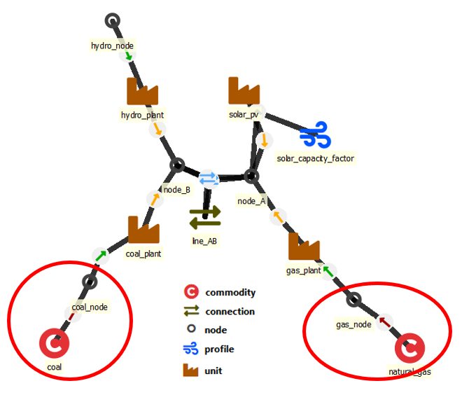

# Commodities

Some `nodes` can act as a source or a sink of commodities instead of forcing a balance between inputs and outputs. To make that happen, commodities must have a `price` and be connected to those `nodes` that serve (or buy) that particular `commodity` at the given `price`. In other words, `commodity` is separate from `node` so that the user can use the same `commodity` properties for multiple nodes. Commodities can also have a `co2_content`. The `commodity` and its `nodes` are connected by establishing a new entity between the `commodity` and each of its `nodes` (e.g. *coal--coal_market*).

- `price` - [CUR/MWh or other unit] Price of the commodity. Constant, period or time.
- `co2_content` - [tCO2/MWh] Constant.
- `price_method` - How the commodity price enters the LP. `price` (default) treats `price` as the marginal cost of every traded MWh. `price_ladder_annual` / `price_ladder_cumulative` activate a stepped supply curve authored via the parameters below; the engine then represents commodity trade as a sum of tier variables, one per ladder step.
- `price_ladder_annual` - Stepped supply curve for `price_method = price_ladder_annual`. 2d map of (tier, period) → price/volume entries. Each tier's `quantity` is a per-year amount; a solve covering less than a full year (a short solve, or one roll of a rolling solve) is only allowed its own share of that year's quantity, in proportion to the hours it covers. In a stochastic solve the forecast branches of a period use that period's ladder.
- `price_ladder_cumulative` - Stepped supply curve for `price_method = price_ladder_cumulative`. 2d map with rolling cumulative breakpoints.
- Ladder tiers (both ladders): a tier label is a name, kept as written (`1`, `01` and `a` are three different tiers); the model buys the tiers by price, whatever their labels or order. Every tier needs a `price` (a tier without one is an error). A tier without a `quantity` is unlimited.
- `unitsize` - [MWh] Numeric scaling for the `v_trade` variable (analogous to `virtual_unitsize` on units). Used with the price-ladder methods to keep tier-step variables well scaled; default 1.0.

