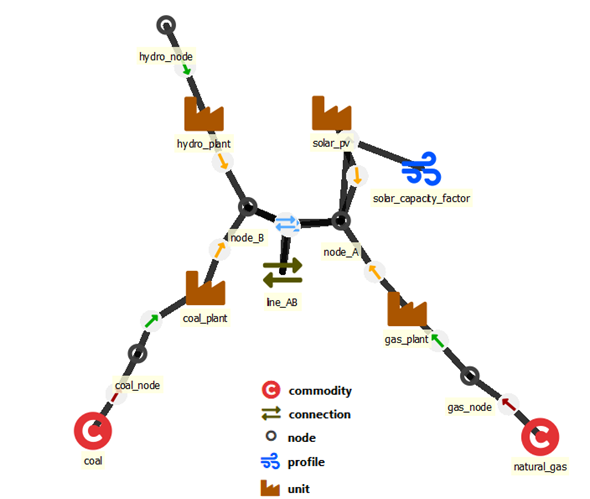
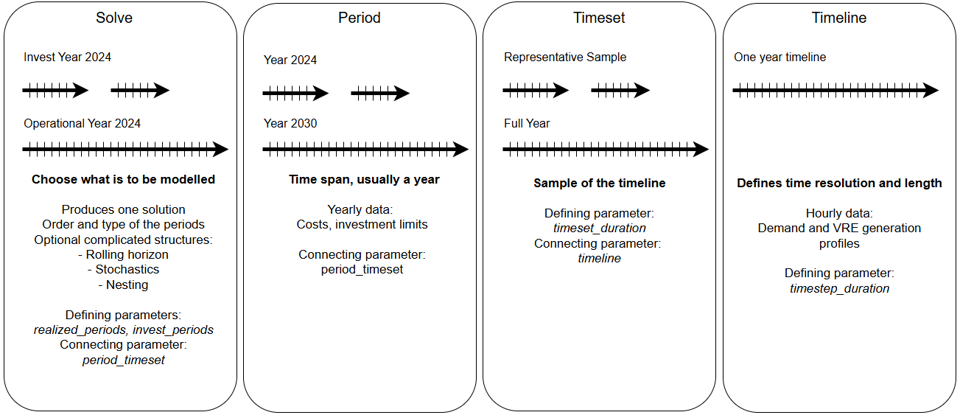

# Main entities to define a power/energy system

Elemental entities (one dimensional):

- [`node`](nodes.md): maintain a balance between generation, consumption, transfers and storage state changes (nodes can also represent storages)
- [`unit`](units.md): power plants or other conversion devices that take one or more inputs and turn them into one or more outputs
- [`connection`](connections.md): transmission lines or other transfer connections between nodes
- [`commodity`](commodities.md): fuels or other commodities that are either purchased or sold at a price outside of the model scope
- [`profile`](units.md#units-constrained-by-profiles): timeseries that can be used to constraint the behaviour of units, connections or storages
- [`reserve`](reserves.md): reserve categories to withhold capacity to cope with issues outside of model scope

Entities with two or more dimensions:

- `unit__inputNode` and `unit__outputNode`: defines the inputs, outputs and their properties for the conversion units
- `connection__node__node`: defines which nodes a connection will connect
- `unit__node__profile` and `connection__profile`: defines a profile limit (upper, lower or fixed) for an energy flow
- `node__profile`: defines a profile limit (upper, lower, or fixed) for the storage state of the node
- `commodity__node`: defines if a node is a source or sink for a commodity
- `reserve__upDown__unit__node` and `reserve__upDown__connection__node`: reserve capacity from a source to the target node

See the other pages of this section for more detailed explanations.

## How to define the temporal properties of the model

### Timesteps and periods

FlexTool has two different kinds of time varying parameters. The first one represents a regular timeline based on timesteps. The duration of each timestep can be defined by the user. There can be multiple timelines in the database - the user needs to define which timeline to use (and what parts of the timeline should be used, as will be explained later). The timestep names in the timeline are defined by the user - they can be abstract like 't0001' or follow a datetime format of choice. However, the timestep names between different timelines must remain unique (usually there should be only one timeline in a database and therefore no issues).

The second time varying dimension is `period`, which is typically used to depict assumptions about the future. One model can include multiple `solves` that the model will solve in sequence (to allow multi-stage modelling). Each solve can include multiple `periods` (so that the user can change parameter values for different parts of the future).

A parameter of particular type can be either constant/time-varying or constant/period-based. For example `inflow` is either a constant or time-varying, but it cannot be period-based (a period-keyed `inflow` is rejected; use `annual_flow` for demand that varies by period).

The time steps of a time series must be time steps of a timeline (the names are case sensitive). A time series may be longer than what the model uses (a full year with a timeset that picks two weeks is fine), but a value whose time step is not a step of any timeline of the scenario is not used: FlexTool prints a warning that names the parameter, the entities and the first such steps (for example hourly data on a 3-hour timeline, or the stamps of another year). A time series with none of its steps on a timeline is an error. The branch names of a stochastic time series and the periods of a period+time map are not time steps and are not checked; neither is a map keyed by the periods of another scenario (that entity gets no value in this scenario). Date-time stamps are compared as dates, so `2050-01-01 00:00` matches the step `2050-01-01T00:00:00`. A time series whose steps are all on a timeline of another scenario (its `timestep_duration` is in an alternative this scenario does not include) gets a warning, not an error.

The keys of a period map must be periods named somewhere in the database: in the `period_timeset`, the period lists or `years_represented` of some solve (of any scenario), the first level of `stochastic_branches`, a stochastic branch period (the period, an underscore and the branch name, such as `p2035_high`), or `model.periods_available`. A key that is none of these (a typing mistake such as `y2020` for `p2020`, or `2020`) stops the run with an error that names the entity, the parameter, the key and the closest period. When the data covers more years than the solves use (a 2020-2050 trajectory for a model that solves 2030), list the extra periods in `model.periods_available`.

**Recommendation — name the Map index for parameters that accept both `period` and `time`.** A few parameters accept *either* a period map or a time series (for example the flowGroup `min_instant_flow` / `max_instant_flow` limits, which accept "Constant, period, time or period+time"). Period and time Maps look structurally identical in Spine Toolbox — both are 1-dimensional Maps — so FlexTool tells them apart from the Map's `index_name`. Set it explicitly to **`period`** or **`time`** when authoring such a Map. If you leave the default (Spine stores it as `x`), FlexTool falls back to inspecting the Map's index *values* and matching them against the model's period and timestep names to guess the intended axis; this works when the keys clearly belong to one set, but is ambiguous if they don't. The guess is made per entity: a map whose keys are periods of another solve only (not of this one) gives that entity no value in that solve (the same as if nothing had been authored for it, so the parameter's own default applies) — it never affects any other entity's value. A map whose keys are periods of no solve in the database and no timesteps stops the run: keys that look like timesteps (`t0099`, `T0001`, a date-time stamp) with the time-series error, other keys (`p2050`) with the period-key error. Keys that match *both* a period and a timestep name are an error. Setting `index_name` removes the guesswork. (Parameters that accept only one of the two — e.g. `inflow` is time-only — are never ambiguous and need no `index_name`.)

### Timesets

Timesets pick one or more sections from the `timeline` to form a `timeset`. Each timeset defines a start and a duration. The aim of timesets is to allow the modeller to create models with representative periods often used in the investment planning.

### Definitions

- `model`: model defines the sequence of solves to be performed (e.g. first an investment solve and then a dispatch solve)

  - *solves*: sequence of solves in the model represented with an array of solve names.
  - *inflation_rate*: [e.g. 0.02 for 2%] Model-wide inflation rate applied to all future costs. When inputs are in real (constant-price) terms, set to 0 (default). When inputs are in nominal terms, set to expected inflation.
  - *inflation_offset_investment*: [years] Offset from the period (often year) start to the first payment of the investment cost annuity.
  - *inflation_offset_operations*: [years] Offset from the period (often year) start to the payment of operational costs.
  - *periods_available*: (Optional) Array of periods available for the model. Use this for periods that are in the data, but are not in period_timeset.
  - *max_flow_for_unconstrained_variables*: [MW] Upper bound for capacities and flows that have no other limit: how much capacity an entity with `invest_method` `invest_no_limit` or `invest_retire_no_limit` (or `cumulative_limits` without `cumulative_max_capacity`) can add on top of its `existing` capacity, and the flow on a unit's input or output whose `conversion_flow_coeff` is 0. The value is used as given; with several model entities the largest value is used. Keep it large enough not to limit the real solution and small enough to avoid numerical problems (see [dev/scaling.md](../dev/scaling.md)). Default 1,000,000.
  - *debug*: Instruction set for performing model debugging and testing.
  - *version*: Database schema version. Written by the migration chain — do not edit manually.
  
- `solve`: each solve is built from an array of periods (e.g. one period for 2025 and another for 2030). Periods use timesets to connect with a timeline. Parameters are split into two parameter-group tags in the master template — `solve_basics` (knobs a typical user touches) and `solve_advanced` (rolling/nested/stochastic structures, solver options, cross-solve handoff). The split is purely cosmetic in the Spine DB editor; behaviour is identical.

  - *period_timeset*: map of periods with associated timesets that will be included in the solve. Index: period name, value: timeset name.
  - *new_stepduration*: [hours] Creates a new `timeline` for this `solve`, with time steps of this length. See also the group-level `new_stepduration` for flex-temporal decomposition.

    **How the data is combined.** Each time series gets one value per new time step, combined over the time steps of the timeline that form it by a rule that depends on what the value is:

    - *Summed*: `inflow` and `energy_margin_adder` (energy per time step). A constant counts once per time step it combines.
    - *Averaged, weighted by the durations of the time steps*: commodity `price`, `co2_price`, `other_operational_cost`, `availability` of units, connections and nodes, `min_load`, `penalty_up` / `penalty_down`, `reservation`, `self_discharge_loss`, `inertia_limit`, `non_synchronous_limit`, `max_instant_flow` / `min_instant_flow` (the limit applies to the step-average flow), `timeset_weights` and `profile`. `self_discharge_loss` compounds per hour, so its mean is a close approximation (0.01 and 0.03 give 0.02; the exact rate would be 0.019951).
    - *Harmonic mean*: `efficiency` and `efficiency_at_min_load` take the mean of 1/efficiency (the fuel per output), so the fuel use of a flow that is constant over the step is exact: 0.4 and 0.5 give 1/efficiency 2.25, not 1/0.45. With a `min_load` that varies within a new time step, the `min_load_efficiency` curve of that step is an approximation (a warning names the units).
    - *Last*: `storage_state_reference_value` takes the value of the new time step's last time step (the state at its end).

    Stochastic (branch) time series are combined the same way, each branch on its own. A time series with values for only some time steps of a new time step uses the time steps it has (a warning names the parameter); the default value of the other time steps is not part of it. A new time step whose values are all equal keeps that value exactly, so a constant and an equivalent time map give the same model.

    Values of time steps that are not on the original timeline are not part of a new time step (a warning names them, see [Timesteps and periods](#timesteps-and-periods)).

    **How the steps are formed.** Steps are aggregated from the start of each `timeset_duration` block. A block that is not a multiple of the step ends with a shorter step. A gap between blocks stays a gap. When several timesets share the timeline, each period keeps its own time steps.

    **Rules and errors.** The `new_stepduration` must be a whole multiple of the timeline's time steps. On a timeline with time steps of different lengths, every new time step must end where a time step of the timeline ends. FlexTool stops with an error otherwise. All timesets used by the solve must resolve to the same underlying timeline. A timeset used by this solve cannot be used by a solve without `new_stepduration` or with a different one.

  - *realized_periods*: these are the periods the model will 'realize' - i.e., what periods will be reported in the results from this solve
  - *realized_invest_periods* Array of the periods that will realize the investment decisions. If this is not defined when the invest_periods exist, the realized_periods that are also invest_periods are used to realize the invests as well. Every realized investment period must be one of the solve's invest_periods: FlexTool stops with an error naming the solve and the periods otherwise (also for a solve that has realized_invest_periods but no invest_periods). When invest_periods is a 2D map, realized_invest_periods must be a 2D map with the same solve names.
  - *invest_periods*: array of periods in which investments can be decided in this solve (applies only to entities that can be invested in). With a construction lead time, the capacity comes online later.
  - *years_represented*: Map to indicate how many years the period represents before the next period in the solve. Used for discounting. Can be below one (multiple periods in one year). Index: period, value: years.
  - *solver*: choice of a solver. HiGHS is the default and only fully supported backend (called via the `highspy` Python bindings). CPLEX can still be wired in as an advanced option for licensed users via `solver_arguments`; see the how-to.
  - *solver_arguments*: Map of solver option name → value, forwarded verbatim to the active solver. This is where the former `highs_*` shortcuts now live. For HiGHS, set `solver` to choose the method ('simplex' or 'ipm' which is interior point method; use 'choose' for MIP models, since 'simplex' and 'ipm' will not work), `parallel` ('on' or 'off') to control parallelisation of single solves (it can be better to turn it off when executing multiple scenarios in parallel), and `presolve` ('on' or 'off') to toggle presolve (which can have a large impact on solution time when solves are large). These only affect speed, not results.
  - *solve_mode*: a single solve or a set of rolling optimisation windows solved in a sequence
  - *timeline_hole_multiplier*: [-] default 1.0. Multiplier applied to the inverse-step-duration term in the `nodeBalance_eq` for variable-step timelines. Tunes how strongly an unrepresented gap between two timesteps is amortised into the storage state equation. Leave at the default unless investigating large-step / sparse-timeline numerical issues.
  - Rolling window parameters:

    - *rolling_solve_jump*: Hours, (Required if rolling_window solve). Interval between the start points of the rolls. Also the output interval. This should be smaller than the horizon
    - *rolling_solve_horizon*: Hours, (Required if rolling_window solve). The length of the horizon of the roll. How long into the future the roll sees. For an individual roll, horizon is the solve length and jump is the output length.
    - *rolling_duration*: Hours, (Optional). Duration of rolling, if not stated, assumed to be the whole timeline of the solve

  - Nested solve sequence parameters:

    - *contains_solves*: Array of solves that are run with after this solve using the realized data of this solve. Read 'How to use Nested Rolling window solves (investments and long term storage)'
    - *fix_storage_periods*: Array of periods where this solve produces a storage-state handoff for the contained solve at the end of each listed period. The handoff carries any subset of three metrics — `fix_storage_quantity`, `fix_storage_price`, `fix_storage_usage` — selected per node by the node parameter `storage_nested_fix_method`.
  
  - Stochastic parameters:

    - *stochastic_branches*: 4D-map defining the solve's **forecast branches** — the probability-weighted possible futures. Index columns: *period*, *branch*, *analysis_time* (the branch's start timestep), *realized* (yes/no), and the value is the branch's **probability weight**. The weights are normalized to sum to one across the forecast branches at each start time. The *realized* flag is an **optional designation** (at most one branch per start time) marking which branch's data are treated as the actuals for the committed / realized-dispatch results; a realized-flagged branch is **not** a weighted member of the forecast fan. A period-indexed value (a map keyed by period, e.g. efficiency, startup cost, commodity price, availability, variable cost or a per-period limit) also applies to that period's forecast branches; a value authored for a branch period itself takes precedence. See 'How to use stochastics' for more information.
    - *stochastic_invest_method*: `none` (default) or `recourse`. `none` makes a single shared here-and-now investment plan across all forecast branches (operations still fan per branch). `recourse` gives per-branch (wait-and-see) investment: each forecast branch invests on its own data at and after the branching period, with probability-weighted investment costs and per-branch investment limits, and reports EVPI/VSS-style stochastic value. Forecast-branch (unrealized) investments are not in the normal outputs, only in the raw dump of `model.output_horizon` (a debug flag). Incompatible with Benders decomposition. See 'How to use stochastics' for the interpretation caveats.
  
  - Detail reduction parameters (see [Leaving out detail in a solve](#leaving-out-detail-in-a-solve)):

    - *reduce_unit_detail_method*: choice. Detail of units and connections this solve leaves out: integer units online, ramps, min limits or the online variables. Default `none`.
    - *reduce_system_detail_method*: choice. System detail this solve leaves out: reserves, inertia limits, non-synchronous limits or the angles of DC power flow. Default `none`.

  - For commercial solvers:

    - *solver_precommand* not used: FlexTool never runs this command. It is kept only so that older databases still read; reserve a floating licence before starting FlexTool.
    - *solver_arguments* Array of additional commands passed to the commercial solver. Made for setting optimization parameters.

- `timeset`: timesets are sets of time with a start (from timeline) and a duration (number of time steps)

  - *timeset_duration* a map with index *timestep_name* that starts the timeset and value that defines the duration of the timeset (how many timesteps). A block must start at a time step of the timeset's timeline; otherwise the run stops with an error that names the timeset and the block. A block length that is not a whole number gets a warning (the whole part is used). A block longer than the rest of the timeline is cut at the end of the timeline, with a warning that says how many time steps are not used (for a timeset with `representative_period_weights` this is an error: a representative period cannot be cut). Only the timesets that the solves of the model use are checked. The stochastic forecast branches of a period use the period's timeset, its representative periods included (every branch has the same selection and weights).
  - *timeline* The name of the timeline that the timeset uses. (String)
  - *timeset_weights*: Optional per-timestep weight map (index: timestep name, `index_name` *time* or left empty; value: float) applied to cost and slack terms in the objective. Use for non-RP models where timesteps represent unequal fractions of the year — e.g. a coarse OSeMOSYS-style timeslice structure where wet-season steps cover more year-hours than dry-season ones. Weights are normalized per period to sum to 1 and then scaled by the number of active timesteps, so uniform input reproduces weight = 1 per step (the default). Must not be combined with `representative_period_weights` on the same timeset — the runner errors out if both are set. The stochastic forecast branches of a period use the weights of the period's timeset. Any other shape (a scalar, a map indexed by *period*) is an error.

- `timeline`: continuous timeline with a user-defined duration for each timestep. Timelines are used by time series data. A time series value whose time step is not a step of any timeline is not used (a warning names the parameter and the first such steps); a time series with none of its steps on a timeline is an error.

  - *timestep_duration*: a map with *timestep_name* as an index and *duration* as a value (hours, above 0). Only the timelines a solve uses (through the timesets of its `period_timeset`, or the timeset a solve without `period_timeset` takes by default) need durations; a spare timeline without them is ignored.
  - *timeline_duration_in_years* Total duration of the timeline in years. Used to relate operational part of the model with the annualized part of the model.

### Leaving out detail in a solve

Two `solve` parameters make one solve faster by leaving out detail: `reduce_unit_detail_method` for units and
connections, `reduce_system_detail_method` for the system. The typical use is an investment solve that leaves out
unit commitment and reserves, followed by a dispatch solve with all the detail (see
[LP investment and a detailed dispatch check](../how_to/solve_sequences.md#how-to-make-an-lp-investment-and-a-detailed-dispatch-check)).

**Only reduces.** Both default to `none`, which keeps everything: the solve is then the same as without the
parameters. A level only leaves out or relaxes detail that the data gives. It never adds any, and an entity without
the feature is untouched. A level that finds nothing to leave out says so in the run log.

**`reduce_unit_detail_method`.** Each value leaves out the parts marked:

| value | integer online, `exact` | ramps | min limits | online variables |
|---|---|---|---|---|
| `none` (default) | | | | |
| `integers` | continuous | | | those without a use left out |
| `integers_ramps` | continuous | left out | | those without a use left out |
| `integers_min_limits` | continuous | | left out | those without a use left out |
| `integers_ramps_min_limits` | continuous | left out | left out | those without a use left out |
| `online` | — | | left out | left out |
| `online_ramps` | — | left out | left out | left out |

What each value removes:

- `none` removes nothing.
- `integers` removes: whole units online (they become continuous) and the `exact` connection method (those connections become *regular*).
- `integers_ramps` removes: what `integers` removes, and the ramp limits and ramp costs.
- `integers_min_limits` removes: what `integers` removes, and min load, the `capacity_min_coeff` floors and the minimum up and down times.
- `integers_ramps_min_limits` removes: what `integers` removes, the ramp limits and ramp costs, and the min limits.
- `online` removes: what `integers_min_limits` removes, and the online variables: units online, start-ups, shut-downs, start-up costs, the user constraints with a `constraint_online_coeff` term and the part-load curve of `min_load_efficiency` units. Ramp limits stay and apply to the capacity.
- `online_ramps` removes: what `online` removes, and the ramp limits and ramp costs.

Each `integers*` level also removes the online variables that nothing in the solve uses any more (see
*Online variables without a use* below).

The parts in detail:

- **Integer units online.** Units and connections with `startup_method` *binary* get continuous units online.

    The rows stay the same, so units online, start-ups and shut-downs can be fractional. A connection with
    `transfer_method` *exact* behaves as *regular*: both directions keep their own flow and losses, only the binary
    that blocks simultaneous flow in both directions goes. Without other integer variables the solve is an LP: node
    and reserve prices are LP duals, and `solver_mip_gap` no longer applies.

- **Ramps.** Ramp limits (`ramp_method` *ramp_limit* or *both* with `ramp_speed_up` / `ramp_speed_down`) and ramp costs (`ramp_method` *ramp_cost* or *both*).

    The start-up and shut-down allowance of the ramp limits goes with them. The *ramps* cost category is 0 for the
    solve.

- **Min limits.** `min_load`, the `capacity_min_coeff` floors and the minimum up and down times (`min_uptime`, `min_downtime`).

    A unit with `min_load_efficiency` keeps its part-load curve. Without the min load floor its units online can
    follow its output (units online ≈ output / capacity), so its fuel becomes close to linear in output.

- **Online variables.** The units online of every unit and connection with a `startup_method`, and with them start-ups, shut-downs, start-up costs and the min limits.

    A unit with `conversion_method` *min_load_efficiency* uses its full-load efficiency at every output: the same
    fuel at full load and less at part load. A user constraint with a `constraint_online_coeff` term is left out of
    the solve whole, with a warning that names it. Ramp limits that are kept apply to the capacity, so a unit that
    starts from zero ramps up at its ramp speed (there is no start-up allowance). `online` contains every effect of
    `integers`, so the solve is an LP.

- **Online variables without a use (`integers*` only).** After its own removals, an `integers*` level also leaves out
  the online variables of each unit or connection that nothing in the solve still uses, as if its `startup_method`
  were *no_startup*.

    The online variables are used by: a start-up cost (`startup_cost`), `min_load` and the `capacity_min_coeff`
    floors, the minimum up and down times, the part-load curve of a *min_load_efficiency* unit, a
    `constraint_online_coeff` term in a user constraint of the solve, a reserve that the unit or connection holds,
    inertia (an `inertia_constant` at a node of a group with `has_inertia`), ramp limits (their start-up and
    shut-down allowance) and, in a realization solve, the units online it takes from its parent solve. A reserve or
    an inertia limit that `reduce_system_detail_method` leaves out is no use. The ties that make the forecast branches
    of a stochastic solve have the same units online are no use either. For example, under `integers_min_limits` a
    unit with only a `min_load` loses its online variables, a unit with a start-up cost or a reserve keeps them; under
    `integers` the unit with the `min_load` keeps them.

    Without a use, the online rows only repeat the capacity limit, so the solution is the same and the solve is
    smaller. The solve's info line in the run log names these units and connections ("online variables left out
    (nothing in this solve uses them)"), and their units online and start-up cells of the solve are empty in the
    outputs. `online` and `online_ramps` leave out every online variable anyway; `none` keeps them all.

**`reduce_system_detail_method`.** Each value leaves out the parts in its name:

| value | reserves | inertia | non-synchronous | DC power flow |
|---|---|---|---|---|
| `none` (default) | | | | |
| `reserves` | left out | | | |
| `inertia` | | left out | | |
| `non_synchronous` | | | left out | |
| `inertia_non_synchronous` | | left out | left out | |
| `reserves_inertia_non_synchronous` | left out | left out | left out | |
| `dc_power_flow` | | | | lossless transport |
| `reserves_inertia_non_synchronous_dc_power_flow` | left out | left out | left out | lossless transport |

What each value removes:

- `none` removes nothing.
- `reserves` removes: the reserve requirements, the reserves that units and connections hold and the reserve shortfall penalty.
- `inertia` removes: the inertia limits and the inertia shortfall penalty.
- `non_synchronous` removes: the non-synchronous share limits and their shortfall penalty.
- `inertia_non_synchronous` removes: what `inertia` and `non_synchronous` remove.
- `reserves_inertia_non_synchronous` removes: what `reserves`, `inertia` and `non_synchronous` remove.
- `dc_power_flow` removes: the voltage angles of `dc_power_flow_with_angles` groups; their lines become lossless transport limited by capacity.
- `reserves_inertia_non_synchronous_dc_power_flow` removes: all of the above.

The parts in detail:

- **Reserves.** Every reserve requirement (`reserve__upDown__group`) and the reserve that units and connections hold, with its limits and shortfall penalty.

    In a stochastic solve the ties that make the forecast branches hold the same reserve go too. An investment
    solve without reserves invests less in flexible capacity.

- **Inertia.** The inertia limits of groups with `has_inertia` and their shortfall penalty.
- **Non-synchronous.** The non-synchronous share limits of groups with `has_non_synchronous` and their shortfall penalty.
- **DC power flow.** The angles of `dc_power_flow_with_angles` groups: the lines become lossless transport connections limited by their capacity.

    Loop flows disappear, so a meshed network can carry more than its physics allows, and an investment solve
    invests less in lines. Links with `is_DC` = *yes* keep their own method.

The capacity margin (`capacity_margin_method`) is never left out.

**Interactions.** When the unit level leaves out something that the system detail the solve keeps relies on, the
run log says so in the solve's info line:

- `online*` with reserves kept: the reserves come from built capacity, not from the capacity online.
- `online*` with inertia kept: inertia is counted from the flows (flow × `inertia_constant`), not from the units online.
- `*min_limits` or `online*` with downward reserves kept: the downward reserve can reach down to zero flow, not only to min load.
- `integers*` with a `constraint_online_coeff` term: the user constraint counts fractional units online.

**An approximation, never tighter.** Every part only removes constraints or integer restrictions, except the
full-load efficiency of `min_load_efficiency` units under `online*`, which uses less fuel than the part-load
curve. CO2 limits read that fuel, so they relax as well. The reduced solve is therefore never more constrained than
the full one.

**Across solves.** Every roll of a rolling solve uses the solve's levels. A nested solve uses its own levels, not
its parent's. A Benders decomposition can split connections whose reserves, online variables or `exact` method
the solve leaves out.

**Realization and continuing solves.** A realization solve (the dispatch of a stochastic solve's realized branch)
uses its parent solve's levels, whatever is set on it, since it takes the parent's units online and reserves. A
warning names a different value set on a declared realization solve. A solve that continues the ramp of a solve
without online variables starts its commitment and ramps cold, with an info line.

**Run log and run status.** A solve with a level other than `none` writes one info line to the run log at its
first roll: what each level left out, for how many units, connections and groups, and the interactions above.
The line names the entities when there are five or fewer, otherwise it gives their count. The entry of each roll
in `_run_status.json` records `reduced`: the two levels, and on the solve's first roll that line too.

**Which cells.** The result cells of a feature that a solve left out are empty, not 0, in the time steps that solve
realized: units online and start-ups, reserves, reserve prices and reserve shortfall, the inertia of groups,
their largest flow and inertia shortfall, the non-synchronous shortfall, and the DC angles. "Not modelled" is not
"zero". The tables of other solves that kept the feature are complete. When no solve keeps a feature, its tables
have no entity columns.

**Per-period values and costs.** A per-period cell is empty when every solve that realized the period left the
feature out. A period shared with a solve that kept the feature keeps its per-period value, in which the time
steps of the solve that left it out count as 0. Its row is labelled with the last solve that realized the period,
which may be the one that left the feature out. The costs stay: a left-out feature costs nothing in the solve.
The fuel of a `min_load_efficiency` unit under `online*` is its output divided by its full-load efficiency.

### Time structure assumptions

The tool includes some assumptions about the time structure, in case something parts are missing. These will work if there is only one option for the model to choose. The assuptions are the following:

 - If `timeset`: `timeline` is not set and only one `timeline` is defined, it is used
 - If no `timeset` is exist and only one `timeline` is defined, create a full timeline timeset
 - If `period_timeset` is defined, but no `realized_periods` or `invest_periods` exists, all periods are realized
 - If `period_timeset` does not exist and only one `timeset` exists, create `timesets` for all `realized_periods` and `invest_periods`
 - If `model`: `solves` does not exist, and only one `solve` exists, that it is used
 - If a `solve` in `model`: `solves` does not exist, create a `solve` where all `periods_available` are realized
 
 For example in the case above, it would have been possible to not fill the `timeset`: `timeline` as there is only one `timeline` to choose. Leaving out the `period_timeset` would result in an error as there are multiple `timesets` to choose.

## Units of measure
FlexTool does not check or convert units. It combines the numbers you enter as they are, so any set of units works
as long as it is consistent. The parameter descriptions, the defaults and the result labels use a default
convention because it reads well for most energy models:

- power and flows: MW; energy and storage: MWh
- money: CUR, the currency of your model (results show costs in millions, M CUR)
- emissions: tonnes of CO2
- time: hours for time steps, years for lifetimes and years represented — these are fixed, not a convention.

**A node in another unit.** A node can hold something else than electricity: water in m3, hydrogen in t, heat
that you want to label MWh_th. Set the node's `unit_of_measure` to the unit of its *amounts* (default MWh), and the
result labels of that node follow it. Time steps are hours, so the node's *rate* is the amount per hour:

| What | MWh node (default) | `unit_of_measure` m3 | `unit_of_measure` MWh_th |
|---|---|---|---|
| flows into and out of the node, unit and connection capacities on its side | MW | m3/h | MW_th |
| storage state and capacity, `inflow` per time step | MWh | m3 | MWh_th |
| flows summed over a period (annualized) | MWh/a | m3/a | MWh_th/a |
| prices, `penalty_up` / `penalty_down`, commodity `price` | CUR/MWh | CUR/m3 | CUR/MWh_th |
| `invest_cost`, `fixed_cost`, `salvage_value` of a unit whose capacity is on the node | CUR/kW | CUR per 0.001 m3/h | CUR/kW_th |
| the same of a storage node | CUR/kWh | CUR per 0.001 m3 | CUR/kWh_th |

The rule: a unit ending in `Wh` drops the `h` for the rate (MWh → MW, MWh_th → MW_th, kWh → kW), any other unit
gets `/h` (m3 → m3/h, t → t/h). The value is case-sensitive (`mwh` gives `mwh/h`). It is a label only: FlexTool
changes no number. Set the amount unit, not the rate: `m3`, not `m3/h` (FlexTool warns about a value that looks
like a rate).

**Costs per kW and kWh.** `invest_cost`, `fixed_cost` and `salvage_value` (and the group
`penalty_capacity_margin`) are entered per kW or kWh, and FlexTool multiplies them by 1000. For a node in another
unit they are per 0.001 of the rate or the amount. A desalination unit that costs 500 CUR per m3/h of capacity has
`invest_cost` 0.5 (500 × 0.001); a water tank that costs 20 CUR per m3 has `invest_cost` 0.02. The capacities
themselves are entered unchanged (2000 m3/h is 2000).

**Efficiencies** are output units per input unit: a desalination unit that makes 12 m3 of water per MWh of heat has
`efficiency` 12 [m3/MWh].

**Penalties** (`penalty_up` 10 000 CUR/MWh by default) are sized for MWh. Set them yourself for a node in another
unit, above the cost of the dearest real way to serve it.

**Which node a result follows.** A result of a node, or of a flow into or out of it, takes that node's unit. A
unit's capacity follows its output nodes (its input nodes when it has no output). When the outputs are in
different units, the label shows how the capacity is used: `MW + MW_th` when the outputs share the capacity (a unit
with several outputs or inputs, which FlexTool models with a sum of its outputs), `MW; MW_th` when each output is
only capped on its own. A connection's flow to each of its nodes takes that node's unit (`connection__leftward` /
`__rightward`). A storage node's annuity and investment cost are per its amount unit (CUR/MWh, CUR/m3): its
capacity is an amount, how much it holds. A unit's or connection's are per its rate unit (CUR/MW, CUR/(m3/h)): its
capacity is a rate.

**Mixed units of measure!** One quantity summed over nodes whose units differ has no unit, and its label is
`Mixed units of measure!`: a nodeGroup's flows over an electricity and a water node, a connection's net flow and
losses between them, a plot that stacks or sums such columns. FlexTool warns about such sets when it reads the
input data (a connection, a commodity, a nodeGroup or flowGroup, and a group capacity limit over different units).
Reserves, inertia, the non-synchronous share and the capacity margin are power features: they stay in MW, and
FlexTool warns about a member node of such a group that is not MWh (or MWh with a suffix, such as MWh_el).

You can also use other units without setting `unit_of_measure`. Then every value connected to those nodes has to
use them (prices in CUR/kg, capacities in kg/h, efficiencies between the units), and the results of those nodes
are in your units even where the label says MW or MWh.

The units written with the results (the `Units` sheet and `unit of measure` header row of the Excel workbook,
`units.csv` of the CSV output, the parquet metadata, the plot labels) follow these rules; see
[Units in the files](../results.md#units-in-the-files).
