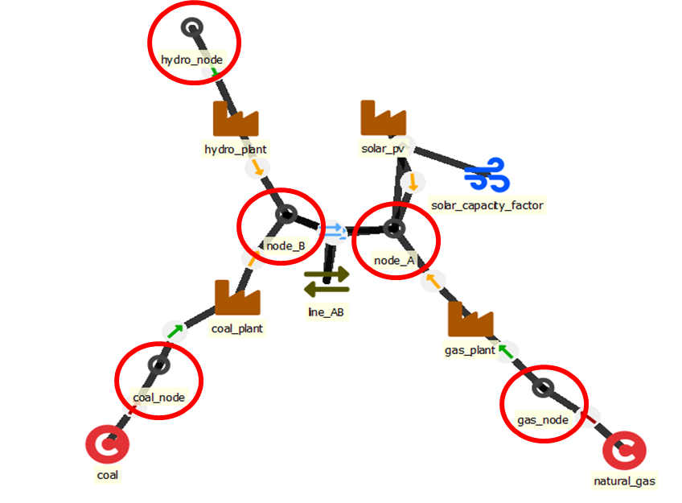

# Nodes

## Defining how the node functions

These parameters will define how the node will behave and use the data it is given (available choices are marked in *italics*):

- `name` - unique name identifier (case sensitive)
- `node_type` - role of the node in the LP (default *balance*):
    - *commodity* - price-exposed source/sink with no balance constraint (fuel imports, no storage)
    - *balance* - energy balance maintained every timestep
    - *storage* - balance plus a state variable (battery, reservoir)
    - *balance_within_period* - balance aggregated over the whole period (e.g. an annual gas budget)
- `invest_method` - Choice of investment method: either *not_allowed* or then a combination of 
    - *invest* and/or *retire* 
    - investment limits for each *period* and/or for all periods (*total*) or *no_limit* 
    - *cumulative_limits* considers investments, retirements and existing together, requires `cumulative_max_capacity` and/or `cumulative_min_capacity`
    - any method other than *not_allowed* offers storage investment (retirement) in every investment period, also without `invest_cost` (`salvage_value`) or where it is 0: that capacity has no annuity, its `fixed_cost` still counts. To forbid investment in a period, set `invest_max_period` 0 for it; a 0 in an `invest_cost` map does not.
- `inflow_method` - choice how to treat inflow time series
    - *use_original* - does not scale the original time series (no value defaults here)
    - *no_inflow* - ignores any inserted inflow time series
    - *scale_to_annual_flow* - will scale the time series to match the `annual_flow` so that the sum of inflow is multiplied by 8760/`hours_in_solve`
    - *scale_in_proprotion* - calculates a scaling factor by dividing `annual_flow` with the sum of time series inflow (after it has been annualized using `timeline_duration_in_years`)
	- *scale_to_annual_and_peak_flow* - scales the time series to match the 'annual_flow' target while transforming the time series to match the highest load with the 'peak_inflow'
- `unit_of_measure` - [text] The unit of the node's amounts, for example *m3*, *t* or *MWh_th* (default *MWh*). A label only: FlexTool converts nothing. The node's results and the inputs about it are labelled in it: flows and the capacity of a unit on its side per hour (m3 → m3/h), storage and `inflow` per time step in the unit (m3), annual results per year (m3/a), prices and penalties per the unit (CUR/m3). See [Unit of measure](#unit-of-measure).

## Unit of measure

`unit_of_measure` names what the node holds: *MWh* (the default) for electricity, *m3* for water, *t* for
hydrogen, *MWh_th* to tell heat from electricity. FlexTool uses it only for the labels of the results, the plots
and the AI assistant; it changes no number. The node's rate is its unit per hour: m3 gives m3/h for its flows and
for the capacity of a unit that delivers to it, MWh_th gives MW_th. The full rule and the table of labels are in
[Units of measure](entities_and_time.md#units-of-measure).

The inputs about the node are then in its units too:

- `inflow`, `existing`, `invest_max_total` and the other capacities: in the node's unit (m3, or m3/h for a unit's
  capacity on the node), entered as they are.
- `penalty_up`, `penalty_down`, the `price` of a commodity on the node, `other_operational_cost` of a flow into
  or out of it: per the node's unit (CUR/m3). Size the penalties for the unit: the default 10 000 is per MWh.
- `invest_cost`, `fixed_cost`, `salvage_value`: per kW or kWh in an MWh model, so per 0.001 of the rate or the
  amount here. A water tank that costs 20 CUR per m3 of storage has `invest_cost` 0.02 (20 × 0.001); a
  desalination unit that costs 500 CUR per m3/h of capacity has `invest_cost` 0.5. Its annuity in the results is
  per m3 for the tank (a storage capacity is an amount) and per m3/h for the unit (a capacity is a rate).
- `efficiency` of a unit between nodes of different units: output units per input unit (12 m3/MWh).

FlexTool warns when a connection, a commodity, a nodeGroup or flowGroup, or a group capacity limit spans nodes of
different units (their sums are labelled *Mixed units of measure!*), when a reserve, inertia, non-synchronous or
capacity-margin group has a member node that is not MWh, and when the value looks like a rate (*m3/h* instead of
*m3*).

## Data for nodes

Input data is set with the following parameters:

- `inflow` - [MWh] per time step. Energy flowing into the node in each time step (negative is outflow, e.g. demand). The value is the energy of the whole step, not a rate: on 1 h steps it equals the average MW, and on 3 h steps it is 3 × the average MW. When the step length of your data changes, rescale the values yourself, e.g. sum hourly values to get 3 h steps, or halve MW values for 0.5 h steps. FlexTool does not convert them, and time-series values whose time names are not on the timeline are ignored. FlexTool sums the values for you only when a solve's `new_stepduration` coarsens the timeline, and when a group's `new_stepduration` balances the node per coarse step. A constant value is used as the same energy in every step. Constant or time series.
- `annual_flow` - [MWh/a] Annual flow in energy units (always positive, the sign of inflow defines in/out). Constant or period.
- `peak_inflow` - [MWh] per time step. The highest inflow of a time step that the scaled inflow should reach. Used only with `inflow_method = scale_to_annual_and_peak_flow`, which then needs `annual_flow` and an `inflow` profile for every period. Use the same scale and sign as `inflow` (negative for a demand); if you change the step length, rescale it as you rescale `inflow`. Each period reaches its own `peak_inflow`; with a solve's `new_stepduration`, `peak_inflow` is matched per original time step.
- `energy_margin_method` - How the node's investment-stage energy margin is applied. Options: *none* (default, off, no scaling), *inflow_multiplier* (multiply this node's inflow by `energy_margin_multiplier` in the investment solve only) and *inflow_adder* (add `energy_margin_adder` MWh of extra demand to each time step of the investment solve only). See [How to add an energy margin for investment adequacy](../how_to/solve_sequences.md#how-to-add-an-energy-margin-for-investment-adequacy).
- `energy_margin_multiplier` - [factor] Multiplier applied to the node's inflow in the investment solve only, when `energy_margin_method = inflow_multiplier`. Default 1 (no effect). A value of 1.1 makes the investment stage build for ~10% more demand, so the built capacity meets the true demand under the true (lower) annual VRE availability. Dispatch solves always see the true, un-margined inflow. The margin does not enter the reserve requirement (a group `increase_reserve_ratio`), the non-synchronous limit or the capacity margin, which follow the real demand (set `capacity_margin` for a capacity surplus). Constant.
- `energy_margin_adder` - [MWh] per time step of the timeline. Extra demand (negative inflow) added to every time step of the investment solve, when `energy_margin_method = inflow_adder`. The value is not a total that is divided over the steps: each time step gets the full value. On a timeline of 24 h time steps, a margin of 10 MW needs a value of 240. When the investment solve uses `new_stepduration`, a solve step gets the sum of the values of the time steps it combines (a constant or period value counts once per time step: on 4 h solve steps of an hourly timeline, 10 adds 40 MWh per solve step). Default 0 (no effect). Adds a fixed amount of demand rather than scaling existing demand, so it also works on a node with no native inflow (e.g. a zero-inflow slack node) where the multiplier is a no-op. Dispatch solves always see the true, un-margined inflow. Like the multiplier, the added demand does not enter the reserve requirement, the non-synchronous limit or the capacity margin. Constant, period or period+time.
- `existing` - [MWh or count] Existing storage capacity or number of storage units (requires `node_type=storage`). If `virtual_unitsize` is given, then `existing` is the number of units (capacity = `existing` × `virtual_unitsize`). Otherwise `existing` is the existing capacity of a single unit (typically in MWh). Constant or period.
- `invest_cost` - [CUR/kWh] Overnight investment cost of new storage capacity. It is paid as an annuity over the years the storage capacity operates. Construction time costs with their interest must be included here. Constant or period: the value of the period when the storage capacity is built (comes online) is used.
- `salvage_value` - [CUR/kWh] Salvage value of the storage. A retirement earns it as an annuity over `lifetime` (see [retirements](units.md#retirements)). Constant or period.
- `lifetime` - [years] Operating lifetime of the storage capacity. It starts when the storage capacity starts to operate: with a construction lead time, after the construction. Used with the discount rate to calculate the annuity. What happens at the end of the lifetime depends on `lifetime_method`: *reinvest_automatic* keeps the storage capacity to the end of the model horizon, *reinvest_choice* retires it, *no_investment* retires it once. The `existing` storage ends at the first year of the model run plus the `lifetime` of the first period (in every solve of a chain of solves). Constant or period.
- `construction_lead_time` - [years] Time from the investment decision until the storage capacity starts to operate. The start is rounded to the start of a period (see `construction_lead_time_method`). Investments whose rounded start is after the end of the solve or the model horizon are not offered, with a warning. Constant or period. Default 0. See [construction lead time](../how_to/investment.md#how-to-make-investments-storageunit).
- `construction_lead_time_method` - How the start of operation (decision year plus `construction_lead_time`) is rounded to the start of a period: *immediate* (no lead time, the storage capacity operates from the decision period), *closest_seam* (the nearest period start; a tie goes to the later one), *previous_seam* (the period start before), *next_seam* (the period start after). Without a value: *immediate* when there is no lead time, else *closest_seam*.
- `discount_rate` - [e.g. 0.05 equals 5%] Discount rate for investments (WACC). Reflects the financing cost and risk for this technology. Should be nominal when model `inflation_rate` > 0, real when `inflation_rate` = 0. Constant or period.
- `invest_max_total` - [MWh] Largest allowed total storage investment over all solves. Every investment decision counts, also reinvestments and investments that are no longer in service; retirements and existing capacity do not reduce it (to limit the capacity in service, use `cumulative_max_capacity`). Constant.
- `invest_max_period` - [MWh] Largest allowed storage capacity coming online in each period. Existing capacity and retirements do not change it. With a construction lead time, the investment is decided earlier. Constant or period. A period map must give a value for every period in which capacity of the solve comes online: its investment periods, or with a construction lead time the periods the investments start to operate in (a missing period is an error).
- `invest_min_total` - [MWh] Smallest required total storage investment over all solves, counted as for `invest_max_total`. Constant.
- `invest_min_period` - [MWh] Smallest required storage capacity coming online in each period, counted as for `invest_max_period`. Constant or period. A period map must give a value for every period in which capacity of the solve comes online: its investment periods, or with a construction lead time the periods the investments start to operate in (a missing period is an error).
- `retire_max_period` / `retire_min_period` - [MWh] Largest allowed / smallest required retirement of storage capacity in each period. Counts only what is retired in that period. Only `existing` storage can be retired (see [retirements](units.md#retirements)). Constant or period. A period map must give a value for every investment period of the solve (a missing period is an error).
- `retire_max_total` / `retire_min_total` - [MWh] Largest allowed / smallest required total retirement over all solves. Investments and existing capacity do not change it. Constant.
- `cumulative_max_capacity` - [MWh] Maximum cumulative capacity (considers existing, invested and retired capacity). Constant or period. A period map must give a value for every investment period of the solve (a missing period is an error).
- `cumulative_min_capacity` - [MWh] Minimum cumulative capacity (considers existing, invested and retired capacity). Constant or period. A period map must give a value for every investment period of the solve (a missing period is an error).
- `fixed_cost` - [CUR/kWh/a] Annual fixed cost for storage. New storage capacity pays it only while it operates. Constant or period.
- `penalty_up` - [CUR/MWh] Penalty cost for energy not served (decreasing consumption) in the node. The cost scales with both the magnitude (MW) and the duration (hours) of the violation. Default value is 10 000. Constant, period, time, period+time or stochastic time. The default applies to every node without a value of its own, and to the periods and timesteps that a map leaves out.
- `penalty_down` - [CUR/MWh] Penalty cost for excess energy (increasing consumption) in the node. The cost scales with both the magnitude (MW) and the duration (hours) of the violation. Default value is 10 000. Constant, period, time, period+time or stochastic time. The default applies to every node without a value of its own, and to the periods and timesteps that a map leaves out.
- `virtual_unitsize` - [MWh] Size of one unit. With it, `existing` is the number of units. Investments and retirements are continuous; their limits are in MWh. No value: the existing capacity, or 1000 MWh without it.
- `self_discharge_loss` - [-] e.g. 0.01 means the content shrinks by the factor 1/1.01 every hour. Loss of stored energy over time: the content decays continuously at ln(1 + loss) per hour, for every modelled time step whatever its length; energy charged or discharged within a step is treated as spread evenly over the step. Constant, period, time or period+time (a time-varying loss decays each step at its own rate; a coarse step or timeset block decays by the sum of its hours' losses; this is exact for stored energy, while energy charged within such a step is weighted as if the loss were constant over the step, which overstates what is kept when the loss changes a lot inside the step).
- `availability` - [e.g. 0.9 means 90%] Fraction of capacity available for storage. Constant, period, time, period+time or stochastic time.
- `invest_forced` - [MWh] Forces exactly this much new storage capacity to come online in the period, overriding the investment optimisation (as setting `invest_min_period` and `invest_max_period` equal). Constant or period.
- `constraint_state_coeff` - A map of coefficients (Index: constraint name, value: coefficient) placing the storage state variable on the left side of a user-defined `constraint`. See [User constraints](user_constraints.md).
- `constraint_invested_capacity_coeff` - A map of coefficients (Index: constraint name, value: coefficient) putting the storage capacity that comes online in each period on the left side of a user-defined `constraint`. Without a construction lead time, this is the storage capacity invested in that period. Coefficient per MWh. See [User constraints](user_constraints.md).
- `constraint_cumulative_pre_built_capacity_coeff` - A map of coefficients (Index: constraint name, value: coefficient). Puts the storage capacity in service at the start of each period on the left side of the user constraint. This is existing capacity plus capacity that came online in earlier periods, minus earlier retirements. Capacity coming online in the period itself is in the invested term. Coefficient per MWh. See [User constraints](user_constraints.md).
- `constraint_capacity_coeff` - A map of coefficients (Index: constraint name, value: coefficient). Puts the node's storage capacity in service in each period on the left side of the user constraint (existing plus investments still in service minus retirements). Coefficient per MWh. Capacity in construction is not included. See [User constraints](user_constraints.md).
- `constraint_retired_capacity_coeff` - A map of coefficients (Index: constraint name, value: coefficient). Puts the storage capacity retired in each period on the left side of the user constraint. Coefficient per MWh. See [User constraints](user_constraints.md).
- `constraint_in_construction_capacity_coeff` - A map of coefficients (Index: constraint name, value: coefficient). Puts the storage capacity in construction in each period on the left side of the user constraint. Capacity is in construction from the period of the investment decision until it comes online. It is zero without a construction lead time. Coefficient per MWh. See [User constraints](user_constraints.md).
- `node__profile` with `profile_method` - limits the storage state with a profile (*upper_limit*, *lower_limit*, *fixed*; the profile is a share of the storage capacity). The default is *none*: the profile is not applied, and FlexTool warns about a link without a `profile_method`. An *upper_limit* or *fixed* link to a profile without a value in the scenario stops the run with an error (it would hold the storage state at 0). See [units constrained by profiles](units.md#units-constrained-by-profiles).

## Using nodes as storages

FlexTool manages storages through nodes. A regular node maintains an energy/material balance between all inputs and outputs (`node_type=balance`). A storage node includes an additional state variable, which means that the node can also use charging and discharging of the storage while maintaining the energy balance. A storage node is created by setting `node_type=storage` and by adding storage capacity using the `existing` parameter and/or by letting the model invest in storage capacity (`invest_method`, `invest_cost`, `invest_max_period` and `invest_max_total` parameters).

Since FlexTool allows different temporal structures (multi-periods, rolling optimization, etc.) there needs to be ways to define how the storages behave when the model timeline is not fully consequtive. By default, storages are forced to match start level to the end level within timesets. This is an acceptable setting for small storages that do not carry meaningful amounts of energy between longer time periods in the model.

There are three methods associated with storage start and end values: `storage_binding_method`, `storage_start_end_method` and `storage_solve_horizon_method`. 

- The most simple one of these is the `storage_start_end_method` and it overrides the other methods, since it forces the start and/or the end state of the storage to a predefined value based on the proportional parameters `storage_state_start` and `storage_state_end` (proportional means that the parameter needs to be set between 0-1 and will be scaled by the storage capacity in the model). The default is *fix_nothing* (the start and the end are not fixed). *fix_start* needs `storage_state_start` on the node and *fix_end* needs `storage_state_end`; *fix_start_end* needs both. A node that fixes a start or an end without its value stops the run with an error naming every such node, the method and the missing parameter (set the value, or a method that does not fix that end). In older databases the default was *fix_start*, and a fix without its value was not applied, or pinned the node at 0 when another node had a value; the upgrade rewrites such stored methods to what they did (*fix_nothing*, or a value of 0) where every scenario of the database used them the same way, and lists them (results unchanged). A node that used the old default with its own `storage_state_start` gets *fix_start* written in that value's alternative (results unchanged). Where scenarios differ, the method is left and the error names the scenarios. Storage nodes that relied on the old default now start free; in a model where another node had a `storage_state_start` they started at 0 (or at their own value) before, and runs of an upgraded database name them (see "Behaviour-change notices" below). These two parameters affect only the first and the last timesteps of the entire model (even when the model has more than one solve). A later solve or roll starts from the storage state realised before it: the end of the realised part of the previous roll or solve at the same nesting level or below (so a storage or investment solve continues from the dispatch solved below it). In nested solves the start applies to the first step of each nested level where the level first appears; a cyclic binding method (*bind_within_timeblock*, *bind_within_period*, *bind_within_solve*, a looping *bind_intraperiod_blocks*) cycles within each later solve without the start value, and a representative-period node (*_blended_weights*) starts each block from its own free start state. The end value (*fix_end*, *fix_start_end*) applies to the last timestep of the entire model, in every solve whose horizon contains that timestep: e.g. both an investment solve and the last dispatch solve (or roll) when both reach the end of the model, the solve of each nested level that contains it, and a roll whose look-ahead reaches it; a solve whose horizon ends earlier is not pinned. In a stochastic solve each terminal branch ends at it. Where an upper-level solve fixes the storage at that step with `storage_nested_fix_method` *fix_quantity* or *fix_usage*, the upper solve's value takes precedence; *fix_price* only values that end, so the end value still applies. `storage_start_end_method` is meant for simple models: in a model with several solves or rolls `storage_state_reference_value` with `storage_solve_horizon_method` *use_reference_value* is usually the better choice, since it guides the storage at the end of every solve horizon (from a time series when one is available), not only at the end of the model.
- `storage_binding_method` chooses the cycle-closure scope for the storage state over discontinuities in the model timeline. There are seven cycle-scope methods plus one orthogonal aggregation method. See the parameter description in `flextool/schemas/spinedb_schema.json` for the canonical enumeration; in short:
    - *bind_within_timeblock* — state cycles within each timeblock (block start = block end + flows); in a rolling solve within the timeblock's part in the roll. With `fix_start` the start state is pinned at the last step of the first timeblock (in a rolling solve, of its part in the roll), the state the first step starts from.
    - *bind_within_period* — state cycles within each FlexTool period; blocks chain inside the period; in a rolling solve within the period's part in the roll.
    - *bind_within_solve* — state cycles across the whole solve horizon; in a rolling solve across each roll. With `fix_start` the start state is pinned at the last step of the solve, the state the first step starts from (*bind_within_period*: at the last step of the first period). In a stochastic solve the cycle closes once per path: the last step of every forecast branch ends at the level the solve's first step starts from; when the forecasts open in the solve's first period, each forecast's first step continues from the last step of its own path, so they all start from the same level. With `storage_start_end_method` *fix_start* (or *fix_start_end*) the start of each forecast is pinned to the given share (`storage_state_start`) of that forecast's own storage capacity, so where the capacity differs by forecast (investment or divestment per forecast) the starting energy differs although the share is the same; without a fixed start all the forecasts start from the same level.
    - With these three methods the storage level is not carried from one roll of a rolling solve to the next.
    - *bind_forward_only* (default) — state chains forward across the solve; no end-to-start closure. In a stochastic solve whose forecasts open in the solve's first period, all the forecasts start from the same level (the carried state, or without one a single free level). The exception is `fix_start` (or `fix_start_end`): each forecast's start is the `storage_state_start` share of its own storage capacity, so the starting energy differs between forecasts whose capacity differs (investment or divestment per forecast).
    - *bind_within_solve_blended_weights*, *bind_within_period_blended_weights*, *bind_forward_only_blended_weights* — representative-period variants of the three above. They apply RP weighting on top of the same cycle scope. With several periods each period uses its own representative periods and base periods (also when periods share a timeset); *bind_within_solve_blended_weights* and *bind_forward_only_blended_weights* chain the periods in solve order like *bind_within_solve* / *bind_forward_only*. With a blended variant every period of the solve needs a timeset with `representative_period_weights`. In a stochastic solve each forecast branch period uses the representative periods of the period it branches from, and each branch is independent: its first period continues from the last base period of the trunk period (the shared period before the split), a later period from the previous period of the same branch. *bind_within_solve_blended_weights* closes once per path: every branch's last period ends at the level the trunk period starts from. *bind_within_period_blended_weights* closes every branch period on itself. When the forecasts open in the solve's first period, all of them start from the same level (*bind_within_solve_blended_weights* through its closure, *bind_forward_only_blended_weights* through an equal chain start, also with `fix_start`, which pins the state in the first block). Inside the non-anticipativity window of a node in an `include_stochastics` group the start levels of the representative blocks are the same in every forecast. In a rolling solve (`solve_mode` *rolling_window*) the blended variants are not applied: those nodes bind forward only (*bind_forward_only*) and the storage state is passed directly from roll to roll; a warning names them once per solve (so a rolling solve that mixes periods with and without representative periods does not stop for them either).
    - *bind_intraperiod_blocks* — orthogonal aggregation method: state is held constant within each block and the energy balance of the node is summed over each block (every flow stays at the solve's time step); the blocks of a period form a loop, and the state of a block is its state at the end of the block. With `fix_start` the start state is pinned at the end of the first period's last block, the state the first block starts from. In a rolling solve (`solve_mode` *rolling_window*) the blocks of each roll also end at the end of the roll's realized part. A period that the roll holds whole loops as above (so a single roll over the whole timeline gives the same result as a solve that is not rolling). In a period that the roll holds only in part, the blocks chain forward: the first block of the period continues from the previous step of the roll, and the storage level is carried from roll to roll, as for *bind_forward_only*. When the roll's first period is held in part, the roll starts from `fix_start` (first roll) or from the level carried from the previous roll. With neither (`fix_nothing`), the first block has no state change, so its flows must balance on their own. Without a loop, `storage_solve_horizon_method` sets the end of the roll; it also sets the end of a period held in part when the next period of the roll is held whole (that period loops, so nothing continues from the end of the part). A `rolling_solve_jump` that is a whole number of periods keeps every realized period looping; otherwise a warning is given.
  - Silent-degrade behaviour: any `*_blended_weights` method on a node in a solve whose active timeset has no `representative_period_weights` is automatically downgraded to the corresponding non-RP variant for that solve. The same storage entity can therefore drive an RP investment solve and a chronological dispatch solve back-to-back without changing the parameter value.
  - Older databases: the parameter used to take an array of methods, and three methods had other names (*bind_within_timeset* → *bind_within_timeblock*, *bind_using_blended_weights* → *bind_within_solve_blended_weights*, *bind_within_model* → *bind_within_solve*). Migration reduces an array to one method, by priority, and renames the old methods.
- `storage_solve_horizon_method` is meant for models that roll forward between solves and have an overlapping temporal window between those solves (e.g. a model with 36 hour horizon rolls forward 24 hours at each solve - those 12 last hours will be overwritten by the next solve). In these cases, the end state of the storage will be replaced by the next solve, but it can be valuable to have some guidance for the end level of storage, since it will affect storage behaviour. There are three methods: *free* is the default and will simply let the model choose where the storage state ends (usually the storage will be emptied, since it would have no monetary value). *use_reference_value* will use the value set by `storage_state_reference_value` (a share of the storage capacity in the period, invested storage included) to force the end state in each solve (the last step of its last period and of each stochastic branch of it) to match the reference value (not for a node whose `storage_binding_method` ties its end to its start: *bind_within_timeblock*, *bind_within_period*, *bind_within_solve* and *bind_intraperiod_blocks* (in a rolling solve only when the roll holds its last period whole: otherwise its blocks chain forward and the pin applies, also at the end of a period held in part that a period held whole follows), including a *_blended_weights* node in a solve without representative periods, which uses the method without *_blended_weights*). In a solve with representative periods the *_blended_weights* nodes keep the end pin: it applies to the state at the end of the last representative block, which their base-period chain does not tie to the start. *use_reference_price* assigns a monetary value (in CUR per energy unit, consistent with other commodity prices) to the storage content at the end of the solve horizon — only at the last `(d, t)` of the solve's last period (and of each stochastic branch of it), not at every roll boundary or at the end of an earlier period of a multi-period solve, also when the periods share a timeset — using the `storage_state_reference_price` parameter; the model is then free to choose how much it stores at the end of horizon based on this monetary value. In a nested lower-level solve, where the upper-level solve fixes the storage at the end of the horizon (`storage_nested_fix_method` *fix_quantity*, *fix_usage* or *fix_price*), the upper solve's value overrides the *use_reference_value* end value at that step. The objective term is **negative** (`−Σ storage_state_reference_price × v_state_end × unitsize × weight_factors`), so a higher terminal state reduces the objective, offsetting the operational cost of leaving energy in storage.

  > **Note: reference-price credit is in the solver objective but
  > not in the calculated cost totals.**  The credit above influences the
  > solver's optimization but is **omitted** from the
  > `costs_discounted_d_p` / `costs_discounted_p_` parquet files and
  > the `summary_solve.csv` totals — it is an artificial endogenous
  > valuation, not a real-world cost. End-of-horizon storage valuation
  > has several valid interpretations and is typically computed as
  > post-analysis rather than as part of the reported cost breakdown.
  > If needed, compute the credit from last-timestep `v_state` values
  > and the `storage_state_reference_price` parameter yourself.

-Method hierarchy:

  1. `storage_start_end_method`
  2. `storage_binding_method`
  3. `storage_solve_horizon_method`

-Meaning:

  - The `storage_binding_method` is ignored (exeption *bind_forward_only*), if `storage_start_end_method` has the value *fix_start_end*: such a node chains forward like *bind_forward_only* (a *_blended_weights* method like *bind_forward_only_blended_weights*), so that the start and the end can take different values. A *bind_intraperiod_blocks* node keeps its timeset blocks, which then chain forward from period to period instead of looping within each period,
  - The `storage_solve_horizon_method` *use_reference_value* is ignored, if other storage state methods are used. Only exeptions are *fix_start* or *bind_forward_only*

-Nested Parameters:

- `storage_nested_fix_method`: Sets this storage as a long-term storage whose end state at the period boundary is passed to the contained lower-level solve as a constraint. Available choices:
    - *fix_nothing* (or *no*) — no handoff for this node (default).
    - *fix_quantity* — pins the lower solve's storage state at the boundary to the parent-solved level (`v_state` equality at the last `(d, t)` of each `fix_storage_periods` entry, via `node_balance_fix_quantity_eq_lower`).
    - *fix_price* — gives the lower solve a per-MWh price tier `p_fix_storage_price` (taken from the parent solve's node price `price_t` at the fix step, or from `storage_state_reference_price`); the lower solve then chooses its own boundary state, paying this price for the energy it holds. Uses the same `storage_state_reference_price`-driven objective term described in the `use_reference_price` paragraph.
    - *fix_usage* — passes the *change* in storage between the solve start and the boundary (i.e. net energy charged or discharged across the dispatch window) as a less-than-or-equal cap `p_fix_storage_usage`, enforced by `node_storage_usage_fix_le`. Useful when the parent solve cares about total throughput rather than the absolute level.
  A parent solve may set any subset of the three metrics per node — the carriers are independent and each travels as its own `handoff/fix_storage_*` Provider key.
