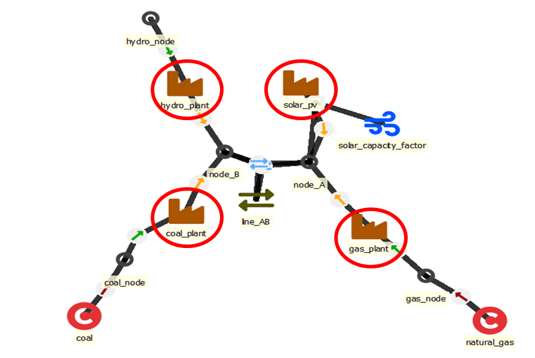

# Units

Units convert energy (or matter) from one form to another (e.g. open cycle gas turbine), but the can also have multiple inputs and/or outputs (e.g. combined heat and power plant). The input nodes are defined with the entity `unit--inputNode` while the output nodes are defined through the entity `unit--outputNode`.

## Defining how the unit functions

- 'conversion_method' to define the way unit converts inputs to outputs 
- `startup_method` - Choice of startup method. 'Linear' startup means that the unit can start partially (anything between 0 and full capacity) but will face startup cost as well as minimum load limit based on the capacity started up. 'Binary' startup means that the unit is committed in whole-unit steps — the online status is a general-integer variable in [0, capacity / unit_size], so the solver must branch on integer commitment.  The time penalty relative to linear is **not** from "binary vs integer" — FlexTool uses one general-integer variable per process per timestep in both binary and the virtual-unitsize cluster form, never N independent 0/1 plants.  The penalty comes from the **granularity** of the decision: if `unit_size` equals the full plant (say 1000 MW), every on/off flip moves 1000 MW of dispatch, the LP relaxation rounds badly, and primal heuristics struggle.  Setting `virtual_unitsize` to a smaller value (e.g. 50–200 MW) keeps the whole-unit semantics but represents the fleet as finer commitment decisions; this is the clustered-UC form and is normally essential to solve a UC model in reasonable time.  See also the [How to make the Flextool run faster](../how_to/index.md) note.
- `minimum_time_method` - Choice between minimum up- and downtimes: *none* (default, no constraints), *min_uptime*, *min_downtime*, *both*. When set to anything other than *none*, online variables are automatically activated (at least linear startup) even if `startup_method` is not explicitly set. This enables the unit commitment tracking needed for minimum time constraints.
- Online status along the timeline: the units online in a step are linked to the previous step as ramp limits link flows (within a period, into a period that continues the previous one on the same timeline, into a forecast branch's first step). A step with no previous step (the first step of a solve or of a period that does not continue the previous one, the step after a gap in the timeline, a representative-period start) is linked to the last step of its own stretch of the period (up to the next gap or the period end): the commitment cycles within the stretch and never across a gap, a representative-period start or into another period. In a rolling solve the units online that the previous roll realized carry over to the next roll's steps that continue its last realized step on the timeline, by position in time (so also into a solve with longer time steps); a roll starting after a gap, at a new year that reuses the timeset or at a representative-period start takes no carry. The same applies to connections with `startup_method`.

## Main data items for units

- Capacity: `existing` - [MW or count] Existing capacity or number of units. If `virtual_unitsize` is given, then `existing` is the number of units (capacity = `existing` × `virtual_unitsize`) — see `virtual_unitsize` below. Otherwise `existing` is the existing capacity of a single unit (typically in MW). Constant or period.
- Technical: `efficiency`, `min_load`, `efficiency_at_min_load`, `min_uptime`, `min_downtime`
	- `efficiency` - [-] Output / input of the unit at full load (each flow weighted by its `conversion_flow_coeff`). It may be above 1: a heat pump with COP 3 has `efficiency` 3, and a desalination unit with an electricity input and a water node output in m³ has the m³ per MWh ratio (e.g. 250). The unit's capacity is on its output side (m³/h for the desalination unit), so its input capacity factor (`unit_cf__inputNode`) is 1/`efficiency` when the unit runs at full load (1/3 for the heat pump). With a very large ratio (above about 10 000 × the unit size: `virtual_unitsize`, else `existing`, else 1000; lower with sub-hour time steps or a `non_synchronous_limit`), the input coefficients fall below the `model` parameter `small_number_threshold` (default 0.0001) and become 0, so the unit draws no input and its output is free. Lower `small_number_threshold` or rescale the output unit of measure. Constant, period, time, period+time or stochastic time.
	- `min_uptime` - [hours] Minimum time the unit must stay online after starting up. Requires `minimum_time_method` set to *min_uptime* or *both*. The constraint looks back over the time steps before each step and adds up their durations, so it accounts for variable timestep durations. The look-back follows the timeline as ramp limits do: it continues into a period whose time steps continue the previous period's on the same timeline and, in a stochastic solve, into the steps before a forecast branch starts; it stops at a gap in the timeline (the minimum time restarts after the gap), at the start of a representative period, at a period that reuses the same timeset as the previous one and at the first step of a solve (no cyclic wrap). In a rolling solve the start-ups that the previous roll realized count for the steps of the next roll that continue its last realized step on the timeline (as the ramp continues: also into a continuing period and every forecast branch that starts there); a solve with longer time steps continues the realized step that ends where its own previous step ends (by position in time). A warning is printed only when a solve continues the timeline of an earlier solve with a hole or an overlap between its first step and the earlier solve's last realized step, since no realized on-line history reaches it. Constant.
	- `min_downtime` - [hours] Minimum time the unit must stay offline after shutting down. Requires `minimum_time_method` set to *min_downtime* or *both*. The look-back works as for `min_uptime`, with shut-downs. Constant.
	- `min_load` - [0-1] Minimum load of the unit. Applies only if the unit has an online variable. With linear startups, it is the share of capacity started up. Constant, period, time, period+time or stochastic time. Applied once per unit, for all timesteps:
  
      - the sum of the unit's output flows >= min_load * online capacity
      
      The output flows are the ones that define the unit's capacity: all outputs with a non-zero `conversion_flow_coeff` (for a unit with one input and one output, its single flow; for a unit without outputs, its input). Inputs never have their own minimum: a unit with several inputs can run on any mix of them (use `input_share_min` to require a share of an input). The floor is not scaled by `availability`, so a unit whose availability falls below `min_load` cannot be online. `capacity_min_coeff` on an output does not lower this floor; to lower or switch off the minimum load, lower `min_load` (0 switches it off; no value means 0, so a unit with an online variable does not need a `min_load`). Downward reserve (and upward reserve at an input node, i.e. reduced consumption) offered by the unit cannot take its outputs below this floor (see [Reserves](reserves.md)).

	- `efficiency_at_min_load` - [-] Output / input at minimum load, like `efficiency` (e.g. 0.4; may be above 1). Efficiency of a `min_load_efficiency` unit at its minimum load; the fuel use is linear between minimum load at this efficiency and full load at `efficiency`. Matters only for a unit with a `min_load` above 0 (with `min_load` 0 the unit uses `efficiency`). Without a value (or for the periods or timesteps a map leaves out) the unit uses `efficiency` at minimum load too, i.e. a flat curve as with *constant_efficiency*, while its minimum load still applies; a warning names such units. Constant, period, time or period+time.

  - `availability` - [e.g. 0.9 means 90%] Fraction of capacity available for flows from/to the unit. For online units, the online variable is multiplied by the availability. Constant, period, time, period+time or stochastic time.
- Economic: `startup_cost` ([CUR/MW] cost of starting up one MW of capacity; constant or period), `fixed_cost` (fuel cost comes through the use of fuel commodities and other variable costs are defined for flows between unit and node, see below)

## Investment parameters for capacity expansion

With `virtual_unitsize`, investment and retirement limits stay in MW; the amounts are not whole units.

- `invest_method` - Choice of investment method: either *not_allowed* or then a combination of 
    - *invest* and/or *retire* 
    - investment limits for each *period* and/or for all periods (*total*) or *no_limit* 
    - *cumulative_limits* considers investments, retirements and existing together, requires `cumulative_max_capacity` and/or `cumulative_min_capacity`
    - any method other than *not_allowed* offers investment (retirement) in every investment period, also without `invest_cost` (`salvage_value`) or where it is 0: that capacity has no annuity, its `fixed_cost` still counts. To forbid investment in a period, use a *period* method (*invest_period*, *invest_period_total* and their *invest_retire_* forms) and set `invest_max_period` 0 for it: the other methods do not use `invest_max_period`. A 0 in an `invest_cost` map does not forbid it.
- `lifetime_method` to choose how the investments behave after unit runs out of lifetime. Automatic reinvestment (reinvest_automatic - default) causes the model to keep the capacity until the end of model horizon and applies the annualized investment cost until the end of model horizon without further choice by the model. Choice of reinvestment (reinvest_choice) removes the capacity at the end of the lifetime and the model needs to decide how much new capacity is to be built. One-shot investment (no_investment) allows the model to invest freely within the first-period lifetime window (subject to the usual invest_method / invest_max_period caps) but pins v_invest to zero for any period after that window — the asset retires once and cannot be rebuilt. Use for physical one-off additions such as plant refurbishments that cannot be repeated at the same cost. If there is a need to remove the possibility to invest after lifetime, then the investment limits can be used.
- `invest_cost` - [CUR/kW] Overnight investment cost of new capacity. It is paid as an annuity over the years the capacity operates. Construction time costs with their interest must be included here. Constant or period: the value of the period when the capacity is built (comes online) is used.
- `salvage_value` - [CUR/kW] Salvage value of the unit capacity. A retirement earns it as an annuity over `lifetime` (see [retirements](#retirements)). Constant or period.
- `lifetime` - [years] Operating lifetime. It starts when the capacity starts to operate: with a construction lead time, after the construction. Used with the discount rate to calculate the annuity. What happens at the end of the lifetime depends on `lifetime_method`: *reinvest_automatic* keeps the capacity to the end of the model horizon, *reinvest_choice* retires it, *no_investment* retires it once. The `existing` capacity ends at the first year of the model run plus the `lifetime` of the first period (in every solve of a chain of solves). Constant or period.
- `construction_lead_time` - [years] Time from the investment decision until the capacity starts to operate. The start is rounded to the start of a period (see `construction_lead_time_method`). Investments whose rounded start is after the end of the solve or the model horizon are not offered, with a warning. Constant or period. Default 0. See [construction lead time](../how_to/investment.md#how-to-make-investments-storageunit).
- `construction_lead_time_method` - How the start of operation (decision year plus `construction_lead_time`) is rounded to the start of a period: *immediate* (no lead time, the capacity operates from the decision period), *closest_seam* (the nearest period start; a tie goes to the later one), *previous_seam* (the period start before), *next_seam* (the period start after). Without a value: *immediate* when there is no lead time, else *closest_seam*.
- `discount_rate` - [e.g. 0.05 equals 5%] Discount rate for investments (WACC). Reflects the financing cost and risk for this technology. Should be nominal when model `inflation_rate` > 0, real when `inflation_rate` = 0. Constant or period.
- `invest_max_total` - [MW] Largest allowed total investment over all solves. Every investment decision counts, also reinvestments and investments that are no longer in service; retirements and existing capacity do not reduce it (to limit the capacity in service, use `cumulative_max_capacity`). Constant.
- `invest_max_period` - [MW] Largest allowed capacity coming online in each period. Existing capacity and retirements do not change it. With a construction lead time, the investment is decided earlier. Constant or period. A period map must give a value for every period in which capacity of the solve comes online: its investment periods, or with a construction lead time the periods the investments start to operate in (a missing period is an error).
- `invest_min_total` - [MW] Smallest required total investment over all solves, counted as for `invest_max_total`. Constant.
- `invest_min_period` - [MW] Smallest required capacity coming online in each period, counted as for `invest_max_period`. Constant or period. A period map must give a value for every period in which capacity of the solve comes online: its investment periods, or with a construction lead time the periods the investments start to operate in (a missing period is an error).
- `retire_cost` - [CUR/kW] Retirement cost for new capacity. Constant or period.
- `retire_max_total` - [MW] Largest allowed total retirement over all solves. Investments and existing capacity do not change it. Constant.
- `retire_max_period` - [MW] Largest allowed retirement in each period. Counts only what is retired in that period; existing capacity and investments do not change it. Constant or period. A period map must give a value for every investment period of the solve (a missing period is an error).
- `retire_min_total` - [MW] Smallest required total retirement over all solves. Constant.
- `retire_min_period` - [MW] Smallest required retirement in each period. Constant or period. A period map must give a value for every investment period of the solve (a missing period is an error).
- Only `existing` capacity (the capacity before the model run) can be retired, until its end of life; a required retirement (`retire_min_period`, `retire_min_total`) that the existing capacity cannot supply stops the run with an error naming the entity and the period. See [retirements](#retirements).
- `cumulative_max_capacity` - [MW] Maximum cumulative capacity (considers existing, invested and retired capacity). Constant or period. A period map must give a value for every investment period of the solve (a missing period is an error).
- `cumulative_min_capacity` - [MW] Minimum cumulative capacity (considers existing, invested and retired capacity). Constant or period. A period map must give a value for every investment period of the solve (a missing period is an error).
- `fixed_cost` - [CUR/kW/a] Annual fixed cost for capacity. New capacity pays it only while it operates. Constant or period.
- `delay` - [hours] A time delay between the input nodes and the output nodes of the unit. Either a constant (the delay in hours) or a map of delays (index: delay in hours, value: weight, the share of the input flow arriving after that delay; the weights should sum to 1). Requires that the time resolutions in the model are always integer multiples of these delays. Used when modelling process delays (e.g. heat-storage charge cycles or production lag).
- `constraint_invested_capacity_coeff` - A map of coefficients (Index: constraint name, value: coefficient) putting the unit's capacity that comes online in each period on the left side of a user-defined `constraint`. Without a construction lead time, this is the capacity invested in that period. Coefficient per MW. See [User constraints](user_constraints.md).
- `constraint_cumulative_pre_built_capacity_coeff` - A map of coefficients (Index: constraint name, value: coefficient). Puts the capacity in service at the start of each period on the left side of the user constraint. This is existing capacity plus capacity that came online in earlier periods, minus earlier retirements. Capacity coming online in the period itself is in the invested term. Coefficient per MW. See [User constraints](user_constraints.md).
- `constraint_capacity_coeff` - A map of coefficients (Index: constraint name, value: coefficient). Puts the unit's capacity in service in each period on the left side of the user constraint (existing plus investments still in service minus retirements). Coefficient per MW. Capacity in construction is not included. See [User constraints](user_constraints.md).
- `constraint_retired_capacity_coeff` - A map of coefficients (Index: constraint name, value: coefficient). Puts the capacity retired in each period on the left side of the user constraint. Coefficient per MW. See [User constraints](user_constraints.md).
- `constraint_in_construction_capacity_coeff` - A map of coefficients (Index: constraint name, value: coefficient). Puts the capacity in construction in each period on the left side of the user constraint. Capacity is in construction from the period of the investment decision until it comes online. It is zero without a construction lead time. Coefficient per MW. See [User constraints](user_constraints.md).
- `constraint_online_coeff` - [unit of the constraint per unit online] A map of coefficients (Index: constraint name, value: coefficient). Puts the number of units online in each time step on the left side of the user constraint. One unit is `virtual_unitsize`; without it, the largest `existing` capacity, else 1000 MW — set `virtual_unitsize` on a unit that is invested in. Needs online variables (`startup_method` *linear* or *binary*, or a `minimum_time_method`); a coefficient on a unit without them is an error. With *binary* startup the number is a whole number, with *linear* startup it is continuous (the online capacity in units' worth). For MW online, use the unit size (MW per unit) as the coefficient. See [User constraints](user_constraints.md).
- `virtual_unitsize` - [MW] Size of one unit. With it, `existing` is the number of units. Binary startups commit whole units of this size. Investments and retirements are continuous; their limits are in MW. No value: the existing capacity, or 1000 MW without it. Also used, in conjunction with `startup_method = binary`, for unit commitment granularity: there, an unset `virtual_unitsize` falls back to the unit's whole built capacity, so every commitment decision moves the full plant — correct only when the modeled entity is inherently a single indivisible unit. **Set this to the actual physical sub-unit size** (e.g. the size of one boiler, turbine, string or module inside the modeled entity) for finer commitment decisions.
    - FlexTool represents unit commitment with a single general-integer variable per process per timestep, counting how many sub-units are online. Its upper bound is `existing` (plus any invested/retired units) when `virtual_unitsize` is set and used as the commitment granularity. So `existing = 5` and `virtual_unitsize = 200` MW describe a 1000 MW plant built from five physical 200 MW units (commitment variable ∈ [0, 5]) — the same MIP as if the plant were entered directly as five separate 200 MW units.
    - **`virtual_unitsize` is not a free tuning knob.**  Picking a value smaller than the real sub-unit size (e.g. 50 MW for a plant whose boilers are actually 200 MW) lets the solver commit fractions that don't physically exist, mis-representing minimum load, startup fuel use and minimum-uptime/downtime behavior.  Pick the value that reflects reality.  If reality genuinely is a single 1 GW boiler, accept the slower MIP or use `startup_method = linear`; see [How to make the Flextool run faster](../how_to/index.md) for the trade-offs.

## Discount calculations

Each asset that can be invested in should have `invest_cost`, `lifetime` and `discount_rate` parameters set and could have an optional `fixed_cost`. These are used to calculate the annuity of the investment. Annuity is used to annualize the investment cost, since FlexTool scales all costs (operational, investment and fixed) to annual level in order to make them comparable. Annuity is calculated as follows:

`invest_cost` * `discount_rate` / { 1 - [ 1 / ( 1 + `discount_rate` ) ] ^ `lifetime` } + `fixed_cost`

A `discount_rate` of 0 gives the straight-line annuity `invest_cost` / `lifetime` + `fixed_cost`. Without a value the `discount_rate` is 0.05; a negative value is an input error. `lifetime` is required when the asset invests or retires with a cost, and when its `lifetime_method` is `reinvest_choice` or `no_investment`. An asset whose `invest_method` allows investing is offered investment also without `invest_cost` (then it has no annuity, only its `fixed_cost`).

The next step is to consider inflation adjustment - future costs are adjusted to a common price base. There is a model-wide assumption for the `inflation_rate`. By default it is 0 (i.e. no inflation, real inputs), but it can be changed through the `inflation_rate` parameter set for the *flexTool* `model` entity. The inflation adjustment factor for every period in the model is calculated from the `inflation_rate` using the `years_represented` parameter of each `solve`, which defines how many years the period represents. Values for `years_represented` are used to calculate how many `years_from_run_start` each year is: every solve, also a later solve of a chain, counts from the start of the run (the first period of the model's first solve). The formula is:

[ 1 / ( 1 + `inflation_rate` ) ] ^ `years_from_run_start`

Operational costs are also adjusted for inflation using the same `inflation_rate`. However, with operational costs it is assumed that they take place on average at the middle of the year whereas investment costs are assumed to take place at the beginning of the year (they are available for the whole year). These can be tweaked with the `inflation_offset_investment` and `inflation_offset_operations` parameters (given in years). Please note that given this formulation, **`invest_cost` should be the overnight built cost**, also with a `construction_lead_time`: the financing costs of the construction period need to be included in your cost assumptions. The annuity and the fixed cost of new capacity are paid only over the years it operates (from the period it comes online), and the `invest_cost` (and `lifetime`, `discount_rate`) of the period it comes online is used.

The model has a model horizon based on the `years_represented` parameters. The model will not include investment annuities after the model horizon (in other words, the investments are 'returned' at the end of the model horizon). Naturally also operational costs are included only until the end of the model horizon.

Finally, the retirements work similar to investments using the same `inflation_rate` and `discount_rate` parameters but with `salvage_value` as the benefit from retiring the unit.

### Retirements

- Only capacity that existed before the model run (`existing`) can be retired; investments of the model are not. A period where the entity has no existing capacity (none given, or past its end of life) has no retirement option. An entity with a retire option in `invest_method` but no existing capacity gets a warning; its retired-capacity terms of user constraints are 0.
- A retirement removes the capacity from its period until the end of life of the existing capacity: for `reinvest_choice` and `no_investment` the first year of the model run plus the `lifetime` (counted from the start of the run also in a chain of solves), for `reinvest_automatic` the end of the model horizon. From the end of life on, the existing capacity is gone anyway.
- The capacity retired and still in effect in a period cannot exceed the existing capacity of that period (also with an `existing` that declines over the periods).
- The retirement saves the fixed cost the retired capacity would have paid in each of those periods (each period's `fixed_cost`, discounted as the fixed cost of existing capacity), and earns the `salvage_value` as an annuity over `lifetime`, in the periods from the retirement until `lifetime` later that are inside the model horizon (as the annuity of an investment, so retiring existing capacity and building identical new capacity gains nothing).
- A required retirement (`retire_min_period`, `retire_min_total`, also of a group) that the existing capacity cannot supply stops the run with an error naming the entity (or group) and the period.

## Entities between units and nodes 

- If the unit’s outputs are flowing into the node, the node acts as output for the unit.
- If the unit’s inputs are flowing out of the node (into the unit), the node acts as input for the unit.
- Not all units necessary have both an input and an output node. E.g. VRE generators have only output nodes and their generation is driven by profiles

## Properties of unit--inputNode and unit--outputNode entities

- `is_non_synchronous` - Chooses whether the unit is synchronously connected to this node.
- `conversion_flow_coeff` - [factor, default 1] How much input energy one unit of this flow stands for. Constant.

    **What it does.** The coefficient goes into the unit's efficiency (conversion) equation: the slope and section of its fuel-use curve. It is not a separate multiplier in the node balance. The node always gets or gives the flow `v_flow` itself. A higher coefficient means more fuel per unit of flow on this edge.

    **The equations.** A direct-method unit (one input, one output) uses `input·source_flow_coef = output·sink_flow_coef·slope⁰ + section⁰·online` (`nodeBalance_eq`). An indirect-method unit (several flows) sums the same terms over its arcs: `Σ v_flow_source × source_flow_coef = Σ v_flow_sink × sink_flow_coef × slope + section × online` (`conversion_indirect`).

    **Typical uses.** Scale fuels of different energy content (fuel₂ = 2 MWh per flow unit → `conversion_flow_coeff = 2`). Weight the outputs of a CHP unit: a premium electricity output that costs more fuel per unit can have a higher coefficient than a byproduct heat output. Convert units of measurement.

    **With a minimum-load section.** When the unit has a `min_load_efficiency` section and an output coefficient other than 1, `efficiency` and `efficiency_at_min_load` are no longer the unit's energy efficiencies. The section is per unit of native output capacity and is not weighted by the output coefficient. The full-load energy efficiency is then `sink_flow_coef / (sink_flow_coef·slope⁰ + section⁰)`.

    **A zero coefficient.** `conversion_flow_coeff = 0` takes the edge out of every per-edge capacity, ramp and min-load constraint. This is the hydro pass-through pattern. The edge stays uncapped: a zero coefficient is not folded into the slope and section, which would divide by zero or make the input free. Only `max_flow_for_unconstrained_variables` (model, default 1 000 000) bounds such a flow, so tie it to another flow with a user constraint (`constraint_flow_coeff`), a flowGroup `max_instant_flow` / `max_cumulative_flow` or an *upper_limit* / *fixed* profile. FlexTool warns about a zero-coefficient flow with none of these (a flowGroup minimum does not tie it: it bounds only from below), about a unit with an input whose outputs all have coefficient 0 (it uses no input, its outputs are free), and about `capacity_max_coeff` / `capacity_min_coeff` on a zero-coefficient output (no effect).

- `capacity_max_coeff` (unit--outputNode) - [factor, default 1] The share of the unit's capacity that this output may use. Constant.

    **What it does.** The capacity is existing + invested − retired. The unit capacity caps the *sum* of the outputs of a multi-output (indirect) unit. `capacity_max_coeff` adds a cap on each output. A value of `0` is a zero cap. To take an edge out of the capacity constraints, use `conversion_flow_coeff = 0` instead.

    **Where it applies.** In `maxFlow`, in `maxToSource` (reverse direction of a 2-way unit), in `minToSink_1var` (reverse-direction cap of a 2-way unit with one flow variable), in the online flow cap and in the ramp constraints, up and down. The ramp limit always scales with the capacity ceiling.

- `capacity_min_coeff` (unit--outputNode) - [factor 0..1, default 0] Optional extra floor on this output of a unit with several outputs. Constant.

    While the unit is online, `output >= capacity_min_coeff × min_load × online capacity`. The unit's own `min_load` applies once to the sum of its outputs and is not scaled by this coefficient. The default 0 means no separate floor on this output. The coefficient has no effect on a unit with one output. Downward reserve on this output cannot take it below the floor.

- `input_share_max` (unit--inputNode) - [factor, default 1] The largest share of the unit's full-load input energy that this input may supply. Input energy is the flow × `conversion_flow_coeff`. Constant.

    **The limit.** The input flow is limited to `input_share_max × availability × capacity × L`. `L` is the input flow that runs the unit at full output from this input alone: `L = (slope × W + section) / conversion_flow_coeff_input`. `W` is the largest output-side input energy per unit of capacity that the outputs can demand. To find it, fill the outputs in descending `conversion_flow_coeff` order, each up to its `capacity_max_coeff`, until their sum reaches the capacity. Then `W = Σ conversion_flow_coeff × fill`.

    **Choosing a value.** The default 1 lets this input alone run the unit at full output, so there is no real limit. Values above 1 act like 1. With two inputs at 0.6 each, neither can run the unit at full output alone, but together they can. An input with lower energy content needs no smaller share: its `conversion_flow_coeff` already raises its flow limit.

    **How it enters the model.** When the unit has no investment or retirement in the solve, the limit is a bound on the flow variable. Otherwise it scales with the invested and retired capacity in `maxFlow`. The source-side ramp limits scale with the same input limit. Inputs with `conversion_flow_coeff = 0` are not limited.

    **Units with one input and one output, or no output.** On a direct-conversion unit an `input_share_max` you set caps the flow at `input_share_max × capacity`. If the output has a `capacity_max_coeff`, the smaller of the two applies. On a unit without outputs, it is the share of the unit's capacity available to the input.

    **Older databases.** This parameter used to be `capacity_max_coeff` on unit--inputNode. Migration renames it.

- `input_share_min` (unit--inputNode) - [factor 0..1, default 0] While the unit runs, the smallest share of its *current* input energy that this input must supply. Constant.

    **The requirement.** `conversion_flow_coeff_s × input_s >= input_share_min_s × Σ conversion_flow_coeff × input`. The sum is over the unit's inputs with a non-zero `conversion_flow_coeff`. The default 0 means no minimum. It applies with or without online variables. When the unit has no input, the requirement is met trivially.

    **Minimum versus maximum.** `input_share_max` is a share of the *full-load* input, `input_share_min` a share of the *current* input. Setting `input_share_min` on every input, with shares summing to 1, fixes the blend. A required share makes the unit unable to run whenever that input cannot supply.

    **Errors and warnings.** These are errors: a share above the same input's `input_share_max`, a share outside 0..1, shares of a unit's inputs that sum above 1, and a share on a unit that has an input with a negative `conversion_flow_coeff`. The share has no effect on an input with `conversion_flow_coeff = 0` or on a unit with a single input; FlexTool gives a warning.

    **Older databases.** Migration renamed the old `capacity_min_coeff` on unit--inputNode to `input_share_min`. It deleted the stored values, because they had a different meaning. Set the share again if you used the old parameter.

- `other_operational_cost` - [CUR/MWh] Other operational variable costs for energy flows. Constant, period, time, period+time or stochastic time.
- `inertia_constant` - [MWs/MW] Inertia constant for a synchronously connected unit to this node. Constant.
- `ramp_method` - [choice] Choice of ramp method. `ramp_limit` limits the ramp speed (`ramp_speed_up`, `ramp_speed_down`). `ramp_cost` charges every change in the flow between consecutive time steps (`ramp_cost`). `both` adds the limit as well.
- `ramp_cost` - [CUR/MW] Cost per MW of change in the step-average flow, up or down, between a time step and the step before it. Charged per change, independent of step length. Needs `ramp_method` `ramp_cost` or `both`. Constant.

    **What is charged.** Every change of the flow from the previous step costs `ramp_cost` per MW, up and down alike. A change is an event, like a start-up, so the step length does not enter: ramping 0 → X → 0 costs 2 × `ramp_cost` × X however long the steps are. Finer time steps can show more variation of the flow, and the cost charges it. The cost is reported in the cost category *ramps*.

    **Which flow.** The cost is on the flow of the side it is set on: an output of the unit on `unit__outputNode`, an input on `unit__inputNode`. A `constant_efficiency` unit with one input and one output has one flow, its output: an input-side ramp cost then prices the change of that output flow, as the input-side ramp limit limits it. Costs on both sides of such a unit add up. A unit with several inputs or outputs has a flow per input and per output: each is charged by the ramp cost of its own side, so switching fuels at a constant output is charged only by input-side ramp costs.

    **Where the cost applies.** The cost uses the same previous step as the ramp limit (see `ramp_speed_up`): no cost at the first step of a solve, across a gap in the timeline, at the start of a representative period or between periods that reuse the same timeset. A rolling window is charged for the change from the flow the previous window realized, once. A unit between coarse nodes is charged between its coarse steps. A stochastic solve charges each forecast branch with its weight.

    **Interactions.** A start-up from zero pays both `startup_cost` and the ramp cost of the flow it adds. A `conversion_flow_coeff` of 0 removes the ramp limit of the flow but not its ramp cost. Reserves are not charged. With a ramp cost, the price at a node where a ramp-costed unit sets the price and its flow does not change is not unique: it can lie up to 2 × `ramp_cost` / step duration [CUR/MWh] above or below that unit's marginal cost. A negative `ramp_cost` is an error.
- `ramp_speed_up` - [share of capacity per minute] Maximum ramp up speed, as a share of capacity per minute. Constant.

    **The limit.** Between two consecutive time steps the flow may rise by at most `ramp_speed_up × 60 × (average duration of the two steps in hours) × capacity`. The capacity is that of the side: `capacity_max_coeff` × capacity on an output, the input limit of `input_share_max` on an input. A speed of 1/60 or more on hourly steps never binds within a period.

    **Coarse time steps.** Time steps aggregated with a solve's `new_stepduration` ramp from each other as consecutive steps. A unit or connection between coarse nodes (a group's `new_stepduration`) ramps between its coarse steps, with their durations. With 24-h steps, a speed of 1/1440 or more never binds within a period.

    **Where the ramp starts.** No limit applies across a gap in the timeline, at the start of a representative period or at the first step of a solve. A period whose time steps continue the previous period's on the same timeline ramps from the previous period's last step. Examples are consecutive parts of one timeline, or a forecast branch that continues the timeline in a stochastic solve. Periods that reuse the same timeset (the usual multi-year setup) do not ramp from each other. A rolling window continues from the flow of the previous window where it continues the previous window's last realized step on the timeline, by position in time. A solve with longer time steps continues the finer step that ends where its own previous step ends.

    **Units with online variables.** The ramp applies to the capacity online in both steps. Units starting or stopping in the step are limited by the start-up and shutdown limit instead, not by the online capacity's own ramp. That limit caps the output in the step the unit starts in to `min_load + ½ × ramp_speed_up × 60 × step duration` of the started capacity (and uses `ramp_speed_down` in the step before a shutdown). See [How to add a minimum load, start-up and ramp](../how_to/thermal_chp.md#how-to-add-a-minimum-load-start-up-and-ramp).

    **Infeasible combinations.** An online unit with a ramp limit can be held online by something else: the online status that a stochastic realization solve fixes, a user constraint on its units online (`constraint_online_coeff`), a minimum-uptime carry, a fixed profile, or a `min_load` time series that jumps more than the step's ramp room. If its reachable flow then moves faster than the ramp allows, the model is infeasible. Units without online variables behave the same way.

- `ramp_speed_down` - [share of capacity per minute] Maximum ramp down speed, as `ramp_speed_up` for decreases. Constant.
- `constraint_flow_coeff` - A map of coefficients (Index: constraint name, value: coefficient) placing this flow variable on the left side of a user-defined `constraint`. Applied per timestep to the directional flow between the unit and the node. See [User constraints](user_constraints.md).
- `startup_input_method` (unit--inputNode) - [choice, default *just_input*] What the input arc supplies. *just_input*: the normal input flow. *startup_and_input*: the normal input flow, and each start-up of the unit also takes `startup_energy` × MW started from this node. *startup_only*: only the start-up energy; the arc has no flow.
- `startup_energy` (unit--inputNode) - [MWh per MW started] Energy taken from the input node per MW of capacity started up (start-ups × unit size). Used with `startup_input_method` *startup_and_input* or *startup_only*. Constant or period.

    **What it is for.** A start-up uses energy that the running unit does not: a coal unit is started on oil, a gas turbine burns gas to warm up, a CSP turbine takes steam from the tank before it delivers power. The start-up input can be fuel, heat (for example from the tank of a CSP plant) or electricity. With *startup_only* the node is used only for start-ups (oil for a coal unit); with *startup_and_input* the unit's normal input also supplies its start-ups (the tank of a CSP turbine). See [How to give a unit a start-up fuel or start-up heat](../how_to/thermal_chp.md#how-to-give-a-unit-a-start-up-fuel-or-start-up-heat).

    **The term.** Each step, the node balance takes `v_startup × startup_energy × unit size` [MWh]: an event, so the step length does not enter, as for `startup_cost`. Linear start-ups take a share of it, binary start-ups whole units' worth; a linear unit stays an LP. A unit with coarse time steps (`new_stepduration`) starts at the first time step of its coarse step. The start-up input is priced as the node's commodity (also on a price ladder), counts in the CO2 price and the CO2 caps of the node's groups (also when it is the group's only emitter) and in the rolling carry of the CO2 caps.

    **A startup_only arc.** It is not an arc of the model: it has no flow and no part in the unit's conversion, capacity, input shares, ramps, reserves, profiles or minimum load, and it does not count as an input for the unit's method (a coal unit with one fuel input and an oil start-up arc stays a one-input unit). A unit whose every input is *startup_only* is modelled like a unit without inputs; FlexTool warns when it has no profile. `conversion_flow_coeff`, `input_share_*`, ramp parameters, `other_operational_cost`, `inertia_constant` and `is_non_synchronous` on such an arc have no effect (a warning).

    **Not included.** The start-up input is not part of `constraint_flow_coeff` (a *startup_only* arc with it is an error; a *startup_and_input* arc gets a warning), of flow groups (`max_instant_flow`, `max_cumulative_flow`, …; a *startup_only* arc in a flowGroup is an error), of input shares or of the capacity margin. A `reduce_unit_detail_method` that leaves out the online variables (*online*, *online_ramps*) also leaves out the start-up input, as the start-up cost: an investment solve at that level under-counts both. Under the *integers* levels a start-up input is a use of the online variables, so the unit keeps them.

    **Checks.** Errors: `startup_energy` on a *just_input* arc, a negative `startup_energy`, a start-up role on a unit without online variables (`startup_method` *no_startup* and no `minimum_time_method`), `constraint_flow_coeff` on a *startup_only* arc and a `unit__node__profile`, `flowGroup__unit__node` or `reserve__upDown__unit__node` entity on a *startup_only* arc. Warnings: a start-up role without `startup_energy`, flow parameters on a *startup_only* arc, a start-up node of type *commodity* that is no commodity's node (the energy is taken from nowhere), a unit whose every input is *startup_only* and that has no profile, and the constraints and flow groups that leave out the start-up input of a *startup_and_input* arc.

    **Results.** `unit_startup_energy__dt` [MWh in the step] and `unit_startup_energy__d` [MWh/a] per unit and start-up node (`unit__node` `startup_energy_t` / `startup_energy_annualized` in the results database). The unit's input from the node (`unit__inputNode__dt` / `__d`), the commodity cost, the CO2 emissions and costs and the node balance (*To units*) include the start-up input; a *startup_only* arc has a column of its own in the unit input tables. The capacity factors count the flow only.

### Choosing the coefficients: typical patterns

| case | conversion_flow_coeff | capacity_max_coeff / input_share_max | capacity_min_coeff / input_share_min |
|---|---|---|---|
| standard unit, 1 source + 1 sink | 1 (default) | 1 (default) | 0 (default; the unit's `min_load` applies to its output) |
| hydro pass-through (water sink on hydro plant) | 0 (tie the flow with a user constraint) | any (skipped) | any (skipped) |
| extraction CHP, electricity output (premium, costs more input energy per unit) | 2 (say) | 1 | 0 (default) — or 1 if electricity alone must reach `min_load` while online (this rules out the pure-heat mode) |
| extraction CHP, heat output (byproduct, cheap per unit of input energy) | 0.2 (say) | 1 (allow full-heat mode) | 0 (default; allows the zero-heat pure-condensing mode) |
| input with lower energy content (e.g. 1.5 flow units per MWh of input energy) | 1.5 | input_share_max 1 (it can still run the unit alone) | – |
| two inputs, each limited to 60 % of the full-load input | 1 | input_share_max 0.6 on each input | – |
| an input must supply at least 30 % of the unit's input while it runs | 1 | 1 (default) | input_share_min 0.3 on that input |

!!! note "Output coefficients do not change the caps"
    On a unit--outputNode, `conversion_flow_coeff` acts only in the efficiency (conversion) equation. The node balance gets the flow itself. The capacity caps come from `capacity_max_coeff`. The floors come from the unit's `min_load` (on the sum of its outputs) and the optional `capacity_min_coeff` of each output.

## Units constrained by profiles

Some generators (e.g. VRE) are not converting energy from one node to the other. Instead, their generation is determined (or limited) by a specific generation profile set by a `profile` entity with a `profile_method`, thats state whether the profile forces an *upper_limit*, *lower_limit* or *equal*ity. Finally `profile` entity is given a `profile` value: constant, period (applies to all timesteps of that period), time, period+time or stochastic time. A 1-D map without `index_name` is read as a period map when its keys are periods and as a time series when they are time steps; keys of both kinds stop the run with an error (set `index_name` to *period* or *time*). A period+time map (two levels) whose outer level has no `index_name` is read as period+time when its outer keys are periods; outer keys that are time steps, of both kinds or no period stop the run with an error. Its inner level is read as the time steps whether or not it has `index_name` *time* (also under an outer level named *period*); inner keys without `index_name` that are periods stop the run with an error. A period map that leaves out a period of the solves gives the profile 0 in that period, with a warning. One needs to use `node__profile`, `unit__node__profile` or `connection__profile` to apply the profile to specific energy flow (or storage state in the case of `node__profile`).

`profile_method` defaults to *upper_limit* on `unit__node__profile` and to *none* (the profile is not applied) on `node__profile` and `connection__profile`. A profile without a value in the scenario is 0, so an *upper_limit* or *fixed* link to it would hold the flow (or the storage state) at 0: FlexTool stops with an error that names the link and the profile, and the alternatives that hold the profile's value when the scenario does not include them. Give the profile a value in an alternative of the scenario, set `profile_method` *lower_limit* (a floor of 0 does nothing) or *none*, or remove the link. A `node__profile` or `connection__profile` link with no `profile_method` gets a warning (an explicit *none* does not). A profile above 1.5 on an *upper_limit* / *fixed* unit link gets a warning (values above 1.5 look like percentages: the profile is a share of the capacity, 0.35, not 35). Capacity factors slightly above 1 are not reported.
